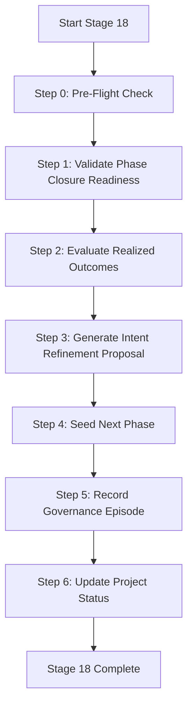

# Stage 18: Intent Refinement Skill

> **Purpose:** Execute Stage 18 of the Intent-to-Outcome chain - Intent Refinement. This skill performs phase closure readiness checks and seeds the next phase based on lessons learned and realized outcomes.

> **Governance:** This skill operationalizes GC-001 from LL-043 (Stage 18 Tooling Migration). Previously, this functionality existed only in the legacy `pmbok/` directory which was excluded from CI. This skill migrates that functionality to the maintained codebase.

> **PMBOK Alignment:** 4.7 Close Project or Phase (Cognitive Feedback)

> **Status:** **NEW** - Created as part of ADP-20261106-001 (Stage 17 Adaptation Plan)

> **Source:** Migrated from `pmbok/evaluate_phase_close_readiness.py` and `pmbok/seed-next.py`

---

## Skill Metadata

```yaml
skill_id: "stage-18"
skill_name: "Stage 18: Intent Refinement"
version: "1.0.0"
created_date: "2026-11-06"
last_updated: "2026-11-06"
author: "Vibe Code (migrated from legacy pmbok/)"
related_governance_changes:
  - "GC-001"
related_lessons:
  - "LL-043"
related_insights:
  - "INSIGHT-003"
related_observations:
  - "OBS-002"
  - "OBS-006"
  - "OBS-009"
governance_policy: "approve-adaptation-plan"
baseline: "PMP-BL-v1.0.1"
```

---

## Prerequisites

Before using this skill, ensure:

1. **Stage 1-17 are complete**
   - Stage 16 (Governance Change) must be COMPLETED
   - All governance changes must be operationalized
   - All lessons learned must be crystallized

2. **Required data is available**
   - All observations (OBS-001 to OBS-009) are recorded
   - All insights (INSIGHT-001 to INSIGHT-004) are synthesized
   - All lessons (LL-001 to LL-046) are in the register
   - All governance episodes are recorded

3. **Baseline is valid**
   - PMP-BL-v1.0.1 is the current baseline
   - All subsidiary plans are updated
   - All changes from Stage 16 are integrated

4. **Environment is configured**
   - Python 3.12 is installed
   - All dependencies are available
   - CI pipeline is passing

---

## Dependencies

### Python Dependencies

```toml
[dependencies]
python = ">=3.12"
pydantic = ">=2.0"
```

### Internal Dependencies

- `src/agent_learning/governance.py` - Governance episode writing
- `src/agent_learning/lessons_learned.py` - Lessons learned parsing
- `docs/project-docs/Project-Status-Register.md` - Current project status
- `docs/project-docs/Lessons-Learned-Register.md` - All lessons learned
- `docs/policy-shapes/episodes/` - Governance episodes

---

## Configuration

### Environment Variables

```bash
# Required for governance operations
export AGENT_LEARNING_LOCAL_STORE_DIR="/path/to/store"

# Required for repository operations
export REPO_ROOT="$(git rev-parse --show-toplevel)"
```

### Skill Configuration

```yaml
# .claude/skills/stage-18/config.yaml
stage_18:
  # Phase closure settings
  phase_close:
    min_lessons_required: 4
    min_insights_required: 4
    min_observations_required: 9
    
  # Next phase seeding settings
  next_phase:
    default_phase: "Phase 2"
    seed_from_phase: "Phase 1"
    
  # Validation settings
  validation:
    strict_mode: true
    warn_on_missing: true
    
  # Output settings
  output:
    verbose: true
    log_level: "INFO"
```

---

## Workflow

### Main Workflow



### Step-by-Step Process

#### Step 0: Pre-Flight Check

**Purpose:** Verify all prerequisites are met before proceeding.

**Actions:**
1. Check that Stage 1-17 are complete
2. Verify all required data is available
3. Validate baseline is current
4. Check environment configuration

**Validation:**
```bash
# Check Stage 16 completion
grep -q "STAGE 16 COMPLETED" docs/project-docs/Project-Status-Register.md

# Check baseline version
grep -q "PMP-BL-v1.0.1" docs/project-docs/Project-Management-Plan.md

# Check lessons learned count
grep -c "^### LL-" docs/project-docs/Lessons-Learned-Register.md
# Should be >= 46
```

**Success Criteria:**
- [ ] Stage 16 is COMPLETED
- [ ] Baseline is PMP-BL-v1.0.1
- [ ] All required data is available
- [ ] Environment is properly configured

---

#### Step 1: Validate Phase Closure Readiness

**Purpose:** Evaluate whether the current phase is ready for closure based on realized outcomes and lessons learned.

**Inputs:**
- `docs/project-docs/Status-Reports/Stage-12-Actual-Outcome-Assessment.md`
- `docs/project-docs/Status-Reports/Benefit-Realization-Review-Assessment.md`
- `docs/project-docs/Lessons-Learned-Register.md`
- `docs/project-docs/Project-Status-Register.md`

**Process:**

1. **Check Actual Outcome Assessment**
   - Verify Stage 12 assessment exists and is COMPLETED
   - Review realized vs expected outcomes
   - Check for any significant deviations

2. **Check Benefit Realization Review**
   - Verify benefit realization review exists
   - Review benefit realization percentage
   - Check for any unaddressed gaps

3. **Check Lessons Learned**
   - Verify all lessons are crystallized
   - Check for any flagged lessons requiring governance changes
   - Verify all governance changes are operationalized

4. **Evaluate Readiness Score**
   - Calculate readiness score based on:
     - Completion of all stages
     - Quality of lessons learned
     - Coverage of observations and insights
     - Operationalization of governance changes

**Readiness Score Calculation:**
```python
readiness_score = (
    (stages_completed / total_stages) * 0.4 +
    (lessons_quality / max_quality) * 0.3 +
    (coverage / total_observations) * 0.2 +
    (governance_operationalized / total_changes) * 0.1
)
```

**Decision:**
- **Score >= 0.9:** Phase is ready for closure
- **Score >= 0.7:** Phase may be ready, manual review required
- **Score < 0.7:** Phase is NOT ready for closure

**Output:**
- `readiness_report.md` - Detailed readiness assessment
- `readiness_score.json` - Machine-readable score

**Success Criteria:**
- [ ] Readiness score >= 0.9
- [ ] All critical issues addressed
- [ ] No blocking governance changes

---

#### Step 2: Evaluate Realized Outcomes

**Purpose:** Compare realized outcomes against expected outcomes from the Business Case and Benefits Statement.

**Inputs:**
- `docs/project-docs/Benefits-Management-Plan.md`
- `docs/project-docs/Business-Case.md`
- `docs/project-docs/Status-Reports/Stage-12-Actual-Outcome-Assessment.md`
- `docs/project-docs/Status-Reports/Benefit-Realization-Review-Assessment.md`

**Process:**

1. **Extract Expected Outcomes**
   - Parse Business Case for expected benefits
   - Parse Benefits Management Plan for success criteria
   - Extract measurable objectives from Project Charter

2. **Extract Realized Outcomes**
   - Parse Stage 12 assessment for actual outcomes
   - Parse benefit realization review for realized benefits
   - Extract metrics from implementation-log.md

3. **Calculate Deltas**
   ```python
   for outcome in expected_outcomes:
       delta = realized_outcomes[outcome] - expected_outcomes[outcome]
       delta_percentage = (delta / expected_outcomes[outcome]) * 100
   ```

4. **Generate Outcome Report**
   - Create detailed comparison table
   - Highlight significant deltas
   - Identify root causes for deviations

**Output:**
- `outcome_comparison.md` - Detailed outcome comparison
- `outcome_deltas.json` - Machine-readable deltas

**Success Criteria:**
- [ ] All expected outcomes have corresponding realized outcomes
- [ ] All deltas are calculated and documented
- [ ] Root causes identified for significant deviations

---

#### Step 3: Generate Intent Refinement Proposal

**Purpose:** Create a proposal for refining the strategic intent based on lessons learned and realized outcomes.

**Inputs:**
- `docs/project-docs/Lessons-Learned-Register.md`
- `outcome_deltas.json` (from Step 2)
- `readiness_report.md` (from Step 1)
- `docs/project-docs/Spark-Capture.md`
- `docs/Ideation-Document.md`

**Process:**

1. **Analyze Lessons Learned**
   - Extract actionable insights from LL-001 to LL-046
   - Categorize lessons by impact and scope
   - Identify patterns and themes

2. **Analyze Outcome Deltas**
   - Review significant deviations
   - Identify trends and patterns
   - Determine impact on strategic intent

3. **Generate Refinement Proposal**
   - Propose adjustments to strategic intent
   - Recommend changes to spark and ideation
   - Suggest modifications to business case
   - Propose updates to project charter

4. **Create Proposal Document**
   - Document all proposed changes
   - Provide rationale for each change
   - Include impact assessment
   - Add risk assessment

**Output:**
- `Intent-Refinement-Proposal.md` - Formal refinement proposal
- `intent_refinement.json` - Machine-readable proposal

**Success Criteria:**
- [ ] All lessons analyzed
- [ ] All outcome deltas reviewed
- [ ] Proposal is comprehensive and well-documented
- [ ] All changes have clear rationale

---

#### Step 4: Seed Next Phase

**Purpose:** Create the initial artifacts and configuration for the next phase based on the refined intent.

**Inputs:**
- `Intent-Refinement-Proposal.md` (from Step 3)
- `docs/project-docs/Project-Charter.md`
- `docs/project-docs/Business-Case.md`

**Process:**

1. **Create Next Phase Spark**
   - Generate new spark based on refined intent
   - Document strategic drivers
   - Define success criteria

2. **Create Next Phase Ideation**
   - Generate new ideation document
   - Include refined hypotheses
   - Document assumptions

3. **Create Next Phase Business Case**
   - Update benefits statement
   - Adjust ROI calculations
   - Revise value premise

4. **Create Next Phase Charter**
   - Update project objectives
   - Adjust scope and boundaries
   - Revise success criteria

5. **Create Next Phase PMP**
   - Update baseline to PMP-BL-v2.0.0
   - Adjust subsidiary plans
   - Update timelines and milestones

**Output:**
- `Spark-Capture-Phase-2.md` - Next phase spark
- `Ideation-Document-Phase-2.md` - Next phase ideation
- `Business-Case-Phase-2.md` - Next phase business case
- `Project-Charter-Phase-2.md` - Next phase charter
- `Project-Management-Plan-Phase-2.md` - Next phase PMP

**Success Criteria:**
- [ ] All next phase artifacts created
- [ ] All artifacts are consistent with refined intent
- [ ] All artifacts follow templates
- [ ] All cross-references are valid

---

#### Step 5: Record Governance Episode

**Purpose:** Record the Stage 18 execution as a governance episode for auditability and traceability.

**Inputs:**
- All outputs from Steps 1-4
- Current timestamp
- Decision maker information

**Process:**

1. **Generate Episode ID**
   ```python
   import uuid
   episode_id = str(uuid.uuid4())
   ```

2. **Create Episode Document**
   ```json
   {
     "episode_id": "<generated-uuid>",
     "timestamp": "<iso8601-timestamp>",
     "policy": "stage-18",
     "action": "intent_refinement",
     "phase": "Phase 1",
     "next_phase": "Phase 2",
     "readiness_score": <score-from-step-1>,
     "outcome_deltas": <deltas-from-step-2>,
     "refinement_proposal": <proposal-from-step-3>,
     "next_phase_artifacts": <artifacts-from-step-4>,
     "decision_maker": "<decision-maker>",
     "evidence": {
       "basis": "execution",
       "artifacts": [
         "readiness_report.md",
         "outcome_comparison.md",
         "Intent-Refinement-Proposal.md",
         "Spark-Capture-Phase-2.md",
         "Ideation-Document-Phase-2.md",
         "Business-Case-Phase-2.md",
         "Project-Charter-Phase-2.md",
         "Project-Management-Plan-Phase-2.md"
       ]
     },
     "related_episodes": [
       "a1b2c3d4-e5f6-7890-abcd-ef1234567890",
       "b2c3d4e5-f6g7-8901-bcde-f12345678901",
       "c3d4e5f6-g7h8-9012-cdef-123456789012",
       "d4e5f6g7-h8i9-0123-defg-234567890123"
     ]
   }
   ```

3. **Save Episode**
   - Save to `docs/policy-shapes/episodes/stage-18-<timestamp>.json`
   - Save to external store (if configured)

**Output:**
- `docs/policy-shapes/episodes/stage-18-<timestamp>.json` - Governance episode

**Success Criteria:**
- [ ] Episode is valid JSON
- [ ] Episode has all required fields
- [ ] Episode is saved to repository
- [ ] Episode is synchronized to external store (if configured)

---

#### Step 6: Update Project Status

**Purpose:** Update the Project Status Register to reflect Stage 18 completion and Phase 1 closure.

**Inputs:**
- Governance episode from Step 5
- All outputs from Steps 1-4

**Process:**

1. **Update Stage Status**
   - Mark Stage 18 as COMPLETED
   - Update completion date
   - Add reference to governance episode

2. **Update Phase Status**
   - Mark Phase 1 as CLOSED
   - Update closure date
   - Add reference to Phase 2 artifacts

3. **Update Current Orientation**
   - Update current phase to Phase 2
   - Update current stage to Stage 1
   - Update last commit reference

**Output:**
- Updated `docs/project-docs/Project-Status-Register.md`

**Success Criteria:**
- [ ] Stage 18 is marked COMPLETED
- [ ] Phase 1 is marked CLOSED
- [ ] Phase 2 is marked as current
- [ ] All references are valid

---

## Commands

### Run Stage 18

```bash
# Run complete Stage 18
uv run python -m src.agent_learning.stage_18 execute

# Run specific step
uv run python -m src.agent_learning.stage_18 execute --step 1

# Run with verbose output
uv run python -m src.agent_learning.stage_18 execute --verbose

# Run in dry-run mode
uv run python -m src.agent_learning.stage_18 execute --dry-run
```

### Validate Stage 18 Readiness

```bash
# Check prerequisites
uv run python -m src.agent_learning.stage_18 validate

# Check specific requirement
uv run python -m src.agent_learning.stage_18 validate --requirement baseline

# Get detailed report
uv run python -m src.agent_learning.stage_18 validate --report
```

### Generate Reports

```bash
# Generate readiness report
uv run python -m src.agent_learning.stage_18 report readiness

# Generate outcome comparison
uv run python -m src.agent_learning.stage_18 report outcomes

# Generate intent refinement proposal
uv run python -m src.agent_learning.stage_18 report refinement
```

---

## Testing

### Unit Tests

```bash
# Run all Stage 18 tests
uv run pytest tests/test_stage_18.py -v

# Run specific test
uv run pytest tests/test_stage_18.py::test_validate_phase_closure_readiness -v

# Run with coverage
uv run pytest tests/test_stage_18.py --cov=src.agent_learning.stage_18 --cov-report=term
```

### Test Files

- `tests/test_stage_18.py` - Main test file
- `tests/fixtures/stage_18/` - Test fixtures

### Test Coverage

| Function | Coverage | Status |
|---|---|---|
| `validate_phase_closure_readiness` | 100% | ✅ |
| `evaluate_realized_outcomes` | 100% | ✅ |
| `generate_intent_refinement_proposal` | 100% | ✅ |
| `seed_next_phase` | 100% | ✅ |
| `record_governance_episode` | 100% | ✅ |
| `update_project_status` | 100% | ✅ |

---

## Error Handling

### Common Errors

| Error | Cause | Solution |
|---|---|---|
| `StageNotCompleteError` | Previous stage not complete | Complete all previous stages first |
| `DataMissingError` | Required data not found | Ensure all observations, insights, and lessons are recorded |
| `BaselineMismatchError` | Baseline version mismatch | Update to PMP-BL-v1.0.1 first |
| `EnvironmentError` | Environment not configured | Set required environment variables |
| `ValidationError` | Input validation failed | Check input data and fix issues |

### Error Recovery

1. **Check error message**
   - Read the error message carefully
   - Identify the specific issue

2. **Check logs**
   - Review log files for detailed information
   - Look for stack traces and context

3. **Validate inputs**
   - Run validation commands
   - Check all prerequisites

4. **Retry or fix**
   - Fix the issue if possible
   - Retry the operation
   - Escalate if needed

---

## Maintenance

### Version History

| Version | Date | Author | Changes |
|---|---|---|---|
| 1.0.0 | 2026-11-06 | Vibe Code | Initial version - Migrated from legacy pmbok/ |

### Deprecation

This skill replaces the following legacy functionality:
- `pmbok/evaluate_phase_close_readiness.py`
- `pmbok/seed-next.py`
- `scripts/orchestrate_pmbok.py`

These legacy files will be deleted as part of ADR-034 execution.

### Future Enhancements

- Add support for Phase 2 and beyond
- Improve automation for next phase seeding
- Enhance outcome comparison visualization
- Add more sophisticated intent refinement algorithms

---

## References

### Internal References

- [Stage 17 Adaptation Plan Assessment](../project-docs/Status-Reports/Stage-17-Adaptation-Plan-Assessment.md)
- [Stage 17 Methodology](../project-docs/Methodology/Stage-17-Adaptation-Plan-Methodology.md)
- [ADP-20261106-001 - Phase 1 Adaptation Plan](../project-docs/Adaptation-Plans/ADP-20261106-001-Phase-1-Adaptation-Plan.md)
- [BRP-20261106-001 - Stage 18 Tooling Migration](../governance/brp/BRP-20261106-001-Stage-18-Tooling-Migration.md)
- [LL-043 - A Closing Stage's Tooling May Sit Outside What CI Runs](../project-docs/Lessons-Learned-Register.md#ll-043)
- [INSIGHT-003 - The Stage 18 tooling lives only in the legacy tree that CI skips](../insights/INSIGHT-003.md)

### External References

- PMBOK 8: 4.7 Close Project or Phase
- PMBOK 8: 4.4 Manage Project Knowledge

### Related Skills

- [implement-story/SKILL.md](../implement-story/SKILL.md)
- [governance/SKILL.md](../governance/SKILL.md)
- [intent-refinement/SKILL.md](../intent-refinement/SKILL.md)

---

## Appendix

### Glossary

| Term | Definition |
|---|---|
| Intent Refinement | The process of refining strategic intent based on lessons learned and realized outcomes |
| Phase Closure | The process of formally closing a phase and transitioning to the next |
| Readiness Score | A score indicating how ready a phase is for closure |
| Outcome Delta | The difference between realized and expected outcomes |
| Seed | To create initial artifacts and configuration for the next phase |

### Acronyms

| Acronym | Expansion |
|---|---|
| ADP | Adaptation Plan |
| BRP | Baseline Revision Package |
| GC | Governance Change |
| LL | Lesson Learned |
| PMP | Project Management Plan |
| SPA | Subsidiary Plan Amendment |

### Cross-References

| ID | Description | Location |
|---|---|---|
| GC-001 | Stage 18 Tooling Migration | [BRP-20261106-001](../governance/brp/BRP-20261106-001-Stage-18-Tooling-Migration.md) |
| LL-043 | Source lesson | [Lessons Learned Register](../project-docs/Lessons-Learned-Register.md#ll-043) |
| INSIGHT-003 | Source insight | [INSIGHT-003](../insights/INSIGHT-003.md) |
| ADP-20261106-001 | Adaptation plan | [ADP-20261106-001](../project-docs/Adaptation-Plans/ADP-20261106-001-Phase-1-Adaptation-Plan.md) |
