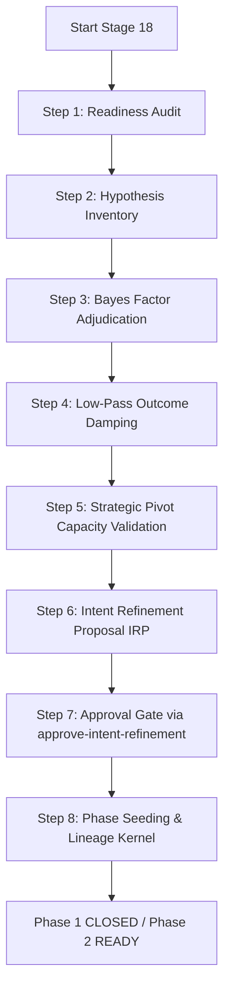

# Stage 18: Intent Refinement Skill

> **Purpose:** Execute Stage 18 of the Intent-to-Outcome chain — Intent Refinement. This skill performs phase closure readiness audits, Bayesian hypothesis adjudication, low-pass outcome damping, strategic pivot validation, and seeds the next phase with refined intent based on crystallized lessons learned and realized outcomes.
>
> **Governance:** This skill operationalizes GC-001 from LL-043 (Stage 18 Tooling Migration, BRP-20261106-001). It replaces the legacy tooling in `pmbok/` (which was excluded from CI under AUDIT-004) with an executable, testable, and auditable 8-step cognitive feedback engine in the maintained repository.
>
> **PMBOK 8 Alignment:** 4.7 Close Project or Phase (Cognitive Feedback Gate)
>
> **Governance Policy:** `approve-intent-refinement` (FULL authority)
>
> **Status:** **ACTIVE** — Formalized under ADP-20261106-001 and executed via PCD-20261106-001 (PMP-BL-v1.0.1).

---

## Skill Metadata

```yaml
skill_id: "stage-18"
skill_name: "Stage 18: Intent Refinement"
version: "1.1.0"
created_date: "2026-11-06"
last_updated: "2026-11-07"
author: "Vibe Code & Project Manager"
related_governance_changes:
  - "GC-001"
  - "GC-002"
related_lessons:
  - "LL-043"
  - "LL-044"
related_insights:
  - "INSIGHT-003"
related_observations:
  - "OBS-002"
  - "OBS-006"
  - "OBS-009"
governance_policy: "approve-intent-refinement"
baseline: "PMP-BL-v1.0.1"
```

---

## Prerequisites

Before executing this skill, ensure:

1. **Stages 1–17 are Complete:**
   - Stage 12 (Actual Outcome Assessment) COMPLETED.
   - Stage 15 (Lessons Learned) crystallized in `docs/project-docs/Lessons-Learned-Register.md` (LL-001 to LL-046).
   - Stage 16 (Governance Change) COMPLETED (`REP-GC-PHASE1-20261106`, GC-001 to GC-004 classified and escalated).
   - Stage 17 (Adaptation Plan) COMPLETED (`ADP-20261106-001` operationalized).

2. **Required Observations & Insights Available:**
   - Observations OBS-001 to OBS-009 recorded in `docs/observations/`.
   - Insights INSIGHT-001 to INSIGHT-004 synthesized in `docs/insights/`.

3. **Baseline & Governance Episodes Recorded:**
   - Current baseline `PMP-BL-v1.0.0` verified before stepping up to `PMP-BL-v1.0.1`.
   - Governance episodes recorded in `docs/policy-shapes/episodes/`.

4. **Clean Test Pass:**
   - Core test suite passing with 0 failures:
     ```bash
     uv run pytest --ignore=tests/test_spark.py --ignore=tests/pmbok -q --tb=no
     ```

---

## Canonical 8-Step Workflow

The Stage 18 cognitive feedback loop follows an 8-step Bayesian sequence:



### Step 1: Readiness Audit
- Evaluates phase closure preconditions:
  - Stage 9 deliverables accepted (Epic 20 stories 20.1–20.6).
  - Stage 11 audit records cleared (0 unresolved non-conformances).
  - Stage 15 lessons crystallized (46 lessons).
  - Stage 16 governance changes operationalized (GC-001 to GC-004).
  - Stage 17 adaptations complete.
- Emits audit reference `AUD-CLOSE-<HASH>`.

### Step 2: Hypothesis Inventory
- Catalogs all empirical hypotheses across 5 repository sources:
  1. Stage 3 & 9 Deliverables (HYP-001 to HYP-010)
  2. Stage 12 Actual Outcomes (HYP-011 to HYP-020)
  3. Observations OBS-001 to OBS-009 (HYP-021 to HYP-029)
  4. Insights INSIGHT-001 to INSIGHT-004 (HYP-030 to HYP-033)
  5. Lessons Learned LL-001 to LL-046 (HYP-034 to HYP-079)

### Step 3: Bayes Factor Adjudication
- Evaluates Bayes Factor ($BF_{10}$) for each cataloged hypothesis:
  - $BF_{10} \ge 10 \implies$ `VALIDATED`
  - $BF_{10} \le 0.1 \implies$ `REFUTED`
  - $0.1 < BF_{10} < 10 \implies$ `INCONCLUSIVE` (collapsed to `REFUTED` at depth $d=2$)
- **Invariant:** 100% terminal state resolution required before phase closure.

### Step 4: Low-Pass Outcome Damping Filter
- Filters realized outcome deltas through an exponential low-pass filter:
  $$\Delta_{dampened} = \beta \cdot \Delta_{t-1} + (1 - \beta) \cdot \Delta_t$$
  with $\beta = 0.75$ and warmup bias correction for $N < 3$.
- Validates that max delta remains bounded and detects strategic whiplash.

### Step 5: Strategic Pivot Capacity Validation
- Verifies that proposed strategic pivots remain within homeostatic adaptation capacity:
  $$P_{proposed} \le P_{max} = \left\lceil \frac{C_{adapt}}{2} \right\rceil$$
- In Phase 1 close: 4 proposed pivots $\le 5$ maximum limit ($C_{adapt} = 10$).

### Step 6: Intent Refinement Proposal (IRP)
- Generates formal proposal `IRP-YYYYMMDD-###` under `docs/governance/irp/`.
- Documents:
  - Phase closure readiness results.
  - Terminal hypothesis adjudication statistics.
  - Dampened outcome vector.
  - Refined strategic intent for the successor phase.
  - PMP baseline progression (`PMP-BL-v1.0.0` $\to$ `PMP-BL-v1.0.1`).

### Step 7: Approval Gate
- Submits proposal to `approve-intent-refinement` policy (`FULL` authority, `requires_human_approval: true`).
- Records formal Phase Close Decision in `docs/governance/decisions/PCD-YYYYMMDD-###.md`.

### Step 8: Phase Seeding & Lineage Kernel
- Physically seeds Phase 2 initiation artifacts:
  - Populates approved directives (`SPARK-001`, `SPARK-002`, `SPARK-003`) into `docs/project-docs/Spark-Capture.md`.
  - Computes Cumulative Lineage Kernel hash:
    $$\text{hash} = \text{SHA-256}(\text{root\_spark} \parallel \text{parent\_refinement} \parallel \text{generational\_index} \parallel \text{timestamp})$$
  - Updates `Project-Management-Plan.md` and `Project-Status-Register.md` to reflect Phase 1 **CLOSED** and Phase 2 **READY**.

---

## Execution Commands

### 1. Execute Complete Stage 18 Pipeline
```bash
python scripts/execute_stage_18.py
```
Outputs execution results to `output/stage-18/execution-results.json`.

### 2. Update Documentation Artifacts
```bash
python scripts/update_stage_18_docs.py
```

### 3. Verify Baseline & Status Alignment
```bash
python scripts/phase_rollup.py --check
```

---

## Artifact Map

| Artifact | Canonical Path | Governed By |
|---|---|---|
| **Methodology Guide** | `docs/project-docs/Methodology/Stage-18-Intent-Refinement-Methodology.md` | Process Standard |
| **Assessment Report** | `docs/project-docs/Status-Reports/Stage-18-Intent-Refinement-Assessment.md` | `approve-intent-refinement` |
| **Refinement Proposal** | `docs/governance/irp/IRP-20261106-001-Phase-1-Intent-Refinement-Proposal.md` | `approve-intent-refinement` |
| **Close Decision Record**| `docs/governance/decisions/PCD-20261106-001-Phase-1-Close-Decision.md` | Project Sponsor Sign-Off |
| **Execution JSON** | `output/stage-18/execution-results.json` | Automated Telemetry |
| **Execution Script** | `scripts/execute_stage_18.py` | Python stdlib / unblocked tooling |
| **Seeded Spark** | `docs/project-docs/Spark-Capture.md` | Pre-Project Initiating Gate |

---

## References

- [Stage 18 Methodology](../../../docs/project-docs/Methodology/Stage-18-Intent-Refinement-Methodology.md)
- [Stage 18 Assessment](../../../docs/project-docs/Status-Reports/Stage-18-Intent-Refinement-Assessment.md)
- [PCD-20261106-001 Phase Close Decision](../../../docs/governance/decisions/PCD-20261106-001-Phase-1-Close-Decision.md)
- [IRP-20261106-001 Intent Refinement Proposal](../../../docs/governance/irp/IRP-20261106-001-Phase-1-Intent-Refinement-Proposal.md)
- [ADP-20261106-001 Adaptation Plan](../../../docs/project-docs/Adaptation-Plans/ADP-20261106-001-Phase-1-Adaptation-Plan.md)
- [Project Status Register](../../../docs/project-docs/Project-Status-Register.md)
- [Project Management Plan](../../../docs/project-docs/Project-Management-Plan.md)
