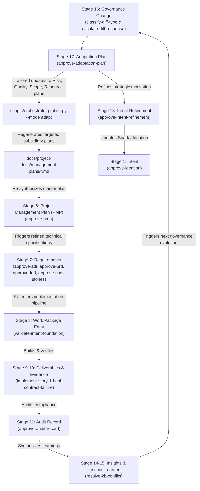

# ADR 008: PMBOK 8 Lifecycle Orchestration and Closed-Loop Adaptation Feedback into Project Management Plan and Cascading Requirements

## 1. Executive Brief

On the 18-stage Intent-to-Outcome Chain (`PROJECT-MANAGEMENT-ONTOLOGY.json`), Stage 16 (**Governance Change**) mechanics were formalized by ADR-007 via paired diff classification and escalation. However, once a governance amendment is validated, a critical operational gap remains: **how does that amendment adapt the project's living governance baseline, and how do those adaptations cascade into subsequent development cycles?** Without a mechanized feedback loop, changes to governance remain isolated text diffs that do not alter execution behavior, risk thresholds, or requirement specifications.

This ADR establishes native **PMBOK 8 Lifecycle Orchestration** and a **Closed-Loop Adaptation Cycle** directly within `agent-learning`:

1. **Native PMBOK 8 Planning Orchestration:** Directly integrates the 9 PMBOK subsidiary management plans (Scope 5.1, Schedule 6.1, Cost 7.1, Quality 8.1, Resource 9.1, Communications 10.1, Risk 11.1, Procurement 12.1, Stakeholder 13.2) and synthesizes them into an integrated **Project Management Plan (PMP)** (PMBOK 4.2).
2. **Dedicated Full-Authority Decision Gate (`approve-pmp`):** Formally validates the integrated Project Management Plan and subsidiary baselines via Bayesian multi-criteria evaluation before technical requirements (ADR, BRD, FDD, User Stories) are authorized for drafting.
3. **Closed-Loop Adaptation Feedback (Stage 17 $\rightarrow$ Stage 6 $\rightarrow$ Stage 7):** When a Stage 16 Governance Change is accepted, the Stage 17 **Adaptation Plan** explicitly itemizes which subsidiary management plans require updates. The orchestrator re-executes *only* the affected process agents, updates the PMP, re-verifies via `approve-pmp`, and triggers cascading amendments down into ADRs, BRDs, FDDs, and User Stories for the next cycle.

This completes the Intent-to-Outcome chain as a living, self-governing cognitive cycle, preserving ADR-001's authority model, ADR-002's storage invariants, and ADR-005's progression verification.

## 2. Status

**Accepted (2026-10-24)** — formally evaluated against the `agent-learning-governance` / `approve-adr` TaskPolicy chain and adjudicated by Menno Drescher (`--disposition accept`), revised with formal Governance Change Impact Matrix, PMP Baseline Versioning, Rollback Strategy, and Baseline Traceability Invariant.

## 3. Context

- **Closing the Cognition Loop:** Prior to this ADR, `agent-learning` possessed automated mechanisms for requirements approval (Stage 7), pipeline gating (Stage 8), contract execution (Stage 9–10), audit recording (Stage 11), knowledge synthesis (Stage 14–15), and diff classification/escalation (Stage 16). Stage 17 (**Adaptation**) and Stage 18 (**Intent Refinement**) remained unmechanized frontiers.
- **The Risk of Disconnected Governance:** If an ADR amendment is accepted (e.g., adding a lineage freeze on supersession notes or correcting an audit integrity bug in regression rollback), but the project's **Quality Management Plan**, **Risk Management Plan**, or **Scope Management Plan** are not updated to reflect that change, the engineering workflow quickly drifts away from governance baselines.
- **PMBOK 8 Input-Process-Output (IPO) Alignment:** In enterprise project management (PMBOK 8 / Process Groups Practice Guide), project artifacts follow strict dependency ordering:
  - Business Documents (Business Case & Benefits Management Plan) are mandatory **inputs** to the Project Charter (4.1).
  - The Project Charter is a mandatory **input** to the Project Management Plan (4.2).
  - The Project Management Plan establishes the baselines (Scope, Schedule, Cost, Quality, Risk) that govern the definition of requirements (5.2 Collect Requirements, 5.3 Define Scope, 5.4 Create WBS).
- **The Lesson of AI-Foundry-Projects:** A standalone PMBOK generator existed in `AI-Foundry-Projects`, but operating it as an isolated external repository introduced maintenance friction and lacked `agent-learning`'s Bayesian decision gates, active learning from feedback, and progression comparison. Bringing this engine natively into the self-governing repository consolidates maintenance and enables continuous learning.

## 4. Decision

### 4.1 Document Authoring Sequence vs. Conceptual Trace

We formally distinguish between the abstract conceptual trace of the ontology and the physical document authoring sequence:

```
Ontology Concept Trace:
Intent → Objective → Hypothesis → Benefit → Capability → Project → Requirement...

Actual Document Authoring & Governance Sequence:
1. Spark Capture (Stage 1: Intent — Initiating)
       ↓
2. Ideation Document (Stage 1: Intent & Stage 3: Hypotheses — Initiating)
       ↓
3. Business Case & Benefits Statement (Stage 4: Benefit — Initiating)
       ↓
4. Project Charter (Stage 2: Objective — Initiating: 4.1 Develop Project Charter)
       ↓
5. Subsidiary Management Plans & Project Management Plan (Stage 6: Project — Planning: 4.2 Develop PMP)
       ↓
6. Technical Specifications: ADR → BRD → FDD → User Stories (Stage 7: Requirement — Planning: 5.2/5.3/5.4)
       ↓
7. Foundation Validation Gate (Stage 8: Work Package Entry — Planning → Executing Gate)
       ↓
8. Implementation & Verification (Stage 9: Deliverable & Stage 10: Evidence — Executing: 4.3 & Monitoring: 8.3)
       ↓
9. Audit Record & Knowledge Synthesis (Stage 11 & Stages 14–15 — Monitoring: 8.2 & 4.4)
       ↓
10. Paired Governance Pipeline (Stage 16: Governance Change — Monitoring: 4.6 Integrated Change Control)
       ↓
11. Adaptation Plan (Stage 17: Adaptation — Adaptive Feedback tailoring PMP Updates)
       ↓
12. Intent Refinement (Stage 18: Intent Refinement — Closing: 4.7 Strategic Feedback to Spark)
```

### 4.2 Native PMBOK 8 Engine and Orchestration

1. **Native Package:** The core PMBOK engine (`pmbok/`) is incorporated natively into the repository, providing:
   - Complete 49-process dependency graph (`pmbok/process_registry.py`).
   - Modular process agents (`pmbok/agents/process_agent.py`) capable of executing in live LLM mode and offline deterministic stub mode.
   - Pydantic models and schemas for all PMBOK entities.
2. **Dedicated CLI Orchestrator (`scripts/orchestrate_pmbok.py`):**
   - `--mode full`: Extracts project context from `Spark-Capture.md` and `Project-Charter.md`, executes the 9 subsidiary planning processes, writes markdown plans to `docs/project-docs/management-plans/`, and synthesizes `docs/project-docs/Project-Management-Plan.md`.
   - `--mode adapt --adaptation-plan <path>`: Parses the checklist in `Adaptation-Plan.md`, executes *only* the affected process agents, updates the specific markdown plan, re-synthesizes `Project-Management-Plan.md`, and prompts for `approve-pmp`.

### 4.3 Full-Authority Decision Gates: `approve-pmp` and `approve-adaptation-plan`

Two new `full`-authority Bayesian TaskPolicies are established under `agent-learning-governance`:

1. **`approve-pmp` (Stage 6 Project Gate):**
   - **Decision Context:** Given an integrated Project Management Plan and its 9 subsidiary plans, decide whether to approve it to authorize drafting technical requirements (ADR, BRD, FDD, Stories), reject it, or request revision.
   - **Criteria:** Scope boundary clarity (0.35), risk and quality coverage (0.35), unforced schedule/cost deferral (0.15), alignment with charter objectives (0.15).
   - **Authority:** `full` (`DecisionResolver`), `requires_human_approval: true`.
2. **`approve-adaptation-plan` (Stage 17 Adaptation Gate):**
   - **Decision Context:** Given an Adaptation Plan responding to a Stage 16 governance amendment, decide whether to approve rollout, reject it, or request revision.
   - **Criteria:** Root-cause governance alignment (0.40), operational feasibility of behavioral changes (0.30), precision of tailored subsidiary plan updates feeding back to PMP (0.30).
   - **Authority:** `full` (`DecisionResolver`), `requires_human_approval: true`.

### 4.4 The Continuous Feedback Cycle



### 4.5 Governance Change Impact Matrix

To eliminate implicit assumptions during Stage 17 Adaptation, every Adaptation Plan must include a formal **Governance Change Impact Matrix** mapping each accepted Stage 16 governance amendment to its concrete impact across the 9 subsidiary management plans:

| Amendment / Change | Scope (5.1) | Schedule (6.1) | Cost (7.1) | Quality (8.1) | Resource (9.1) | Comms (10.1) | Risk (11.1) | Procurement (12.1) | Stakeholder (13.2) |
|---|---|---|---|---|---|---|---|---|---|
| *Example: Evidence retention increase* | None | None | Low | High | None | Low | Medium | None | None |
| *Example: Strict human sign-off on lifecycle notes* | None | Low | None | Medium | Low | None | High | None | Low |

The CLI orchestrator (`scripts/orchestrate_pmbok.py --mode adapt`) parses this matrix or its corresponding checklist to determine the exact subset of PMBOK process agents that must be executed.

### 4.6 PMP Baseline Versioning, Archival, and Supersession Rules

1. **Baseline Identifier:** Every approved PMP receives a globally unique, immutable baseline identifier adhering to SemVer:
   - Initial project baseline: `PMP-BL-v1.0.0`
   - Adaptive iteration baseline: `PMP-BL-v1.1.0` (minor for scope/quality/risk tailoring), `PMP-BL-v2.0.0` (major for project charter restructuring).
2. **Supersession & Archival:** When a new baseline is approved by `approve-pmp`, the previous baseline file and its subsidiary plans are atomically archived to `docs/project-docs/management-plans/history/{baseline_id}/`. The new baseline supersedes the prior baseline in `Project-Management-Plan.md`.
3. **Traceability Tagging:** Every downstream technical specification (ADR, BRD, FDD, User Story) must record the governing `pmp_baseline: "PMP-BL-vX.Y.Z"` in its YAML frontmatter.

### 4.7 Rollback and Recovery Pathway

Governance adaptation must provide both a forward evolution path and a deterministic rollback path:

1. **Triggering Conditions:** If downstream implementation introduces detected regressions (via ADR-005 `compare_decision_results()`) or if post-adaptation execution reveals an unviable operational burden, a rollback is initiated.
2. **Atomic Rollback:** The orchestrator restores the previous approved baseline (`PMP-BL-vX.Y.Z`) from `history/`, rolls back the subsidiary management plans to their archived states, and records an `Episode` with disposition `adaptation_rollback`.
3. **Negative Reinforcement:** The escalation policy (`escalate-diff-response`) receives a negative reward penalty (-1.5) for the failed autonomous escalation, updating bandit weights to prefer human escalation for similar diff categories in subsequent rounds.

### 4.8 Configurable Approval Weighting Profiles

While standard software projects balance Scope (0.35) and Risk/Quality (0.35), specialized project domains require tailored decision profiles:

- **Standard Engineering Profile (Default):** Scope (0.35), Risk & Quality (0.35), Schedule/Cost (0.15), Charter Alignment (0.15).
- **Regulated / Safety-Critical Profile:** Risk & Quality (0.50), Scope (0.25), Compliance & Charter Alignment (0.15), Schedule/Cost (0.10).
- **Rapid Prototyping / Spike Profile:** Charter Alignment (0.40), Scope (0.30), Risk & Quality (0.15), Schedule/Cost (0.15).

Decision frames for `approve-pmp` select the appropriate weighting profile based on the project's complexity profile in `shared-complexity-profile.json`.

## 5. Invariants

1. **PMP Precedes Technical Specifications:** No ADR, BRD, FDD, or User Story may be considered baseline-approved without an active, approved `Project-Management-Plan.md` in place.
2. **No Silent Management Plan Drift:** Every Adaptation Plan must explicitly declare which subsidiary management plans (Scope, Schedule, Cost, Quality, Resource, Communications, Risk, Procurement, Stakeholder) are altered by a governance amendment via the Governance Change Impact Matrix.
3. **Storage Boundary Compliance (ADR-002):** Zero new record types are introduced. PMP, adaptation audit records, and baseline snapshots are stored strictly as `Episode` instances in `LearningStore`, utilizing free-form metadata dictionaries.
4. **Mandatory Human Sign-Off:** Both `approve-pmp` and `approve-adaptation-plan` permanently mandate `requires_human_approval: true`. Autonomous agents recommend decisions, but project leadership retains final approval authority.
5. **Progression Verification (ADR-005):** Re-synthesizing the PMP following an adaptation must be verified via `compare_decision_results()` to guarantee that operational adjustments produce decision `progression` and do not re-introduce previously resolved regressions.
6. **Baseline Traceability Invariant:** Every approved PMP, ADR, BRD, FDD, User Story, and Adaptation Plan must reference the governing PMP baseline identifier (`PMP-BL-vX.Y.Z`) from which it originated. No downstream artifact may exist without a traceable planning baseline.
7. **Baseline Recoverability & Rollback Invariant:** Every superseded PMP baseline and its subsidiary plan snapshots must remain recoverable from archive. If an adaptation triggers downstream regression or rejection, the orchestrator must support atomic rollback to the prior approved baseline without history corruption.

## 6. Alternatives Considered

| Alternative | Reason for Rejection |
|---|---|
| Maintain PMBOK orchestration in `AI-Foundry-Projects` externally | Violates self-governance; introduces cross-repository synchronization drift, fragmented dependency management, and prevents seamless CI/CD testing within `agent-learning`. |
| Unstructured Markdown management plans without formal process mapping | Lacks standard PMBOK 8 traceability; prevents automated parsing of affected planning sections during Stage 17 Adaptation; creates unreplayable documentation. |
| Automatic unreviewed PMP updates | Bypasses project leadership; risks unvetted scope creep or premature cost/schedule commitments without sponsor oversight. |
| Monolithic single-step adaptation | Conflating governance amendment (Stage 16), operational adaptation (Stage 17), and strategic intent refinement (Stage 18) into a single decision creates an intractable decision frame with conflicting criteria weights. |

## 7. Consequences

### Positive
- **Closed Cognition Loop:** Evolving governance directly updates project baselines and technical specifications through a repeatable, mechanized workflow.
- **PMBOK 8 Compliance:** All 18 stages map directly to recognized enterprise standards (Initiating, Planning, Executing, Monitoring & Controlling, Closing), providing clear boundaries for both human teams and AI agents.
- **Reproducible Planning:** Subsidiary management plans are generated from project context using deterministic process agents, eliminating ad-hoc planning documentation.
- **Single Source of Truth:** `agent-learning` becomes fully self-contained, requiring zero external repositories to govern, plan, build, audit, and adapt its lifecycle.

### Negative / Residual Costs
- **Planning Governance Overhead:** Formalizing the PMP adds a discrete decision gate (`approve-pmp`) before technical specifications can enter the work package pipeline.
- **Dependency Footprint:** `sidpa-template` and `agent-learning` include the lightweight `pmbok` Python package and its dependencies (`pydantic`, `sqlalchemy` for runtime state tracking).

---

## 8. References
- PMBOK Guide — 8th Edition & Process Groups: A Practice Guide (PMI)
- ADR-001: Decision Authority Model
- ADR-002: Five-Record-Type Storage Boundary
- ADR-005: Decision Progress Comparison & Regression Prevention
- ADR-006: Lightweight Evidence Transport
- ADR-007: Automated Governance Change Paired Pipeline
- `docs/intent-to-outcome-chain-coverage.md`: Full 18-stage coverage matrix
