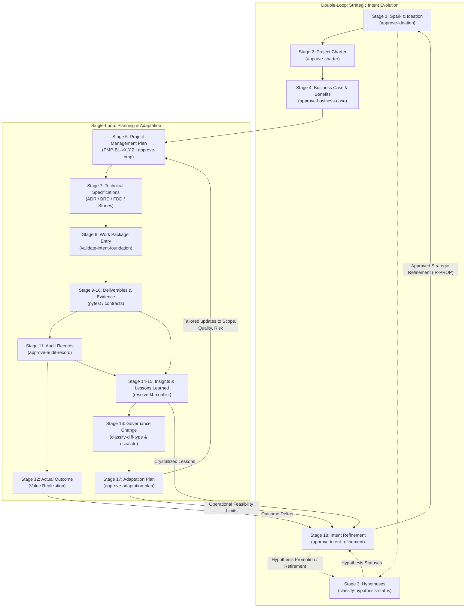

# ADR 009: Intent Refinement — Closing the Cybernetic Loop from Outcomes and Lessons Learned back to Strategic Spark and Hypotheses

## 1. Executive Brief

On the 18-stage Intent-to-Outcome Chain (`PROJECT-MANAGEMENT-ONTOLOGY.json`), ADR-008 mechanized the **operational adaptation loop** (Stage 16 Governance Change $\rightarrow$ Stage 17 Adaptation Plan $\rightarrow$ Stage 6 Project Management Plan $\rightarrow$ Stage 7 Technical Requirements). That feedback loop ensures that when governance changes or process flaws occur, planning baselines and technical specifications are re-orchestrated rather than left as passive documentation diffs.

However, operational adaptation answers *how* a system executes; it does not evaluate *why* the system is executing or whether the original business hypotheses, strategic motivations, and expected benefits formulated at the beginning of the lifecycle held true in reality. Without a formalized mechanism for **Intent Refinement (Stage 18)**, the cognitive lifecycle remains half-severed:
- Teams and autonomous agents continue optimizing the efficiency of delivery without assessing if the delivered capabilities achieved their intended business outcomes.
- Initial assumptions and hypotheses (Stage 3) remain permanently open ("zombie hypotheses"), never formally validated or refuted by empirical evidence.
- Subsequent project phases (Phase $N+1$) or sister projects start from a blank slate or blindly inherit outdated premises, breaking organizational learning.

This ADR formalizes **Stage 18 (Intent Refinement)** as the closing cybernetic feedback engine of the Intent-to-Outcome Chain (aligned with PMBOK 8 Process **4.7 Close Project or Phase**):

1. **The Intent Refinement Artifact (`Intent-Refinement-Proposal.md`):** Establishes a standardized, evidence-grounded document capturing realized vs. expected outcomes, hypothesis resolutions, invalidated premises, and strategic pivots.
2. **Dedicated Full-Authority Decision Gate (`approve-intent-refinement`):** Establishes a Bayesian evaluation gate under `agent-learning-governance` that enforces multi-criteria validation across Strategic Alignment, Empirical Grounding, and Actionable Forward Directives before any strategic intent may be updated.
3. **Hypothesis Resolution & Promotion Protocol:** Couples actual outcomes (Stage 12) directly into `classify-hypothesis-status` (Stage 3), systematically graduating validated hypotheses into permanent organizational knowledge and retiring disproven assumptions.
4. **Top-of-Chain Spark Ingestion:** Mechanizes the feedback path from approved refinement proposals directly into Phase $N+1$ `Spark-Capture.md` and `Ideation-Document.md`, formally converting the 18-stage lifecycle from a linear sequence into an infinite cybernetic double-loop learning system.

---

## 2. Status

**Draft (2026-10-24)** — authored and submitted for formal evaluation against the `agent-learning-governance` / `approve-adr` TaskPolicy chain and human adjudication by Menno Drescher.

---

## 3. Context

### 3.1 Single-Loop vs. Double-Loop Learning in Autonomous Systems

In systems architecture and organizational cybernetics (Argyris & Schön, Ashby):
- **Single-Loop Learning (Operational Adaptation — Stage 17):** The system detects an error or governance gap and adjusts its actions, rules, and plans (e.g., subsidiary plans in PMBOK 8) to maintain adherence to existing norms and objectives. ADR-008 achieved complete single-loop closure.
- **Double-Loop Learning (Intent Refinement — Stage 18):** The system evaluates actual outcomes against underlying assumptions, norms, and objectives, deciding whether the foundational **intent** itself must be modified, expanded, or abandoned.

Prior to this ADR, `agent-learning` had no formal mechanism to perform double-loop learning. An agent could adapt its test policies or risk matrices, but it could not systematically declare: *"Hypothesis 2 (that subagents improve rule generation quality) was empirically disproven by Audit Finding 14; we must refine our strategic intent from multi-agent synthesis to deterministic template expansion."*

### 3.2 PMBOK 8 Process 4.7 (Close Project or Phase) as Cognitive Feedback

In PMBOK 8 and the *Process Groups Practice Guide*, Process **4.7 Close Project or Phase** is frequently misconstrued as administrative close-out (archiving records, releasing resources). In modern value delivery and adaptive lifecycles, 4.7 is the primary **knowledge transfer and benefits validation phase**:
- **Inputs:** Project Management Plan (4.2), Project Documents (Lessons Learned Register 4.4, Quality Control Measurements 8.3), and Business Documents (Business Case & Benefits Management Plan).
- **Process:** Comparing realized benefits against the initial business case, verifying scope completion against deliverables, and documenting finalized organizational process assets.
- **Outputs:** Final Report and Organizational Process Assets updates—which directly trigger the next project phase or strategic charter.

### 3.3 The Problem of "Zombie Hypotheses"

In agile and agentic environments, teams frequently draft hypotheses in early ideation (`HYP-001`, `HYP-002`), but once code execution begins (Stages 9–10), these hypotheses are forgotten. They are neither affirmed nor disproved; they linger in perpetuity. Stage 18 enforces a terminal state: every hypothesis tested in a release cycle must be adjudicated as **Validated**, **Refuted**, or **Refined** based on empirical verification evidence and realized outcomes.

---

## 4. Decision

### 4.1 Strict Separation: Operational Adaptation (Stage 17) vs. Strategic Intent Refinement (Stage 18)

We establish a clear ontological and functional boundary between Stage 17 and Stage 18:

| Characteristic | Stage 17: Adaptation Plan (`Adaptation-Plan.md`) | Stage 18: Intent Refinement (`Intent-Refinement-Proposal.md`) |
|---|---|---|
| **PMBOK 8 Alignment** | 4.6 Perform Integrated Change Control (Tailoring) | 4.7 Close Project or Phase (Cognitive Feedback) |
| **Cybernetic Level** | Single-Loop (Operational execution) | Double-Loop (Strategic purpose and hypothesis validity) |
| **Target Audience** | Delivery Orchestrator, Engineers, Process Agents | Project Sponsors, System Architects, Product Leaders |
| **Governed Artifacts** | Subsidiary Plans (Scope, Risk, Quality, Schedule, etc.) | Spark Capture, Ideation Document, Business Case, Hypotheses |
| **Core Question** | *"How do we adjust our execution plans to meet the baseline?"* | *"Did our expected benefits materialize, and should our goals evolve?"* |
| **Downstream Impact** | Targeted re-synthesis of `Project-Management-Plan.md` | New or amended `Spark-Capture.md` for Phase $N+1$ |

### 4.2 The Intent Refinement Proposal (`Intent-Refinement-Proposal.md`)

When a development phase concludes or an adaptation cycle reveals strategic divergence, an `Intent-Refinement-Proposal.md` is authored with the following mandatory schema:

```yaml
---
pmbok_edition: "PMBOK 8"
pmbok_process_group: "Closing"
pmbok_process: "4.7 Close Project or Phase"
pmp_baseline: "PMP-BL-v1.0.0"
refinement_id: "IR-PROP-v1.0.0"
lifecycle_stage: "Stage 18 (Intent Refinement)"
governance_policy: "approve-intent-refinement"
inputs:
  - "docs/project-docs/management-plans/Project-Management-Plan.md"
  - "docs/project-docs/Adaptation-Plan.md"
  - "docs/project-docs/Audit-Register.md"
  - "data/audit/lessons-learned-register.json"
outputs:
  - "docs/project-docs/Intent-Refinement-Proposal.md"
  - "docs/project-docs/Spark-Capture.vNext.md"
---
```

#### Mandatory Sections:
1. **Executive Evaluation Brief:** Concise summary of phase achievements and strategic variance.
2. **Outcome Delta Evaluation Matrix (§4.6):** Empirical comparison between the initial Benefits Statement / Business Case and realized production outcomes.
3. **Hypothesis Adjudication Register:** Formal terminal adjudication of all active Stage 3 hypotheses.
4. **Strategic Pivots & Lessons Learned Synthesis:** High-level architectural, product, or organizational insights derived from Stage 15 Lessons Learned.
5. **Phase $N+1$ Spark Directives:** Concrete, unambiguous catalysts for the next `Spark-Capture.md` (e.g., retiring obsolete components, pursuing newly discovered market/technical capabilities).

### 4.3 Full-Authority Decision Gate: `approve-intent-refinement`

A dedicated `full`-authority Bayesian TaskPolicy is registered under `agent-learning-governance`:

- **Policy ID:** `agent-learning-governance` / `approve-intent-refinement`
- **Authority:** `full` (`DecisionResolver`), permanent `requires_human_approval: true`.
- **Decision Actions:** `approve`, `reject`, `request_revision`.
- **Evaluation Criteria & Default Weights:**
  1. **Empirical Grounding (0.35):** Does the proposal justify strategic adjustments using concrete evidence from Stage 10 (Verification Evidence), Stage 11 (Audit Record), or Stage 12 (Actual Outcome), rather than subjective conjecture?
  2. **Hypothesis Resolution Completeness (0.25):** Are all open hypotheses for the phase definitively adjudicated (validated, refuted, or refined) with verifiable test references?
  3. **Strategic Alignment & Value Continuity (0.20):** Does the proposed intent refinement maintain continuity with the organization's overarching vision and governance invariants, or does it represent unvetted mission creep?
  4. **Actionability of Forward Spark Directives (0.20):** Are the directives for the next phase sufficiently specific to seed an actionable `Spark-Capture.md` and `Ideation-Document.md`?

### 4.4 Hypothesis Resolution & Promotion Protocol

Stage 18 acts as the formal terminal checkpoint for Stage 3 Hypotheses:

```
[Stage 3: Hypothesis Formulated] (HYP-XXX: in_testing)
               │
               ▼
   [Stage 9-10: Execution & Testing]
               │
               ▼
   [Stage 12: Actual Outcome Observed]
               │
               ▼
   [Stage 18: Intent Refinement Adjudication]
         ├── If Evidence Conclusive (Positive) ──► Mark VALIDATED ──► Graduate to Core Principle / Architecture Invariant
         ├── If Evidence Conclusive (Negative) ──► Mark REFUTED   ──► Archive with Negative Learning Penalty (Retire)
         └── If Evidence Inconclusive          ──► Mark REFINED   ──► Reformulate as HYP-XXX.1 for Phase N+1
```

All status transitions are formally recorded in `classify-hypothesis-status` episodes, guaranteeing zero untracked assumptions.

### 4.5 The Complete Closed Cybernetic Loop Architecture

Integrating Stage 18 closes the full cybernetic double-loop of the Intent-to-Outcome Chain:



### 4.6 Outcome Delta Evaluation Matrix

To prevent hand-waving during phase close, every `Intent-Refinement-Proposal.md` must include a structured **Outcome Delta Evaluation Matrix** contrasting initial Business Case commitments against empirical reality:

| Objective / Benefit | Target Metric (Stage 4) | Actual Realized Metric (Stage 12) | Delta / Variance | Causal Factor (Stage 11/15) | Strategic Directive (Stage 18) |
|---|---|---|---|---|---|
| *Decision Resolution Speed* | $< 2.0\text{ s}$ per gate | $0.45\text{ s}$ average | $+1.55\text{ s}$ (Super-optimal) | In-memory policy caching | Reaffirm architecture; expand to batch gates |
| *Rule Regression Frequency* | $0\%$ regressions | $1.2\%$ initial regressions | $-1.2\%$ variance | Rollback penalty missing | Added Invariant 7; baseline rollback validated |
| *Multi-Agent Collaboration* | $> 90\%$ autonomy | $65\%$ autonomy achieved | $-25\%$ autonomy deficit | High context churn across LLMs | Refine intent: prefer deterministic orchestrator |

### 4.7 Phase Transition and Spark Ingestion Protocol

Once `approve-intent-refinement` yields an approved disposition:
1. **SemVer Proposal Stamping:** The proposal receives an immutable identifier `IR-PROP-v<X.Y.Z>` matching the active `PMP-BL-v<X.Y.Z>`.
2. **Automated Spark Directives Export:** The orchestrator extracts Section 5 ("Phase $N+1$ Spark Directives") and initializes `docs/project-docs/Spark-Capture.vNext.md`.
3. **Traceability Inheritance:** The new `Spark-Capture.md` explicitly links back to `parent_refinement: "IR-PROP-v<X.Y.Z>"`, establishing an unbroken chain of causality across generational project boundaries.
4. **Baseline Archival:** The active PMP baseline is marked `CLOSED / PHASE_COMPLETED` in the state store, preventing further operational adaptation within that closed phase.

---

## 5. Invariants

1. **Empirical Grounding Invariant:** No strategic intent, hypothesis, or benefit commitment may be refined without citing specific empirical evidence from Stage 10 (Verification Evidence), Stage 11 (Audit Record), or Stage 12 (Actual Outcome). Speculative or unevidenced pivots are invalid.
2. **Non-Duplication of Operational Adaptation:** Stage 18 must never duplicate Stage 17. Operational adjustments to subsidiary plans (schedules, risk buffers, test thresholds) belong exclusively in Stage 17 `Adaptation-Plan.md`. Stage 18 operates exclusively on *strategic motivations*, *business benefits*, *core hypotheses*, and *next-generation sparks*.
3. **Permanent Human Strategic Authority:** The `approve-intent-refinement` gate permanently mandates `requires_human_approval: true`. Autonomous systems may synthesize outcome deltas and formulate refinement proposals, but human project leadership retains sole authority to redefine project purpose.
4. **Storage Boundary Compliance (ADR-002):** Zero new database record types or containers are introduced. Intent refinement decisions and proposals are stored strictly as `Episode` instances within `LearningStore`, utilizing free-form metadata envelopes (`refinement_id`, `outcome_deltas`, `hypothesis_resolutions`).
5. **Generational Traceability Invariant:** Every Phase $N+1$ `Spark-Capture.md` must cite the parent `IR-PROP-v<X.Y.Z>` from which it originated, preserving end-to-end strategic lineage across multi-phase project evolutions.
6. **Hypothesis Terminality Invariant:** No development phase may be formally closed via `approve-intent-refinement` with open, unadjudicated hypotheses. Every active hypothesis must be marked `validated`, `refuted`, or `refined` with recorded evidence links.

---

## 6. Alternatives Considered

| Alternative | Reason for Rejection |
|---|---|
| **Linear Phase Close (Standard Waterfall / Conventional PMBOK):** Close phase administratively without feeding back into strategic intent. | Severes the cognitive loop; treats software delivery as a terminal pipeline rather than a continuous learning organism; repeats historical mistakes across project phases. |
| **Autonomous Self-Refining Intent:** Allow AI agents to autonomously rewrite project intent and business goals based on reward maximization. | High risk of existential mission drift, reward hacking, and unaligned scope mutation; violates ADR-001 authority invariants and corporate governance. |
| **Conflate Adaptation (Stage 17) and Intent Refinement (Stage 18) into a single plan:** | Blurs the boundary between single-loop operational fixes and double-loop strategic pivots; leads to noisy decision frames where tactical bug fixes drown out strategic hypothesis validation. |
| **Free-Form Retrospective Notes without Bayesian Gating:** | Produces unverified, non-replayable meeting notes that never translate into actionable machine-readable catalysts for the next project cycle. |

---

## 7. Consequences

### Positive
- **Complete Double-Loop Cybernetic Closure:** The 18-stage Intent-to-Outcome chain is transformed from an open-ended lifecycle into a continuous, self-correcting cognitive loop.
- **Elimination of Zombie Hypotheses:** All experimental assumptions are systematically resolved and graduated into organizational knowledge or cleanly retired.
- **Audit-Proof Strategic Lineage:** Every strategic pivot in project vision is fully documented, evidenced by runtime telemetry, and approved through a formal Bayesian decision gate.
- **Seamless Generational Handoff:** Phase $N+1$ begins with rich, pre-validated context directly synthesized from Phase $N$'s empirical outcomes.

### Negative / Residual Costs
- **Phase Transition Governance Overhead:** Formalizing `approve-intent-refinement` requires project leadership and architects to conduct an outcome review before initializing the next project charter.
- **Telemetry Rigor Requirement:** Teams and agents must maintain accurate logging in Stages 10, 11, and 12 to provide the empirical evidence required by Invariant 1.

---

## 8. References
- PMBOK Guide — 8th Edition & Process Groups: A Practice Guide (PMI)
- Chris Argyris & Donald Schön: *Organizational Learning: A Theory of Action Perspective* (Single-Loop vs. Double-Loop Learning)
- W. Ross Ashby: *An Introduction to Cybernetics* (Requisite Variety and Feedback Systems)
- ADR-001: Decision Authority Model
- ADR-002: Five-Record-Type Storage Boundary
- ADR-005: Decision Progress Comparison & Regression Prevention
- ADR-007: Automated Governance Change Paired Pipeline
- ADR-008: PMBOK 8 Lifecycle Orchestration and Closed-Loop Adaptation Feedback
- `docs/intent-to-outcome-chain-coverage.md`: 18-Stage PMBOK 8 Coverage Matrix
