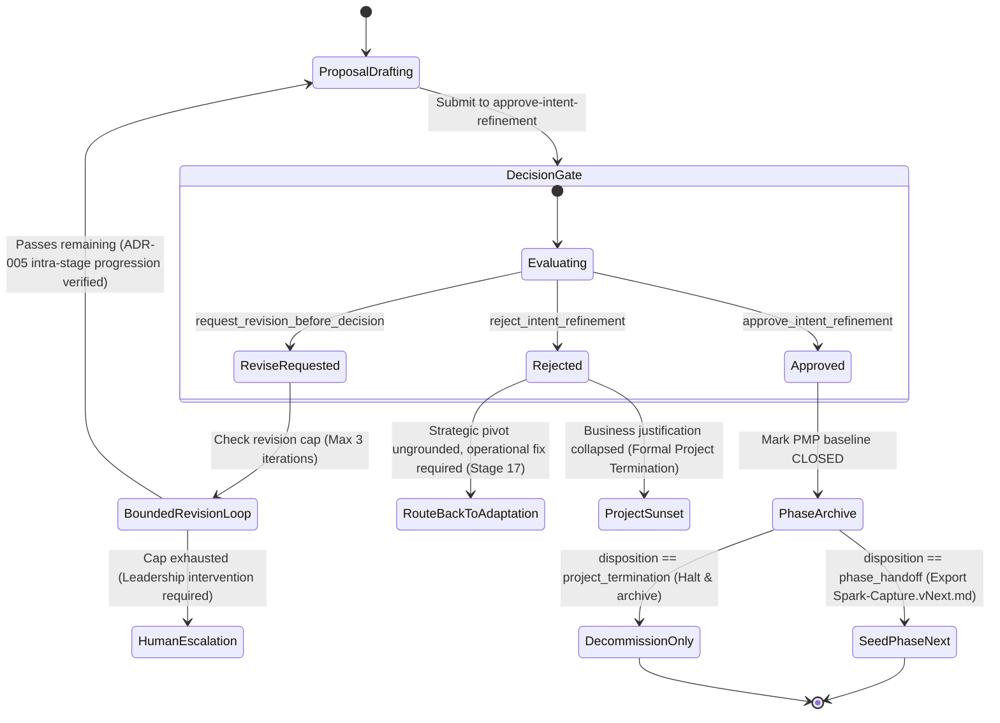

# ADR 009: Intent Refinement — Closing the Cybernetic Loop from Outcomes and Lessons Learned back to Strategic Spark and Hypotheses

## 1. Executive Brief

On the 18-stage Intent-to-Outcome Chain (`PROJECT-MANAGEMENT-ONTOLOGY.json`), ADR-008 mechanized the **operational adaptation loop** (Stage 16 Governance Change $\rightarrow$ Stage 17 Adaptation Plan $\rightarrow$ Stage 6 Project Management Plan $\rightarrow$ Stage 7 Technical Requirements). That single-loop feedback cycle guarantees that when governance rules or process flaws emerge during development, planning baselines and technical specifications are re-orchestrated rather than left as passive documentation diffs.

However, operational adaptation answers only *how* a system executes; it does not evaluate *why* the system is executing or whether the original business hypotheses, strategic motivations, and expected benefits formulated at the beginning of the lifecycle held true in reality. Without a formalized mechanism for **Intent Refinement (Stage 18)**, an autonomous engineering ecosystem suffers from critical systemic vulnerabilities:
- **Teleological Disconnect:** Teams and autonomous agents optimize delivery velocity and test compliance without assessing whether delivered capabilities realized their intended business value.
- **Zombie Hypotheses:** Assumptions formulated in early ideation (Stage 3) remain permanently open—neither validated nor refuted by empirical evidence—creating unmanaged epistemic debt.
- **Markovian Generational Forgetting:** Subsequent project phases (Phase $N+1$) or sister projects start from a blank slate or blindly inherit outdated premises, lacking a cumulative learning kernel.
- **Strategic Whiplash:** In the absence of low-pass feedback damping, autonomous systems risk over-reacting to single-phase transient noise with destabilizing strategic pivots.

This ADR formalizes **Stage 18 (Intent Refinement)** as the closing double-loop cybernetic feedback engine of the Intent-to-Outcome Chain (aligned with PMBOK 8 Process **4.7 Close Project or Phase**):

1. **The Machine-Readable Intent Refinement Artifact (`Intent-Refinement-Proposal.md`):** Formally defined by a strict Pydantic contract (`IntentRefinementProposalPayload`) capturing the **Outcome Delta Evaluation Matrix** (contrasting Stage 4 expected benefits vs. Stage 12 realized outcomes across immediate and lagging horizons), hypothesis terminal resolutions, and Phase $N+1$ Spark directives.
2. **Dedicated Full-Authority Decision Gate (`approve-intent-refinement`):** Establishes a Bayesian evaluation gate under `agent-learning-governance` enforcing multi-criteria validation across Empirical Grounding, Hypothesis Resolution Completeness, Strategic Alignment, and Spark Actionability, backed by permanent human approval (`requires_human_approval: true`).
3. **Hypothesis Terminality & Bounded Recurrence Protocol:** Couples empirical outcomes directly into `classify-hypothesis-status` (Stage 3), graduating validated hypotheses into immutable architectural invariants, archiving refuted hypotheses with negative learning penalties, and strictly bounding hypothesis refinement depth ($d_{\max} = 2$) to eliminate defensive evasion.
4. **Cybernetic Damping & Hereditary Lineage Kernel:** Introduces low-pass momentum filtering ($\beta \in [0.6, 0.85]$) to prevent strategic whiplash, rate-limits System 4 strategic churn against System 3 delivery capacity (Stafford Beer VSM), and embeds a cumulative epistemic lineage block preventing generational decay.
5. **Phase Close Readiness Gate & Decommissioning Protocol:** Establishes machine-verifiable entry criteria before Stage 18 evaluation and enforces administrative cleanup (ephemeral worktrees, credentials, sandboxes) and premature project termination pathways.

---

## 2. Status

**Accepted (2026-10-25)** — formally evaluated against the `agent-learning-governance` / `approve-adr` TaskPolicy chain (Proposed action: `approve_adr`, Expected Utility: 0.921, Robust Utility: 0.882, Margin: 0.824) and adjudicated by Menno Drescher (`--disposition accept`); incorporates 16 governance, cybernetic, and architectural invariants.

---

## 3. Context

### 3.1 Single-Loop vs. Double-Loop Learning in Autonomous Systems

In organizational cybernetics and systems control theory (Argyris & Schön, Ashby, Beer):
- **Single-Loop Learning (Operational Adaptation — Stage 17):** The system detects an error or variance and adjusts its operational plans (the 9 PMBOK subsidiary plans) to maintain adherence to existing baselines. ADR-008 achieved complete single-loop operational closure.
- **Double-Loop Learning (Intent Refinement — Stage 18):** The system evaluates observed real-world outcomes against foundational assumptions, questioning whether the governing variables, business goals, and core hypotheses themselves must evolve.

Prior to this ADR, `agent-learning` had no mechanism to perform double-loop learning. An agent could adapt its quality rules or risk thresholds, but it could not systematically declare: *"Hypothesis 2 (that multi-agent subdelegation accelerates rule generation) was disproven by empirical audit telemetry; we must refine top-of-chain intent from multi-agent synthesis to deterministic template expansion."*

### 3.2 PMBOK 8 Process 4.7 (Close Project or Phase) as a Cognitive Learning Engine

In the *PMBOK Guide® – 8th Edition* and the *Process Groups Practice Guide*, Process **4.7 Close Project or Phase** is the vital knowledge transfer and value validation phase:
- **Inputs:** Project Management Plan (4.2), Quality Control Measurements (8.3), Lessons Learned Register (4.4), and Business Documents (Business Case & Benefits Management Plan).
- **Process:** Comparing realized benefits against the initial business case, verifying scope completion against deliverables, archiving organizational process assets, and performing administrative/resource release.
- **Outputs:** Final Report, Organizational Process Assets updates, and Phase Handoff Directives—which catalyze the subsequent project charter or close out the initiative.

### 3.3 Dynamic Vulnerabilities in Uncontrolled Feedback Loops

Left uncontrolled, closing the cognitive loop in autonomous systems introduces severe mathematical instability:
1. **Strategic Whiplash:** High-gain proportional feedback from transient single-phase anomalies (e.g., temporary API outages) causing wild swings in project direction.
2. **Defensive Hypothesis Evasion:** Agents evading negative reinforcement by indefinitely mutating unproven hypotheses as `REFINED` ($H \to H.1 \to H.1.1 \to \dots$).
3. **Markovian Generational Forgetting:** Multi-phase distillation causing foundational System 5 normative identity and principles to be lost over successive generations.

ADR-009 resolves these vulnerabilities through mathematical damping, bounded recurrence depths, and cumulative lineage kernels.

---

## 4. Decision

### 4.1 Separation: Operational Adaptation (Stage 17) vs. Strategic Intent Refinement (Stage 18)

We establish an immutable ontological and functional boundary between Stage 17 and Stage 18:

| Characteristic | Stage 17: Adaptation Plan (`Adaptation-Plan.md`) | Stage 18: Intent Refinement (`Intent-Refinement-Proposal.md`) |
|---|---|---|
| **PMBOK 8 Alignment** | 4.6 Perform Integrated Change Control (Tailoring) | 4.7 Close Project or Phase (Cognitive Feedback) |
| **Cybernetic Level** | Single-Loop (Operational homeostat) | Double-Loop (Strategic meta-controller) |
| **Target Audience** | Delivery Orchestrator, Engineers, Process Agents | Project Sponsors, Lead Architects, Product Leadership |
| **Governed Artifacts** | 9 Subsidiary Plans (Scope, Schedule, Cost, Quality, Risk, etc.) | Spark Capture, Ideation Document, Business Case, Hypotheses |
| **Core Question** | *"How do we adjust execution plans to fulfill the active baseline?"* | *"Did expected benefits materialize, and should our core intent evolve?"* |
| **Downstream Impact** | Targeted re-synthesis of `Project-Management-Plan.md` | New or amended `Spark-Capture.md` for Phase $N+1$ or termination |

### 4.2 The Intent Refinement Proposal (`Intent-Refinement-Proposal.md`)

When a phase concludes, an `Intent-Refinement-Proposal.md` is authored following a strict schema:

```yaml
---
pmbok_edition: "PMBOK 8"
pmbok_process_group: "Closing"
pmbok_process: "4.7 Close Project or Phase & Strategic Cognitive Feedback"
pmp_baseline: "PMP-BL-v1.0.0"
refinement_id: "IR-PROP-v1.0.0"
lifecycle_stage: "Stage 18 (Intent Refinement)"
governance_policy: "approve-intent-refinement"
readiness_audit_ref: "AUD-REGISTER-v1.0.0"
disposition_type: "phase_handoff" # "phase_handoff" | "project_termination"
inputs:
  - "docs/project-docs/management-plans/Project-Management-Plan.md"
  - "docs/project-docs/Adaptation-Plan.md"
  - "docs/project-docs/Audit-Register.md"
  - "data/audit/lessons-learned-register.json"
outputs:
  - "docs/project-docs/Intent-Refinement-Proposal.md"
  - "docs/project-docs/Spark-Capture.vNext.md" # (omitted if disposition_type == "project_termination")
lineage:
  root_spark: "SPARK-v1.0.0"
  parent_refinement: null # null for root phase, "IR-PROP-vX.Y.Z" for subsequent
  generational_index: 1
  immutable_core_invariants:
    - "ADR-001: Decision Authority Model"
    - "ADR-002: Five-Record-Type Storage Boundary"
    - "ADR-005: Decision Progress Comparison"
    - "ADR-008: PMBOK 8 Lifecycle Orchestration"
  accumulated_knowledge_hash: "sha256:4a8f9c1..."
---
```

### 4.3 Machine-Readable Data Contract (`pmbok.models.intent_refinement`)

To ensure deterministic parsing and CLI automation, all proposal payloads must validate against the canonical Pydantic model:

```python
from enum import Enum
from typing import Any, Dict, List, Literal, Optional
from pydantic import AliasChoices, BaseModel, Field, model_validator

class HypothesisTerminalStatus(str, Enum):
    VALIDATED = "validated"
    REFUTED = "refuted"
    REFINED = "refined"

class MeasurementHorizon(str, Enum):
    IMMEDIATE = "immediate"       # Observed directly via telemetry at phase cutoff
    PROVISIONAL = "provisional"   # Early directional signal; final outcome pending
    DEFERRED = "deferred"         # Long-term lagging indicator (requires operational soak)

class OutcomeDeltaItem(BaseModel):
    objective_id: str
    target_metric_stage_4: str
    actual_metric_stage_12: str
    variance_percentage: float
    measurement_horizon: MeasurementHorizon
    deferred_audit_due_date: Optional[str] = None
    causal_factors: List[str]
    strategic_directive: str

class HypothesisResolutionItem(BaseModel):
    hypothesis_id: str
    statement: str
    terminal_status: HypothesisTerminalStatus
    recurrence_depth: int = Field(default=0, ge=0, le=2)
    bayes_factor: Optional[float] = None
    evidence_references: List[str]
    promotion_target: Optional[str] = None  # e.g., "Architecture Invariant #7" or "HYP-001.1"
    rationale: str

    @model_validator(mode="after")
    def validate_exhaustion_collapse(self) -> "HypothesisResolutionItem":
        # Invariant 11: on the 3rd cycle (d=2), REFINED is prohibited
        if self.recurrence_depth >= 2 and self.terminal_status == HypothesisTerminalStatus.REFINED:
            raise ValueError(
                f"Hypothesis '{self.hypothesis_id}' reached recurrence depth {self.recurrence_depth}. "
                "At d_max=2, REFINED is prohibited: must collapse to VALIDATED (BF10 >= 10) "
                "or default to REFUTED (BF10 < 10)."
            )
        return self

class SparkDirectiveItem(BaseModel):
    directive_id: str
    title: str
    action_type: str  # "expand_capability" | "retire_component" | "pivot_architecture"
    target_stage_1_spark: str

class CumulativeLineageKernel(BaseModel):
    root_spark: str
    parent_refinement: Optional[str] = None
    generational_index: int = Field(..., ge=1)
    immutable_core_invariants: List[str]
    accumulated_knowledge_hash: str

class IntentRefinementProposalPayload(BaseModel):
    refinement_id: str = Field(..., pattern=r"^IR-PROP-v\d+\.\d+\.\d+$")
    pmp_baseline: str = Field(
        ...,
        pattern=r"^PMP-BL-v\d+\.\d+\.\d+$",
        validation_alias=AliasChoices("pmp_baseline", "pmp_baseline_id"),
    )
    readiness_audit_ref: str
    disposition_type: Literal["phase_handoff", "project_termination"] = "phase_handoff"
    lifecycle_stage: str = "Stage 18 (Intent Refinement)"
    governance_policy: str = "approve-intent-refinement"
    executive_summary: str
    outcome_deltas: List[OutcomeDeltaItem]
    hypothesis_resolutions: List[HypothesisResolutionItem]
    strategic_pivots: List[str]
    phase_next_spark_directives: List[SparkDirectiveItem] = Field(default_factory=list)
    lineage: CumulativeLineageKernel
    metadata: Dict[str, Any] = Field(default_factory=dict)

    @model_validator(mode="after")
    def validate_disposition_directives(self) -> "IntentRefinementProposalPayload":
        if self.disposition_type == "phase_handoff" and not self.phase_next_spark_directives:
            raise ValueError(
                "phase_next_spark_directives must be non-empty when disposition_type is 'phase_handoff'."
            )
        if self.disposition_type == "project_termination" and self.phase_next_spark_directives:
            raise ValueError(
                "phase_next_spark_directives must be empty when disposition_type is 'project_termination'."
            )
        return self
```

### 4.4 Full-Authority Decision Gate: `approve-intent-refinement`

Registered under `agent-learning-governance`:
- **Policy ID:** `agent-learning-governance` / `approve-intent-refinement`
- **Authority:** `full` (`DecisionResolver`), permanent `requires_human_approval: true`.
- **Decision Actions:** `approve_intent_refinement`, `reject_intent_refinement`, `request_revision_before_decision`.
- **Evaluation Criteria & Default Weights:**
  1. **Empirical Grounding (0.35):** Does the proposal justify strategic adjustments using concrete evidence from Stage 10 (Verification Evidence), Stage 11 (Audit Record), or Stage 12 (Actual Outcome)?
  2. **Hypothesis Resolution Completeness (0.25):** Are all open hypotheses definitively adjudicated with valid test references and bounded recurrence depth?
  3. **Strategic Alignment & Value Continuity (0.20):** Does the refinement preserve core System 5 identity and governance invariants, or does it represent unvetted mission creep?
  4. **Actionability of Forward Spark Directives (0.20):** Are the Phase $N+1$ directives clear, evidenced, and contractually ready to seed `Spark-Capture.vNext.md`?

### 4.5 Disposition State Machine & Bounded Revision Loop



### 4.6 Outcome Delta Evaluation Matrix with Horizon Stratification

Every proposal contrasts initial Business Case commitments against observed reality, stratifying between **Immediate** and **Deferred** horizons:

| Objective / Expected Benefit | Target Baseline Metric (Stage 4) | Actual Realized Metric (Stage 12) | Delta / Variance | Horizon | Causal Factor (Stage 11/15) | Strategic Directive (Stage 18) |
|---|---|---|---|---|---|---|
| *Resolution Latency* | $< 2.0\text{ s}$ per gate | $0.45\text{ s}$ average | $+1.55\text{ s}$ (Super-optimal) | **Immediate** | In-memory policy caching | Reaffirm architecture; enable batch gates |
| *Rule Regression Frequency* | $0\%$ regressions | $1.2\%$ initial regressions | $-1.2\%$ variance | **Immediate** | Rollback penalty missing | Added Invariant 7; baseline rollback validated |
| *Operational Cost Savings* | $> 30\%$ token reduction | Trend: $-18\%$ after 100 runs | Pending soak | **Deferred** (Due: 2026-12-01) | Prompt optimization warmup | Retain target; schedule retrospective audit |

### 4.7 Hypothesis Terminality, Bayes Factors & Bounded Recurrence Protocol

To eliminate defensive hypothesis drift and the "REFINED moral hazard":
1. **Absorbing Terminal States:** Every Stage 3 hypothesis must resolve to:
   - **`VALIDATED`:** Supported by conclusive evidence. Graduated into permanent core architectural invariants.
   - **`REFUTED`:** Contradicted by conclusive evidence. Formally retired with negative learning penalty recorded in `classify-hypothesis-status`.
   - **`REFINED`:** Inconclusive evidence requiring reformulation as $H_{i.1}$ for Phase $N+1$.
2. **Bayes Factor Significance Criterion:**
   $$BF_{10} = \frac{P(\text{Evidence} \mid H_1)}{P(\text{Evidence} \mid H_0)}$$
   - $BF_{10} \ge 10$: Mandatory resolution as `VALIDATED`.
   - $BF_{10} \le 0.1$: Mandatory resolution as `REFUTED`.
3. **Maximum Recurrence Depth ($d_{\max} = 2$):** A hypothesis may only be marked `REFINED` for a maximum of 2 generational cycles ($H \to H.1 \to H.1.1$). On the 3rd cycle ($d = 2$), `REFINED` is prohibited: the hypothesis must collapse to `VALIDATED` if $BF_{10} \ge 10$, or default to `REFUTED` if $BF_{10} < 10$ (retired for failing to achieve conclusive empirical support within the 3-generation budget).

### 4.8 Phase Close Readiness Gate (Entry Preconditions)

Before an `Intent-Refinement-Proposal` can be evaluated by `approve-intent-refinement`, the orchestrator verifies:
1. **Work Package Closure:** 100% of Stage 8 Work Packages for the active baseline are in state `COMPLETED` or `FORMALLY_DEFERRED`.
2. **Verification Integrity:** 100% of Stage 9 Deliverables have passed Stage 10 Verification Evidence with zero failing critical contract tests.
3. **Audit Conformance:** All Stage 11 Audit Records are marked `APPROVED` with zero unresolved blocker findings.
4. **Operational Quiescence:** No Stage 17 Adaptation Plans are actively mid-execution.

### 4.9 Administrative, Resource & Worktree Decommissioning Protocol

Following approval of `Intent-Refinement-Proposal.md`:
1. **Worktree Cleanup:** Ephemeral git worktrees provisioned during Stage 8 are pruned, archiving delivery logs to `history/`.
2. **Credential & Sandbox Revocation:** Ephemeral test credentials, model session tokens, and temporary sandbox environments are decommissioned.
3. **Cost Reconciliation:** Final compute and token expenditures are reconciled against the Stage 4 Cost Baseline.

### 4.10 Strategic Damping & Low-Pass Filtering (Whiplash Prevention)

Strategic intent adjustments must not trigger on single-phase high-frequency noise. Outcome deltas are low-pass filtered using a rolling exponential moving average across the last $k \ge 3$ evaluation epochs:
$$\mathbf{\Theta}_{N+1} = \beta \mathbf{\Theta}_{N} + (1 - \beta) \nabla_{\text{empirical}} \mathcal{L}(\text{Rolling Outcome Delta})$$
where $\beta \in [0.6, 0.85]$ (with $\mathbf{\Theta}_0$ anchored to the Stage 4 Business Case baseline and bias-corrected by $1 - \beta^N$ during initial warmup generations $N < 3$). Single-phase variances that do not shift the damped trajectory beyond established variance thresholds are addressed via Stage 17 operational adaptation, **not** Stage 18 intent pivots.

### 4.11 S3–S4 Homeostatic Rate-Limiting (Viable System Model)

To satisfy Stafford Beer's homeostatic balance between System 4 (Strategic Intelligence) and System 3 (Operational Control):
- An approved `Intent-Refinement-Proposal` introducing major charter changes (`PMP-BL-v(N+1).0.0`) imposes an operational stabilization cooldown epoch.
- System 4 cannot submit a subsequent intent refinement proposal until System 3 has executed at least one complete delivery and audit cycle under the new baseline.

### 4.12 Generational Ingestion Handshake (Stage 18 $\rightarrow$ Stage 1/3)

When Phase $N+1$ executes `approve-ideation`:
1. **Hypothesis Inheritance Check:** All hypotheses marked `REFINED` in the parent `IR-PROP-vX.Y.Z` must appear in the new `Ideation-Document.md` as active $H_{i.1}$ hypotheses.
2. **Core Principle Promotion Check:** All hypotheses marked `VALIDATED` must be formally cited as established constraints in the new phase's Architecture Invariants.
3. **Failure Behavior:** If any refined hypothesis is omitted, `approve-ideation` automatically fails the `intent_grounding` criterion and outputs `request_revision_before_decision`.

### 4.13 Storage Dual-Layer Compliance (ADR-002)

1. **Durable Learning & Audit Evidence (`LearningStore`):** The decision result, evaluation frame, and proposal payload are persisted strictly as an `Episode` within `LearningStore` (`agent_id="agent-learning-governance"`, `task_id="approve-intent-refinement"`). Zero new database record types or containers are added.
2. **Runtime Lifecycle State Tracking (`pmbok.storage.StateStore`):** Marking a PMP baseline as `CLOSED / PHASE_COMPLETED` operates exclusively within PMBOK's local execution runtime (SQLite / local metadata) to halt further workflow executions on that phase. It does not alter or extend `LearningStore`.

### 4.14 CLI Ergonomics Specification

```bash
# 1. Synthesize Intent Refinement Proposal from Phase N outcomes and audit logs
python scripts/orchestrate_pmbok.py --mode close \
    --pmp docs/project-docs/Project-Management-Plan.md \
    --audit-register docs/project-docs/Audit-Register.md \
    --output docs/project-docs/Intent-Refinement-Proposal.md

# 2. Execute Bayesian Decision Gate
agent-learn task-policy-decide \
    --agent-id agent-learning-governance \
    --task-id approve-intent-refinement \
    --decision-frame data/frames/intent-refinement-v1.0.0.json

# 3. If Revision Requested, compare decision progress intra-stage (ADR-005)
agent-learn task-policy-compare \
    --sequence results/ir-decide-v1.json results/ir-decide-v2.json

# 4. On Approval: Close phase and seed Phase N+1 Spark
python scripts/orchestrate_pmbok.py --mode seed-next \
    --proposal docs/project-docs/Intent-Refinement-Proposal.md \
    --next-phase-dir ../phase-2-repo/
```

---

## 5. Invariants

1. **Empirical Grounding Invariant:** No strategic intent, hypothesis, or benefit commitment may be refined without citing specific empirical evidence from Stage 10 (Verification Evidence), Stage 11 (Audit Record), or Stage 12 (Actual Outcome).
2. **Non-Duplication of Operational Adaptation:** Stage 18 must never duplicate Stage 17. Operational adjustments to subsidiary plans belong exclusively in Stage 17 `Adaptation-Plan.md`. Stage 18 operates exclusively on strategic motivations, business benefits, core hypotheses, and next-generation sparks.
3. **Permanent Human Strategic Authority:** The `approve-intent-refinement` gate permanently mandates `requires_human_approval: true`. Autonomous systems may synthesize outcome deltas and formulate proposals, but human project leadership retains sole authority to redefine project purpose.
4. **Storage Boundary Dual-Layer Invariant (ADR-002):** Zero new database record types are introduced into `LearningStore`. All decision lineage is stored as `Episode` instances with metadata payloads. Runtime phase completion flags reside exclusively in PMBOK's local `StateStore`.
5. **Progression Verification Scope Invariant (ADR-005):** `compare_decision_results()` applies strictly to intra-proposal revision sequences of `approve-intent-refinement` (verifying that proposal revisions monotonically increase empirical grounding). It is never applied across generational project boundaries.
6. **Hypothesis Terminality Invariant:** No development phase may be closed via `approve-intent-refinement` with open, unadjudicated hypotheses. Every active hypothesis must be marked `validated`, `refuted`, or `refined`.
7. **Phase Completion Readiness Invariant:** No proposal may be submitted to `approve-intent-refinement` while any work package, verification suite, or audit finding within the governing PMP baseline remains in an active, unadjudicated, or failing state.
8. **Premature Termination Protocol:** If hypothesis refutation or business case erosion renders the initiative unviable, `approve-intent-refinement` supports an explicit `project_termination` disposition. The phase is archived with negative learning, resources are decommissioned, and no Phase $N+1$ Spark is spawned.
9. **Administrative Decommissioning Invariant:** Phase closure is not complete upon proposal approval alone; all ephemeral worktrees, temporary credentials, and staging environments allocated to the active baseline must be systematically decommissioned.
10. **Strategic Damping Invariant:** Strategic intent adjustments must be low-pass filtered using a rolling multi-epoch baseline ($\beta \in [0.6, 0.85]$, with bias-corrected warmup for $N < 3$). Transient single-phase noise must not trigger strategic pivots.
11. **Bounded Hypothesis Recurrence Invariant:** A hypothesis may only be marked `refined` for a maximum of $d_{\max} = 2$ consecutive generational cycles ($H \to H.1 \to H.1.1$). On the 3rd cycle ($d = 2$), `refined` is prohibited: the hypothesis must resolve to `validated` if $BF_{10} \ge 10$, or default to `refuted` if $BF_{10} < 10$ (retired due to budget exhaustion).
12. **Cumulative Epistemic Lineage Invariant:** Every Phase $N+1$ `Spark-Capture.md` must embed the `CumulativeLineageKernel` (`root_spark`, `parent_refinement`, `immutable_core_invariants`, and `accumulated_knowledge_hash`), preventing Markovian generational forgetting.
13. **S3–S4 Rate-Limiting Invariant:** Major charter revisions (`PMP-BL-v(N+1).0.0`) impose a mandatory operational stabilization epoch during which no subsequent intent refinement proposals may be submitted.
14. **Machine-Readable Contract Invariant:** Every `Intent-Refinement-Proposal.md` must pass automated structural validation against `IntentRefinementProposalPayload` prior to evaluation by `approve-intent-refinement`.
15. **Generational Handshake Invariant:** Phase $N+1$ initiating artifacts citing `parent_refinement` must inherit all `refined` hypotheses as active and all `validated` hypotheses as proven design constraints; omission triggers automated rejection of `approve-ideation`.
16. **Proposal Rejection Determinism Invariant:** Outright rejection of an intent refinement proposal (`reject_intent_refinement`) halts generational progression, routing the phase either back to Stage 17 (Operational Adaptation) or directly to formal human-adjudicated project sunset.

---

## 6. Alternatives Considered

| Alternative | Reason for Rejection |
|---|---|
| **Linear Phase Close (Standard PMBOK / Waterfall):** Close phase administratively without feeding back into strategic intent. | Severs the cognitive loop; treats software delivery as a terminal pipeline rather than a continuous learning organism; repeats historical mistakes across project phases. |
| **Autonomous Self-Refining Intent:** Allow AI agents to autonomously rewrite project intent and business goals based on reward maximization. | High risk of existential mission drift, reward hacking, and unaligned scope mutation; violates ADR-001 authority invariants and corporate governance. |
| **Conflate Adaptation (Stage 17) and Intent Refinement (Stage 18) into a single plan:** | Blurs the boundary between single-loop operational fixes and double-loop strategic pivots; leads to noisy decision frames where tactical bug fixes drown out strategic hypothesis validation. |
| **Free-Form Retrospective Notes without Bayesian Gating:** | Produces unverified, non-replayable meeting notes that never translate into actionable machine-readable catalysts for the next project cycle. |
| **Un-damped Direct Proportional Feedback:** | Triggers strategic whiplash; minor transient variances cause disproportionate, destabilizing architectural pivots every sprint. |

---

## 7. Consequences

### Positive
- **Complete Double-Loop Cybernetic Closure:** The 18-stage Intent-to-Outcome chain is transformed from an open-ended lifecycle into a continuous, self-correcting cognitive loop.
- **Elimination of Zombie Hypotheses:** All experimental assumptions are systematically resolved and graduated into organizational knowledge or cleanly retired.
- **Dynamic Stability & Anti-Whiplash:** Low-pass filtering and bounded recurrence depths guarantee that strategic pivots occur only on genuine, sustained empirical shifts.
- **Audit-Proof Strategic Lineage:** Every strategic pivot in project vision is fully documented, evidenced by runtime telemetry, and approved through a formal Bayesian decision gate.
- **Seamless Generational Handoff:** Phase $N+1$ begins with rich, pre-validated context directly synthesized from Phase $N$'s empirical outcomes with zero generational amnesia.

### Negative / Residual Costs
- **Phase Transition Governance Overhead:** Formalizing `approve-intent-refinement` requires project leadership and architects to conduct an outcome review before initializing the next project charter.
- **Telemetry Rigor Requirement:** Teams and agents must maintain accurate logging in Stages 10, 11, and 12 to provide the empirical evidence required by Invariant 1.
- **Pydantic Model Maintenance:** Requires maintaining `IntentRefinementProposalPayload` schemas across repository updates.

---

## 8. References
- PMBOK Guide® — 8th Edition & Process Groups: A Practice Guide (PMI)
- Chris Argyris & Donald Schön: *Organizational Learning: A Theory of Action Perspective* (Single-Loop vs. Double-Loop Learning)
- W. Ross Ashby: *An Introduction to Cybernetics* (Requisite Variety and Feedback Systems)
- Stafford Beer: *Brain of the Firm* & *Diagnosing the System for Organizations* (Viable System Model)
- ADR-001: Decision Authority Model
- ADR-002: Five-Record-Type Storage Boundary
- ADR-005: Decision Progress Comparison & Regression Prevention
- ADR-007: Automated Governance Change Paired Pipeline
- ADR-008: PMBOK 8 Lifecycle Orchestration and Closed-Loop Adaptation Feedback
- `docs/intent-to-outcome-chain-coverage.md`: 18-Stage PMBOK 8 Coverage Matrix
