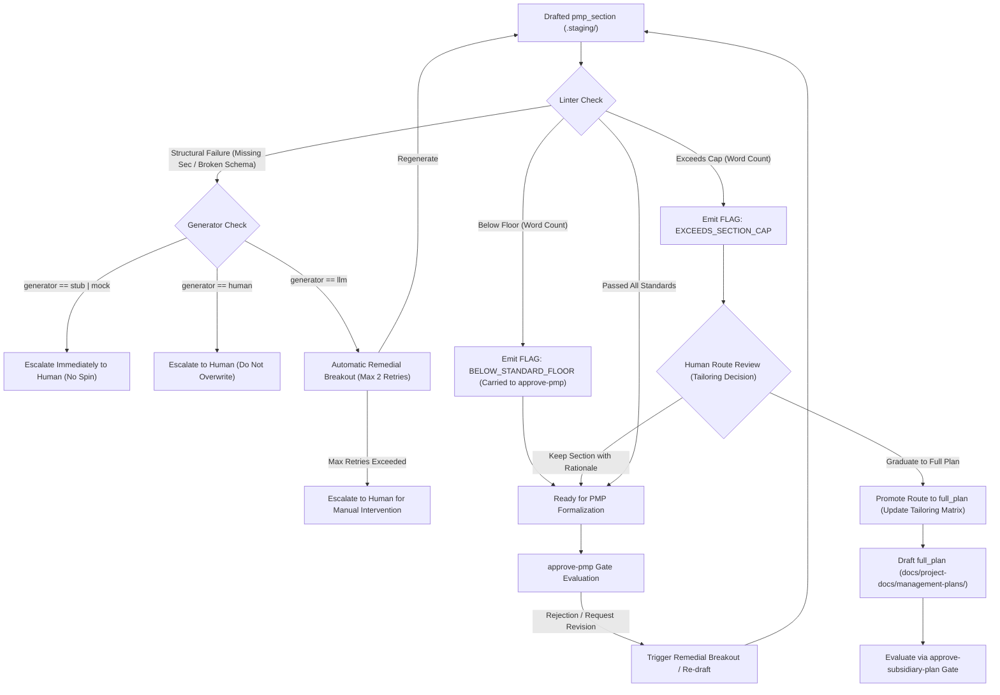

# ADR 012: Subsidiary Management Plan Standards and Content Contracts

## 1. Executive Brief
ADR-011 established route tailoring (`full_plan`, `pmp_section`, `not_applicable`) and declared that floors and caps are governance flags rather than mechanical blocks. ADR-013 introduced route-aware per-plan approval gates (`approve-subsidiary-plan`), cryptographic content hashing, technical integrity hard blocks, and staged section persistence (`docs/project-docs/.staging/pmp-sections/`).

However, neither ADR formalized:
1. **The content contract:** What structural sections, metadata schemas, and interfaces must a subsidiary plan contain to be valid?
2. **Quantitative floor and cap thresholds:** How are floors (minimum required substantive content) and caps (maximum boundary before graduation is flagged) calculated, tokenized, and verified?
3. **PMBOK 8 Performance Domain mapping:** How the 9 operational subsidiary management plans bridge to the authentic **7 Performance Domains** of PMBOK 8 (*Governance, Scope, Schedule, Finance, Stakeholders, Resources, Risk*) under the *Planning* Focus Area, while maintaining backward compatibility with legacy tooling process numbers (`5.1` through `13.2`).
4. **Remedial breakout vs. graduation triggers:** The exact conditions under which an embedded section triggers a remedial regeneration versus when it is flagged to graduate to a standalone document, how flags are carried to `approve-pmp`, and how downstream staleness propagates.
5. **Decoupled plan standards hierarchy:** How universal plan invariants relate to domain-specific plan standards (Scope, Schedule, Cost, Quality, Resource, Communications, Risk, Procurement, Stakeholder).

This ADR establishes the **universal standard framework and content contract** for all PMBOK subsidiary management plans across the agent-learning repository. Individual plans inherit this framework and specify their domain-specific mechanics through dedicated daughter ADRs, beginning with the three Baseline-Substantiating Plans (Scope, Schedule, Cost).

---

## 2. Status
**Proposed (2026-10-25)** — Drafted to establish the standard framework preceding dedicated domain plan specifications (starting with Scope Management Plan). Ready for multi-criteria evaluation under `approve-adr`.

---

## 3. Context & Problem Statement
* **Current Baseline Deficiencies:** In the initial PMBOK baseline (`PMP-BL-v1.0.0`), 8 of the 9 generated plans in `docs/project-docs/management-plans/` contain generic stub text (`"description": "Stub content for Artifact"`), and the Quality plan has formatting errors. No schema exists to validate whether an LLM generator produced actionable governance mechanics or empty fluff.
* **Ambiguous Section Boundaries:** While ADR-011 introduced the concept of `pmp_section` floors and caps, the absence of quantitative thresholds prevents orchestrator linters from emitting deterministic governance flags.
* **PMBOK 8 Domain vs. Process Mismatch:** `scripts/orchestrate_pmbok.py` hardcodes 6th-edition process numbers (`5.1` to `13.2`). In PMBOK 8th Edition, the standard organizes project management into **7 Performance Domains** (*Governance, Scope, Schedule, Finance, Stakeholders, Resources, Risk*) across 5 Focus Areas (*Initiating, Planning, Executing, Monitoring & Controlling, Closing*). The subsidiary management plans are planning outputs that cross-cut these 7 domains. A flexible mapping bridge recognizing primary and secondary domains is required.
* **Credit Assignment Needs Structural Anchoring:** Per LL-008, credit assignment requires that plans are evaluated individually. To evaluate them objectively through `approve-subsidiary-plan`, the evaluator requires a standard rubric and uniform section taxonomy.

---

## 4. Technical Decision

### 4.1 The Universal Three-Section Content Contract
Every subsidiary management plan—whether staged as a `pmp_section` or authored as a standalone `full_plan`—must conform to a uniform three-tier macro-structure:

```
┌─────────────────────────────────────────────────────────────┐
│ 1. Mandatory YAML Frontmatter (Metadata Contract)           │
├─────────────────────────────────────────────────────────────┤
│ 2. Section 1: Intent, Alignment & Boundaries                │
│    - Core Mandate & Purpose                                 │
│    - Traceability to Project Charter & Upstream Baseline    │
│    - Explicit Out-of-Scope Boundaries                       │
├─────────────────────────────────────────────────────────────┤
│ 3. Section 2: Domain Mechanics & Standards                  │
│    - Methodologies, Algorithms, & Operational Procedures    │
│    - Baselines, Envelopes, or Tolerance Bands               │
│    - Artifacts & Storage Locations                          │
├─────────────────────────────────────────────────────────────┤
│ 4. Section 3: Governance, Control & Decision Rights         │
│    - Accountable Owner Role & Escalation Target             │
│    - Decision Rights (Baseline Changes, Exception Approvals)│
│    - Variance Thresholds & Review Cadence                   │
│    - Integrated Change Control & Adaptation Triggers        │
└─────────────────────────────────────────────────────────────┘
```

1. **Section 1: Intent, Alignment & Boundaries:** Discloses the plan's mandate, links explicitly to the [Project Charter](../project-docs/Project-Charter.md) and upstream dependencies, and explicitly documents **out-of-scope boundaries**. If a plan genuinely has no out-of-scope items, it must explicitly record an entry: *"None: [rationale]"* rather than omitting the section.
2. **Section 2: Domain Mechanics & Standards:** Details the concrete operational practices for that domain (e.g., WBS dictionary for Scope; CPM/milestones for Schedule; EVM/burn rates for Cost; probability-impact matrices for Risk).
3. **Section 3: Governance, Control & Decision Rights:** Identifies the functional owner role, explicit decision authority (who approves baseline changes, who authorizes variance exceptions, who accepts deliverables), variance tolerances (e.g. $\pm 10\%$ cost variance, 2-day schedule slippage), escalation bodies, and adaptation loop triggers.

### 4.2 Universal Frontmatter Metadata Schema
Every plan file (`full_plan` or staged `pmp_section`) must begin with strict YAML frontmatter.

```yaml
---
plan_id: "scope-management"              # Unique plan identifier kebab-case
plan_name: "Scope Management Plan"       # Formal human-readable title
pmbok_edition: "PMBOK 8"                 # Governed framework edition
pmbok_focus_area: "Planning"             # PMBOK 8 Focus Area
primary_pmbok_domain: "Scope"            # Primary PMBOK 8 Domain (Governance|Scope|Schedule|Finance|Stakeholders|Resources|Risk)
secondary_pmbok_domains:                 # Optional secondary cross-cutting domains
  - "Governance"
legacy_process: "5.1 Plan Scope Management" # Backward-compatible PMBOK 6 process code
route: "full_plan"                       # full_plan | pmp_section | not_applicable
generator: "llm"                         # llm | human | stub | mock (ADR-013 §4.2 audit field)
version: "1.0.0"                         # Semantic plan version
baseline_id: "<target-baseline-id>"      # Target baseline identifier (e.g. PMP-BL-v1.0.0)
owner_role: "Project Manager"            # Functional owner role from Stakeholder Register
depends_on: []                           # Machine-readable plan_id dependencies from canonical DAG (ADR-013 §4.1)
inputs:
  - "Project-Charter.md"
  - "docs/project-docs/Ideation-Document.md"
outputs:
  - "docs/project-docs/management-plans/Scope-Management-Plan.md" # if full_plan; .staging/pmp-sections/ if pmp_section
governance_policy: "approve-subsidiary-plan" # "approve-subsidiary-plan" (if full_plan) | "approve-pmp" (if pmp_section)
---
```

> [!NOTE]
> **No In-File Hash Circularity:** `canonical_content_hash` is **not** stored inside the in-file YAML frontmatter. In accordance with ADR-013 §4.2 and §4.3, the canonical hash is computed dynamically over the LF-normalized disk content and persisted strictly within `Episode.metadata` and the `DecisionFrame`. Storing the hash inside the file being hashed creates a self-referential cryptographic cycle.

### 4.3 Standard Floor and Cap Quantifications

#### Measurement Boundary Rules
To ensure deterministic, reproducible linting:
* **Scope of Measurement:** Word count is calculated exclusively on the **Markdown body below the closing frontmatter delimiter (`---`)**.
* **Exclusions:** YAML frontmatter, raw HTML comments, and fenced code blocks (` ``` `) are excluded from the word count.
* **Tokenization Rule:** Words are tokens containing at least one alphanumeric character (matching regex `\b[a-zA-Z0-9_-]+\b`). Standalone markdown structural punctuation (`##`, `---`, `|`, `-`) is excluded from the count.
* **Mandatory Heading Regexes:**
  1. `^##\s+1\.\s+Intent,\s+Alignment\s+&\s+Boundaries`
  2. `^##\s+2\.\s+Domain\s+Mechanics\s+&\s+Standards`
  3. `^##\s+3\.\s+Governance,\s+Control\s+&\s+Decision\s+Rights`

#### Baseline Defaults vs. Project-Level Standard
* **Baseline Defaults:** The numbers in the table below define the repository baseline defaults (`standard: baseline`).
* **Charter Standard Scaling:** The Project Charter's declared `project_standard` (ADR-011 §3.3) may scale or raise the floor (e.g. `standard: high-assurance` may require 1,000 words for full plans), but may **never lower** the baseline floor.
* **Daughter ADR Specialization:** Daughter ADRs may specify higher domain-specific floors or tighter caps.
* **Over-Cap Full Plans:** If a standalone `full_plan` exceeds 5,000 words, the linter emits `FLAG: EXCEEDS_PLAN_CAP`, signaling an over-scoped or bloated document that should split auxiliary reference material into technical appendices.

#### Baseline Quantitative Thresholds

| Metric | Embedded `pmp_section` | Standalone `full_plan` | Flag Type | Enforcement Mechanism |
|---|---|---|---|---|
| **Minimum Floor (Word Count)** | 150 words | 600 words | `FLAG: BELOW_STANDARD_FLOOR` | Governance Flag (Human decides with recorded rationale) |
| **Maximum Cap (Word Count)** | 800 words | 5,000 words | `FLAG: EXCEEDS_SECTION_CAP` / `FLAG: EXCEEDS_PLAN_CAP` | Governance Flag (Graduation or Appendix recommendation) |
| **Mandatory Headings** | Sections 1, 2, 3 present | Sections 1, 2, 3 + subsections | `FLAG: MISSING_REQUIRED_SECTION` | Structural Failure (Triggers remediation / revision request) |
| **Out-of-Scope Declaration** | Required in §1 | Required in §1 | `FLAG: MISSING_BOUNDARY_DEF` | Governance Flag (Requires explicit boundary or "None") |
| **Owner Role & Generator** | Required in frontmatter | Required in frontmatter | `FLAG: INVALID_METADATA` | Structural Failure (Missing required metadata) |

#### Hard Blocks vs. Governance Flags (ADR-013 §4.2 Alignment)
* **Technical Integrity Hard Blocks (Ruled Out Outright):** In accordance with ADR-013 §4.2, a candidate plan is mechanically ruled out from `approve_plan` if frontmatter carries `generator: stub` or `generator: mock`, if the body contains placeholder tokens (`Stub content for Artifact`, `[Insert here]`, `[TBD]`, `[TODO]`), or if generation encountered a caught exception or missing artifact file.
* **Governance Flags (Flags, Not Blocks):** Word count deviations below floor or above cap are surfaced as evidence in the `DecisionFrame`. The human adjudicator may approve the plan, provided a non-empty rationale is recorded in `Episode.metadata` (ADR-011 §3.2, ADR-013 Invariant #5).

### 4.4 PMBOK 8 Performance Domain Mapping & Process Bridge
PMBOK 8 organizes projects into **7 Performance Domains** (*Governance, Scope, Schedule, Finance, Stakeholders, Resources, Risk*) under the *Planning* Focus Area. To bridge modern PMBOK 8 domains with the repository's 6th-edition process numbers in `scripts/orchestrate_pmbok.py`, the orchestrator recognizes the following mapping:

```
Primary Performance Domain     Secondary Domains           Legacy Process  Subsidiary Management Plan       Plan Tier
──────────────────────────────────────────────────────────────────────────────────────────────────────────────────────────────────
Scope                          Governance                  5.1            Scope Management Plan            Tier 1 (Substantiating)
Schedule                       Governance                  6.1            Schedule Management Plan         Tier 1 (Substantiating)
Finance                        Governance                  7.1            Cost Management Plan             Tier 1 (Substantiating)
Governance                     Scope, Quality              8.1            Quality Management Plan          Tier 2 (Governance)
Resources                      Governance                  9.1            Resource Management Plan         Tier 3 (Execution)
Stakeholders                   Governance                  10.1           Communications Management Plan   Tier 3 (Execution)
Risk                           Governance, Finance         11.1           Risk Management Plan             Tier 2 (Governance)
Finance                        Resources, Governance       12.1           Procurement Management Plan      Tier 3 (Execution)
Stakeholders                   Governance                  13.2           Stakeholder Engagement Plan      Tier 3 (Execution)
```

#### Plan Tier Definitions
Tiers are functional governance classifications and do not dictate linear DAG execution sequence:
* **Tier 1 (Baseline-Substantiating):** Creates and substantiates core project baselines (Scope, Schedule, Cost). Setting `not_applicable` on a Tier 1 plan emits `FLAG: OMISSION_OF_BASE_PLAN`, requiring human rationale and sponsor confirmation during route approval (ADR-011 §3.2).
* **Tier 2 (Governance & Control):** Establishes systemic control frameworks, risk tolerances, and verification gates (Risk, Quality).
* **Tier 3 (Execution Support):** Provides operational execution, procurement, team resources, and stakeholder mechanisms (Resource, Stakeholder, Communications, Procurement).

### 4.5 Remedial Breakout vs. Graduation Mechanics
ADR-011 §3.5 and ADR-013 §4.4 establish that foundation breakouts are remedial for sections. Sections drafted in `.staging/pmp-sections/` do not pass an independent approval gate; their governance flags are surfaced during PMP formalization (`approve-pmp`). We formalize the precise state transitions:



1. **Remedial Foundation Breakout (Intra-Section Correction):**
   * *Structural Failure Trigger:* Missing mandatory sections, broken frontmatter, or stub tokens trigger automated remediation only if `generator == "llm"`. It is bounded to a maximum of 2 retries before escalating to a human. If `generator` is `stub` or `mock`, it escalates immediately. If `generator` is `human`, automated regeneration is prohibited to prevent overwriting manual work.
   * *Floor Flag Handling:* If a section is flagged `BELOW_STANDARD_FLOOR`, the flag is carried into the `approve-pmp` `DecisionFrame`. The human adjudicator may approve the integrated PMP with a recorded rationale in `Episode.metadata`, or request revision.
   * *PMP Gate Rejection Trigger:* If `approve-pmp` rejects an embedded section during formalization, it triggers a remedial breakout.
   * *Staleness Propagation:* Regenerating an embedded section marks all transitively dependent downstream plans in the causal DAG as `STALE_DEPENDENCY` per ADR-013 §4.5.
2. **Graduation (Route Promotion):**
   * *Trigger:* When an embedded section exceeds its 800-word cap (`FLAG: EXCEEDS_SECTION_CAP`) or when project complexity warrants standalone governance, the human adjudicator may promote the route from `pmp_section` to `full_plan`.
   * *Execution:* The tailoring matrix is updated. A standalone plan is drafted under `docs/project-docs/management-plans/<Name>.md`, subjected to `approve-subsidiary-plan`, and the PMP section is reduced to an executive summary and verified link.
   * *Downstream Invalidation:* Graduation triggers downstream re-verification of approvals per ADR-013 §4.5.
3. **Full Plan Structural Failures:** For a `full_plan`, structural failures and technical integrity blocks prevent `approve_plan` outright under ADR-013 §4.2, returning `request_revision_before_decision`.

### 4.6 The Decoupled Plan Standards ADR Hierarchy
ADR-012 defines the universal contract and meta-rules. Domain-specific plan standards are specified in dedicated daughter ADRs that inherit ADR-012.

> [!NOTE]
> **ADR Numbering Continuity:** ADR-014 through ADR-023 are allocated to learning policies and algorithmic mechanisms; ADR-024 defines the learning methodology selection chain. Daughter plan standard ADRs are allocated starting at ADR-025:

* **Tier 1 — Baseline-Substantiating Plan Standards (The Core Triad):**
  * `ADR-025`: Scope Management Plan Standard (WBS, scope boundaries, acceptance criteria).
  * `ADR-026`: Schedule Management Plan Standard (Progressive elaboration, milestones, timeboxes).
  * `ADR-027`: Cost Management Plan Standard (Staged funding, management envelope, contingency).
* **Tier 2 — Governance & Control Plan Standards:**
  * `ADR-028`: Risk Management Plan Standard (Risk domain, risk taxonomy, thresholds).
  * `ADR-029`: Quality Management Plan Standard (Quality gates, verification criteria, test coverage).
* **Tier 3 — Execution Support Plan Standards:**
  * `ADR-030`: Resource Management Plan Standard (Roles, team allocation, tooling assets).
  * `ADR-031`: Stakeholder Engagement Plan Standard (Stakeholder matrix, engagement levels).
  * `ADR-032`: Communications Management Plan Standard (Cadence, channels, audience).
  * `ADR-033`: Procurement Management Plan Standard (Sourcing strategies, vendors, contracts).

---

## 5. Architectural Invariants
1. **Universal Contract Compliance:** Every subsidiary management plan—whether standalone or staged section—must provide the standard frontmatter and the three canonical sections (Intent, Mechanics, Governance & Decision Rights).
2. **Deterministic Word Count Scope:** Word counts are evaluated on the Markdown body below the closing frontmatter delimiter (`---`), excluding frontmatter, raw HTML, and fenced code blocks, tokenizing alphanumeric words (`\b[a-zA-Z0-9_-]+\b`).
3. **Floors as Flags, Not Blocks:** Content falling below declared floors generates a `FLAG: BELOW_STANDARD_FLOOR`. Approval requires a recorded human rationale in `Episode.metadata` during plan approval (`full_plan`) or PMP formalization (`pmp_section`) (ADR-011 Invariant #1, ADR-013 Invariant #5).
4. **Remedial Breakouts Propagate Staleness:** Remedial breakouts regenerate staged sections in `docs/project-docs/.staging/pmp-sections/`. Affected transitively downstream plans become `STALE_DEPENDENCY` per ADR-013 §4.5.
5. **Graduation Preserves Traceability:** Graduating a section to a full plan updates the tailoring matrix, initiates a standalone `approve-subsidiary-plan` gate, and contracts the PMP entry to a summary.
6. **Zero Entity Sprawl:** Linting snapshots, flag resolutions, and approval evidence are persisted as standard `Episode.metadata` when decision frames are evaluated (ADR-002 Invariant #2).
7. **Canonical Hashing Integrity:** All plans are hashed according to the LF-normalized specification defined in ADR-013 §4.3. Hashes are recorded in `Episode.metadata`, never inside the governed markdown file itself.

---

## 6. Alternatives Considered
* **Alternative 1: Monolithic Plan Standard (Single massive ADR defining all 9 plans).**  
  * *Rejected:* A monolithic document mixing Cost, Risk, Procurement, and Scope creates high governance coupling. Modifying the Risk threshold would require re-adjudicating the entire omnibus ADR.
* **Alternative 2: Ad-Hoc Plan Formats Without Shared Frontmatter.**  
  * *Rejected:* LLM generators produce wildly inconsistent markdown structures. Without a rigid frontmatter contract and uniform 3-section layout, automated linter validation and credit assignment are impossible.
* **Alternative 3: Hard System Blocks on Word Count Floors.**  
  * *Rejected:* Direct contradiction of ADR-011 §3.2. Agile and small-scale projects often summarize plans concisely. Human accountability with recorded rationales is superior to rigid mechanical blocking.
* **Alternative 4: Embedding Canonical Content Hashes in Frontmatter.**  
  * *Rejected:* Creates an irreconcilable self-referential hash paradox. Storing the hash in `Episode.metadata` maintains cryptographic verification without mutating the artifact.

---

## 7. Consequences

### Positive
* **Deterministic Linting:** Automated tools can immediately verify whether an LLM plan generation succeeded, meets minimum floors, and adheres to structural contracts before presenting it to human approvers.
* **Predictable Remedial and Graduation Cycles:** Clear triggers define when an embedded section can be automatically regenerated versus when it must graduate.
* **Clean Traceability to PMBOK 8:** Bridges 6th-edition process numbering in current tooling with 8th-edition 7 Performance Domains under the Planning Focus Area without breaking backward compatibility.
* **Modular Domain Evolution:** Allows individual plans (e.g., Scope, Cost) to evolve their specific standards in targeted daughter ADRs without invalidating the general framework.

### Negative
* **Schema Rigidity:** Generators must strictly format frontmatter and top-level headings, requiring robust prompt scaffolding.
* **Word Count Heuristics:** Word counts are a proxy for completeness; a verbose plan may pass the floor while lacking depth. Domain-specific daughter ADRs must enforce section-specific substantive criteria.

---

## 8. Open Questions & Future Extensions
1. **Automated Linter Integration:** When should the linter run in the orchestrator? (Target: Run during `scripts/orchestrate_pmbok.py --mode draft` to emit warnings before `approve-subsidiary-plan` is invoked).
2. **Learner Policy Scoring Rubrics:** How do the advisory learners (`docs/design-notes/planning-redesign-notes.md §4.12` and ADR-011 §6) score domain mechanics beyond word count? (Addressed in future learner ADRs).

---

## 9. Amendment Log

| Date | Change | Why |
|---|---|---|
| 2026-10-25 | Proposed | Initial drafting of the universal plan standards and content contracts framework, establishing the three-section contract, quantitative floors/caps, PMBOK 8 mapping, and decoupled daughter ADR hierarchy. |
| 2026-10-25 | Amended (Round 1 Review) | Resolved self-referential hash paradox (anchored in `Episode.metadata` per ADR-013 §4.3). Added `generator` and `owner_role`. Added downstream `STALE_DEPENDENCY` propagation rules. Defined deterministic word-count scope. |
| 2026-10-25 | Amended (Round 2 Review) | Corrected PMBOK 8 taxonomy to the authentic 7 Performance Domains (*Governance, Scope, Schedule, Finance, Stakeholders, Resources, Risk*) under the *Planning* Focus Area. Fixed staging vs `approve-pmp` flow: sections are not approved at staging; floor flags carry forward to `approve-pmp`. Corrected staleness citations to ADR-013 §4.5. Aligned hard-block rules and `mock` generator token with ADR-013 §4.2. Guarded auto-regeneration against spinning on stubs and overwriting human text. Removed floor-flag graduation edge. Clarified Tier 1 omission as a flagged deviation per ADR-011 §3.2. Defined regex word tokenization and exact heading regex strings. |
