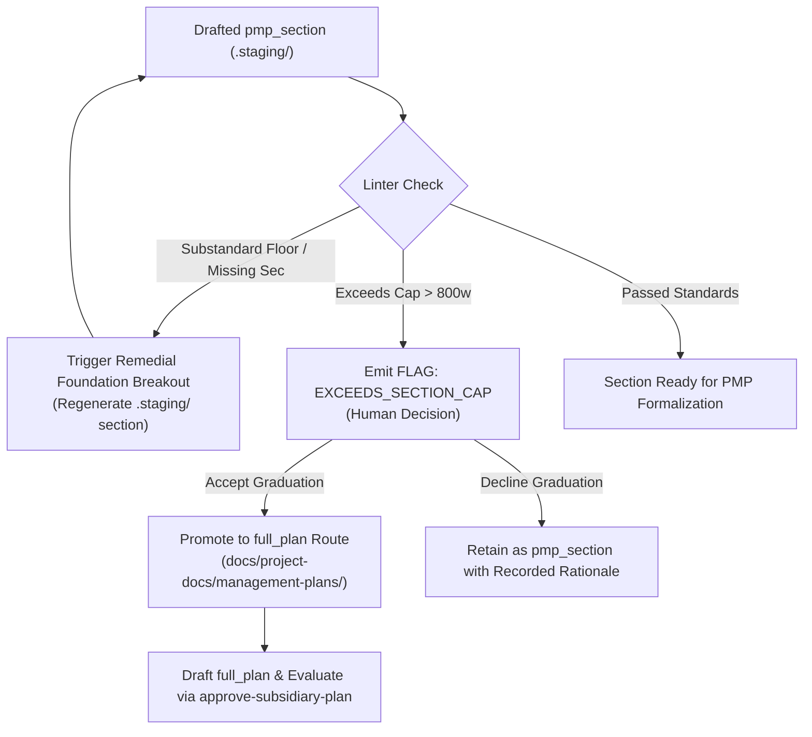

# ADR 012: Subsidiary Management Plan Standards and Content Contracts

## 1. Executive Brief
ADR-011 established route tailoring (`full_plan`, `pmp_section`, `not_applicable`) and declared that floors and caps are governance flags rather than mechanical blocks. ADR-013 introduced route-aware per-plan approval gates (`approve-subsidiary-plan`), cryptographic content hashing, technical integrity hard blocks, and staged section persistence (`docs/project-docs/.staging/pmp-sections/`).

However, neither ADR formalized:
1. **The content contract:** What structural sections, metadata schemas, and interfaces must a subsidiary plan contain to be valid?
2. **Quantitative floor and cap thresholds:** How are floors (minimum required substantive content) and caps (maximum boundary before graduation is flagged) calculated and verified?
3. **PMBOK 8 Performance Domain mapping:** How the 9 operational subsidiary management plans map into PMBOK 8's 8 Performance Domains while maintaining backward compatibility with legacy tooling process numbers (`5.1` through `13.2`).
4. **Remedial breakout vs. graduation triggers:** The exact conditions under which an embedded section triggers a remedial regeneration versus when it is flagged to graduate to a standalone document.
5. **Decoupled plan standards hierarchy:** How universal plan invariants relate to domain-specific plan standards (Scope, Schedule, Cost, Quality, Resource, Communications, Risk, Procurement, Stakeholder).

This ADR establishes the **universal standard framework and content contract** for all PMBOK subsidiary management plans across the agent-learning repository. Individual plans inherit this framework and specify their domain-specific mechanics through dedicated daughter ADRs, beginning with the three Baseline-Substantiating Plans (Scope, Schedule, Cost).

---

## 2. Status
**Proposed (2026-10-25)** — Drafted to establish the standard framework preceding dedicated domain plan specifications (starting with Scope Management Plan). Ready for multi-criteria evaluation under `approve-adr`.

---

## 3. Context & Problem Statement
* **Current Baseline Deficiencies:** In the initial PMBOK baseline (`PMP-BL-v1.0.0`), 8 of the 9 generated plans in `docs/project-docs/management-plans/` contain generic stub text (`"description": "Stub content for Artifact"`), and the Quality plan has formatting errors. No schema exists to validate whether an LLM generator produced actionable governance mechanics or empty fluff.
* **Ambiguous Section Boundaries:** While ADR-011 introduced the concept of `pmp_section` floors and caps, the absence of quantitative thresholds prevents orchestrator linters from emitting deterministic governance flags.
* **PMBOK 8 Domain vs. Process Mismatch:** `scripts/orchestrate_pmbok.py` hardcodes 6th-edition process numbers (`5.1` to `13.2`). In PMBOK 8th Edition, the 10 Knowledge Areas are replaced by 8 Performance Domains (*Stakeholders, Team, Development Approach & Life Cycle, Planning, Project Work, Delivery, Measurement, Uncertainty*). The subsidiary plans remain essential planning outputs under the *Planning Performance Domain*, but their scope directly intersects other performance domains. A clean mapping bridge is needed.
* **Credit Assignment Needs Structural Anchoring:** Per LL-008, credit assignment requires that plans are evaluated individually. To evaluate them objectively through `approve-subsidiary-plan`, the evaluator requires a standard rubric and uniform section taxonomy.

---

## 4. Technical Decision

### 4.1 The Universal Three-Section Content Contract
Every subsidiary management plan—whether staged as a `pmp_section` or authored as a standalone `full_plan`—must conform to a uniform three-tier macro-structure:

```
┌─────────────────────────────────────────────────────────────┐
│ 1. Mandatory YAML Frontmatter (Metadata Contract)           │
├─────────────────────────────────────────────────────────────┤
│ 2. Section 1: Intent, Alignment & Boundaries                │
│    - Core Mandate & Purpose                                 │
│    - Traceability to Project Charter & Upstream Baseline    │
│    - Explicit Out-of-Scope Boundaries                       │
├─────────────────────────────────────────────────────────────┤
│ 3. Section 2: Domain Mechanics & Standards                  │
│    - Methodologies, Algorithms, & Operational Procedures    │
│    - Baselines, Envelopes, or Tolerance Bands               │
│    - Artifacts & Storage Locations                          │
├─────────────────────────────────────────────────────────────┤
│ 4. Section 3: Governance, Control & Escalation              │
│    - Accountable Roles (Owner Role & Escalation Target)     │
│    - Variance Thresholds & Review Cadence                   │
│    - Integrated Change Control & Adaptation Triggers        │
└─────────────────────────────────────────────────────────────┘
```

1. **Section 1: Intent, Alignment & Boundaries:** Discloses the plan's mandate, links explicitly to the [Project Charter](file:///c:/Users/MennoDrescher/source/repos/agent-learning/docs/project-docs/Project-Charter.md) and upstream dependencies, and explicitly documents **out-of-scope boundaries** (omission is never silent, ADR-011 Invariant #2).
2. **Section 2: Domain Mechanics & Standards:** Details the concrete operational practices for that domain (e.g., WBS dictionary for Scope; CPM/milestones for Schedule; EVM/burn rates for Cost; probability-impact matrices for Risk).
3. **Section 3: Governance, Control & Escalation:** Identifies the functional owner role, variance tolerances (e.g. $\pm 10\%$ cost variance, 2-day schedule slippage), escalation bodies, and adaptation loop triggers.

### 4.2 Universal Frontmatter Metadata Schema
Every plan file (`full_plan` or staged `pmp_section`) must begin with strict YAML frontmatter:

```yaml
---
plan_id: "scope-management"              # Unique plan identifier kebab-case
plan_name: "Scope Management Plan"       # Formal human-readable title
pmbok_edition: "PMBOK 8"                 # Governed framework edition
pmbok_domain: "Planning"                 # Primary PMBOK 8 Performance Domain
legacy_process: "5.1 Plan Scope Management" # Backward-compatible PMBOK 6 process code
route: "full_plan"                       # full_plan | pmp_section | not_applicable
version: "1.0.0"                         # Semantic plan version
baseline_id: "PMP-BL-v1.0.0"             # Target baseline identifier
author_role: "Project Manager"           # Functional owner role from Stakeholder Register
canonical_content_hash: "<sha256>"       # LF-normalized hash (ADR-013 §5)
inputs:
  - "Project-Charter.md"
  - "docs/project-docs/Ideation-Document.md"
outputs:
  - "docs/project-docs/management-plans/Scope-Management-Plan.md"
governance_policy: "approve-subsidiary-plan"
---
```

### 4.3 Standard Floor and Cap Quantifications
Floors and caps are evaluated via deterministic linting:
* **Floors are flags, not blocks (ADR-011 §3.2, ADR-013 Invariant #5):** If a plan falls below its word count floor or omits a standard section, the linter emits `FLAG: BELOW_STANDARD_FLOOR`. The human adjudicator can still approve the plan, provided a non-empty rationale is recorded in `Episode.metadata`.
* **Caps are flags for graduation (ADR-011 §3.5, ADR-013 Invariant #6):** If an embedded `pmp_section` exceeds its cap, the linter emits `FLAG: EXCEEDS_SECTION_CAP`, recommending graduation to `full_plan`.
* **Technical Integrity blocks remain absolute (ADR-013 Invariant #1):** Stubs, empty files, and unresolved placeholders (`<TBD>`, `[Insert ...]`) are hard blocks ruling out `approve_plan`.

#### Baseline Quantitative Thresholds

| Metric | Embedded `pmp_section` | Standalone `full_plan` | Flag Type | Trigger Condition |
|---|---|---|---|---|
| **Minimum Floor (Word Count)** | 150 words | 600 words | `BELOW_STANDARD_FLOOR` | Content < floor |
| **Maximum Cap (Word Count)** | 800 words | 5,000 words | `EXCEEDS_SECTION_CAP` | Content > cap |
| **Mandatory Headings** | Sections 1, 2, 3 present | Sections 1, 2, 3 + subsections | `MISSING_REQUIRED_SECTION` | Missing heading |
| **Out-of-Scope Declaration** | Required in §1 | Required in §1 | `MISSING_BOUNDARY_DEF` | No out-of-scope items |
| **Owner Role Declaration** | Required in frontmatter/§3 | Required in frontmatter/§3 | `UNASSIGNED_OWNER` | Owner is empty/unspecified |

### 4.4 PMBOK 8 Performance Domain Mapping & Process Bridge
To bridge modern PMBOK 8 Performance Domains with the repository's 6th-edition process numbers in `scripts/orchestrate_pmbok.py`, the orchestrator recognizes the following bidirectional mapping:

```
PMBOK 8 Performance Domain         Legacy Process    Subsidiary Management Plan       Plan Tier
─────────────────────────────────────────────────────────────────────────────────────────────────────
Planning (Core Baseline)            5.1              Scope Management Plan            Tier 1 (Substantiating)
Planning (Core Baseline)            6.1              Schedule Management Plan         Tier 1 (Substantiating)
Planning (Core Baseline)            7.1              Cost Management Plan             Tier 1 (Substantiating)
Uncertainty                         11.1             Risk Management Plan             Tier 2 (Governance)
Delivery & Measurement              8.1              Quality Management Plan          Tier 2 (Governance)
Team & Stakeholders                 9.1              Resource Management Plan         Tier 3 (Execution)
Team & Stakeholders                 13.2             Stakeholder Engagement Plan      Tier 3 (Execution)
Stakeholders & Delivery             10.1             Communications Management Plan   Tier 3 (Execution)
Project Work                        12.1             Procurement Management Plan      Tier 3 (Execution)
```

### 4.5 Remedial Breakout vs. Graduation Mechanics
ADR-011 §3.5 and ADR-013 §4.4 establish that foundation breakouts are remedial for sections. We formalize the precise state transitions:



1. **Remedial Breakout (Intra-Section Correction):** Triggered when an embedded `pmp_section` in `docs/project-docs/.staging/pmp-sections/<Name>.md` is incomplete, thin, or fails its floor. The orchestrator re-runs the domain foundation prompt to regenerate the staged section. The PMP structure is not altered; only the section content is repaired.
2. **Graduation (Route Promotion):** Triggered when a `pmp_section` exceeds its 800-word cap or when the project team decides the domain requires standalone governance. The route is updated from `pmp_section` to `full_plan` in the tailoring matrix. A standalone plan is drafted in `docs/project-docs/management-plans/<Name>.md`, subjected to `approve-subsidiary-plan`, and the PMP section is reduced to an executive summary and verified link.

### 4.6 The Decoupled Plan Standards ADR Hierarchy
ADR-012 defines the universal contract and meta-rules. Domain-specific plan standards are specified in dedicated ADRs that inherit ADR-012:

* **Tier 1 — Baseline-Substantiating Plan Standards (The Core Triad):**
  * `ADR-025`: Scope Management Plan Standard (WBS, scope boundaries, acceptance criteria).
  * `ADR-026`: Schedule Management Plan Standard (Progressive elaboration, milestones, timeboxes).
  * `ADR-027`: Cost Management Plan Standard (Staged funding, management envelope, contingency).
* **Tier 2 — Governance & Control Plan Standards:**
  * `ADR-028`: Risk Management Plan Standard (Uncertainty domain, risk taxonomy, thresholds).
  * `ADR-029`: Quality Management Plan Standard (Quality gates, verification criteria, test coverage).
* **Tier 3 — Execution & Stakeholder Plan Standards:**
  * `ADR-030`: Resource Management Plan Standard (Roles, team allocation, tooling assets).
  * `ADR-031`: Stakeholder Engagement Plan Standard (Stakeholder matrix, engagement levels).
  * `ADR-032`: Communications Management Plan Standard (Cadence, channels, audience).
  * `ADR-033`: Procurement Management Plan Standard (Sourcing strategies, vendors, contracts).

---

## 5. Architectural Invariants
1. **Universal Contract Compliance:** Every subsidiary management plan—whether standalone or staged section—must provide the standard frontmatter and the three canonical sections (Intent, Mechanics, Governance).
2. **Deterministic Floor and Cap Verification:** Linting of floors (minimum words) and caps (maximum words) is deterministic and machine-verifiable.
3. **Floors as Flags, Not Blocks:** Content falling below declared floors generates a `BELOW_STANDARD_FLOOR` flag. Approval requires a recorded human rationale in `Episode.metadata` (ADR-011 Invariant #1, ADR-013 Invariant #5).
4. **Remedial Breakouts are Localized:** Remedial breakouts regenerate staged sections in `docs/project-docs/.staging/pmp-sections/` without invalidating unaffected plans or the PMP outline.
5. **Graduation Preserves Traceability:** Graduating a section to a full plan updates the tailoring matrix, initiates a standalone `approve-subsidiary-plan` gate, and contracts the PMP entry to a summary.
6. **Zero Entity Sprawl:** Linting results, flag resolutions, and approval evidence are persisted as standard `Episode.metadata` (ADR-002 Invariant #2).
7. **Canonical Hashing Integrity:** All plans are hashed according to the LF-normalized specification defined in ADR-013 §5.

---

## 6. Alternatives Considered
* **Alternative 1: Monolithic Plan Standard (Single massive ADR defining all 9 plans).**  
  * *Rejected:* A monolithic document mixing Cost, Risk, Procurement, and Scope creates high governance coupling. Modifying the Risk threshold would require re-adjudicating the entire omnibus ADR.
* **Alternative 2: Ad-Hoc Plan Formats Without Shared Frontmatter.**  
  * *Rejected:* LLM generators produce wildly inconsistent markdown structures. Without a rigid frontmatter contract and uniform 3-section layout, automated linter validation and credit assignment are impossible.
* **Alternative 3: Hard System Blocks on Word Count Floors.**  
  * *Rejected:* Direct contradiction of ADR-011 §3.2. Agile and small-scale projects often summarize plans concisely. Human accountability with recorded rationales is superior to rigid mechanical blocking.

---

## 7. Consequences

### Positive
* **Deterministic Linting:** Automated tools can immediately verify whether an LLM plan generation succeeded, meets minimum floors, and adheres to structural contracts before presenting it to human approvers.
* **Predictable Remedial and Graduation Cycles:** Clear triggers define when an embedded section can be automatically regenerated versus when it must graduate.
* **Clean Traceability to PMBOK 8:** Bridges 6th-edition process numbering in current tooling with 8th-edition Performance Domains without breaking backward compatibility.
* **Modular Domain Evolution:** Allows individual plans (e.g., Scope, Cost) to evolve their specific standards in targeted daughter ADRs without invalidating the general framework.

### Negative
* **Schema Rigidity:** Generators must strictly format frontmatter and top-level headings, requiring robust prompt scaffolding.
* **Word Count Heuristics:** Word counts are a proxy for completeness; a verbose plan may pass the floor while lacking depth. Domain-specific daughter ADRs must enforce section-specific substantive criteria.

---

## 8. Open Questions & Future Extensions
1. **Automated Linter Integration:** When should the linter run in the orchestrator? (Target: Run during `scripts/orchestrate_pmbok.py --mode draft` to emit warnings before `approve-subsidiary-plan` is invoked).
2. **Learner Policy Scoring Rubrics:** How do the advisory learners (ADR-011 §4.12) score domain mechanics beyond word count? (Addressed in future learner ADRs).

---

## 9. Amendment Log

| Date | Change | Why |
|---|---|---|
| 2026-10-25 | Proposed | Initial drafting of the universal plan standards and content contracts framework, establishing the three-section contract, quantitative floors/caps, PMBOK 8 mapping, and decoupled daughter ADR hierarchy. |
