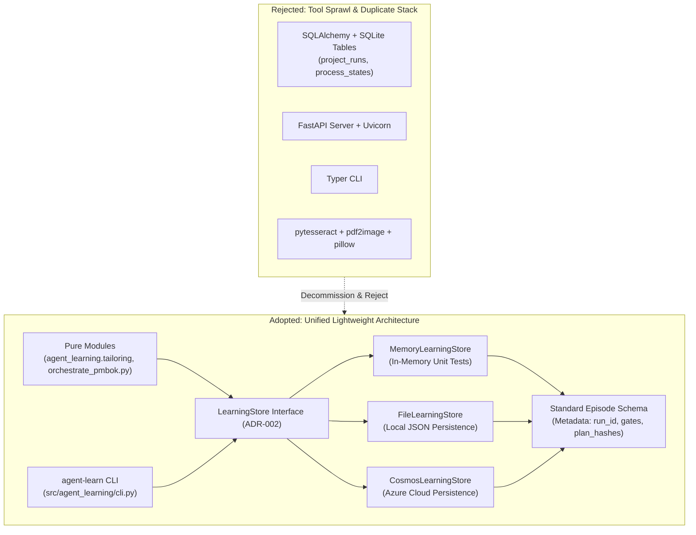

# ADR 028: PMBOK Tooling Decommissioning and Lightweight LearningStore Convergence

## 1. Executive Brief
Under **ADR-002** (Storage Backend Strategy) and **Pillar IV** (Software Engineering Integrity: Zero Entity Sprawl), all cognitive and project management states across the 18-stage intent-to-outcome lifecycle must be persisted exclusively through the standard `LearningStore` interface (`MemoryLearningStore`, `FileLearningStore`, `CosmosLearningStore`) as metadata-enriched `Episode` records.

In commit `a513470`, an 18,223-line monolithic subsystem was ingested into `pmbok/`. While intended to support **ADR-008** (PMBOK Lifecycle Orchestration), this monolith introduced a parallel, competing technology stack:
1. **Duplicate Database Engine:** `pmbok/storage/state_store.py` creates bespoke SQLite tables (`project_runs`, `process_states`, `approval_gates`, `audit_records`) via SQLAlchemy Core, directly violating ADR-002 Invariant #2.
2. **Heavy Undeclared Tooling:** It depends on heavy third-party packages (`sqlalchemy`, `fastapi`, `tenacity`, `typer`, `pydantic-settings`, `pytesseract`, `pdf2image`, `pillow`) that are not declared in `pyproject.toml`.
3. **Broken Test Collection:** Clean environment test runs fail during collection across 15 files in `tests/pmbok/`, forcing maintainers to permanently pass `--ignore=tests/pmbok` (documented as a known defect in **LL-013**).
4. **Duplicate Surface Area:** It introduces an unmaintained REST API (`pmbok/api/app.py`) and an unmaintained CLI (`pmbok/cli/main.py`), duplicating the repository's native `agent-learn` CLI.

This ADR formalizes the **prevention of tool sprawl and the convergence of PMBOK lifecycle orchestration onto the standard lightweight architecture**. We explicitly reject adding heavy ORMs, web servers, or OCR engines to the core build. The legacy SQLite/FastAPI monolith in `pmbok/` is decommissioned, and all PMBOK orchestration states are migrated into standard `LearningStore` (Cosmos DB and Local File Store) `Episode` entities.

---

## 2. Status
**Proposed (2026-10-25)** — Architectural convergence and technical debt remediation. Governs Epic 12 (PMBOK Tooling Modernization and Storage Convergence).

---

## 3. Context & Problem Statement

### 3.1 The Ingestion Gap and Dependency Debt
When `pmbok/` was imported, it was developed in a loose virtual environment containing unpinned packages. Because `pyproject.toml` remained configured as a lightweight SDK (`numpy`, `pydantic`, `azure-identity`), executing `pytest` in a clean checkout fails immediately with 15 collection errors:
* `ModuleNotFoundError: No module named 'tenacity'` (in `pmbok/orchestrator/orchestrator.py`)
* `ModuleNotFoundError: No module named 'sqlalchemy'` (in `pmbok/storage/state_store.py`)
* `ModuleNotFoundError: No module named 'fastapi'` (in `tests/pmbok/test_api.py`)
* `ModuleNotFoundError: No module named 'yaml'` (in `pmbok/audit/policy_loader.py`)

Rather than addressing the architectural debt, development workflows masked the failure by hardcoding `--ignore=tests/pmbok` into test runners. As captured in **LL-013**:
> *"The implement-story skill requires 'the full suite passes', but 15 files under `tests/pmbok` cannot be collected from a clean install, so the command cannot pass... Keep the skill's validation command accurate: fix the cause or amend the command."*

### 3.2 Direct Violation of ADR-002 Invariant #2
ADR-002 explicitly established:
> **Invariant #2 (Strict Storage Boundary):** *"Zero new database tables, Cosmos DB containers, or custom entities. The entire 18-stage cognitive lifecycle is persisted within standard `LearningStore` interfaces as metadata-enriched `Episode` instances."*

`pmbok/storage/state_store.py` creates five separate SQLite relational tables with foreign keys and custom schema migrations. This bifurcation fragments audit trails: governance gates recorded by `agent-learning` live in Cosmos DB / JSON files, while PMBOK process states live in an isolated SQLite database.

### 3.3 Redundant and Unused Capabilities
The `pmbok/` folder contains extensive scaffolding that provides zero utility to the agentic decision-making framework:
* **Embedded FastAPI server (`pmbok/api/app.py`):** The repository is an agentic SDK and CLI library, not a standalone web microservice.
* **Redundant Typer CLI (`pmbok/cli/main.py`):** Conflicts with the established Click/argparse `agent-learn` CLI.
* **OCR Ingestion (`pdf2image`, `pytesseract`):** Scanned PDF text extraction is an operational edge case that brings heavy native C-libraries (`tesseract`, `poppler`) into a pure Python library.

---

## 4. Technical Decision

### 4.1 Rejection of Heavyweight Tools (Zero Tool Sprawl)
We explicitly reject introducing `sqlalchemy`, `fastapi`, `typer`, `tenacity`, `pytesseract`, `pdf2image`, or `pillow` into `pyproject.toml`. 

The core dependencies of `agent-learning` remain strictly limited to the lightweight baseline:
* `numpy>=1.24` (mathematical operations, Bayesian posteriors, bandit distributions)
* `pydantic>=2.0` (data contract validation)
* `azure-identity>=1.15` (Azure authentication)
* `azure-cosmos>=4.5` (optional extra: `[project.optional-dependencies] cosmos`)

### 4.2 Storage Convergence onto `LearningStore`
All PMBOK process execution states, approval gate verdicts, and plan adaptation histories are unified under the standard `LearningStore` interface:
1. **PMBOK Project Run State:** Stored as an `Episode` with `task_id: "pmbok-lifecycle-run"`, containing the run configuration, process graph status, and active baselines in `Episode.metadata`.
2. **Approval Gate Records:** The gates required by ADR-008 (`approve-pmp`), ADR-011 (`tailoring-route-decision`), and ADR-013 (`approve-subsidiary-plan`) emit standard adjudicated `Episode` instances.
3. **No Bespoke Tables:** The five SQLite tables in `pmbok/storage/state_store.py` are deprecated and decommissioned. Zero SQLite database files (`*.db`) are created in repository operations.

### 4.3 Subsystem Modernization into `src/agent_learning/pmbok/`
The valuable domain logic inside `pmbok/` (the 49-process registry, process input/output mappings, and adaptation graph traversal) will be refactored into a pure, lightweight internal package: `src/agent_learning/pmbok/`:
* Implemented using standard library and `pydantic` only (modeled after the pure design of `agent_learning.tailoring`).
* Replaces custom retry loops (`tenacity`) with standard library linear/exponential backoff.
* Replaces custom YAML policy parsers with lightweight, safe standard parsers or pure JSON schemas.
* Eliminates the embedded FastAPI server and Typer CLI; all PMBOK commands are surfaced directly via `agent-learn pmbok ...`.

### 4.4 Test Suite Remediation (Resolving LL-013)
The test suite under `tests/pmbok/` will be systematically remediated:
1. Delete obsolete tests for decommissioned components (e.g. `tests/pmbok/test_api.py`, `tests/pmbok/test_storage.py` asserting on SQLite tables).
2. Migrate valid behavioral tests (process sequence verification, BABOK decomposition, audit scoring) to assert against `MemoryLearningStore` and pure functional contracts.
3. Ensure that `uv run pytest` executes cleanly out-of-the-box on a clean checkout with **zero collection errors** and without requiring `--ignore=tests/pmbok`.

### 4.5 Orchestrator Integration with ADR-011, ADR-012, and ADR-013
The operational script `scripts/orchestrate_pmbok.py` will be realigned with the accepted ADR corpus:
* **Route Awareness (ADR-011):** Ingests the tailored routes (`full_plan`, `pmp_section`, `not_applicable`) from `agent_learning.tailoring`.
* **Standard Contracts & 3-Tier Precedence (ADR-012):** Enforces 3-section contracts and deterministic floor/cap regex linting.
* **Component-Level Approval Gates (ADR-013):** Executes hash-verified `approve-subsidiary-plan` gates before permitting integrated PMP synthesis.

---

## 5. Invariants

* **Invariant 1 (Dependency Purity):** No relational database ORM (`sqlalchemy`), web server (`fastapi`), CLI framework (`typer`), or OCR engine (`pytesseract`) may be added to `pyproject.toml`.
* **Invariant 2 (Strict Storage Boundary):** All PMBOK lifecycle states, gate decisions, and adaptation records must be stored as `Episode` instances through `LearningStore` (ADR-002 Invariant #2).
* **Invariant 3 (Clean Test Suite Execution):** A default test invocation (`pytest`) on a clean environment must run 100% of the active test suite without collection errors or mandatory exclusion flags.
* **Invariant 4 (Pure Functional PMBOK Core):** Modules in `agent_learning.pmbok` must rely solely on the Python standard library and `pydantic`, with zero direct cloud or database dependencies.
* **Invariant 5 (CLI Singularity):** The repository provides exactly one CLI entry point: `agent-learn` (console script `agent_learning.cli:main`).

---

## 6. Alternatives Considered

* **Alternative 1: Add all missing packages to `pyproject.toml` base dependencies.**  
  * *Rejected:* Drags heavy dependencies (`sqlalchemy`, `fastapi`, `uvicorn`, `tenacity`, `typer`, `pillow`, `pytesseract`) into an agentic reasoning SDK. Doubles package install size and introduces system binary dependencies (`tesseract`, `poppler`).
* **Alternative 2: Place the legacy monolith behind an optional extra (`[project.optional-dependencies] pmbok = [...]`).**  
  * *Rejected:* Preserves an unmaintained second database architecture (SQLite) and perpetuates entity sprawl. Masks structural rot rather than eliminating it.
* **Alternative 3: Completely remove PMBOK orchestration from the project.**  
  * *Rejected:* PMBOK orchestration is the foundational backbone of the 18-stage lifecycle (Stage 6 PMP formalization, Stage 17 adaptation, closed-loop cybernetics). The orchestration logic is load-bearing; only the bloated implementation stack must be replaced.

---

## 7. Consequences

### Positive
* **Zero Sprawl:** Eliminates duplicate SQLite tables and aligns all persistence with ADR-002 and Cosmos DB.
* **Featherweight Install:** Preserves `agent-learning` as a fast, dependency-lean library suitable for containerized and edge agent environments.
* **Clean CI / Test Runner:** Resolves LL-013 permanently; eliminates `--ignore=tests/pmbok` hacks.
* **Unified CLI & API:** All user and agent interactions route through `agent-learn`.

### Negative / Trade-Offs
* **Refactoring Effort:** Requires rewriting `scripts/orchestrate_pmbok.py` and `pmbok/orchestrator/orchestrator.py` to use `LearningStore` instead of SQLAlchemy `StateStore`.
* **Test Pruning:** Obsolete tests targeting FastAPI endpoints and SQLite schema assertions will be permanently deleted.

---

## 8. Amendment Log

| Date | Author | Description |
|---|---|---|
| 2026-10-25 | Menno Drescher | Initial draft proposing the decommissioning of the legacy SQLite/FastAPI PMBOK monolith and converging all PMBOK state onto `LearningStore` (Cosmos DB and File Store). |
