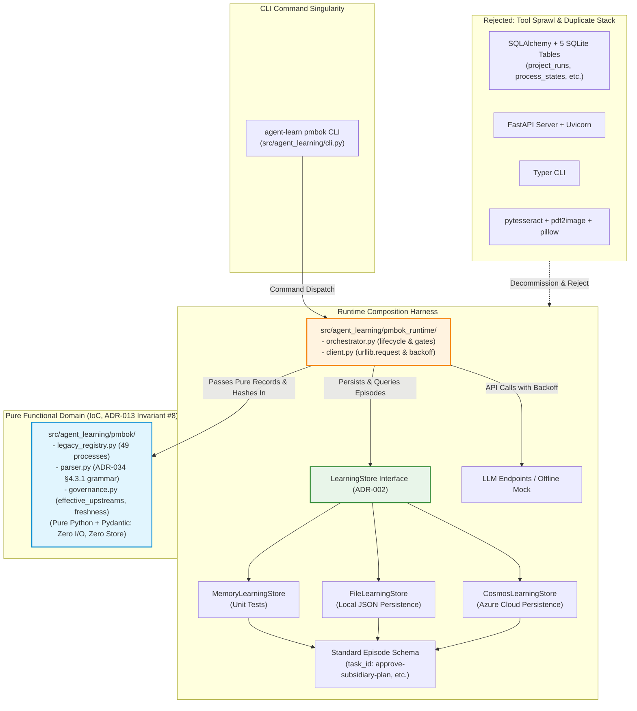

# ADR 034: PMBOK Tooling Decommissioning and Lightweight LearningStore Convergence

## 1. Executive Brief
Under **ADR-002** (Storage Backend Strategy) and **Pillar IV** (Software Engineering Integrity: Zero Entity Sprawl), all cognitive and project management states across the 18-stage intent-to-outcome lifecycle must be persisted exclusively through the standard `LearningStore` interface (`MemoryLearningStore`, `FileLearningStore`, `CosmosLearningStore`) as metadata-enriched `Episode` records.

In commit `a513470`, an 18,223-line monolithic subsystem was ingested into `pmbok/`. While intended to support **ADR-008** (PMBOK Lifecycle Orchestration), this monolith introduced a parallel, competing technology stack:
1. **Duplicate Database Engine:** `pmbok/storage/state_store.py` creates five bespoke SQLite tables (`project_runs`, `process_states`, `approval_gates`, `audit_records`, `artifact_indices`) via SQLAlchemy Core, directly violating ADR-002 Invariant #2.
2. **Heavy Undeclared Tooling:** It depends on heavy third-party packages (`sqlalchemy`, `fastapi`, `tenacity`, `typer`, `pydantic-settings`, `pytesseract`, `pdf2image`, `pillow`) that are not declared in `pyproject.toml`.
3. **Broken Test Collection:** Clean environment test runs fail during collection across 15 files in `tests/pmbok/`, forcing maintainers to permanently pass `--ignore=tests/pmbok` (documented as a known defect in **LL-013**).
4. **Duplicate Surface Area:** It introduces an unmaintained REST API (`pmbok/api/app.py`) and an unmaintained CLI (`pmbok/cli/main.py`), duplicating the repository's native `agent-learn` CLI.

This ADR formalizes the **prevention of tool sprawl and the convergence of PMBOK lifecycle orchestration onto the standard lightweight architecture**. We explicitly reject adding heavy ORMs, web servers, or OCR engines to the build. The legacy PMBOK persistence and service stack (SQLite, SQLAlchemy, FastAPI, Typer, and OCR tooling) is decommissioned, and all PMBOK orchestration states are migrated into standard `LearningStore` (Cosmos DB, Local File Store, Memory Store) `Episode` entities.

### Supersedes & Amends
* **Supersedes:** ADR-009 §4.13 by permanently decommissioning `pmbok/storage/state_store.py` rather than permitting a parallel local SQLite `StateStore`.
* **Amends:** ADR-008 §4.2, BRU-008-04, and Story 8.1 by eliminating references to `pmbok/api` and `pmbok/cli`.
* **Follow-On Alignments:** Establishes convergence requirements for follow-on ADRs to formalize targeted amendments to ADR-012 (frontmatter grammar re-homing) and ADR-013 (transitive staleness verification, hard-block alignment, derived state projections, and CLI singularity).

---

## 2. Status
**Proposed (2026-10-25)** — Architectural convergence and technical debt remediation. Governs Epic 12 (PMBOK Tooling Modernization and Storage Convergence).

---

## 3. Context & Problem Statement

### 3.1 The Ingestion Gap and Dependency Debt
When `pmbok/` was imported, it was developed in a loose virtual environment containing unpinned packages. Because `pyproject.toml` remained configured as a lightweight SDK (`numpy`, `pydantic`, `azure-identity`), executing `pytest` in a clean checkout fails immediately with 15 collection errors:
* `ModuleNotFoundError: No module named 'tenacity'` (in `pmbok/orchestrator/orchestrator.py`)
* `ModuleNotFoundError: No module named 'sqlalchemy'` (in `pmbok/storage/state_store.py`)
* `ModuleNotFoundError: No module named 'fastapi'` (in `tests/pmbok/test_api.py`)
* `ModuleNotFoundError: No module named 'yaml'` (in `pmbok/audit/policy_loader.py`)

Rather than addressing the architectural debt, development workflows masked the failure by hardcoding `--ignore=tests/pmbok` into test runners. As captured in **LL-013**:
> *"The implement-story skill requires 'the full suite passes', but 15 files under `tests/pmbok` cannot be collected from a clean install, so the command cannot pass... Keep the skill's validation command accurate: fix the cause or amend the command."*

### 3.2 Direct Violation of ADR-002 Invariant #2
ADR-002 explicitly established:
> **Invariant #2 (Strict Storage Boundary):** *"Zero new database tables, Cosmos DB containers, or custom entities. The entire 18-stage cognitive lifecycle is persisted within standard `LearningStore` interfaces as metadata-enriched `Episode` instances."*

`pmbok/storage/state_store.py` and `pmbok/storage/index.py` define five separate SQLite relational tables (`project_runs`, `process_states`, `approval_gates`, `audit_records`, `artifact_indices`) with foreign keys and custom schema migrations. This bifurcation fragments audit trails: governance gates recorded by `agent-learning` live in Cosmos DB / JSON files, while PMBOK process states live in an isolated SQLite database.

### 3.3 Redundant and Unused Capabilities
The `pmbok/` folder contains extensive scaffolding that provides zero utility to the agentic decision-making framework:
* **Embedded FastAPI server (`pmbok/api/app.py`):** The repository is an agentic SDK and CLI library, not a standalone web microservice. Repository-wide inspection (`git grep "pmbok.api"`, `git grep "pmbok.cli"`, and `git grep "FastAPI"`) confirmed exactly zero consumers or importers across `src/` or `scripts/`.
* **Redundant Typer CLI (`pmbok/cli/main.py`):** Conflicts with the canonical `argparse`-based `agent-learn` CLI.
* **OCR Ingestion (`pdf2image`, `pytesseract`, `pillow`):** Scanned PDF text extraction is an operational edge case that brings heavy native C-libraries (`tesseract`, `poppler`) into a pure Python library.

---

## 4. Technical Decision



### 4.1 Rejection of Heavyweight Tools (Zero Tool Sprawl)
No new runtime dependency may be added to `pyproject.toml` without an explicit ADR. Relational ORMs (`sqlalchemy`), web frameworks (`fastapi`), CLI frameworks (`typer`), retry libraries (`tenacity`), and OCR tools (`pytesseract`, `pdf2image`, `pillow`) are prohibited unless authorized through a superseding ADR with explicit architectural justification.

The core dependencies of `agent-learning` remain strictly limited to the lightweight baseline:
* `numpy>=1.24` (mathematical operations, Bayesian posteriors, bandit distributions)
* `pydantic>=2.0` (data contract validation)
* `azure-identity>=1.15` (Azure authentication)
* `azure-cosmos>=4.5` (optional extra: `[project.optional-dependencies] cosmos`)

For LLM generation and API calls, the CLI composition root uses standard library `urllib.request` (zero third-party dependencies) and provides the deterministic offline `--mock` client that ADR-013 depends upon for offline test suites.

### 4.2 Storage Convergence: PMBOK Lifecycle State as Episodes
All PMBOK process execution states, approval gate verdicts, and plan adaptation histories are unified under the standard `LearningStore` interface without modifying the core storage abstraction:

#### 4.2.1 Canonical PMBOK-to-Episode Data Model Mapping
PMBOK lifecycle concepts map directly to standard `Episode` attributes and `metadata` dictionaries:

| PMBOK Concept | `Episode` Representation | Schema Location & Semantics |
|---|---|---|
| **Project Run** | `Episode` instance | `agent_id: "pmbok-orchestration"`, `task_id: "pmbok-lifecycle-run"`, `action_type: "governance"`, `action_logprob: None` |
| **Phase / State** | `metadata["phase"]` | String identifier (`"Initiating"`, `"Planning"`, `"Executing"`, etc.) |
| **Process State** | `metadata["processes"]` | Dict mapping `process_id` (e.g. `"5.1"`) to status snapshot (`"not_started"`, `"in_progress"`, `"completed"`, `"failed"`) |
| **Run Sequence** | `metadata["sequence_number"]` | Monotonic integer sequence counter for ordering events within a run |
| **Approval Gate** | `metadata["gate_episode_ids"]` | Dict mapping plan ID to `{"episode_id": str, "canonical_hash": str, "verdict": str}`. **Cross-reference only**: the authoritative records remain the individual gate Episodes under `agent_id: "agent-learning-governance"` (`approve-charter`, `approve-pmp`, `approve-subsidiary-plan`). |
| **Active Baseline** | `metadata["baseline_hash"]` | LF-normalized canonical SHA-256 hash of active `Project-Management-Plan.md` |
| **Tailoring Route** | `metadata["route_episode_ids"]` | Dict mapping plan ID to tailoring route `episode_id`. **Cross-reference only**: the authoritative records remain the route-decision Episodes under `agent_id: "agent-learning-governance"` (ADR-011). |
| **Audit Result** | `Episode.result_summary` | Summary of verification findings and gate recommendations |

##### Approval Gate Episode Metadata Schema (`approve-subsidiary-plan`)
To eliminate contract drift between gate producers (`agent-learn pmbok approve`) and verification queries before formalization, every `approve-subsidiary-plan` episode adheres to the normative metadata contract:
* `metadata["plan_id"]`: str — Unique kebab-case plan identifier (e.g. `"scope-management"`).
* `metadata["canonical_content_hash"]`: str — LF-normalized, NFC Unicode, BOM-stripped SHA-256 hash computed over the markdown file on disk below volatile frontmatter.
* `metadata["upstream_hashes"]`: Dict[str, str] — Map of effective upstream plan IDs (recursively bypassing `not_applicable` nodes) to their canonical hashes at the time of approval. Omission rationales for `not_applicable` nodes are approved under tailoring (`approve-charter` or `approve-pmp`); editing an omission rationale does not stale downstream plans, as downstream plans depend on their effective active ancestors.
* `metadata["decision_disposition"]`: str — Human adjudication disposition (`"accepted"`, `"rejected"`, or `"modify"`). When a human accepts an approval, `action_id: "approve_plan"`, `decision_disposition: "accepted"`, and `feedback_status: "accepted"`. When a human accepts a rejection recommendation, `action_id: "reject_plan"`, `decision_disposition: "accepted"`, and `feedback_status: "accepted"`. (A `"modify"` disposition indicates human alteration requiring re-evaluation before approval).
* `metadata["feedback_status"]`: str — Supervised feedback status (`"accepted"` or `"rejected"`, matching the CLI `--require-decision-policy` contract).
* `metadata["run_id"]`: str — Orchestration run UUID.
* `metadata["sequence_number"]`: int — Monotonic per-plan integer sequence counter assigned by the single-writer CLI orchestrator for deterministic ordering.

#### 4.2.2 Append-Only State Transitions & Transitive Staleness Verification
* **Append-Only Immutability:** State changes (e.g. starting a process, completing a plan, recording a gate) append a new immutable `Episode` record. The current project state is derived deterministically from the latest episode matching the target `run_id`.
* **Learner Isolation:** All `pmbok-lifecycle-run` episodes carry `action_type: "governance"` and `action_logprob: None`. They are intended to be explicitly excluded from `ReinforceLearner` training batches and `historical_feedback` calculations per ADR-001 §4.3 and Story 1.1 (to be formally verified in Phase 2 per ERR-034-03).
* **Lookup Interface for Run State:** Retrieving run state uses standard store queries:
  ```python
  runs = [
      ep for ep in store.list_episodes(agent_id="pmbok-orchestration", task_id="pmbok-lifecycle-run")
      if ep.metadata.get("run_id") == run_id
  ]
  latest_run = max(runs, key=lambda ep: (ep.metadata.get("sequence_number", 0), ep.created_at)) if runs else None
  ```
* **Transitive Staleness Law (ADR-013 §4.5):** A plan is fresh if and only if every transitive ancestor in the causal DAG—regardless of whether routed as a standalone `full_plan` or a staged `pmp_section`—is currently present, valid, non-stub, and its recorded upstream hash matches current disk content. Omitted nodes (`not_applicable`) are bypassed to their nearest active ancestors. If any ancestor is modified or stale, all downstream dependents are transitively stale, even if immediate parents have not yet been regenerated. Sections (`pmp_section`) have no standalone approval records; a section's freshness is inherited directly from presence on disk, non-stub content, and the recursive freshness of its effective ancestors.
* **Pure Domain Record & Lookup Protocol (Resolving ADR-013 §9):** To uphold Invariant 4, the verification function operates exclusively on plain dataclasses within `src/agent_learning/pmbok/governance.py` without importing `LearningStore` or `Episode`. The runtime harness (`src/agent_learning/pmbok_runtime/`) preloads store episodes, extracts the latest adjudication per plan ordered by `(sequence_number, created_at)`, constructs `PlanApprovalRecord` instances, and passes them to the pure domain logic.
  *Normative content is the Transitive Staleness Law; the code below is an illustrative reference sketch of the pure domain lookup and freshness verification logic, to be formally specified in a follow-on ADR:*
  ```python
  # Pure domain record in src/agent_learning/pmbok/governance.py
  @dataclass(frozen=True)
  class PlanApprovalRecord:
      plan_id: str
      canonical_content_hash: str
      action_id: str             # "approve_plan", "reject_plan", "request_revision"
      decision_disposition: str  # "accepted", "rejected", "modify"
      feedback_status: str       # "accepted", "rejected"
      upstream_hashes: Dict[str, str]
      sequence_number: int
      created_at: str

  class CyclicDependencyError(Exception):
      pass

  def effective_upstreams(
      plan_id: str,
      dag: Dict[str, List[str]],
      routes: Dict[str, str],
      active_stack: Optional[Set[str]] = None
  ) -> List[str]:
      """Recursively resolves active ancestor dependencies by bypassing not_applicable nodes."""
      if active_stack is None:
          active_stack = set()
      if plan_id in active_stack:
          raise CyclicDependencyError(f"Cycle detected resolving effective upstreams at {plan_id}")
      active_stack.add(plan_id)

      effective: List[str] = []
      for upstream_id in dag.get(plan_id, []):
          up_route = routes.get(upstream_id, "full_plan")
          if up_route == "not_applicable":
              effective.extend(effective_upstreams(upstream_id, dag, routes, active_stack))
          else:
              effective.append(upstream_id)

      active_stack.remove(plan_id)
      return sorted(list(set(effective)))

  def check_plan_freshness(
      plan_id: str,
      dag: Dict[str, List[str]],
      routes: Dict[str, str],
      current_hashes: Dict[str, str],
      is_non_stub: Dict[str, bool],
      approvals: Dict[str, PlanApprovalRecord],
      active_stack: Optional[Set[str]] = None
  ) -> Tuple[bool, str, Optional[str]]:
      """Pure DAG verification asserting that a plan and all its effective ancestors are fresh."""
      if active_stack is None:
          active_stack = set()
      if plan_id in active_stack:
          raise CyclicDependencyError(f"Cycle detected in causal DAG at {plan_id}")
      active_stack.add(plan_id)

      route = routes.get(plan_id, "full_plan")
      # 1. Bypassed omitted nodes
      if route == "not_applicable":
          active_stack.remove(plan_id)
          return True, "NOT_APPLICABLE", None

      # 2. Section check (present, non-stub, non-raw hash, and recursive effective ancestor walk)
      if route == "pmp_section":
          curr_hash = current_hashes.get(plan_id)
          if not curr_hash or not is_non_stub.get(plan_id, False) or curr_hash.startswith("raw:"):
              active_stack.remove(plan_id)
              return False, "INVALID_OR_STUB_SECTION", plan_id

          for upstream_id in effective_upstreams(plan_id, dag, routes):
              fresh, reason, offending = check_plan_freshness(
                  upstream_id, dag, routes, current_hashes, is_non_stub, approvals, active_stack
              )
              if not fresh:
                  active_stack.remove(plan_id)
                  return False, reason, offending or upstream_id

          active_stack.remove(plan_id)
          return True, "SECTION_FRESH", None

      # 3. Full plan check (requires valid human-accepted approval matching current disk hash)
      rec = approvals.get(plan_id)
      if not rec:
          active_stack.remove(plan_id)
          return False, "NO_APPROVAL_RECORD", plan_id

      if (
          rec.action_id != "approve_plan"
          or rec.decision_disposition != "accepted"
          or rec.feedback_status != "accepted"
      ):
          active_stack.remove(plan_id)
          return False, f"NOT_APPROVED_{rec.action_id}", plan_id

      curr_hash = current_hashes.get(plan_id)
      if not curr_hash or curr_hash.startswith("raw:"):
          active_stack.remove(plan_id)
          return False, "INVALID_METADATA_UNPARSEABLE", plan_id

      if rec.canonical_content_hash != curr_hash:
          active_stack.remove(plan_id)
          return False, "REAPPROVAL_REQUIRED_CONTENT_MODIFIED", plan_id

      # 4. Transitive ancestor verification over effective upstreams
      effective_parents = effective_upstreams(plan_id, dag, routes)
      for upstream_id in effective_parents:
          upstream_curr_hash = current_hashes.get(upstream_id)
          if rec.upstream_hashes.get(upstream_id) != upstream_curr_hash:
              active_stack.remove(plan_id)
              return False, f"STALE_DEPENDENCY_{upstream_id}", upstream_id

          fresh, reason, offending = check_plan_freshness(
              upstream_id, dag, routes, current_hashes, is_non_stub, approvals, active_stack
          )
          if not fresh:
              active_stack.remove(plan_id)
              if reason.startswith("NO_APPROVAL") or reason.startswith("NOT_APPROVED"):
                  return False, f"PENDING_UPSTREAM_{upstream_id}", offending or upstream_id
              return False, f"TRANSITIVE_STALE_FROM_{upstream_id}", offending or upstream_id

      active_stack.remove(plan_id)
      return True, "APPROVED_AND_FRESH", None
  ```
* **Derived Lifecycle States & Precedence (ADR-013 §4.6 Projection):** Plan governance states are pure derived projections calculated at evaluation time according to explicit precedence (*illustrative reference model to be formally standardized in a follow-on ADR*):
  1. *File Existence:* If markdown file does not exist on disk: state is `NOT_STARTED`.
  2. *Technical Integrity Hard Block:* If frontmatter is unparseable or violates grammar rules: state is `FLAG: INVALID_METADATA` (gate evaluation is mechanically blocked).
  3. *In-Flight Review:* If an unadjudicated `DecisionResult` exists in `docs/policy-shapes/results/` matching `plan_id` and the *current* canonical content hash (`status: needs_user_feedback`): state is `UNDER_REVIEW`. (Evaluating against `docs/policy-shapes/results/` is an assumption of the file-based store adapter; an in-flight review for current content takes precedence over previous historical adjudications).
  4. *Local Edit Precedence (Over Past Adjudications):* If current disk content hash differs from the hash recorded in the latest adjudication:
     - If prior adjudication was `approve_plan`: state is `REAPPROVAL_REQUIRED`.
     - If prior adjudication was `reject_plan` or `request_revision`: state returns to `DRAFTED` (rejections and revision requests are non-terminal once edited).
  5. *Adjudicated Verdict Matching Current Hash:* If current disk hash matches the latest adjudication:
     - If `approve_plan` with `decision_disposition: accepted` and `feedback_status: accepted`:
       - Run `check_plan_freshness()`:
         - If fresh: state is `APPROVED`.
         - If an upstream ancestor is unapproved or not ready (`PENDING_UPSTREAM`): state is `PENDING_UPSTREAM`.
         - If an upstream ancestor was modified or stale (`STALE_DEPENDENCY`): state is `STALE_DEPENDENCY`.
     - If `request_revision`: state is `REVISION_REQUESTED`.
     - If `reject_plan`: state is `REJECTED`.
  6. *Initial State:* If no adjudication or in-flight review exists for this plan: state is `DRAFTED`.
* **Change-Detection Fallback for Unparseable Frontmatter:** If frontmatter cannot be parsed, canonical hashing is impossible. The system computes a raw-file SHA-256 hash prefixed with `raw:` solely for local change detection and `DRAFTED` tracking. A `raw:` hash is strictly barred from gate approval, and any downstream plan depending on an effective upstream with a `raw:` hash is blocked from approval.

#### 4.2.3 Legacy State Migration Policy
No data migration from legacy SQLite files is required. As documented in ADR-013 §4.8 (Legacy Bootstrap Baseline Retained for Historical Traceability), baseline `PMP-BL-v1.0.0` was an unapproved stub draft, and no production baselines were ever committed under the legacy SQLite store. Any existing SQLite databases (`data/pmbok_runtime/*.db`) are discarded. No repository-supported runtime operation may create or depend upon SQLite database files (`*.db`).

### 4.3 Pure Functional PMBOK Core (`src/agent_learning/pmbok/`) & Runtime Harness
The domain logic inside `pmbok/` (the 49-process registry, process input/output mappings, and adaptation graph traversal) is refactored into a strictly pure domain package: `src/agent_learning/pmbok/`, with runtime composition isolated into `src/agent_learning/pmbok_runtime/`:
* **Inversion of Control (ADR-013 Invariant #8):** `agent_learning.pmbok` is a pure functional domain package. It **must not** import `agent_learning.store.LearningStore` and contains zero network I/O or sleep calls.
* **Separation of Runtime Composition (`agent_learning.pmbok_runtime`):** All store queries, network I/O, LLM API calls, and retry loops are strictly quarantined in `src/agent_learning/pmbok_runtime/` (`orchestrator.py`, `client.py`). The CLI layer (`src/agent_learning/cli.py`) serves strictly as the `argparse` command dispatcher.
* **Decoupled LLM Client & Standard Library Backoff:** Replaces `tenacity` retry loops with a clean standard-library exponential backoff helper in `pmbok_runtime/client.py` using `time.sleep` with exponential backoff and jitter. External API calls use standard library `urllib.request` (zero third-party dependencies) with the offline `--mock` client from ADR-013.
* **Secure Credential Handling:** External LLM endpoints read credentials exclusively from ambient environment variables (`AZURE_OPENAI_KEY`, `OPENAI_API_KEY`). Under Invariant 6, credentials and tokens are strictly excluded from `Episode` records, metadata dictionaries, and CLI logs.
* **Legacy 6th-Edition Process Bridge:** The 49-process registry extracted into `src/agent_learning/pmbok/legacy_registry.py` provides backward compatibility with the 6th-edition process codes referenced in ADR-012's `legacy_process` metadata field. Full transition to the authentic PMBOK 8 40-process model (grouped under 5 focus areas and 7 performance domains) is scoped as a follow-on enhancement in future learning ADRs.
* **Decommissioning `pmbok/`:** Following migration of domain logic to `src/agent_learning/pmbok/` and runtime harness to `src/agent_learning/pmbok_runtime/`, the legacy top-level `pmbok/` directory and standalone script `scripts/orchestrate_pmbok.py` are permanently deleted. The obsolete `--mode full` atomic generation is intentionally replaced by the three-step sequence (`draft` $\to$ `approve` $\to$ `formalize`) rather than ported.

#### 4.3.1 Provisional Frontmatter Grammar Subset & Fail-Closed Law
To guarantee zero external runtime dependencies (`pyyaml`) per Invariant 1 and eliminate cross-platform parser discrepancies, `agent_learning.pmbok.parser` implements a deterministic standard-library parser. *This section (§4.3.1) serves as the provisional specification for Epic 12 Phase 1 development, to be re-homed and formally standardized in the follow-on ADR amending ADR-012:*
1. **Delimiters, Line Endings & BOM:** CRLF (`\r\n`) is normalized to LF (`\n`) and any leading UTF-8 BOM (`\ufeff`) is automatically stripped before tokenization. Frontmatter must be bounded by opening `---` and closing `---` on lines by themselves with no leading or trailing whitespace.
2. **Key-Value Pairs:** Flat string or enum keys matching `^[a-z_]+$` followed by a colon and space (`<key>: <value>`) or a colon followed by trailing comments/whitespace (`<key>:  # comment`). Duplicate keys are strictly prohibited; encountering a duplicate key emits `FLAG: INVALID_METADATA`.
3. **Scalar Values:**
   - Double-quoted strings (`"..."`) supporting standard escapes (`\"`, `\\`, `\n`).
   - Single-quoted strings (`'...'`) interpreted as literal text without escape processing.
   - Bare scalar tokens matching `^[A-Za-z0-9_.-]+$` (e.g. `1.0.0`, `full_plan`, `Scope`). Strings containing spaces or symbols (e.g. `"PMBOK 8"`) **must be quoted**.
   - Empty flow lists (`[]`).
4. **Lists:** Multi-line string sequences where a key is followed on subsequent lines by `  - "item"` or `  - item`, indented with exactly two spaces (`  - `).
5. **Comments:** `# comment text` preceded by whitespace is permitted:
   - On an independent line (blank lines and comment lines are discarded).
   - After a scalar value (e.g. `key: val  # comment`).
   - After an empty flow list (e.g. `depends_on: []  # comment`).
   - After a bare key with no scalar value (e.g. `secondary_pmbok_domains:  # comment`).
   - *Quoting Invariance:* A `#` character appearing inside single- or double-quoted strings is parsed as literal string content, never as a comment delimiter.
6. **Prohibited Constructs:** Nested mappings, multi-line block scalars (`|`, `>`), YAML anchors/aliases (`&`, `*`), flow mappings (`{...}`), and custom type tags (`!!`) are strictly prohibited.
7. **Fail-Closed Governance Law:**
   - If frontmatter is unparseable or violates grammar rules, the parser emits a structured `FLAG: INVALID_METADATA` diagnostic with line-number context (never raising an uncaught exception).
   - Because unparseable frontmatter prevents reading `generator`, the system assumes unknown/human origin: **auto-regeneration is strictly forbidden**, escalating immediately to a human maintainer.
   - At gate review, unparseable frontmatter functions as the **fourth Technical Integrity Hard Block** (amending ADR-013 §4.2 and Invariant 5) that mechanically rules out `approve_plan` outright.
8. **Volatile Stripping Parity:** The canonical hashing utility `strip_volatile_frontmatter` (ADR-013 §4.3) uses this exact subset parser to strip volatile metadata keys without disturbing static semantic fields.
9. **Conformance Testing:** Phase 1 mandates a dedicated conformance test suite asserting that the ADR-012 §4.2 canonical frontmatter example parses with 100% fidelity.
1. **Delimiters, Line Endings & BOM:** CRLF (`\r\n`) is normalized to LF (`\n`) and any leading UTF-8 BOM (`\ufeff`) is automatically stripped before tokenization. Frontmatter must be bounded by opening `---` and closing `---` on lines by themselves with no leading or trailing whitespace.
2. **Key-Value Pairs:** Flat string or enum keys matching `^[a-z_]+$` followed by a colon and space (`<key>: <value>`) or a colon followed by trailing comments/whitespace (`<key>:  # comment`). Duplicate keys are strictly prohibited; encountering a duplicate key emits `FLAG: INVALID_METADATA`.
3. **Scalar Values:**
   - Double-quoted strings (`"..."`) supporting standard escapes (`\"`, `\\`, `\n`).
   - Single-quoted strings (`'...'`) interpreted as literal text without escape processing.
   - Bare scalar tokens matching `^[A-Za-z0-9_.-]+$` (e.g. `1.0.0`, `full_plan`, `Scope`). Strings containing spaces or symbols (e.g. `"PMBOK 8"`) **must be quoted**.
   - Empty flow lists (`[]`).
4. **Lists:** Multi-line string sequences where a key is followed on subsequent lines by `  - "item"` or `  - item`, indented with exactly two spaces (`  - `).
5. **Comments:** `# comment text` preceded by whitespace is permitted:
   - On an independent line (blank lines and comment lines are discarded).
   - After a scalar value (e.g. `key: val  # comment`).
   - After an empty flow list (e.g. `depends_on: []  # comment`).
   - After a bare key with no scalar value (e.g. `secondary_pmbok_domains:  # comment`).
   - *Quoting Invariance:* A `#` character appearing inside single- or double-quoted strings is parsed as literal string content, never as a comment delimiter.
6. **Prohibited Constructs:** Nested mappings, multi-line block scalars (`|`, `>`), YAML anchors/aliases (`&`, `*`), flow mappings (`{...}`), and custom type tags (`!!`) are strictly prohibited.
7. **Fail-Closed Governance Law:**
   - If frontmatter is unparseable or violates grammar rules, the parser emits a structured `FLAG: INVALID_METADATA` diagnostic with line-number context (never raising an uncaught exception).
   - Because unparseable frontmatter prevents reading `generator`, the system assumes unknown/human origin: **auto-regeneration is strictly forbidden**, escalating immediately to a human maintainer.
   - At gate review, unparseable frontmatter functions as the **fourth Technical Integrity Hard Block** (amending ADR-013 §4.2 and Invariant 5) that mechanically rules out `approve_plan` outright.
8. **Volatile Stripping Parity:** The canonical hashing utility `strip_volatile_frontmatter` (ADR-013 §4.3) uses this exact subset parser to strip volatile metadata keys without disturbing static semantic fields.
9. **Conformance Testing:** Phase 1 mandates a dedicated conformance test suite asserting that the ADR-012 §4.2 canonical frontmatter example parses with 100% fidelity.

### 4.4 CLI Singularity: Absorbing the Orchestrator
In accordance with Invariant 5, the legacy stand-alone script `scripts/orchestrate_pmbok.py` and the unused Typer CLI (`pmbok/cli/main.py`) are decommissioned. All orchestration capabilities are consolidated into the canonical `argparse` CLI:
```bash
agent-learn pmbok draft --charter <path> [--plan <plan-id>]
agent-learn pmbok approve [--plan <plan-id> | --all --interactive]
agent-learn pmbok formalize --baseline-id <id>
agent-learn pmbok adapt --adaptation-plan <path>
```
* **Batch Adjudication Protocol (ADR-013 §4.2 Parity):** When `agent-learn pmbok approve --all --interactive` is invoked, the command operates exclusively across plans routed as `full_plan` (embedded `pmp_section` drafts are evaluated at PMP formalization). The CLI displays an integrated dashboard of candidate plans, diffs, flags, and agent scores. While ergonomic review is consolidated to respect human channel capacity, **governance accountability remains strictly decoupled and per-plan**:
  - The atomic sign-off unrolls into discrete, isolated, cryptographically hashed `Episode` records in `LearningStore` per plan under `task_id: approve-subsidiary-plan`.
  - Batch sign-off requires a separate recorded non-empty rationale for every flagged plan in the batch, guaranteeing that batch reviews cannot bypass individual plan accountability or rationale requirements.
* **Post-Formalization Gate Dispatch:** Upon successful synthesis via `agent-learn pmbok formalize`, the CLI immediately prepares and surfaces the integrated governance gate:
  ```bash
  agent-learn task-policy-decide --agent-id agent-learning-governance --task-id approve-pmp
  ```
This directly resolves the open flag-naming and command-dispatch question in ADR-013 §9.

### 4.5 Orchestrator Integration with Governance Standards
The new CLI commands serve as the unified host harness delivering Epic 12, executing the governance framework authored across the core ADRs:
* **Tailoring Integration (ADR-011):** Ingests tailored routes (`full_plan`, `pmp_section`, `not_applicable`) from `agent_learning.tailoring`. Initial route decisions in the Charter are approved under `approve-charter`; subsequent baseline adaptation routes are approved under `approve-pmp`.
* **Universal 3-Section Contracts (ADR-012):** Validates the mandatory YAML frontmatter (with PMBOK 8 7-domain taxonomy), §1 Intent & Boundaries, §2 Domain Mechanics, and §3 Governance & Decision Rights. Enforces word-count floors and caps (with regex-checked structural headings).
* **Per-Plan Approval Gates (ADR-013):** Executes hash-verified `approve-subsidiary-plan` gates before permitting integrated PMP formalization, with transitive DAG staleness propagation.
* **Decision Progression Tracking (ADR-005):** Closed-loop adaptation re-planning evaluates pairwise comparison deltas ($\Delta \mathcal{U} > \epsilon$) to ensure every baseline amendment demonstrates `PROGRESSION` and zero regression.

---

## 5. Invariants

* **Invariant 1 (Dependency Purity):** No new runtime dependency may be added to `pyproject.toml` without an explicit ADR. Relational ORMs (`sqlalchemy`), web frameworks (`fastapi`), CLI frameworks (`typer`), retry libraries (`tenacity`), and OCR tools (`pytesseract`, `pdf2image`, `pillow`) are prohibited unless authorized through a superseding ADR with explicit architectural justification.
* **Invariant 2 (Strict Storage Boundary):** No repository-supported runtime operation may create or depend upon SQLite database files (`*.db`). All PMBOK lifecycle states, gate decisions, and adaptation records must be stored as `Episode` instances through `LearningStore` (ADR-002 Invariant #2).
* **Invariant 3 (Clean Test Suite Execution):** A default test invocation (`pytest`) on a clean environment must run 100% of the active test suite without collection errors or mandatory exclusion flags. Tests requiring optional extras (e.g. `azure-cosmos`) must skip gracefully via `pytest.importorskip` or environment markers, never fail during collection.
* **Invariant 4 (Pure Functional PMBOK Core & Runtime Boundary):** Modules in `agent_learning.pmbok` must rely solely on the Python standard library and `pydantic`. The domain package must never import `LearningStore` (ADR-013 Invariant #8) and must contain zero network I/O or sleep calls. Runtime composition in `agent_learning.pmbok_runtime` may import `LearningStore` and network clients; `agent_learning.pmbok` may not.
* **Invariant 5 (CLI Singularity):** The repository provides exactly one CLI entry point: `agent-learn` (`src/agent_learning/cli.py`). All PMBOK commands surface under `agent-learn pmbok ...`.
* **Invariant 6 (Audit-Data Minimalism):** `Episode.metadata` is strictly restricted to identifiers, hashes, route strings, and relative file paths. Under no circumstances may full plan markdown, Charter prose, or bulky document bodies be embedded in `Episode.metadata` or `Episode.result_summary`.

---

## 6. Implementation Phasing & Decommissioning Criteria

### 6.1 Four-Stage Implementation Sequencing (Epic 12)
To prevent interim instability, modernization follows a strict four-stage sequence:
1. **Phase 1 (Pure Domain Extraction):** Create `src/agent_learning/pmbok/` containing the 49-process registry, I/O schemas, DAG traversal, `governance.py` (`effective_upstreams`, `check_plan_freshness`), and the stdlib frontmatter parser. Verify with pure unit tests and grammar conformance tests against the ADR-012 §4.2 example.
2. **Phase 2 (Composition Root & Runtime Harness):** Implement `src/agent_learning/pmbok_runtime/` (`orchestrator.py`, `client.py`) connecting the pure domain package to `LearningStore` and stdlib backoff, and expose commands via `src/agent_learning/cli.py` (`agent-learn pmbok <draft|approve|formalize|adapt>`).
3. **Phase 3 (Test Suite Porting):** Port valid behavioral tests (process graph validation, BABOK decomposition, audit scoring) to assert against `MemoryLearningStore`. Verify all ported tests pass green.
4. **Phase 4 (Decommissioning & Cleanup):** Delete `scripts/orchestrate_pmbok.py`, delete obsolete SQLite/FastAPI tests in `tests/pmbok/`, and delete the legacy `pmbok/` directory.

#### Normative Test Suite Specifications (Epic 12)
Phases 1 and 2 must implement and verify the following named test scenarios:
1. **Test 1 (Mixed-Route Staleness):** Scope (`full_plan`) $\to$ Schedule (`pmp_section`) $\to$ Cost (`full_plan`). Modifying Scope's disk hash invalidates Cost as transitively stale (`TRANSITIVE_STALE_FROM_scope-management`) through Schedule's active ancestor walk, even if Schedule has not yet been regenerated.
2. **Test 2 (Omission Bypass Staleness):** Scope (`full_plan`) $\to$ Schedule (`not_applicable`) $\to$ Cost (`full_plan`). Modifying Scope's disk hash invalidates Cost as transitively stale through the recursive effective-upstream bypass.
3. **Test 3 (Cycle Detection vs. Diamond DAG):** A cyclic graph (Plan A $\to$ Plan B $\to$ Plan A) raises `CyclicDependencyError`; a diamond dependency DAG (Cost $\to$ Risk and Procurement $\to$ Integration) evaluates cleanly without false cycle detection.
4. **Test 4 (Lifecycle State Derivation):** Editing an approved plan on disk yields `REAPPROVAL_REQUIRED`; editing a rejected or revision-requested plan yields `DRAFTED`; submitting an edited plan for review yields `UNDER_REVIEW` (under the file-based adapter assumption for in-flight results).
5. **Test 5 (Frontmatter Grammar Conformance):** The ADR-012 §4.2 frontmatter example parses with 100% fidelity, correctly processing comments after empty mapping keys, comments after empty flow lists `[]`, and quoted strings.
6. **Test 6 (Technical Integrity Hard Block & Raw Hash):** An upstream section with unparseable frontmatter or a `raw:` hash blocks downstream plan approval.

### 6.2 Auditable Completion Criteria
Epic 12 is complete when:
1. Zero files in the repository import from the legacy top-level `pmbok` package.
2. The legacy top-level `pmbok/` directory is permanently deleted.
3. `uv run pytest` runs 100% clean with zero `--ignore=tests/pmbok` flags and zero collection errors.
4. `agent-learn pmbok --help` executes cleanly.
5. PMBOK project run states are successfully inspected via `agent-learn task-episodes-list --agent-id pmbok-orchestration`.

---

## 7. Alternatives Considered

* **Alternative 1: Add all missing packages to `pyproject.toml` base dependencies.**  
  * *Rejected:* Drags heavy dependencies (`sqlalchemy`, `fastapi`, `uvicorn`, `tenacity`, `typer`, `pillow`, `pytesseract`) into an agentic reasoning SDK. Doubles package install size and introduces system binary dependencies (`tesseract`, `poppler`).
* **Alternative 2: Place the legacy monolith behind an optional extra (`[project.optional-dependencies] pmbok = [...]`).**  
  * *Rejected:* Preserves an unmaintained second database architecture (SQLite) and perpetuates entity sprawl. Masks structural rot rather than eliminating it.
* **Alternative 3: Rewrite `StateStore` using standard library `sqlite3` without SQLAlchemy.**  
  * *Rejected:* While `sqlite3` avoids third-party dependencies, maintaining a separate relational database directly violates ADR-002 Invariant #2, fragments audit trails away from Cosmos DB, and creates dual persistence logic.
* **Alternative 4: Completely remove PMBOK orchestration from the project.**  
  * *Rejected:* PMBOK orchestration is the foundational backbone of the 18-stage lifecycle (Stage 6 PMP formalization, Stage 17 adaptation, closed-loop cybernetics). The orchestration logic is load-bearing; only the bloated implementation stack must be replaced.
* **Alternative 5: Add `pyyaml` as a declared runtime dependency.**  
  * *Rejected:* While `pyyaml` provides prebuilt wheels and pure-Python paths, adopting an external general YAML parser introduces unnecessary package bloat and complex AST parsing for what is strictly a flat frontmatter key-value schema. A focused standard library parser strictly enforces the restricted grammar of ADR-034 §4.3.1 and upholds Invariant 1.

---

## 8. Consequences & Errata Tracker

### Positive
* **Zero Entity Sprawl:** Enforces ADR-002 Invariant #2; all lifecycle data lives in `LearningStore` and Cosmos DB.
* **Clean CI / Test Runner:** Resolves LL-013 permanently; eliminates `--ignore=tests/pmbok` hacks.
* **Lightweight Install:** Protects `agent-learning` as an embeddable, fast library.
* **Unified CLI:** Absorbs disparate scripts into `agent-learn`.

### Negative / Trade-Offs
* **Decommissioned Surface:** The embedded FastAPI server and OCR ingestion are permanently removed. (Acceptable: zero consumers exist).
* **Refactoring Burden:** Requires executing the 4-phase Epic 12 migration.
* **Parser Maintenance Overhead:** The project assumes ownership of a bespoke frontmatter parser in `agent_learning.pmbok`, requiring strict conformance testing against the ADR-012 example and hard-blocking YAML syntax outside the defined subset.

### 8.1 Errata & Carried-Over Item Tracker

The following implementation items are formally tracked for execution alongside their respective milestones:

| Item ID | Description | Target Milestone / Epic | Responsible Owner | Resolution Protocol |
|---|---|---|---|---|
| **ERR-034-01** | Phase assignments for ADR-012 linter and ADR-013 gate runner | Epic 12, Phase 2 | Runtime Engine | Implement as subcommands in `agent-learn pmbok lint` and `agent-learn pmbok approve`. |
| **ERR-034-02** | Policy shape creation for `approve-subsidiary-plan` and `approve-pmp` | Daughter ADR Milestone (ADR-025 to ADR-033) | Governance Architecture | Author JSON decision frames and policy definitions alongside daughter plan standards. |
| **ERR-034-03** | Agent task policy status for `pmbok-orchestration` episodes | Epic 12, Phase 2 | SDK Architecture | Verify that orchestration run episodes carry `action_type: "governance"` and bypass learner updates per ADR-001 §4.3. |
| **ERR-034-04** | Route approval locus (`approve-charter` vs `approve-pmp`) | Stage 3 / Stage 6 Alignment | Governance Architecture | Route decisions in Charter are approved under `approve-charter`; adaptations under `approve-pmp`. |
| **ERR-034-05** | Conversion of legacy YAML policy files in `policy_loader.py` | Epic 12, Phase 3 | Core SDK | Convert legacy policy files to JSON to eliminate `pyyaml` dependency in test helpers. |
| **ERR-034-06** | DAG authority precedence: Global Graph vs In-File `depends_on` | Epic 12, Phase 1 | PMBOK Core | The global PMBOK dependency DAG in `agent_learning.pmbok` is authoritative; frontmatter `depends_on` is lint-verified for consistency. |

---

## 9. Amendment Log

| Date | Author | Description |
|---|---|---|
| 2026-10-25 | Menno Drescher / Antigravity | Initial draft proposing the decommissioning of the legacy SQLite/FastAPI PMBOK monolith and converging all PMBOK state onto `LearningStore` (Cosmos DB and File Store). |
| 2026-10-25 | Menno Drescher / Antigravity | Addressed comprehensive multi-LLM review: renumbered from ADR-028 to ADR-034 to prevent daughter plan collision; added explicit supersedes clause for ADR-009 §4.13 and ADR-008; corrected CLI composition root diagram per ADR-013 Invariant #8; aligned tailoring route episodes per ADR-011; defined stdlib frontmatter parser strategy; added canonical PMBOK-to-Episode mapping table; defined auditable completion criteria. |
| 2026-10-25 | Menno Drescher / Antigravity | Addressed final peer review polishes: (1) amended ADR-012 §4.2 by defining the formal standard-library frontmatter grammar subset (§4.2.1) and non-blocking `FLAG: INVALID_METADATA` parser rejection behavior; (2) made gate and route episodes authoritative under `agent-learning-governance` with run episodes holding ID/hash cross-references; (3) codified explicit `LearningStore` query interfaces for run states and hash-matching gate verifications (resolving ADR-013 §9); (4) added batch approval CLI command parity `approve [--plan <plan-id> | --all --interactive]` unrolling per-plan accountability (ADR-013 §4.2); (5) decoupled LLM retries into stdlib exponential backoff helper; (6) softened Invariant 1 blacklist phrasing. |
| 2026-10-25 | Menno Drescher / Antigravity | Addressed Architecture Board final review: (1) codified fail-closed law for unparseable frontmatter as fourth hard block at gate evaluation (ADR-012 §4.2.1; originally drafted as Tier A, later harmonized to fourth Technical Integrity Hard Block); (2) updated approval verification query to enforce human-adjudicated disposition (`decision_disposition: accepted`), latest-wins ordering (`created_at`), and upstream staleness check; (3) designated 49 processes as Legacy 6th-Edition Process Bridge mapped to ADR-012 `legacy_process`; (4) specified stdlib `urllib.request` / `--mock` LLM client and moved backoff to CLI infrastructure; (5) added Invariant 6 (Audit-Data Minimalism); (6) added Alternative 5 (`pyyaml` rejection rationale); (7) verified zero consumers of `pmbok.api` via repo search. |
| 2026-10-25 | Menno Drescher / Antigravity | Addressed Round 4 peer review: (1) codified recursive transitive DAG staleness verification law (ADR-013 §4.5); (2) defined normative approval metadata schema table (`plan_id`, `canonical_content_hash`, `upstream_hashes`, `run_id`, `sequence_number`); (3) reconciled header and body on fail-closed frontmatter law and human escalation without auto-spinning; (4) articulated full derivation logic for all 7 plan lifecycle states; (5) clarified CLI dispatcher (`cli.py`) vs. composition submodules (`orchestrator.py`, `client.py`); (6) documented parser maintenance trade-off. |
| 2026-10-25 | Menno Drescher / Antigravity | Addressed Round 5 peer review: (1) fixed mixed-route transitive staleness recursion in verification algorithm (recursing into ancestor nodes for `pmp_section` routes); (2) isolated runtime composition into `src/agent_learning/pmbok_runtime/` (`client.py`, `orchestrator.py`) to preserve pure functional zero-I/O boundary of `agent_learning.pmbok` (Invariant 4); (3) articulated explicit frontmatter grammar subset directly in §4.3.1; (4) codified non-terminal local edit precedence for `REJECTED` and `REVISION_REQUESTED` lifecycle states. |
| 2026-10-25 | Menno Drescher / Antigravity | Addressed Round 6 peer review: (1) fixed `not_applicable` omission bypass dropping ancestors via recursive `effective_upstreams()` helper; (2) made ADR-034 §4.3.1 the authoritative frontmatter grammar standard, allowing comments after bare keys and `[]`, normalizing CRLF/BOM, and enforcing quoting for strings with spaces; (3) refactored verification function to accept pure domain `PlanApprovalRecord` without store coupling; (4) fixed lifecycle state derivation order ensuring in-flight review for current hash takes precedence as `UNDER_REVIEW`; (5) barred `raw:` hashes from approvals and downstream dependencies; (6) updated architecture diagram and invariants for `pmbok_runtime`; (7) added normative 6-test suite specification and carried-over errata tracker table. |
| 2026-10-25 | Menno Drescher / Antigravity | Final pre-approval polish: (1) marked code sketches and state derivation in §4.2.2 as illustrative reference models to prevent premature contract freezing prior to follow-on ADRs; (2) designated §4.3.1 grammar subset as provisional for Epic 12 Phase 1, to be re-homed and formally standardized in ADR-012 follow-on; (3) scoped header supersedes/amends strictly to ADR-009 §4.13 and ADR-008, deferring in-place edits of ADR-012/ADR-013 to their follow-on revisions; (4) reconciled ERR-034-03, ERR-034-04, Test 1 reason string, and feedback status naming in metadata schema. |


