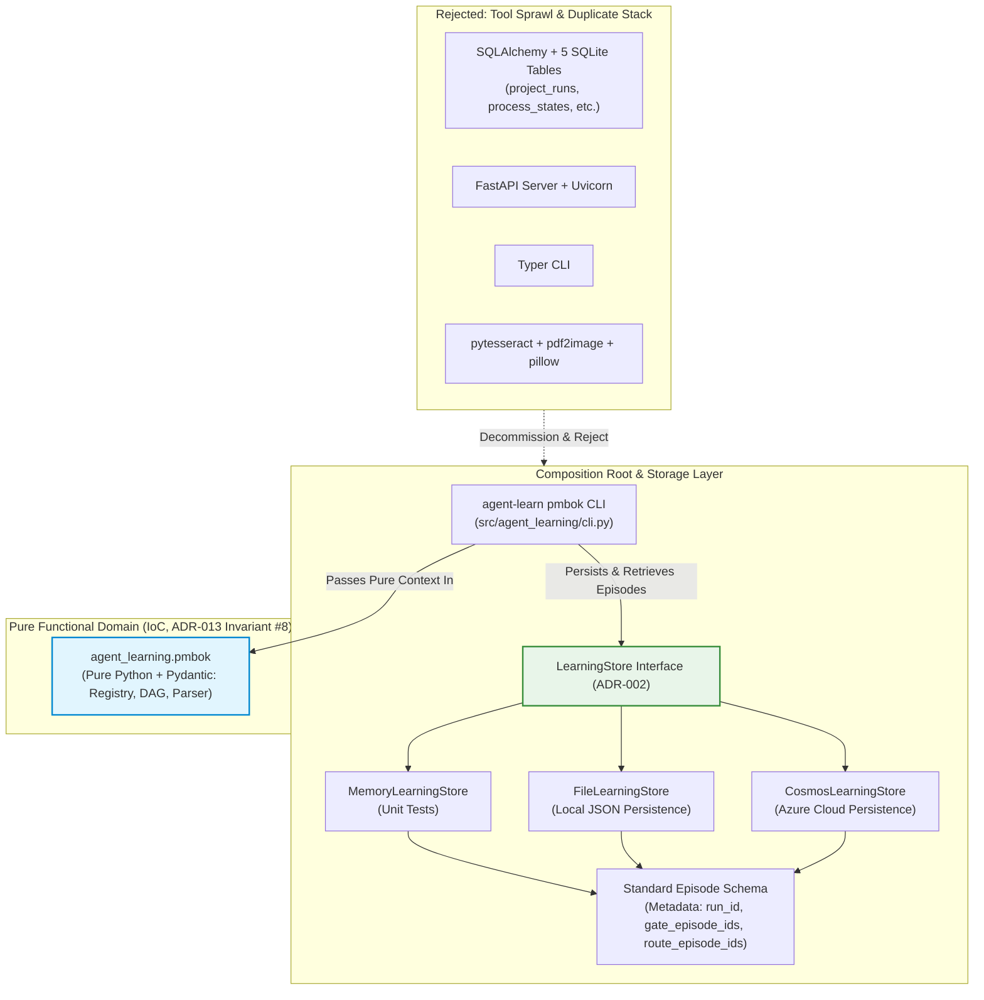

# ADR 034: PMBOK Tooling Decommissioning and Lightweight LearningStore Convergence

## 1. Executive Brief
Under **ADR-002** (Storage Backend Strategy) and **Pillar IV** (Software Engineering Integrity: Zero Entity Sprawl), all cognitive and project management states across the 18-stage intent-to-outcome lifecycle must be persisted exclusively through the standard `LearningStore` interface (`MemoryLearningStore`, `FileLearningStore`, `CosmosLearningStore`) as metadata-enriched `Episode` records.

In commit `a513470`, an 18,223-line monolithic subsystem was ingested into `pmbok/`. While intended to support **ADR-008** (PMBOK Lifecycle Orchestration), this monolith introduced a parallel, competing technology stack:
1. **Duplicate Database Engine:** `pmbok/storage/state_store.py` creates five bespoke SQLite tables (`project_runs`, `process_states`, `approval_gates`, `audit_records`, `artifact_indices`) via SQLAlchemy Core, directly violating ADR-002 Invariant #2.
2. **Heavy Undeclared Tooling:** It depends on heavy third-party packages (`sqlalchemy`, `fastapi`, `tenacity`, `typer`, `pydantic-settings`, `pytesseract`, `pdf2image`, `pillow`) that are not declared in `pyproject.toml`.
3. **Broken Test Collection:** Clean environment test runs fail during collection across 15 files in `tests/pmbok/`, forcing maintainers to permanently pass `--ignore=tests/pmbok` (documented as a known defect in **LL-013**).
4. **Duplicate Surface Area:** It introduces an unmaintained REST API (`pmbok/api/app.py`) and an unmaintained CLI (`pmbok/cli/main.py`), duplicating the repository's native `agent-learn` CLI.

This ADR formalizes the **prevention of tool sprawl and the convergence of PMBOK lifecycle orchestration onto the standard lightweight architecture**. We explicitly reject adding heavy ORMs, web servers, or OCR engines to the build. The legacy PMBOK persistence and service stack (SQLite, SQLAlchemy, FastAPI, Typer, and OCR tooling) is decommissioned, and all PMBOK orchestration states are migrated into standard `LearningStore` (Cosmos DB, Local File Store, Memory Store) `Episode` entities.

### Supersedes & Amends
* **Supersedes:** ADR-009 §4.13 by permanently decommissioning `pmbok/storage/state_store.py` rather than permitting a parallel local SQLite `StateStore`.
* **Amends:** ADR-008 §4.2, BRU-008-04, and Story 8.1 by eliminating references to `pmbok/api` and `pmbok/cli`.
* **Amends:** ADR-012 §4.2 by defining the formal standard-library-parseable frontmatter grammar subset (§4.2.1) and non-blocking `FLAG: INVALID_METADATA` parser rejection semantics.
* **Amends:** ADR-013 §4.1, §4.2, §4.10, and §9 by absorbing `scripts/orchestrate_pmbok.py` into `agent-learn pmbok <draft|approve|formalize|adapt>`, providing both single-plan (`--plan <plan-id>`) and batch interactive (`--all --interactive`) approval modes, and settling the open CLI flag-naming and verification query questions.

---

## 2. Status
**Proposed (2026-10-25)** — Architectural convergence and technical debt remediation. Governs Epic 12 (PMBOK Tooling Modernization and Storage Convergence).

---

## 3. Context & Problem Statement

### 3.1 The Ingestion Gap and Dependency Debt
When `pmbok/` was imported, it was developed in a loose virtual environment containing unpinned packages. Because `pyproject.toml` remained configured as a lightweight SDK (`numpy`, `pydantic`, `azure-identity`), executing `pytest` in a clean checkout fails immediately with 15 collection errors:
* `ModuleNotFoundError: No module named 'tenacity'` (in `pmbok/orchestrator/orchestrator.py`)
* `ModuleNotFoundError: No module named 'sqlalchemy'` (in `pmbok/storage/state_store.py`)
* `ModuleNotFoundError: No module named 'fastapi'` (in `tests/pmbok/test_api.py`)
* `ModuleNotFoundError: No module named 'yaml'` (in `pmbok/audit/policy_loader.py`)

Rather than addressing the architectural debt, development workflows masked the failure by hardcoding `--ignore=tests/pmbok` into test runners. As captured in **LL-013**:
> *"The implement-story skill requires 'the full suite passes', but 15 files under `tests/pmbok` cannot be collected from a clean install, so the command cannot pass... Keep the skill's validation command accurate: fix the cause or amend the command."*

### 3.2 Direct Violation of ADR-002 Invariant #2
ADR-002 explicitly established:
> **Invariant #2 (Strict Storage Boundary):** *"Zero new database tables, Cosmos DB containers, or custom entities. The entire 18-stage cognitive lifecycle is persisted within standard `LearningStore` interfaces as metadata-enriched `Episode` instances."*

`pmbok/storage/state_store.py` and `pmbok/storage/index.py` define five separate SQLite relational tables (`project_runs`, `process_states`, `approval_gates`, `audit_records`, `artifact_indices`) with foreign keys and custom schema migrations. This bifurcation fragments audit trails: governance gates recorded by `agent-learning` live in Cosmos DB / JSON files, while PMBOK process states live in an isolated SQLite database.

### 3.3 Redundant and Unused Capabilities
The `pmbok/` folder contains extensive scaffolding that provides zero utility to the agentic decision-making framework:
* **Embedded FastAPI server (`pmbok/api/app.py`):** The repository is an agentic SDK and CLI library, not a standalone web microservice. Repository-wide inspection (`git grep "pmbok.api"`, `git grep "pmbok.cli"`, and `git grep "FastAPI"`) confirmed exactly zero consumers or importers across `src/` or `scripts/`.
* **Redundant Typer CLI (`pmbok/cli/main.py`):** Conflicts with the canonical `argparse`-based `agent-learn` CLI.
* **OCR Ingestion (`pdf2image`, `pytesseract`, `pillow`):** Scanned PDF text extraction is an operational edge case that brings heavy native C-libraries (`tesseract`, `poppler`) into a pure Python library.

---

## 4. Technical Decision



### 4.1 Rejection of Heavyweight Tools (Zero Tool Sprawl)
No new runtime dependency may be added to `pyproject.toml` without an explicit ADR. Relational ORMs (`sqlalchemy`), web frameworks (`fastapi`), CLI frameworks (`typer`), retry libraries (`tenacity`), and OCR tools (`pytesseract`, `pdf2image`, `pillow`) are prohibited unless authorized through a superseding ADR with explicit architectural justification.

The core dependencies of `agent-learning` remain strictly limited to the lightweight baseline:
* `numpy>=1.24` (mathematical operations, Bayesian posteriors, bandit distributions)
* `pydantic>=2.0` (data contract validation)
* `azure-identity>=1.15` (Azure authentication)
* `azure-cosmos>=4.5` (optional extra: `[project.optional-dependencies] cosmos`)

For LLM generation and API calls, the CLI composition root uses standard library `urllib.request` (zero third-party dependencies) and provides the deterministic offline `--mock` client that ADR-013 depends upon for offline test suites.

### 4.2 Storage Convergence: PMBOK Lifecycle State as Episodes
All PMBOK process execution states, approval gate verdicts, and plan adaptation histories are unified under the standard `LearningStore` interface without modifying the core storage abstraction:

#### 4.2.1 Canonical PMBOK-to-Episode Data Model Mapping
PMBOK lifecycle concepts map directly to standard `Episode` attributes and `metadata` dictionaries:

| PMBOK Concept | `Episode` Representation | Schema Location & Semantics |
|---|---|---|
| **Project Run** | `Episode` instance | `agent_id: "pmbok-orchestration"`, `task_id: "pmbok-lifecycle-run"`, `action_type: "governance"`, `action_logprob: None` |
| **Phase / State** | `metadata["phase"]` | String identifier (`"Initiating"`, `"Planning"`, `"Executing"`, etc.) |
| **Process State** | `metadata["processes"]` | Dict mapping `process_id` (e.g. `"5.1"`) to status (`"not_started"`, `"in_progress"`, `"completed"`, `"failed"`) |
| **Approval Gate** | `metadata["gate_episode_ids"]` | Dict mapping plan or gate ID to `{"episode_id": str, "canonical_hash": str, "verdict": str}`. **Cross-reference only**: the authoritative records remain the individual gate Episodes under `agent_id: "agent-learning-governance"` (`approve-charter`, `approve-pmp`, `approve-subsidiary-plan`). |
| **Active Baseline** | `metadata["baseline_hash"]` | LF-normalized canonical SHA-256 hash of active `Project-Management-Plan.md` |
| **Tailoring Route** | `metadata["route_episode_ids"]` | Dict mapping plan ID to tailoring route `episode_id`. **Cross-reference only**: the authoritative records remain the route-decision Episodes under `agent_id: "agent-learning-governance"` (ADR-011). |
| **Audit Result** | `Episode.result_summary` | Summary of verification findings and gate recommendations |

#### 4.2.2 Append-Only State Transitions & Lookup Interface
* **Append-Only Immutability:** State changes (e.g. starting a process, completing a plan, recording a gate) append a new immutable `Episode` record. The current project state is derived deterministically from the latest episode matching the target `run_id`.
* **Learner Isolation:** All `pmbok-lifecycle-run` episodes carry `action_type: "governance"` and `action_logprob: None`. They are explicitly excluded from `ReinforceLearner` training batches and `historical_feedback` calculations, adhering to ADR-001 §4.3 and Story 1.1.
* **Lookup Interface for Run State:** Retrieving run state uses standard store queries:
  ```python
  runs = store.list_episodes(agent_id="pmbok-orchestration", task_id="pmbok-lifecycle-run")
  # Filter in memory by metadata["run_id"] and sort by timestamp
  latest_run = max((ep for ep in runs if ep.metadata.get("run_id") == run_id), key=lambda ep: ep.timestamp)
  ```
* **Lookup Interface for Plan Approval Verification (Resolving ADR-013 §9):** To verify whether a subsidiary plan holds an authoritative, non-stale human approval before PMP formalization, the composition root executes:
  ```python
  # 1. Query all approval episodes for this task
  approvals = store.list_episodes(
      agent_id="agent-learning-governance", 
      task_id="approve-subsidiary-plan"
  )
  # 2. Filter for target plan and sort descending by created_at (latest wins)
  plan_episodes = sorted(
      [ep for ep in approvals if ep.metadata.get("plan_id") == plan_id],
      key=lambda ep: ep.created_at,
      reverse=True
  )
  if not plan_episodes:
      raise GovernanceError(f"Plan {plan_id} has no recorded approval episodes.")

  latest_ep = plan_episodes[0]

  # 3. Verify human adjudication disposition, action, and canonical content hash
  is_approved = (
      latest_ep.action_id == "approve_plan"
      and latest_ep.metadata.get("decision_disposition") == "accepted"
      and latest_ep.execution_status == "completed"
      and latest_ep.metadata.get("canonical_content_hash") == current_disk_hash
  )
  if not is_approved:
      raise GovernanceError(f"Plan {plan_id} is not approved or hash mismatch.")

  # 4. Pure staleness verification over recorded upstream hashes
  recorded_upstream = latest_ep.metadata.get("upstream_hashes", {})
  for upstream_id, recorded_hash in recorded_upstream.items():
      current_upstream_hash = compute_canonical_plan_hash(read_plan_file(upstream_id))
      if current_upstream_hash != recorded_hash:
          raise StalenessError(f"Plan {plan_id} has stale upstream dependency {upstream_id}.")
  ```
* **Derived Lifecycle States (ADR-013 §4.6 Projection):** Plan governance states (`DRAFTED`, `UNDER_REVIEW`, `APPROVED`, `REVISION_REQUESTED`, `REJECTED`, `STALE_DEPENDENCY`, `REAPPROVAL_REQUIRED`) are pure derived projections calculated at query time from the latest `Episode` and current disk hashes, rather than mutable database records.

#### 4.2.3 Legacy State Migration Policy
No data migration from legacy SQLite files is required. As documented in ADR-013 §4.8 (Legacy Bootstrap Baseline Retained for Historical Traceability), baseline `PMP-BL-v1.0.0` was an unapproved stub draft, and no production baselines were ever committed under the legacy SQLite store. Any existing SQLite databases (`data/pmbok_runtime/*.db`) are discarded. No repository-supported runtime operation may create or depend upon SQLite database files (`*.db`).

### 4.3 Pure Functional PMBOK Core (`src/agent_learning/pmbok/`)
The valuable domain logic inside `pmbok/` (the 49-process registry, process input/output mappings, and adaptation graph traversal) is refactored into a pure internal package: `src/agent_learning/pmbok/`:
* **Inversion of Control (ADR-013 Invariant #8):** `agent_learning.pmbok` is a pure functional domain package. It **must not** import `agent_learning.store.LearningStore`. The CLI layer (`agent-learn pmbok`) serves as the composition root that reads state, calls pure functions, and writes resulting `Episode` records.
* **Domain Purity vs. Infrastructure I/O:** `agent_learning.pmbok` is strictly pure: zero database imports, zero network requests, and zero sleep calls. Exponential backoff and retries are implemented in the CLI composition root (`src/agent_learning/cli.py`) using Python standard library `time.sleep` with exponential backoff and jitter.
* **Legacy 6th-Edition Process Bridge:** The 49-process registry extracted into `src/agent_learning/pmbok/legacy_registry.py` provides backward compatibility with the 6th-edition process codes referenced in ADR-012's `legacy_process` metadata field. Full transition to the authentic PMBOK 8 40-process model (grouped under 5 focus areas and 7 performance domains) is scoped as a follow-on enhancement in future learning ADRs.
* **Deterministic Frontmatter Parsing & Fail-Closed Law:** Python stdlib has no native YAML parser. While policy configurations use standard JSON (`stdlib json`), ADR-012 mandates YAML frontmatter on markdown plans. `agent_learning.pmbok` implements a zero-dependency, deterministic frontmatter parser supporting the exact subset defined in ADR-012 §4.2.1 (flat string/enum keys, string lists, empty flow lists `[]`, inline comments, strict quoting). If a human-authored or generated plan contains unsupported YAML constructs, the parser does not crash with an unhandled exception; it emits `FLAG: INVALID_METADATA` with diagnostic line details. In accordance with ADR-012 §4.2.1 and ADR-013 §4.2, **unparseable frontmatter fails closed at gate review as a Tier A Technical Integrity Hard Block**, because `generator: stub|mock` cannot be audited and `strip_volatile_frontmatter` cannot compute a canonical content hash.
* **Decommissioning `pmbok/`:** Following migration of domain logic to `src/agent_learning/pmbok/`, the top-level `pmbok/` directory is permanently deleted.

### 4.4 CLI Singularity: Absorbing the Orchestrator
In accordance with Invariant 5, the legacy stand-alone script `scripts/orchestrate_pmbok.py` and the unused Typer CLI (`pmbok/cli/main.py`) are decommissioned. All orchestration capabilities are consolidated into the canonical `argparse` CLI:
```bash
agent-learn pmbok draft --charter <path> [--plan <plan-id>]
agent-learn pmbok approve [--plan <plan-id> | --all --interactive]
agent-learn pmbok formalize --baseline-id <id>
agent-learn pmbok adapt --adaptation-plan <path>
```
* **Batch Adjudication Protocol (ADR-013 §4.2 Parity):** When `agent-learn pmbok approve --all --interactive` is invoked, the command operates exclusively across plans routed as `full_plan` (embedded `pmp_section` drafts are evaluated at PMP formalization). The CLI displays an integrated dashboard of candidate plans, diffs, flags, and agent scores. While ergonomic review is consolidated to respect human channel capacity, **governance accountability remains strictly decoupled and per-plan**:
  - The atomic sign-off unrolls into discrete, isolated, cryptographically hashed `Episode` records in `LearningStore` per plan under `task_id: approve-subsidiary-plan`.
  - Batch sign-off requires a separate recorded non-empty rationale for every flagged plan in the batch, guaranteeing that batch reviews cannot bypass individual plan accountability or rationale requirements.
* **Post-Formalization Gate Dispatch:** Upon successful synthesis via `agent-learn pmbok formalize`, the CLI immediately prepares and surfaces the integrated governance gate:
  ```bash
  agent-learn task-policy-decide --agent-id agent-learning-governance --task-id approve-pmp
  ```
This directly resolves the open flag-naming and command-dispatch question in ADR-013 §9.

### 4.5 Orchestrator Realignment with Accepted Standards
The new CLI commands serve as the unified host harness that executes the accepted governance framework:
* **Tailoring Integration (ADR-011):** Ingests tailored routes (`full_plan`, `pmp_section`, `not_applicable`) from `agent_learning.tailoring`. Route decisions are approved under `approve-charter` or `approve-pmp`.
* **Universal 3-Section Contracts (ADR-012):** Validates the mandatory YAML frontmatter (with PMBOK 8 7-domain taxonomy), §1 Intent & Boundaries, §2 Domain Mechanics, and §3 Governance & Decision Rights. Enforces word-count floors and caps (with regex-checked structural headings).
* **Per-Plan Approval Gates (ADR-013):** Executes hash-verified `approve-subsidiary-plan` gates before permitting integrated PMP formalization, with transitive DAG staleness propagation.
* **Decision Progression Tracking (ADR-005):** Closed-loop adaptation re-planning evaluates pairwise comparison deltas ($\Delta \mathcal{U} > \epsilon$) to ensure every baseline amendment demonstrates `PROGRESSION` and zero regression.

---

## 5. Invariants

* **Invariant 1 (Dependency Purity):** No new runtime dependency may be added to `pyproject.toml` without an explicit ADR. Relational ORMs (`sqlalchemy`), web frameworks (`fastapi`), CLI frameworks (`typer`), retry libraries (`tenacity`), and OCR tools (`pytesseract`, `pdf2image`, `pillow`) are prohibited unless authorized through a superseding ADR with explicit architectural justification.
* **Invariant 2 (Strict Storage Boundary):** No repository-supported runtime operation may create or depend upon SQLite database files (`*.db`). All PMBOK lifecycle states, gate decisions, and adaptation records must be stored as `Episode` instances through `LearningStore` (ADR-002 Invariant #2).
* **Invariant 3 (Clean Test Suite Execution):** A default test invocation (`pytest`) on a clean environment must run 100% of the active test suite without collection errors or mandatory exclusion flags. Tests requiring optional extras (e.g. `azure-cosmos`, `pyspark`) must skip gracefully via `pytest.importorskip` or environment markers, never fail during collection.
* **Invariant 4 (Pure Functional PMBOK Core):** Modules in `agent_learning.pmbok` must rely solely on the Python standard library and `pydantic`. The domain package must never import `LearningStore` (ADR-013 Invariant #8) and must contain zero network I/O or sleep calls.
* **Invariant 5 (CLI Singularity):** The repository provides exactly one CLI entry point: `agent-learn` (`src/agent_learning/cli.py`). All PMBOK commands surface under `agent-learn pmbok ...`.
* **Invariant 6 (Audit-Data Minimalism):** `Episode.metadata` is strictly restricted to identifiers, hashes, route strings, and relative file paths. Under no circumstances may full plan markdown, Charter prose, or bulky document bodies be embedded in `Episode.metadata` or `Episode.result_summary`.

---

## 6. Implementation Phasing & Decommissioning Criteria

### 6.1 Four-Stage Implementation Sequencing (Epic 12)
To prevent interim instability, modernization follows a strict four-stage sequence:
1. **Phase 1 (Pure Domain Extraction):** Create `src/agent_learning/pmbok/` containing the 49-process registry, I/O schemas, DAG traversal, and the stdlib frontmatter parser. Verify with pure unit tests.
2. **Phase 2 (Composition Root & CLI):** Implement `agent-learn pmbok <draft|approve|formalize|adapt>` in `src/agent_learning/cli.py`, connecting the pure domain package to `LearningStore`.
3. **Phase 3 (Test Suite Porting):** Port valid behavioral tests (process graph validation, BABOK decomposition, audit scoring) to assert against `MemoryLearningStore`. Verify all ported tests pass green.
4. **Phase 4 (Decommissioning & Cleanup):** Delete `scripts/orchestrate_pmbok.py`, delete obsolete SQLite/FastAPI tests in `tests/pmbok/`, and delete the legacy `pmbok/` directory.

### 6.2 Auditable Completion Criteria
Epic 12 is complete when:
1. Zero files in the repository import from the legacy top-level `pmbok` package.
2. The legacy top-level `pmbok/` directory is permanently deleted.
3. `uv run pytest` runs 100% clean with zero `--ignore=tests/pmbok` flags and zero collection errors.
4. `agent-learn pmbok --help` executes cleanly.
5. PMBOK project run states are successfully inspected via `agent-learn task-episodes-list --agent-id pmbok-orchestration`.

---

## 7. Alternatives Considered

* **Alternative 1: Add all missing packages to `pyproject.toml` base dependencies.**  
  * *Rejected:* Drags heavy dependencies (`sqlalchemy`, `fastapi`, `uvicorn`, `tenacity`, `typer`, `pillow`, `pytesseract`) into an agentic reasoning SDK. Doubles package install size and introduces system binary dependencies (`tesseract`, `poppler`).
* **Alternative 2: Place the legacy monolith behind an optional extra (`[project.optional-dependencies] pmbok = [...]`).**  
  * *Rejected:* Preserves an unmaintained second database architecture (SQLite) and perpetuates entity sprawl. Masks structural rot rather than eliminating it.
* **Alternative 3: Rewrite `StateStore` using standard library `sqlite3` without SQLAlchemy.**  
  * *Rejected:* While `sqlite3` avoids third-party dependencies, maintaining a separate relational database directly violates ADR-002 Invariant #2, fragments audit trails away from Cosmos DB, and creates dual persistence logic.
* **Alternative 4: Completely remove PMBOK orchestration from the project.**  
  * *Rejected:* PMBOK orchestration is the foundational backbone of the 18-stage lifecycle (Stage 6 PMP formalization, Stage 17 adaptation, closed-loop cybernetics). The orchestration logic is load-bearing; only the bloated implementation stack must be replaced.
* **Alternative 5: Add `pyyaml` as a declared runtime dependency.**  
  * *Rejected:* Dragging in `pyyaml` adds a heavy C-extension compilation footprint for what is strictly a flat frontmatter key-value schema. Standard library parsing requires under 50 lines of deterministic pure Python code, implements the exact restricted grammar of ADR-012 §4.2.1, eliminates vulnerability exposure, and honors Invariant 1.

---

## 8. Consequences

### Positive
* **Zero Entity Sprawl:** Enforces ADR-002 Invariant #2; all lifecycle data lives in `LearningStore` and Cosmos DB.
* **Clean CI / Test Runner:** Resolves LL-013 permanently; eliminates `--ignore=tests/pmbok` hacks.
* **Lightweight Install:** Protects `agent-learning` as an embeddable, fast library.
* **Unified CLI:** Absorbs disparate scripts into `agent-learn`.

### Negative / Trade-Offs
* **Decommissioned Surface:** The embedded FastAPI server and OCR ingestion are permanently removed. (Acceptable: zero consumers exist).
* **Refactoring Burden:** Requires executing the 4-phase Epic 12 migration.

---

## 9. Amendment Log

| Date | Author | Description |
|---|---|---|
| 2026-10-25 | Menno Drescher / Antigravity | Initial draft proposing the decommissioning of the legacy SQLite/FastAPI PMBOK monolith and converging all PMBOK state onto `LearningStore` (Cosmos DB and File Store). |
| 2026-10-25 | Menno Drescher / Antigravity | Addressed comprehensive multi-LLM review: renumbered from ADR-028 to ADR-034 to prevent daughter plan collision; added explicit supersedes clause for ADR-009 §4.13 and ADR-008; corrected CLI composition root diagram per ADR-013 Invariant #8; aligned tailoring route episodes per ADR-011; defined stdlib frontmatter parser strategy; added canonical PMBOK-to-Episode mapping table; defined auditable completion criteria. |
| 2026-10-25 | Menno Drescher / Antigravity | Addressed final peer review polishes: (1) amended ADR-012 §4.2 by defining the formal standard-library frontmatter grammar subset (§4.2.1) and non-blocking `FLAG: INVALID_METADATA` parser rejection behavior; (2) made gate and route episodes authoritative under `agent-learning-governance` with run episodes holding ID/hash cross-references; (3) codified explicit `LearningStore` query interfaces for run states and hash-matching gate verifications (resolving ADR-013 §9); (4) added batch approval CLI command parity `approve [--plan <plan-id> | --all --interactive]` unrolling per-plan accountability (ADR-013 §4.2); (5) decoupled LLM retries into stdlib exponential backoff helper; (6) softened Invariant 1 blacklist phrasing. |
| 2026-10-25 | Menno Drescher / Antigravity | Addressed Architecture Board final review: (1) codified fail-closed law for unparseable frontmatter as Tier A hard block at gate evaluation (ADR-012 §4.2.1); (2) updated approval verification query to enforce human-adjudicated disposition (`decision_disposition: accepted`), latest-wins ordering (`created_at`), and upstream staleness check; (3) designated 49 processes as Legacy 6th-Edition Process Bridge mapped to ADR-012 `legacy_process`; (4) specified stdlib `urllib.request` / `--mock` LLM client and moved backoff to CLI infrastructure; (5) added Invariant 6 (Audit-Data Minimalism); (6) added Alternative 5 (`pyyaml` rejection rationale); (7) verified zero consumers of `pmbok.api` via repo search. |

