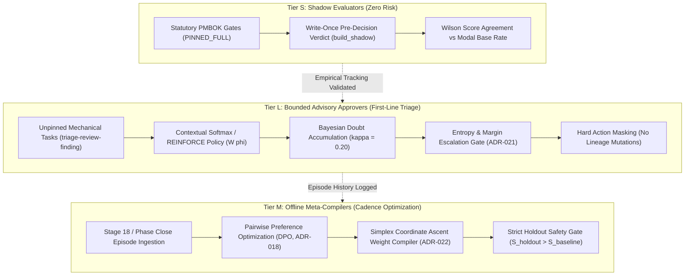

# ADR 041: Progressive Shadow Evaluation and Bounded Advisory Integration in SIDPA Governance

## 1. Executive Brief
ADR-039 established the shadow-gate contract (write-once `Episode.metadata`, agreement against base rate using Wilson lower bounds) and the review-finding corpus (reconstructed Amazon Q triage findings). However, ADR-039 bounded its scope to reference baseline predictors (`ModalPredictor`, `ClaimTypePredictor`) and deferred active learning policies. 

This ADR captures the architectural extensions identified during the SIDPA governance methodology review. It defines a **progressive graduation ladder** and a **three-tier operational model** (Shadow Evaluators, Bounded Advisory Approvers, and Offline Meta-Compilers) that allows learning methodologies (such as Thompson Sampling, Contextual Softmax, DPO, and Simplex Weight Compilation) to safely advise governance processes without eroding sovereign human oversight on statutory PMBOK approval gates.

## 2. Status
**Draft (2026-11-10)** — Held in Draft state during Phase 2 stage-gate closure. Extends ADR-039 and operationalizes downstream governance integration pathways for Phase 3.

---

## 3. Context & Problem Statement
- **ADR-039 stops at baseline characterization.** ADR-039 §4.3 and FDD-039 §3.6 restrict Epic 39 to reference baseline predictors. Active policy adapters (#2 REINFORCE, #9 Thompson Sampling, #38 Contextual Bandit) were explicitly deferred to follow-on work once baseline predictability on the review corpus is measured.
- **The Sovereign Human Gate Invariant (`PINNED_FULL`).** Sixteen statutory PMBOK governance tasks (such as `approve-adr`, `approve-pmp`, `approve-adaptation-plan`, `approve-user-stories`, `approve-project-pillars`) are hard-pinned to `DecisionAuthority.FULL` (`requires_human_approval: true`). Autonomous agent execution on these gates is permanently barred.
- **The Need for a Graduation Pathway.** Without an explicit architectural pathway, there is no defined mechanism for a learner to graduate from passive retrospective scoring into prospective shadow evaluation, and subsequently into bounded advisory assistance on high-volume, non-statutory tasks (e.g., preliminary PR review comment triage).
- **Scope Boundary Separation.** Clarification is required between *project implementation work* (engineering backlog stories like Epic 39) and *governance baseline amendments* (Stage 16 changes to ADR-036 or ADR-021). Furthermore, cross-repository propagation to `sidpa-template` must follow formal Tier 3 propagation protocols rather than ad-hoc code edits.

---

## 4. Decision

### 4.1 Three-Tier Governance Integration Architecture



1. **Tier S — Shadow Evaluators (Zero Risk, Sovereign Gates):**
   - Operates across all `PINNED_FULL` gates and high-stakes reviews.
   - Evaluates the decision context and records `build_shadow` write-once in `Episode.metadata` *strictly before* the human decision.
   - Evaluated against the human modal-action base rate using the Wilson lower bound (`autonomy.wilson_lower_bound`).
   - Invariant: A Tier S shadow learner **never acts, never approves, and never halts execution**.

2. **Tier L — Bounded Advisory Approvers (First-Line Triage):**
   - Applies solely to unpinned, non-statutory, high-volume tasks (e.g., preliminary triage recommendations for linter and reviewer comments under `triage-review-finding`).
   - Employs contextual feature representations $W \phi(x)$ (Epic 38) and structured critique delta grammar (ADR-014).
   - Ingests reviewer critique tags to accumulate Bayesian doubt $\kappa = 0.20$. If accumulated doubt exceeds threshold, status immediately flips to `NEEDS_USER_FEEDBACK`.
   - Bounded by ADR-021 authority routing: if Shannon entropy $H \ge \tau_{\text{esc}}$ or decision margin $\Delta p \le \epsilon_{\text{margin}}$, the decision halts for sovereign human resolution.
   - Enforces hard action masking: actions altering architectural lineage (e.g., `new_superseding_adr`, `pending_supersession_note`) are masked with $-\infty$ logits.

3. **Tier M — Offline Meta-Compilers (Cadence Optimization):**
   - Executes offline during Stage 18 Intent Refinement or Phase Close ceremonies.
   - Fits pairwise preference models (DPO / Bradley-Terry, ADR-018) from human review overrides without requiring scalar reward engineering.
   - Optimizes multicriteria classification weights and escalation thresholds on the probability simplex $\sum w_i = 1.0$ using coordinate ascent (ADR-022).
   - Governed by a strict holdout safety gate: configuration updates are rejected unless holdout validation score strictly exceeds baseline ($S_{\text{holdout}} > S_{\text{baseline}}$).

---

### 4.2 The Progressive Graduation Ladder

A learning methodology must pass three sequential gates before assuming any advisory or triage responsibility:

```
[ Gate 1: Retrospective Corpus Benchmark ]
   │  - Must statistically beat ClaimTypePredictor on ADR-039 corpus.
   ▼
[ Gate 2: Prospective Shadow Evaluation ]
   │  - Must achieve status: "tracks" against modal base rate (Wilson bound, n >= 20).
   ▼
[ Gate 3: Formal Stage 16 Governance Review ]
   │  - Human sponsor approval; formal amendment to task authority.
   ▼
[ Active Tier L Bounded Advisory Deployment ]
```

1. **Gate 1 (Retrospective Corpus Benchmark):** The candidate learner must be evaluated on the ADR-039 review-finding corpus using the causal time-ordered protocol ($0..i-1$). It must demonstrate statistically significant improvement over `ClaimTypePredictor`.
2. **Gate 2 (Prospective Shadow Evaluation):** The candidate learner must be deployed as a Tier S shadow evaluator in `implement-story` Step 8. It must record prospective shadow verdicts across at least $n \ge 20$ live episodes and achieve `status: "tracks"` under the Wilson lower bound rule without triggering stability warnings.
3. **Gate 3 (Formal Stage 16 Governance Review):** Achieving tracking status does not grant autonomous execution. Enabling an advisory or first-line triage role requires a formal Stage 16 governance change (amending ADR-036/ADR-021) accepted by the repository maintainer.

---

### 4.3 Governance Lifecycle Boundary & Cross-Repository Propagation

1. **Project Backlog vs. Governance Baseline:**
   - Implementation of shadow recording infrastructure (Epic 39, Stories 39.1–39.6) constitutes engineering backlog execution within `agent_learning_ext`. It does not modify governance authorities.
   - Any modification to task authority or approval flags (`requires_human_approval`) is a Stage 16 governance amendment.
2. **`sidpa-template` Propagation Protocol:**
   - In accordance with ADR-010, ADR-036, and Story 39.6 $AC_5$, `sidpa-template` is **never edited directly** during story implementation in `agent-learning`.
   - Proven patterns and skill updates are formulated as Tier 3 proposals in the Lessons Learned Register (`docs/project-docs/Lessons-Learned-Register.md`) and propagated to `sidpa-template` as a unified sync following Phase Close.

---

## 5. Architectural Invariants

1. **Sovereign Gate Immutability:** Statutory PMBOK approval gates (`PINNED_FULL`) remain permanently under human authority. Agents recommend, critique, and advise; humans adjudicate.
2. **Mandatory Escalation on Uncertainty:** Any decision where entropy $H \ge \tau_{\text{esc}}$ or margin $\Delta p \le \epsilon_{\text{margin}}$ halts immediately for human feedback.
3. **Hard Action Masking:** Destructive or lineage-altering actions are physically masked from learner policy distributions.
4. **Causal Separation of Evidence:** Retrospective corpus evaluations are labeled `retrospective` and can never be counted as prospective shadow-gate evidence.
5. **Strict Holdout Safety Gating:** Meta-compiled configurations must demonstrate strict validation improvement on held-out episodes before adoption.

---

## 6. Alternatives Considered

1. **Direct Autonomous Gate Execution:** Letting calibrated learners auto-approve low-risk gates.  
   *Rejected:* Directly violates ADR-001, ADR-003, and the fundamental human-decide governance principle.
2. **Unbounded Online Learning:** Allowing policy weights to update online during live story execution.  
   *Rejected:* Introduces non-stationarity and catastrophic drift. All policy and weight updates must be batched, evaluated offline, and holdout-verified.
3. **Heuristic Rule-Based Triage:** Hardcoding keyword heuristics for review comment triage.  
   *Rejected:* Fails to learn from nuanced human reviewer feedback and cannot adapt across evolving codebases.

---

## 7. Consequences

### Positive
- Provides a mathematically sound, risk-free graduation path for learning algorithms from historical data to live advisory roles.
- Protects statutory governance integrity by permanently insulating `PINNED_FULL` gates from autonomous usurpation.
- Establishes a concrete, closed-loop integration bridge between `agent-learning` capabilities and `sidpa-template` orchestration.

### Negative
- Requires maintaining shadow evaluation telemetry and Wilson bound tracking across live story cycles.
- Progression through the 3-gate graduation ladder requires disciplined human oversight and patience before advisory benefits are realized.

---

## 8. Open Questions
1. **Feature Vector Standardization:** What exact feature schema $\phi(x)$ should be standardized for `triage-review-finding` context encoding across different review tools (Amazon Q, Cursor, human reviewers)?
2. **Doubt Decay Half-Life:** Should accumulated Bayesian doubt $\kappa$ decay across long, multi-story implementation cycles, or remain strictly cumulative until formal review?

---

## 9. Amendment Log

| Date | Status | Change Description |
|---|---|---|
| 2026-11-10 | **Draft** | Initial drafting based on SIDPA governance methodology review findings; formalizes the progressive shadow graduation ladder and three-tier operational architecture extending ADR-039. |
