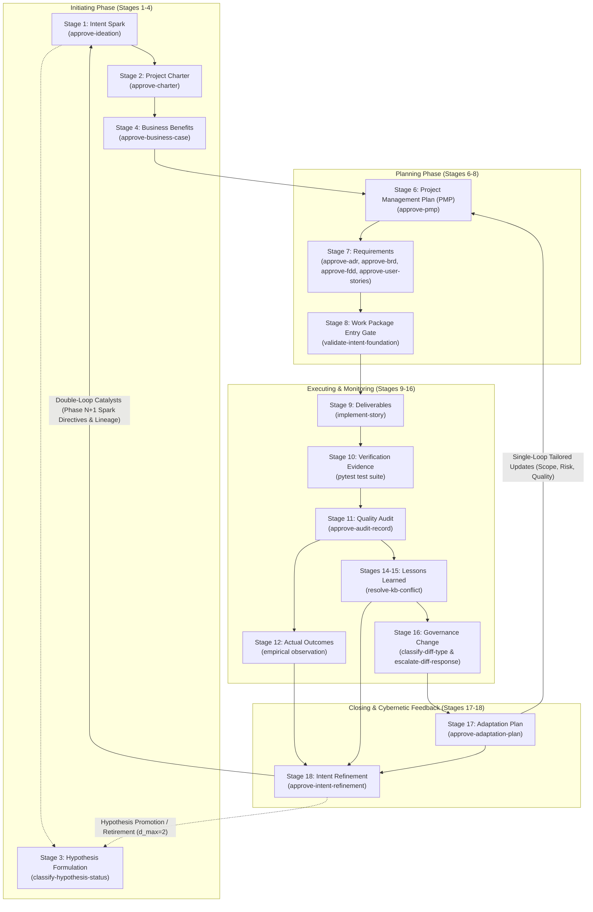

# Architecture Decision Records (ADRs) — The Self-Governing Agent Engine

This repository (`agent-learning`) is a **self-governing, self-stabilizing cybernetic learning engine**. Its architectural principles, development baselines, and cognitive evolution are decided, recorded, and verified by its own native `TaskPolicy` governance chain (`agent-learning-governance`).

Every architectural transition across the 18-stage **Intent-to-Outcome Chain** (`PROJECT-MANAGEMENT-ONTOLOGY.json`) is codified as an Architecture Decision Record (ADR), evaluated via Bayesian multi-criteria decision reasoning, and permanently registered in the institutional learning store.

---

## 1. The Four-Pillar Architectural Manifesto

The architectural corpus (ADR-001 through ADR-013) rests upon **four mutually counterweighting pillars**. No single pillar operates in isolation; each acts as a structural counterweight to the failure modes of the others.

```
                     ┌────────────────────────────────────────┐
                     │          GOVERNANCE PILLAR             │
                     │  Sovereignty, Decision Authority &     │
                     │  Locked Human-in-the-Loop Sign-Off     │
                     └───────▲────────────────────────▲───────┘
                             │                        │
       Governance bounds     │                        │   Governance bounds
       Mathematical drift    │                        │   Cybernetic action
                             │                        │
  ┌──────────────────────────┴─────┐            ┌─────┴──────────────────────────┐
  │      MATHEMATICAL PILLAR       │            │       CYBERNETICS PILLAR       │
  │  Bayes Factors, Low-Pass       │◄──────────►│  Double-Loop Feedback, Beer    │
  │  Damping, d_max=2 Exhaustion   │    Math    │  VSM Homeostasis, Single-Loop  │
  └──────────────────────────▲─────┘ disciplines│  Tailoring (PMBOK 8 Processes) │
                             │       Cybernetics└─────▲──────────────────────────┘
                             │                        │
                             │                        │
                             │   Engineering bounds   │
                             │   both Math & State    │
                             │                        │
                     ┌───────┴────────────────────────┴───────┐
                     │          ENGINEERING PILLAR            │
                     │  Strict Pydantic Contracts, Zero       │
                     │  Storage Sprawl, Episode Envelope Law  │
                     └────────────────────────────────────────┘
```

### Pillar I: Sovereign Governance (Authority without Human Bottlenecks)
- **Two-Route Authority Model (ADR-001):** High-frequency tactical choices run on fast contextual reinforcement learning (`low`), while strategic, baseline-altering choices require reasoned multi-criteria Bayesian evaluation (`full`).
- **Permanent Inviolability:** Critical governance decision gates (`approve-adr`, `approve-brd`, `approve-fdd`, `approve-user-stories`, `approve-pmp`, `approve-adaptation-plan`, `approve-intent-refinement`) permanently enforce `requires_human_approval: true`. Autonomous process agents recommend and quantify, but human leadership retains sovereign authority.
- **Complexity-Proportional Autonomy (ADR-003):** Progression from reasoned oversight to learned autonomy is strictly gated by Wilson score lower-bound correctness intervals and drift-audit sampling across explicit complexity tiers.

### Pillar II: Cybernetic Homeostasis (Double-Loop Feedback & Stafford Beer VSM)
- **Closed-Loop Lifecyle Closure (ADR-007, ADR-008, ADR-009):** The lifecycle does not terminate at delivery. It closes the cognitive loop from Stage 12 Actual Outcomes and Stage 15 Lessons Learned back to Stage 1 Spark and Stage 3 Hypotheses.
- **Single-Loop vs. Double-Loop Separation:** Stage 17 (`Adaptation-Plan.md`) provides single-loop operational adaptation by tailoring the 9 PMBOK subsidiary plans within existing baselines. Stage 18 (`Intent-Refinement-Proposal.md`) provides double-loop strategic learning by questioning whether foundational goals, business benefits, and hypotheses must evolve.
- **Viable System Model (VSM) Balance:** System 1 (Execution) is coordinated by System 2 (PMP), stabilized by System 3 (Adaptation), informed by System 4 (Intent Refinement), and governed by System 5 (Human Leadership Policy).

### Pillar III: Mathematical Rigor (Disciplining Epistemic Drift)
- **Bayesian Hypothesis Adjudication (ADR-009):** Hypotheses are resolved by empirical Bayes factors ($BF_{10} \ge 10 \implies \text{VALIDATED}$, $BF_{10} \le 0.1 \implies \text{REFUTED}$).
- **Bounded Recurrence Exhaustion ($d_{\max}=2$):** Eliminates defensive hypothesis mutation (the "REFINED moral hazard"). At depth $d=2$, refinement is prohibited: hypotheses must collapse to `VALIDATED` if $BF_{10} \ge 10$ or default to `REFUTED` if $BF_{10} < 10$.
- **Low-Pass Whiplash Filter:** Exponential momentum smoothing ($\mathbf{\Theta}_{N+1} = \beta \mathbf{\Theta}_{N} + (1 - \beta) \nabla \mathcal{L}$) with $\beta \in [0.6, 0.85]$ and bias-corrected warmup ($1 - \beta^N$) anchors the cognitive feedback loop against sprint-level noise.
- **Stateless Decision-Progress Comparison (ADR-005):** Pure mathematical classification of decision quality deltas ($\Delta \mathcal{U} > \epsilon$) across paired decision frames without state corruption.

### Pillar IV: Software Engineering Integrity (Contracts & Zero Sprawl)
- **Strict Storage Boundary (ADR-002 Invariant #2):** Zero new database tables, Cosmos DB containers, or custom entities. The entire 18-stage cognitive lifecycle is persisted within standard `LearningStore` interfaces as metadata-enriched `Episode` instances.
- **Runtime Pydantic Validation:** Every governance artifact (`IntentRefinementProposalPayload`, `PMP`, `AdaptationPlan`) is validated at runtime before any decision gate can evaluate it.
- **Cumulative Hereditary Lineage Kernel:** Preserves root spark IDs, parent refinements, and immutable invariants across project handoffs, eliminating generational amnesia.
- **Lightweight Evidence Transport (ADR-006):** Captures lightweight audit evidence for `low`-authority decisions with strict SDK non-interpretation to prevent telemetry leakage into reinforcement learners.

---

## 2. Cross-Pillar Structural Counterweight Matrix

| Pillar | Counterweights Failure Mode In | Structural Counterweight Mechanism |
|---|---|---|
| **Engineering** $\to$ | **Governance & Cybernetics** | Enforces ADR-002's five-record-type storage boundary and ADR-005's stateless comparison design. Prevents an 18-stage loop from collapsing under schema sprawl, bespoke database tables, and unmaintainable state machines. |
| **Mathematical** $\to$ | **Cybernetics** | Disciplines double-loop learning and S3–S4 feedback. Hard Bayes factor thresholds ($BF_{10} \ge 10$ / $\le 0.1$), the $d_{\max}=2$ recurrence ceiling, and low-pass momentum filtering ($\beta \in [0.6, 0.85]$) convert soft organizational theory into a stable, bounded control system. |
| **Governance** $\to$ | **Mathematical & Cybernetics** | Enforces sovereign human agency. Even when an action wins decisively on utility ($\Delta \mathcal{U} > \epsilon$) or crosses a 95% Wilson lower bound, locked human sign-off (`requires_human_approval: true`) prevents statistical confidence from usurping human authority over architecture, baselines, or strategic intent. |
| **Cybernetics** $\to$ | **Engineering** | Prevents software delivery from becoming a dead-end, terminal waterfall pipeline. Connects lessons learned and realized outcomes directly into living operational baselines and catalytic directives. |

---

## 3. The Accepted ADR Corpus

Every ADR in this table is formally **Accepted** by Menno Drescher. ADR-001 through ADR-013 are the foundational corpus; later ADRs were added to the table as they were accepted. ADR-001 through ADR-009 and ADR-011 were evaluated via Bayesian decision policy through the live `agent-learning-governance` chain; ADR-010 was approved by Menno directly (see its §2).

ADR-014 to ADR-023 are the ten learning-method designs (Thompson sampling, UCB, epsilon-greedy, pairwise preference, meta-priors, warm-starting, authority routing, scored search, dueling-bandit ranking, and critique-to-evidence). They were accepted on 2026-10-28 **as designs only**: none is built, and the gaps named in each ADR's code-design section stay open. For how to run the sketches that illustrate them, see [`docs/learning-methodology-walkthroughs.md`](../learning-methodology-walkthroughs.md). ADR-024 selects among them per use case.

| ADR | Title | Status | Intent-to-Outcome Stage & PMBOK 8 Process | Core Architectural Decision |
|---|---|---|---|---|
| [**ADR-001**](ADR-001-decision-authority-model.md) | Decision Authority Model — Learned vs. Reasoned Resolution | **Accepted** | Stage 7 (Requirement)<br>5.3 Define Scope | Dual-route selection (`low` reinforcement learning vs. `full` Bayesian decision theory) converging on common `DecisionResult`/`Episode` lineage. |
| [**ADR-002**](ADR-002-storage-backend-strategy.md) | Storage Backend Strategy — Local File, In-Memory, and Cosmos DB | **Accepted** | Cross-Cutting Storage<br>ADR-002 Invariants | Single abstract `LearningStore` interface with 3 interchangeable backends; strictly limits storage to five core record types with zero bespoke entity sprawl. |
| [**ADR-003**](ADR-003-evidence-gated-autonomy-thresholds.md) | Evidence-Gated Autonomy — Complexity-Proportional Thresholds | **Accepted** | Stage 16 (Governance)<br>4.6 Integrated Change | Wilson score lower-bound correctness intervals, complexity tiers (T1–T4), and drift-audit sampling governing autonomy transitions. |
| [**ADR-004**](ADR-004-authority-migration-comparison-not-replay.md) | Authority-Migration History — A Forward Comparison Snapshot, Not a Retroactive Replay | **Accepted** | Cross-Cutting (Authority Migration)<br>ADR-001 §4.3 | No retroactive replay of historical `low`-authority episodes; a frozen `MigrationRecord` inside `PolicySnapshot.metadata` is captured on each authority transition instead. |
| [**ADR-005**](ADR-005-decision-progress-comparison.md) | Decision-Progress Comparison and Regression Healing | **Accepted** | Stage 10 (Verification)<br>8.3 Control Quality | Pure, stateless mathematical comparison of decision quality deltas ($\Delta \mathcal{U} > \epsilon$), pairwise classification, and regression healing. |
| [**ADR-006**](ADR-006-opt-in-lightweight-evidence-capture-for-low-authority.md) | Opt-In Lightweight Evidence Capture for Low-Authority Decisions | **Accepted** | Stage 10 (Verification)<br>8.3 Control Quality | Opt-in metadata flag and non-interpreting evidence envelope transport for low-authority bandit decisions without reward leakage. |
| [**ADR-007**](ADR-007-governance-change-paired-diff-classification-and-escalation.md) | Automated Governance Change: Paired Semantic Diff Classification and Escalation Learning | **Accepted** | Stage 16 (Governance)<br>4.6 Integrated Change | Paired architecture: full-authority semantic classification (`classify-diff-type`) and low-authority operational escalation learning (`escalate-diff-response`). |
| [**ADR-008**](ADR-008-pmbok-lifecycle-orchestration-and-pmp-adaptation-loop.md) | PMBOK 8 Lifecycle Orchestration and Closed-Loop Adaptation Feedback | **Accepted** | Stage 6 (PMP) & Stage 17 (Adaptation)<br>4.2 Develop PMP & 4.6 Tailoring | In-repo PMBOK orchestration of 9 subsidiary plans, dedicated `approve-pmp` / `approve-adaptation-plan` gates, and targeted `--mode adapt` re-planning. |
| [**ADR-009**](ADR-009-intent-refinement-and-cognitive-feedback-loop.md) | Intent Refinement and Cognitive Feedback Loop | **Accepted** | Stage 18 (Intent Refinement)<br>4.7 Close Project or Phase | Double-loop cognitive feedback closing outcomes to spark; Bayes factor hypothesis retirement ($d_{\max}=2$); low-pass whiplash filter; cumulative lineage kernel. |
| [**ADR-010**](ADR-010-lessons-learned-crystallization-and-register.md) | Lessons Learned Crystallization and the Organizational Process Assets Register | **Accepted** | Post-coding recap (separate from Stage 15)<br>Feeds Phase Close readiness (4.7) | Light breakout recap held once per epic after its last user story, on how the code was created from the stories, recorded in `docs/project-docs/Lessons-Learned-Register.md` as `LL-###` entries or a short no-new-lessons sign-off entry. Tier 2/3 propagation (component skills, universal memory) is optional. An Autonomous Breakout Facilitator (draft-and-propose only, human approval for entries and cross-repo actions) is permitted but not built. |
| [**ADR-011**](ADR-011-project-tailoring-and-route-decision.md) | Project Tailoring and Route Decision | **Accepted** | Stage 17 (Adaptation, tailoring) & Stage 18 (Intent Refinement)<br>PMBOK 8 2.1.6.2, 2.1.7 | A route per management plan (full plan, PMP section, or not applicable), decided by a human with the system recommending; floors and caps as flags; the Charter sets limits and holds the integration section when it defines it; depth changes follow Stage 17, standard changes Stage 18. Wider design kept in `docs/design-notes/`. |
| [**ADR-012**](ADR-012-subsidiary-management-plan-standards-and-content-contracts.md) | Subsidiary Management Plan Standards and Content Contracts | **Accepted** | Stage 6 (PMP Formalization)<br>PMBOK 8 Planning Focus Area | Universal 3-section content contract (Intent, Mechanics, Governance & Decision Rights), YAML frontmatter schema, deterministic floor/cap regex linting flags, PMBOK 8 7-domain bridge, and decoupled daughter plan ADR hierarchy starting at ADR-025. |
| [**ADR-013**](ADR-013-subsidiary-plan-approval-gates-before-pmp-formalization.md) | Subsidiary Plan Approval Gates Before PMP Formalization | **Accepted** | Stage 6 (PMP Formalization)<br>PMBOK 8 4.2 Develop PMP | Inserts route-aware per-plan approval gates (`approve-subsidiary-plan`) between drafting and formalization; canonical content hashing (LF-normalized); transitive STALE_DEPENDENCY status propagation bounded to DAG branches; explicit plan governance state machine; separation of plan-level vs. integration-level defects; IoC module decoupling. |
| [**ADR-014**](ADR-014-critique-to-evidence-ingestion.md) | Lightweight Critique-to-Evidence Ingestion | **Accepted** | Cross-Cutting Learning Policy<br>Ideation §2.1 Methodology #8 | Maps tagged reviewer findings to bounded, auditable changes in decision evidence; no model weights change. (design only, not built) |
| [**ADR-015**](ADR-015-bayesian-bandit-posterior-sampling.md) | Bayesian Bandit Posterior Sampling (Thompson Sampling) | **Accepted** | Cross-Cutting Learning Policy<br>Ideation §2.1 Methodology #9 | Beta posterior sampling with a recorded 64-bit seed, so exploration is replayable, and a cap on the effective sample size. (design only, not built) |
| [**ADR-016**](ADR-016-deterministic-ucb-decision-policy.md) | Deterministic Upper Confidence Bound (UCB) Decision Policy | **Accepted** | Cross-Cutting Learning Policy<br>Ideation §2.1 Methodology #10 | Deterministic upper-confidence-bound policy (standard and Wilson variants) with fixed tie-breaks and no random numbers. (design only, not built) |
| [**ADR-017**](ADR-017-scheduled-epsilon-greedy-policy.md) | Scheduled Epsilon-Greedy Policy Baseline | **Accepted** | Cross-Cutting Learning Policy<br>Ideation §2.1 Methodology #11 | Epsilon-greedy baseline with a decaying rate, a reversible-action mask, replayable exploration and a logged branch. (design only, not built) |
| [**ADR-018**](ADR-018-pairwise-preference-optimization.md) | Pairwise Preference Optimization for Discrete Action Logits | **Accepted** | Cross-Cutting Learning Policy<br>Ideation §2.1 Methodology #13 | Bradley-Terry fit of action logits from human overrides, anchored to a reference policy. (design only, not built) |
| [**ADR-019**](ADR-019-hierarchical-meta-prior-compilation.md) | Hierarchical Meta-Prior Compilation Across Task Families | **Accepted** | Cross-Cutting Learning Policy<br>Ideation §2.1 Methodology #14 | Pools converged policies of one family into a role-indexed meta-prior, with a heterogeneity check and ADR-003 gate separation. (design only, not built) |
| [**ADR-020**](ADR-020-explicit-policy-prior-warm-starting.md) | Explicit Policy Prior Warm-Starting | **Accepted** | Cross-Cutting Learning Policy<br>Ideation §2.1 Methodology #15 | Warm-starts a new policy from a donor policy through an explicit action map and damping; never counts as scored outcomes. (design only, not built) |
| [**ADR-021**](ADR-021-contextual-authority-ensemble-routing.md) | Contextual Authority Ensemble Routing | **Accepted** | Cross-Cutting Learning Policy<br>Ideation §2.1 Methodology #17 | Routes each request to low or full authority by entropy, margin and tier; lifecycle gates stay full; a starvation guard lets contexts graduate. (design only, not built) |
| [**ADR-022**](ADR-022-scored-search-decision-compilation.md) | Scored-Search Decision Configuration Compilation | **Accepted** | Cross-Cutting Learning Policy<br>Ideation §2.1 Methodology #22 | Offline, holdout-validated search of criteria weights against human labels; frozen at runtime and adopted only by a human. (design only, not built) |
| [**ADR-023**](ADR-023-active-dueling-bandit-ranking-engine.md) | Active Dueling-Bandit Ranking Engine | **Accepted** | Cross-Cutting Learning Policy<br>Ideation §2.1 Methodology #23 | Active pairwise ranking with a Bradley-Terry fit and Laplace variance, and a minimum exposure per item. (design only, not built) |
| [**ADR-025**](ADR-025-scope-management-plan-standard-and-baseline-contract.md) | Scope Management Plan Standard and Baseline Contract | **Accepted** | Stage 6 (Planning)<br>PMBOK 8 Planning (Legacy 5.1) | Primary Baseline-Substantiating Plan contract: mandatory in-scope and out-of-scope boundaries, WBS decomposition rules, deliverable acceptance DoD, and transitive DAG invalidation down to Schedule and Cost. |
| [**ADR-034**](ADR-034-pmbok-tooling-decommissioning-and-lightweight-learningstore-convergence.md) | PMBOK Tooling Decommissioning and Lightweight LearningStore Convergence | **Accepted** | Stage 6 & Stage 17 Tooling<br>PMBOK 8 Orchestration (ADR-002) | Rejects tool and dependency sprawl (SQLAlchemy, FastAPI, Typer, OCR); decommissions the legacy SQLite monolith; converges PMBOK state onto standard LearningStore (Cosmos DB / File) as Episode entities; pure functional domain core in `agent_learning.pmbok` and runtime harness in `agent_learning.pmbok_runtime`. |
| [**ADR-024**](ADR-024-learning-methodology-selection-chain.md) | Learning Methodology Selection Chain | **Accepted** | Cross-Cutting Learning Policy<br>PMBOK 8 2.1.6.2 Tailoring | Human-declared use-case profiles, deterministic precondition filtering across 32 learning methodologies, maturity ranking recommendation, and metadata-recorded selections. |
| [**ADR-036**](ADR-036-learning-methodology-examples-ledger-and-review-triage-loop.md) | Learning Methodology Examples, Best-Practice Ledger and the Review-Triage Learning Loop | **Accepted** | Cross-Cutting Learning<br>PMBOK 8 Manage Project Knowledge (4.4) | An example catalog for all 32 methodologies (runnable, proof of concept, or documented only, always labeled synthetic), an append-only best-practice ledger that adopts a practice only on real episodes, and a staged review-triage loop that learns during `implement-story` Step 8 while accept and decline stay human. |

### Proposed Standards & Pipeline ADRs

| ADR | Title | Status | Intent-to-Outcome Stage & PMBOK 8 Process | Core Architectural Decision |
|---|---|---|---|---|
| [**ADR-026**](ADR-026-schedule-management-plan-standard-and-baseline-contract.md) | Schedule Management Plan Standard and Baseline Contract | **Proposed** | Stage 6 (Planning)<br>PMBOK 8 Planning (Legacy 6.1) | Plan Tier 1: milestone register traced to the WBS, timebox and sequencing model, estimation basis, schedule baseline and buffers, variance tolerances, and `STALE_DEPENDENCY` to Cost, Resource and Risk. |
| [**ADR-027**](ADR-027-cost-management-plan-standard-and-baseline-contract.md) | Cost Management Plan Standard and Baseline Contract | **Proposed** | Stage 6 (Planning)<br>PMBOK 8 Planning (Legacy 7.1) | Plan Tier 1: management envelope, cost categories and estimating basis, staged funding, contingency versus reserve, burn-rate control, variance tolerances, and `STALE_DEPENDENCY` to Risk and Procurement. |
| [**ADR-028**](ADR-028-risk-management-plan-standard.md) | Risk Management Plan Standard | **Proposed** | Stage 6 (Planning)<br>PMBOK 8 Planning (Legacy 11.1) | Plan Tier 2: taxonomy, reproducible probability-impact scale, register contract, response strategies, escalation thresholds that reach a human, and contingency link to Schedule and Cost. |
| [**ADR-029**](ADR-029-quality-management-plan-standard.md) | Quality Management Plan Standard | **Proposed** | Stage 6 (Planning)<br>PMBOK 8 Planning (Legacy 8.1) | Plan Tier 2: quality gates with pass criteria, verification and coverage rules, nonconformance and recorded waivers, metrics; verifies Scope acceptance criteria without redefining them. |
| [**ADR-030**](ADR-030-resource-management-plan-standard.md) | Resource Management Plan Standard | **Proposed** | Stage 6 (Planning)<br>PMBOK 8 Planning (Legacy 9.1) | Plan Tier 3: role catalogue with accountable humans, allocation against timeboxes, agent work boundaries, tooling assets, and capacity-conflict resolution. |
| [**ADR-031**](ADR-031-stakeholder-engagement-plan-standard.md) | Stakeholder Engagement Plan Standard | **Proposed** | Stage 6 (Planning)<br>PMBOK 8 Planning (Legacy 13.2) | Plan Tier 3: stakeholder register contract (source of `owner_role` names), influence and interest, engagement-level gaps and actions, approval versus notification, data minimization. |
| [**ADR-032**](ADR-032-communications-management-plan-standard.md) | Communications Management Plan Standard | **Proposed** | Stage 6 (Planning)<br>PMBOK 8 Planning (Legacy 10.1) | Plan Tier 3: communication matrix with owners and cadence, decision-recording rule (record is not the channel), status format, escalation path, confidentiality classes. |
| [**ADR-033**](ADR-033-procurement-management-plan-standard.md) | Procurement Management Plan Standard | **Proposed** | Stage 6 (Planning)<br>PMBOK 8 Planning (Legacy 12.1) | Plan Tier 3: make-or-buy criteria, dependency intake rule extending ADR-034 anti-sprawl, supplier selection, contract and licence checks, exit path. |
| [**ADR-035**](ADR-035-cycle-identification-and-cross-cycle-artifact-traceability.md) | Cycle Identification and Cross-Cycle Artifact Traceability | **Proposed** | Cross-Cutting Traceability<br>PMBOK 8 Integration (ADR-008 baselines) | Defines a cycle and `cycle_id`, an append-only Cycle Register with Provenance Pin Sets (version plus canonical hash), the lookup rule from any artifact version to its cycle and baseline, and register-as-authority validation; no new LearningStore record type. |
| [**ADR-037**](ADR-037-design-time-baseline-feedback-loop.md) | Design-Time Baseline Feedback Loop (Stage 7-8 → Stage 16 → Stage 6) | **Proposed** | Stage 16 / Stage 6<br>PMBOK 8 4.6 Integrated Change Control | A second, design-time route back to the approved baseline for defects found while writing Stage 7 requirements or checking Stage 8 readiness: captured as `BFI-NNN`, classified and routed by the existing Stage 16 pair with `evidence_basis = design_time`, submitted as a Baseline Revision Package (a baseline, not an amendment), patch versioning (`PMP-BL-v1.0.x`), no new TaskPolicy. |

---

## 4. The Closed-Loop Intent-to-Outcome Architecture



---

## 5. Self-Governance Verification Trail

This repository verifies its own governance decisions using the `agent-learning-governance` chain under `data/agent-learning/store/`:

```powershell
# 1. Decide: evaluate candidate decision frame using Bayesian multi-criteria reasoning
python -m agent_learning.cli task-policy-decide \
  --agent-id agent-learning-governance \
  --task-id approve-adr \
  --decision-frame docs/policy-shapes/decision-frames/adr-009-approval.json

# 2. Adjudicate: apply human sign-off (--disposition accept)
python -m agent_learning.cli task-policy-adjudicate \
  --agent-id agent-learning-governance \
  --task-id approve-adr \
  --decision-result docs/policy-shapes/results/adr-009-decision-result.json \
  --disposition accept

# 3. Register: persist immutable episode into LearningStore
python -m agent_learning.cli task-episode-register \
  --agent-id agent-learning-governance \
  --task-id approve-adr \
  --require-decision-policy \
  --episode docs/policy-shapes/results/adr-009-reg.json
```

As of 2026-10-28, every accepted ADR except ADR-008, ADR-010 and ADR-034 has a registered adjudication record in `docs/policy-shapes/episodes/` (ADR-010 was approved by Menno directly). Ten of the 14 BRDs and ten of the 14 FDDs have one (the BRD and FDD numbered 5, 7, 8 and 10 do not). Each record holds the decision's robust and expected utility and the human disposition. The records are plain JSON files; they are not cryptographically signed.
