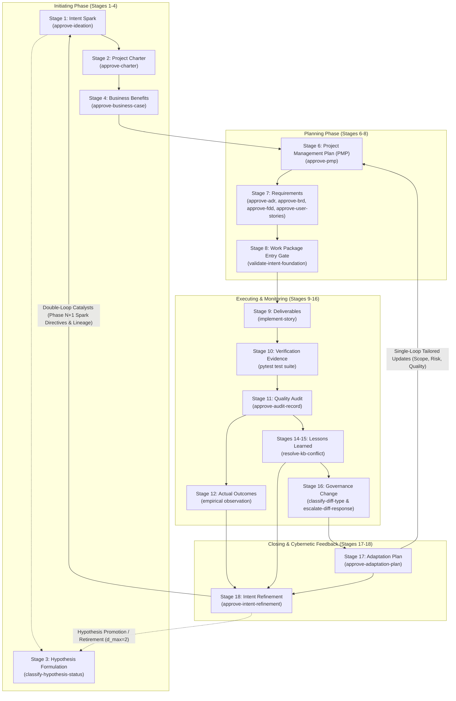

# Architecture Decision Records (ADRs) — The Self-Governing Agent Engine

This repository (`agent-learning`) is a **self-governing, self-stabilizing cybernetic learning engine**. Its architectural principles, development baselines, and cognitive evolution are decided, recorded, and verified by its own native `TaskPolicy` governance chain (`agent-learning-governance`).

Every architectural transition across the 18-stage **Intent-to-Outcome Chain** (`PROJECT-MANAGEMENT-ONTOLOGY.json`) is codified as an Architecture Decision Record (ADR), evaluated via Bayesian multi-criteria decision reasoning, and permanently registered in the institutional learning store.

---

## 1. The Four-Pillar Architectural Manifesto

The architectural corpus (ADR-001 through ADR-013) rests upon **four mutually counterweighting pillars**. No single pillar operates in isolation; each acts as a structural counterweight to the failure modes of the others.

```
                     ┌────────────────────────────────────────┐
                     │          GOVERNANCE PILLAR             │
                     │  Sovereignty, Decision Authority &     │
                     │  Locked Human-in-the-Loop Sign-Off     │
                     └───────▲────────────────────────▲───────┘
                             │                        │
       Governance bounds     │                        │   Governance bounds
       Mathematical drift    │                        │   Cybernetic action
                             │                        │
  ┌──────────────────────────┴─────┐            ┌─────┴──────────────────────────┐
  │      MATHEMATICAL PILLAR       │            │       CYBERNETICS PILLAR       │
  │  Bayes Factors, Low-Pass       │◄──────────►│  Double-Loop Feedback, Beer    │
  │  Damping, d_max=2 Exhaustion   │    Math    │  VSM Homeostasis, Single-Loop  │
  └──────────────────────────▲─────┘ disciplines│  Tailoring (PMBOK 8 Processes) │
                             │       Cybernetics└─────▲──────────────────────────┘
                             │                        │
                             │                        │
                             │   Engineering bounds   │
                             │   both Math & State    │
                             │                        │
                     ┌───────┴────────────────────────┴───────┐
                     │          ENGINEERING PILLAR            │
                     │  Strict Pydantic Contracts, Zero       │
                     │  Storage Sprawl, Episode Envelope Law  │
                     └────────────────────────────────────────┘
```

### Pillar I: Sovereign Governance (Authority without Human Bottlenecks)
- **Two-Route Authority Model (ADR-001):** High-frequency tactical choices run on fast contextual reinforcement learning (`low`), while strategic, baseline-altering choices require reasoned multi-criteria Bayesian evaluation (`full`).
- **Permanent Inviolability:** Critical governance decision gates (`approve-adr`, `approve-brd`, `approve-fdd`, `approve-user-stories`, `approve-pmp`, `approve-adaptation-plan`, `approve-intent-refinement`) permanently enforce `requires_human_approval: true`. Autonomous process agents recommend and quantify, but human leadership retains sovereign authority.
- **Complexity-Proportional Autonomy (ADR-003):** Progression from reasoned oversight to learned autonomy is strictly gated by Wilson score lower-bound correctness intervals and drift-audit sampling across explicit complexity tiers.

### Pillar II: Cybernetic Homeostasis (Double-Loop Feedback & Stafford Beer VSM)
- **Closed-Loop Lifecyle Closure (ADR-007, ADR-008, ADR-009):** The lifecycle does not terminate at delivery. It closes the cognitive loop from Stage 12 Actual Outcomes and Stage 15 Lessons Learned back to Stage 1 Spark and Stage 3 Hypotheses.
- **Single-Loop vs. Double-Loop Separation:** Stage 17 (`Adaptation-Plan.md`) provides single-loop operational adaptation by tailoring the 9 PMBOK subsidiary plans within existing baselines. Stage 18 (`Intent-Refinement-Proposal.md`) provides double-loop strategic learning by questioning whether foundational goals, business benefits, and hypotheses must evolve.
- **Viable System Model (VSM) Balance:** System 1 (Execution) is coordinated by System 2 (PMP), stabilized by System 3 (Adaptation), informed by System 4 (Intent Refinement), and governed by System 5 (Human Leadership Policy).

### Pillar III: Mathematical Rigor (Disciplining Epistemic Drift)
- **Bayesian Hypothesis Adjudication (ADR-009):** Hypotheses are resolved by empirical Bayes factors ($BF_{10} \ge 10 \implies \text{VALIDATED}$, $BF_{10} \le 0.1 \implies \text{REFUTED}$).
- **Bounded Recurrence Exhaustion ($d_{\max}=2$):** Eliminates defensive hypothesis mutation (the "REFINED moral hazard"). At depth $d=2$, refinement is prohibited: hypotheses must collapse to `VALIDATED` if $BF_{10} \ge 10$ or default to `REFUTED` if $BF_{10} < 10$.
- **Low-Pass Whiplash Filter:** Exponential momentum smoothing ($\mathbf{\Theta}_{N+1} = \beta \mathbf{\Theta}_{N} + (1 - \beta) \nabla \mathcal{L}$) with $\beta \in [0.6, 0.85]$ and bias-corrected warmup ($1 - \beta^N$) anchors the cognitive feedback loop against sprint-level noise.
- **Stateless Decision-Progress Comparison (ADR-005):** Pure mathematical classification of decision quality deltas ($\Delta \mathcal{U} > \epsilon$) across paired decision frames without state corruption.

### Pillar IV: Software Engineering Integrity (Contracts & Zero Sprawl)
- **Strict Storage Boundary (ADR-002 Invariant #2):** Zero new database tables, Cosmos DB containers, or custom entities. The entire 18-stage cognitive lifecycle is persisted within standard `LearningStore` interfaces as metadata-enriched `Episode` instances.
- **Runtime Pydantic Validation:** Every governance artifact (`IntentRefinementProposalPayload`, `PMP`, `AdaptationPlan`) is validated at runtime before any decision gate can evaluate it.
- **Cumulative Hereditary Lineage Kernel:** Preserves root spark IDs, parent refinements, and immutable invariants across project handoffs, eliminating generational amnesia.
- **Lightweight Evidence Transport (ADR-006):** Captures lightweight audit evidence for `low`-authority decisions with strict SDK non-interpretation to prevent telemetry leakage into reinforcement learners.

---

## 2. Cross-Pillar Structural Counterweight Matrix

| Pillar | Counterweights Failure Mode In | Structural Counterweight Mechanism |
|---|---|---|
| **Engineering** $\to$ | **Governance & Cybernetics** | Enforces ADR-002's five-record-type storage boundary and ADR-005's stateless comparison design. Prevents an 18-stage loop from collapsing under schema sprawl, bespoke database tables, and unmaintainable state machines. |
| **Mathematical** $\to$ | **Cybernetics** | Disciplines double-loop learning and S3–S4 feedback. Hard Bayes factor thresholds ($BF_{10} \ge 10$ / $\le 0.1$), the $d_{\max}=2$ recurrence ceiling, and low-pass momentum filtering ($\beta \in [0.6, 0.85]$) convert soft organizational theory into a stable, bounded control system. |
| **Governance** $\to$ | **Mathematical & Cybernetics** | Enforces sovereign human agency. Even when an action wins decisively on utility ($\Delta \mathcal{U} > \epsilon$) or crosses a 95% Wilson lower bound, locked human sign-off (`requires_human_approval: true`) prevents statistical confidence from usurping human authority over architecture, baselines, or strategic intent. |
| **Cybernetics** $\to$ | **Engineering** | Prevents software delivery from becoming a dead-end, terminal waterfall pipeline. Connects lessons learned and realized outcomes directly into living operational baselines and catalytic directives. |

---

## 3. The Complete ADR Corpus (ADR-001 through ADR-013)

All twelve ADRs are formally **Accepted** by Menno Drescher. ADR-001 through ADR-009 and ADR-011 were evaluated via Bayesian decision policy through the live `agent-learning-governance` chain; ADR-010 was approved by Menno directly (see its §2):

| ADR | Title | Status | Intent-to-Outcome Stage & PMBOK 8 Process | Core Architectural Decision |
|---|---|---|---|---|
| [**ADR-001**](ADR-001-decision-authority-model.md) | Decision Authority Model — Learned vs. Reasoned Resolution | **Accepted** | Stage 7 (Requirement)<br>5.3 Define Scope | Dual-route selection (`low` reinforcement learning vs. `full` Bayesian decision theory) converging on common `DecisionResult`/`Episode` lineage. |
| [**ADR-002**](ADR-002-storage-backend-strategy.md) | Storage Backend Strategy — Local File, In-Memory, and Cosmos DB | **Accepted** | Cross-Cutting Storage<br>ADR-002 Invariants | Single abstract `LearningStore` interface with 3 interchangeable backends; strictly limits storage to five core record types with zero bespoke entity sprawl. |
| [**ADR-003**](ADR-003-evidence-gated-autonomy-thresholds.md) | Evidence-Gated Autonomy — Complexity-Proportional Thresholds | **Accepted** | Stage 16 (Governance)<br>4.6 Integrated Change | Wilson score lower-bound correctness intervals, complexity tiers (T1–T4), and drift-audit sampling governing autonomy transitions. |
| [**ADR-004**](ADR-004-authority-migration-comparison-not-replay.md) | Authority-Migration History — A Forward Comparison Snapshot, Not a Retroactive Replay | **Accepted** | Cross-Cutting (Authority Migration)<br>ADR-001 §4.3 | No retroactive replay of historical `low`-authority episodes; a frozen `MigrationRecord` inside `PolicySnapshot.metadata` is captured on each authority transition instead. |
| [**ADR-005**](ADR-005-decision-progress-comparison.md) | Decision-Progress Comparison and Regression Healing | **Accepted** | Stage 10 (Verification)<br>8.3 Control Quality | Pure, stateless mathematical comparison of decision quality deltas ($\Delta \mathcal{U} > \epsilon$), pairwise classification, and regression healing. |
| [**ADR-006**](ADR-006-opt-in-lightweight-evidence-capture-for-low-authority.md) | Opt-In Lightweight Evidence Capture for Low-Authority Decisions | **Accepted** | Stage 10 (Verification)<br>8.3 Control Quality | Opt-in metadata flag and non-interpreting evidence envelope transport for low-authority bandit decisions without reward leakage. |
| [**ADR-007**](ADR-007-governance-change-paired-diff-classification-and-escalation.md) | Automated Governance Change: Paired Semantic Diff Classification and Escalation Learning | **Accepted** | Stage 16 (Governance)<br>4.6 Integrated Change | Paired architecture: full-authority semantic classification (`classify-diff-type`) and low-authority operational escalation learning (`escalate-diff-response`). |
| [**ADR-008**](ADR-008-pmbok-lifecycle-orchestration-and-pmp-adaptation-loop.md) | PMBOK 8 Lifecycle Orchestration and Closed-Loop Adaptation Feedback | **Accepted** | Stage 6 (PMP) & Stage 17 (Adaptation)<br>4.2 Develop PMP & 4.6 Tailoring | In-repo PMBOK orchestration of 9 subsidiary plans, dedicated `approve-pmp` / `approve-adaptation-plan` gates, and targeted `--mode adapt` re-planning. |
| [**ADR-009**](ADR-009-intent-refinement-and-cognitive-feedback-loop.md) | Intent Refinement and Cognitive Feedback Loop | **Accepted** | Stage 18 (Intent Refinement)<br>4.7 Close Project or Phase | Double-loop cognitive feedback closing outcomes to spark; Bayes factor hypothesis retirement ($d_{\max}=2$); low-pass whiplash filter; cumulative lineage kernel. |
| [**ADR-010**](ADR-010-lessons-learned-crystallization-and-register.md) | Lessons Learned Crystallization and the Organizational Process Assets Register | **Accepted** | Post-coding recap (separate from Stage 15)<br>Feeds Phase Close readiness (4.7) | Light breakout recap held once per epic after its last user story, on how the code was created from the stories, recorded in `docs/project-docs/Lessons-Learned-Register.md` as `LL-###` entries or a short no-new-lessons sign-off entry. Tier 2/3 propagation (component skills, universal memory) is optional. An Autonomous Breakout Facilitator (draft-and-propose only, human approval for entries and cross-repo actions) is permitted but not built. |
| [**ADR-011**](ADR-011-project-tailoring-and-route-decision.md) | Project Tailoring and Route Decision | **Accepted** | Stage 17 (Adaptation, tailoring) & Stage 18 (Intent Refinement)<br>PMBOK 8 2.1.6.2, 2.1.7 | A route per management plan (full plan, PMP section, or not applicable), decided by a human with the system recommending; floors and caps as flags; the Charter sets limits and holds the integration section when it defines it; depth changes follow Stage 17, standard changes Stage 18. Wider design kept in `docs/design-notes/`. |
| [**ADR-013**](ADR-013-subsidiary-plan-approval-gates-before-pmp-formalization.md) | Subsidiary Plan Approval Gates Before PMP Formalization | **Accepted** | Stage 6 (PMP Formalization)<br>PMBOK 8 4.2 Develop PMP | Inserts route-aware per-plan approval gates (`approve-subsidiary-plan`) between drafting and formalization; canonical content hashing (LF-normalized); transitive STALE_DEPENDENCY status propagation bounded to DAG branches; explicit plan governance state machine; separation of plan-level vs. integration-level defects; IoC module decoupling. |

### Proposed Standards & Pipeline ADRs

| ADR | Title | Status | Intent-to-Outcome Stage & PMBOK 8 Process | Core Architectural Decision |
|---|---|---|---|---|
| [**ADR-012**](ADR-012-subsidiary-management-plan-standards-and-content-contracts.md) | Subsidiary Management Plan Standards and Content Contracts | **Proposed** | Stage 6 (PMP Formalization)<br>PMBOK 8 Planning Domain | Universal 3-section content contract (Intent, Mechanics, Governance), YAML frontmatter schema, deterministic floor/cap linting flags, PMBOK 8 mapping bridge, and decoupled daughter plan ADR hierarchy. |
| [**ADR-024**](ADR-024-learning-methodology-selection-chain.md) | Learning Methodology Selection Chain | **Proposed** | Cross-Cutting Learning Policy<br>PMBOK 8 2.1.6.2 Tailoring | Human-declared use-case profiles, deterministic precondition filtering across 32 learning methodologies, maturity ranking recommendation, and metadata-recorded selections. |
| [**ADR-025**](ADR-025-scope-management-plan-standard-and-baseline-contract.md) | Scope Management Plan Standard and Baseline Contract | **Proposed** | Stage 6 (Planning)<br>PMBOK 8 Planning (Legacy 5.1) | Primary Baseline-Substantiating Plan contract: mandatory in-scope and out-of-scope boundaries, WBS decomposition rules, deliverable acceptance DoD, and transitive DAG invalidation down to Schedule and Cost. |

---

## 4. The Closed-Loop Intent-to-Outcome Architecture



---

## 5. Self-Governance Verification Trail

This repository verifies its own governance decisions using the `agent-learning-governance` chain under `data/agent-learning/store/`:

```powershell
# 1. Decide: evaluate candidate decision frame using Bayesian multi-criteria reasoning
python -m agent_learning.cli task-policy-decide \
  --agent-id agent-learning-governance \
  --task-id approve-adr \
  --decision-frame docs/policy-shapes/decision-frames/adr-009-approval.json

# 2. Adjudicate: apply human sign-off (--disposition accept)
python -m agent_learning.cli task-policy-adjudicate \
  --agent-id agent-learning-governance \
  --task-id approve-adr \
  --decision-result docs/policy-shapes/results/adr-009-decision-result.json \
  --disposition accept

# 3. Register: persist immutable episode into LearningStore
python -m agent_learning.cli task-episode-register \
  --agent-id agent-learning-governance \
  --task-id approve-adr \
  --require-decision-policy \
  --episode docs/policy-shapes/results/adr-009-reg.json
```

Every accepted ADR, BRD, FDD, and User Story in this repository possesses a complete cryptographic and Bayesian adjudication record in `docs/policy-shapes/episodes/`.
