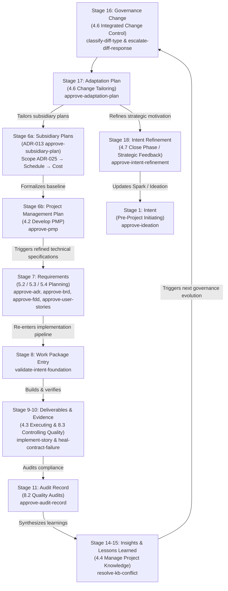

# Intent-to-Outcome Chain & TaskPolicy Coverage — `agent-learning` (PMBOK 8 Aligned)

This document records the exact status and realization of the 18-stage **Intent-to-Outcome Chain** (`PROJECT-MANAGEMENT-ONTOLOGY.json`) within the `agent-learning` repository, fully aligned with the **PMBOK 8 Process Groups and Process Numbering**.

Unlike external client projects where `agent-learning` acts as an imported dependency, `agent-learning` is a **self-governing codebase**: its own architectural evolutions, requirements, and governance changes are decided, recorded, and verified by its own native `TaskPolicy` engine (`agent-learning-governance`).

Every stage that yields a documented artifact requires a formal Bayesian validation gate. We start with a **Spark** and systematically trace intent through execution, verification, governance amendment, behavioral adaptation, and back to refined intent—closing the complete development lifecycle loop.

---

## 1. Document Authoring Sequence vs. Conceptual Ontology

There is an important distinction between the abstract conceptual trace and the **actual document authoring sequence**:

```
1. Spark Capture (Intent — Initiating)
       ↓
2. Ideation Document (Hypotheses — Initiating)
       ↓
3. Business Case & Benefits Statement (Benefit — Initiating)
       ↓
4. Project Charter (Objective — Initiating: 4.1 Develop Project Charter)
       ↓
5. Subsidiary Management Plans (Planning: 5.1/6.1/7.1 via ADR-011 Tailoring & ADR-013 approve-subsidiary-plan)
       ↓ (Causal DAG: Scope ADR-025 → Schedule → Cost)
   Integrated Project Management Plan (Planning: 4.2 Develop PMP via approve-pmp)
       ↓
6. Technical Specifications: ADR → BRD → FDD → User Stories (Planning: 5.2/5.3/5.4)
       ↓
7. Foundation Validation Gate (Planning → Executing Entry Gate)
       ↓
8. Implementation & Verification (Executing: 4.3 & Monitoring & Controlling: 8.3)
       ↓
9. Audit Record & Knowledge Synthesis (Monitoring & Controlling: 8.2 & 4.4)
       ↓
10. Paired Governance Pipeline (Monitoring & Controlling: 4.6 Integrated Change Control)
       ↓
11. Adaptation Plan (Adaptive Closing / Feedback: Tailoring PMP Updates)
       ↓
12. Intent Refinement (Closing: 4.7 Close Phase & Strategic Feedback to Spark)
```

---

## 2. Complete 18-Stage Coverage Matrix (PMBOK 8 Process Mapping)

| # | Chain Stage | PMBOK 8 Process Group | PMBOK 8 Process Number & Name | Governed Document Artifact | Assigned TaskPolicy | Authority & Decision Shape | Lifecycle Role & IPO |
|---|---|---|---|---|---|---|---|
| 1 | **Intent** | **Initiating** | Pre-Project: Strategic Need Identification | `Spark-Capture.md`<br>`Ideation-Document.md` | `template-governance` / **`approve-ideation`** | `FULL`<br>(3 actions: approve, reject, request revision) | **Starts with a Spark.** Inputs: Trigger event / strategic driver. Process: Validate intent. Output: Approved Ideation. |
| 2 | **Objective** | **Initiating** | 4.1 Develop Project Charter | `Project-Charter.md` | `template-governance` / **`approve-charter`** | `FULL`<br>(3 actions: approve, reject, request revision) | Inputs: Business Case & Benefits. Process: Authorize project & assign sponsor. Output: Project Charter. |
| 3 | **Hypothesis** | **Initiating** | Pre-Project: Design Assumption Formulation | `Ideation-Document.md`<br>(Hypothesis section / `HYP-*.md`) | `agent-learning-governance` / **`classify-hypothesis-status`** | `FULL`<br>(7 actions: advance to testing, mark validated, mark invalidated, etc.) | Inputs: Design assumptions & test logs. Process: Evaluate empirical evidence. Output: Validated / testing status. |
| 4 | **Benefit** | **Initiating** | Business Documents: Benefits Realization Planning | `Business-Case.md`<br>`Benefits-Statement.md` | `template-governance` / **`approve-business-case`** | `FULL`<br>(3 actions: approve, reject, request revision) | Inputs: Hypotheses & ROI premise. Process: Validate economics. Output: Benefits Statement (Input to Charter). |
| 5 | **Capability** | **Executing** | Capability Crystallization | Capability Matrix / Catalog | *Automated Synthesis* | Deterministic mapping | Inputs: Delivered code & modules. Process: Map skills & competencies. Output: Organizational Capabilities. |
| 6 | **Project** | **Planning** | 4.2 Develop Project Management Plan | `Project-Management-Plan.md`<br>& Subsidiary Plans (`docs/project-docs/management-plans/` / `.staging/pmp-sections/`) | `agent-learning-governance` /<br>• **`approve-subsidiary-plan`** (ADR-013)<br>• **`approve-pmp`** | `FULL`<br>(3 actions each: approve, reject, request revision) | Inputs: Project Charter & tailored subsidiary plans (Scope ADR-025, Schedule, Cost, etc.). Process: Prerequisite subsidiary plan gate + integrated baseline formalization. Output: Approved PMP Baseline (`PMP-BL-vX.Y.Z`). |
| 7 | **Requirement** | **Planning** | 5.2 Collect Requirements & 5.3 Define Scope | Architecture & Specs:<br>• `ADR-*.md`<br>• `BRD-*.md`<br>• `FDD-*.md`<br>• `user-stories/*.md` | `template-governance` /<br>• **`approve-adr`**<br>• **`approve-brd`**<br>• **`approve-fdd`**<br>• **`approve-user-stories`** | `FULL`<br>(3 actions each: approve, reject, request revision) | Inputs: PMP Scope & Hypotheses. Process: Architectural & functional specification. Output: Approved ADR/BRD/FDD/Stories. |
| 8 | **Work Package** | **Planning → Executing** | 5.4 Create WBS & Sprint Gate | Epic / Sprint Backlog Entry | `template-governance` / **`validate-intent-foundation`** | `FULL`<br>(3 actions: accept, reject, flag) | Inputs: Approved requirements package. Process: Gate implementation entry. Output: Provisioned git worktree. |
| 9 | **Deliverable** | **Executing** | 4.3 Direct & Manage Project Work | Source Code & Release Artifacts | `implement-story` & `heal-contract-failure` | Direct Execution & Review | Inputs: Approved stories & acceptance criteria. Process: TDD / contract-first build. Output: Executable code deliverable. |
| 10 | **Verification Evidence** | **Monitoring & Controlling** | 8.3 Control Quality | Contract Tests & Execution Logs | Executable Test Suite | Input Evidence | Inputs: Code deliverable & contract tests. Process: Execute test suite. Output: Verification evidence report (pytest). |
| 11 | **Audit Record** | **Monitoring & Controlling** | 8.2 Manage Quality Audits | `Audit-Register.md`<br>`Audit-Finding.md` | `template-governance` / **`approve-audit-record`** | `FULL`<br>(3 actions: approve, reject, request revision) | Inputs: Deliverables & verification logs. Process: Audit architectural conformance. Output: Approved Audit Register entries. |
| 12 | **Actual Outcome** | **Monitoring & Controlling** | 5.5 Validate Scope & Value Realization | Post-Delivery Impact Assessment | *Empirical Observation* | Baseline Comparison | Inputs: Production telemetry & Benefits Statement. Process: Compare realized vs expected value. Output: Impact deltas. |
| 13 | **Observation** | **Monitoring & Controlling** | 4.5 Monitor & Control Project Work | Telemetry & Environment Gotchas | Knowledge Base Captures | Raw Input | Inputs: Runtime telemetry & review findings. Process: Record raw telemetry. Output: Uninterpreted observation log. |
| 14 | **Insight** | **Monitoring & Controlling** | 4.4 Manage Project Knowledge (Synthesis) | Synthesized Technical Findings | `obsidian-brain-ingestor` / **`resolve-kb-conflict`** | `FULL`<br>(trust existing, supersede, flag) | Inputs: Observation logs. Process: Synthesize causal significance. Output: Resolved insight node. |
| 15 | **Lesson Learned** | **Monitoring & Controlling** | 4.4 Manage Project Knowledge (Lessons Learned Register) | Formalized Organizational Knowledge | `obsidian-brain-ingestor` / **`resolve-kb-conflict`** | `FULL`<br>(trust existing, supersede, flag) | Inputs: Verified insights. Process: Crystallize actionable knowledge. Output: Formalized Lessons Learned register. |
| 16 | **Governance Change** | **Monitoring & Controlling** | 4.6 Perform Integrated Change Control | Governance Amendments & Diffs | `template-governance` /<br>• **`classify-diff-type`**<br>• **`escalate-diff-response`** | Paired Pipeline:<br>• `FULL` (7 diff classes)<br>• `LOW` (3 escalation actions) | Inputs: Lessons learned & proposed diffs. Process: Semantic classification & escalation bandit. Output: Governed baseline update. |
| 17 | **Adaptation** | **Closing / Adaptive Feedback** | 4.6 Perform Integrated Change Control (Tailoring) | `Adaptation-Plan.md` | `template-governance` / **`approve-adaptation-plan`** | `FULL`<br>(3 actions: approve, reject, request revision) | Inputs: Validated Stage 16 governance change. Process: Operationalize into skills/workflows. Output: **Tailored PMP updates**. |
| 18 | **Intent Refinement** | **Closing** | 4.7 Close Project or Phase (Cognitive Feedback) | `Intent-Refinement-Proposal.md` | `template-governance` / **`approve-intent-refinement`** | `FULL`<br>(3 actions: approve, reject, request revision) | Inputs: Adaptation results & realized outcomes. Process: Refine strategic motivation. Output: **Catalyst for next Spark Capture**. |

---

## 3. The Continuous Adaptation & PMP Feedback Cycle

When an operational gap, audit finding, or governance amendment occurs:



---

## 4. Active & Available Policies in Governance Lineage

| TaskPolicy | `agent_id` / `task_id` | Authority | PMBOK Process | Operational Role |
|---|---|---|---|---|
| **Ideation Approval** | `agent-learning-governance` / `approve-ideation` | `full` | Pre-Project Initiating | Validates Spark Capture and Ideation Document (Stage 1 Intent) |
| **Charter Approval** | `agent-learning-governance` / `approve-charter` | `full` | 4.1 Develop Project Charter | Validates Project Charter and measurable objectives (Stage 2 Objective) |
| **Hypothesis Classification** | `agent-learning-governance` / `classify-hypothesis-status` | `full` | Pre-Project Initiating | Evaluates experimental empirical evidence against formulated hypotheses (Stage 3 Hypothesis) |
| **Business Case Approval** | `agent-learning-governance` / `approve-business-case` | `full` | Business Documents Initiating | Validates Business Case, Benefits Statement, and value premise (Stage 4 Benefit) |
| **Subsidiary Plan Approval** | `agent-learning-governance` / `approve-subsidiary-plan` | `full` | 5.1/6.1/7.1 Subsidiary Planning | Evaluates individual subsidiary management plans (Scope ADR-025, Schedule, Cost, Risk, Quality) before PMP formalization (ADR-013 §4.2) |
| **PMP Approval** | `agent-learning-governance` / `approve-pmp` | `full` | 4.2 Develop PMP | Formalizes integrated Project Management Plan and subsidiary management plans (Stage 6 Project) |
| **ADR Approval** | `agent-learning-governance` / `approve-adr` | `full` | 5.3 Define Scope / Architecture | Evaluates architectural soundness, alternatives, and consequence honesty (Stage 7 Requirement) |
| **BRD Approval** | `agent-learning-governance` / `approve-brd` | `full` | 5.2 Collect Requirements | Evaluates business rules, stakeholder alignment, and boundary definitions (Stage 7 Requirement) |
| **FDD Approval** | `agent-learning-governance` / `approve-fdd` | `full` | 5.3 Detailed Interface Design | Evaluates technical interface design, storage footprint, and invariant enforcement (Stage 7 Requirement) |
| **Story Approval** | `agent-learning-governance` / `approve-user-stories` | `full` | 5.4 Create WBS / Backlog | Evaluates testability of acceptance criteria and contract feasibility (Stage 7 Requirement) |
| **Foundation Validation** | `agent-learning-governance` / `validate-intent-foundation` | `full` | Planning → Executing Gate | Pre-implementation gate ensuring requirement artifacts are fully grounded (Stage 8 Work Package) |
| **Audit Record Approval** | `agent-learning-governance` / `approve-audit-record` | `full` | 8.2 Manage Quality Audits | Validates audit findings, non-conformances, and corrective actions (Stage 11 Audit Record) |
| **Semantic Diff Classification** | `agent-learning-governance` / `classify-diff-type` | `full` | 4.6 Integrated Change Control | Evaluates candidate textual diffs against frozen baseline to determine structural form of change (Stage 16 Governance Change) |
| **Diff Response Escalation** | `agent-learning-governance` / `escalate-diff-response` | `low` | 4.6 Integrated Change Control | Learns operational escalation policy from aggregate outcomes via REINFORCE, gated by ADR-005 progression comparison (Stage 16 Governance Change) |
| **Adaptation Plan Approval** | `agent-learning-governance` / `approve-adaptation-plan` | `full` | 4.6 Change Tailoring | Validates operational rollout of governance changes and tailored updates to subsidiary management plans (Stage 17 Adaptation) |
| **Intent Refinement Approval** | `agent-learning-governance` / `approve-intent-refinement` | `full` | 4.7 Close Phase / Cognitive Feedback | Validates cognitive feedback from outcomes back into top-of-chain intent (Stage 18 Intent Refinement) |
