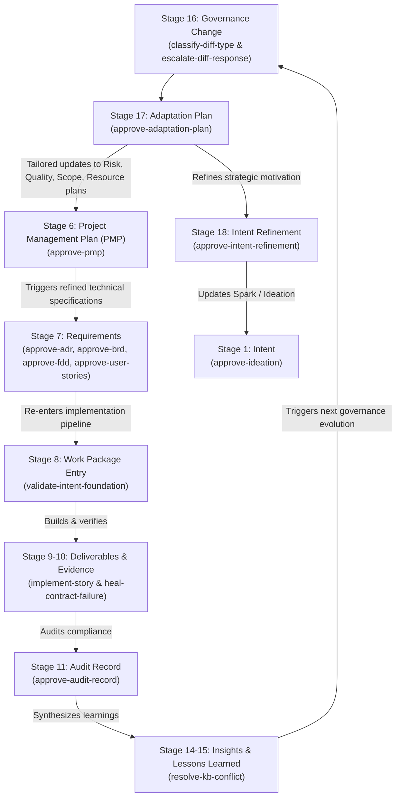

# Intent-to-Outcome Chain & TaskPolicy Coverage — `agent-learning`

This document records the exact status and realization of the 18-stage **Intent-to-Outcome Chain** (`PROJECT-MANAGEMENT-ONTOLOGY.json`) within the `agent-learning` repository.

Unlike external client projects where `agent-learning` acts as an imported dependency, `agent-learning` is a **self-governing codebase**: its own architectural evolutions, requirements, and governance changes are decided, recorded, and verified by its own native `TaskPolicy` engine (`agent-learning-governance`).

Every stage that yields a documented artifact requires a formal Bayesian validation gate. We start with a **Spark** and systematically trace intent through execution, verification, governance amendment, behavioral adaptation, and back to refined intent—closing the complete development lifecycle loop.

---

## 1. Document Authoring Sequence vs. Conceptual Ontology

There is an important distinction between the abstract conceptual trace and the **actual document authoring sequence**:

* **Conceptual Ontology (`traceabilityChain`):**
  $$\text{Intent} \longrightarrow \text{Objective} \longrightarrow \text{Hypothesis} \longrightarrow \text{Benefit} \longrightarrow \dots$$
* **Actual Document Authoring & Governance Sequence (PMBOK 8 / SIDPA Lifecycle):**
  ```
  1. Spark Capture (Intent)
         ↓
  2. Ideation Document (Hypotheses)
         ↓
  3. Business Case & Benefits Statement (Benefit)
         ↓
  4. Project Charter (Objective)
         ↓
  5. Subsidiary Management Plans & Project Management Plan (PMP)
         ↓
  6. Technical Specifications: ADR → BRD → FDD → User Stories (Requirement)
         ↓
  7. Foundation Validation Gate (Work Package Entry)
         ↓
  8. Implementation & Verification (Deliverable & Evidence)
         ↓
  9. Audit Record & Knowledge Synthesis (Audit, Insight, Lesson Learned)
         ↓
  10. Paired Governance Pipeline (Governance Change)
         ↓
  11. Adaptation Plan (tailoring Management Plan updates feeding back to PMP)
         ↓
  12. Intent Refinement (closing the cognitive loop back to Spark / Intent)
  ```

---

## 2. Complete 18-Stage Coverage Matrix

| # | Stage Name | Governed Document Artifact | `agent-learning` Realization & TaskPolicy | Authority & Decision Shape | Lifecycle Role |
|---|---|---|---|---|---|
| 1 | **Intent** | `Spark-Capture.md`<br>`Ideation-Document.md` | `agent-learning-governance` / **`approve-ideation`** | `FULL`<br>(3 actions: approve, reject, request revision) | **Starts with a Spark.** Validates strategic motivation, problem statement, and scope boundaries before chartering. |
| 2 | **Objective** | `Project-Charter.md` | `agent-learning-governance` / **`approve-charter`** | `FULL`<br>(3 actions: approve, reject, request revision) | Validates project charter, sponsor authority, measurable objectives traced to benefits, and realistic scope boundaries. |
| 3 | **Hypothesis** | `Ideation-Document.md`<br>(Hypothesis section / `HYP-*.md`) | `agent-learning-governance` / **`classify-hypothesis-status`** | `FULL`<br>(7 actions: advance to testing, mark validated, mark invalidated, etc.) | Evaluates falsifiable design assumptions against empirical evidence (11 real hypotheses evaluated: HYP-AL-001 through 011). |
| 4 | **Benefit** | `Business-Case.md`<br>`Benefits-Statement.md` | `agent-learning-governance` / **`approve-business-case`** | `FULL`<br>(3 actions: approve, reject, request revision) | Validates business economics, ROI assumptions, risk assessments, and benefit-to-hypothesis linkage before authorizing project execution. |
| 5 | **Capability** | Capability Matrix / Modules | *Deterministic crystallization* | Deterministic mapping | Evaluates organizational/technical capabilities enabled by deliverables (`agent_learning.decision`, `comparison`, `governance`). |
| 6 | **Project** | `Project-Management-Plan.md`<br>& Subsidiary Plans | `agent-learning-governance` / **`approve-pmp`** | `FULL`<br>(3 actions: approve, reject, request revision) | Formalizes integrated Project Management Plan and subsidiary plans, establishing governance baselines prior to technical requirement drafting. |
| 7 | **Requirement** | Architecture & Specifications:<br>• `ADR-*.md`<br>• `BRD-*.md`<br>• `FDD-*.md`<br>• `user-stories/*.md` | `agent-learning-governance` /<br>• **`approve-adr`**<br>• **`approve-brd`**<br>• **`approve-fdd`**<br>• **`approve-user-stories`** | `FULL`<br>(3 actions each: approve, reject, request revision) | **ADRs 001–007 Accepted**; BRDs 001–007 and FDDs 001–007 approved; Epics 1–7 with testable stories. |
| 8 | **Work Package** | Epic / Story Backlog Entry | `agent-learning-governance` / **`validate-intent-foundation`** | `FULL`<br>(3 actions: accept, reject, flag) | Gates entry into the work package; validates intent foundation before worktree provisioning. |
| 9 | **Deliverable** | Source Code & Release Artifacts | Pure modules via SIDPA `implement-story` & worktree isolation | Direct Execution & Review | `decision.py`, `comparison.py`, `governance.py`. |
| 10 | **Verification Evidence** | Contract Tests & Fixtures | Pure contract tests (`tests/test_*.py`) | Input Evidence | 466 unit & contract tests passing; zero external mocks. |
| 11 | **Audit Record** | `Audit-Register.md`<br>`Audit-Finding.md` | `agent-learning-governance` / **`approve-audit-record`** | `FULL`<br>(3 actions: approve, reject, request revision) | Formally validates audit findings and compliance reviews before logging to immutable store. |
| 12 | **Actual Outcome** | Post-Delivery Impact Assessment | `DecisionResult` and `PairwiseComparison` deltas | Baseline Comparison | Measures realized production outcomes against expected Benefits and Hypotheses. |
| 13 | **Observation** | Telemetry, Environment Gotchas | PR reviews (Amazon Q), test tracebacks | Raw Input | Uninterpreted findings captured in task transcripts and PR reviews. |
| 14 | **Insight** | Interpreted Significance | Root cause diagnosis via `heal-contract-failure` | Analytical Synthesis | Identified "Green Defects" (Contract Incompleteness Failures). |
| 15 | **Lesson Learned** | Formalized Organizational Knowledge | Component skills in `.claude/skills/<component>/SKILL.md` | Crystallized Knowledge | Load-bearing constraints documented and enforced across `comparison`, `governance`, `heal-contract-failure`. |
| 16 | **Governance Change** | Governance Amendments & Diffs | `agent-learning-governance` /<br>• **`classify-diff-type`**<br>• **`escalate-diff-response`** | Paired Pipeline:<br>• `FULL` (7 diff classes)<br>• `LOW` (3 escalation actions) | **ADR-007 / Story 7.1 / PR #2**: 7-action diff classifier across 3 operational tiers paired with 3-action escalation bandit, gated by ADR-005 comparison and ADR-006 evidence transport. |
| 17 | **Adaptation** | `Adaptation-Plan.md` | `agent-learning-governance` / **`approve-adaptation-plan`** | `FULL`<br>(3 actions: approve, reject, request revision) | Validates that governance amendments are operationalized into behavioral adjustments, and **tailors specific updates to Subsidiary Management Plans feeding back to the PMP**. |
| 18 | **Intent Refinement** | `Intent-Refinement-Proposal.md` | `agent-learning-governance` / **`approve-intent-refinement`** | `FULL`<br>(3 actions: approve, reject, request revision) | Synthesizes adaptation results and empirical outcomes to update top-of-chain intent—**closing the cognitive loop back to Stage 1**. |

---

## 3. The Continuous Adaptation & PMP Feedback Cycle

When an operational gap, audit finding, or governance amendment occurs:



---

## 4. Active & Available Policies in Governance Lineage

| TaskPolicy | `agent_id` / `task_id` | Authority | Actions | Operational Role |
|---|---|---|---|---|
| **Ideation Approval** | `agent-learning-governance` / `approve-ideation` | `full` | `approve_ideation`, `reject_ideation`, `request_revision_before_decision` | Validates Spark Capture and Ideation Document (Stage 1 Intent) |
| **Charter Approval** | `agent-learning-governance` / `approve-charter` | `full` | `approve_charter`, `reject_charter`, `request_revision_before_decision` | Validates Project Charter and measurable objectives (Stage 2 Objective) |
| **Hypothesis Classification** | `agent-learning-governance` / `classify-hypothesis-status` | `full` | 7 actions (`advance_to_testing`, `mark_validated`, `mark_invalidated`, `mark_inconclusive`, `remain_formulated_blocked`, `flag_for_human_review`, `no_new_evidence`) | Evaluates experimental empirical evidence against formulated hypotheses (Stage 3 Hypothesis) |
| **Business Case Approval** | `agent-learning-governance` / `approve-business-case` | `full` | `approve_business_case`, `reject_business_case`, `request_revision_before_decision` | Validates Business Case, Benefits Statement, and value premise (Stage 4 Benefit) |
| **PMP Approval** | `agent-learning-governance` / `approve-pmp` | `full` | `approve_pmp`, `reject_pmp`, `request_revision_before_decision` | Formalizes integrated Project Management Plan and subsidiary management plans (Stage 6 Project) |
| **ADR Approval** | `agent-learning-governance` / `approve-adr` | `full` | `approve_adr`, `reject_adr`, `request_revision_before_decision` | Evaluates architectural soundness, alternatives, and consequence honesty (Stage 7 Requirement) |
| **BRD Approval** | `agent-learning-governance` / `approve-brd` | `full` | `approve_brd`, `reject_brd`, `request_revision_before_decision` | Evaluates business rules, stakeholder alignment, and boundary definitions (Stage 7 Requirement) |
| **FDD Approval** | `agent-learning-governance` / `approve-fdd` | `full` | `approve_fdd`, `reject_fdd`, `request_revision_before_decision` | Evaluates technical interface design, storage footprint, and invariant enforcement (Stage 7 Requirement) |
| **Story Approval** | `agent-learning-governance` / `approve-user-stories` | `full` | `approve_user_stories`, `reject_user_stories`, `request_revision_before_decision` | Evaluates testability of acceptance criteria and contract feasibility (Stage 7 Requirement) |
| **Foundation Validation** | `agent-learning-governance` / `validate-intent-foundation` | `full` | `accept_foundation_proceed`, `reject_needs_rework`, `flag_for_human_review` | Pre-implementation gate ensuring requirement artifacts are fully grounded (Stage 8 Work Package) |
| **Audit Record Approval** | `agent-learning-governance` / `approve-audit-record` | `full` | `approve_audit_record`, `reject_audit_record`, `request_revision_before_decision` | Validates audit findings, non-conformances, and corrective actions (Stage 11 Audit Record) |
| **Semantic Diff Classification** | `agent-learning-governance` / `classify-diff-type` | `full` | 7 actions across 3 tiers (`new_superseding_adr`, `amendment_log_entry`, `correction_note`, `clarification_section`, `provenance_note`, `pending_supersession_note`, `supersession_update`) | Evaluates candidate textual diffs against frozen baseline to determine structural form of change (Stage 16 Governance Change) |
| **Diff Response Escalation** | `agent-learning-governance` / `escalate-diff-response` | `low` | 3 actions (`escalate_to_human`, `apply_with_notification`, `apply_automatically`) | Learns operational escalation policy from aggregate outcomes via REINFORCE, gated by ADR-005 progression comparison (Stage 16 Governance Change) |
| **Adaptation Plan Approval** | `agent-learning-governance` / `approve-adaptation-plan` | `full` | `approve_adaptation_plan`, `reject_adaptation_plan`, `request_revision_before_decision` | Validates operational rollout of governance changes and tailored updates to subsidiary management plans (Stage 17 Adaptation) |
| **Intent Refinement Approval** | `agent-learning-governance` / `approve-intent-refinement` | `full` | `approve_intent_refinement`, `reject_intent_refinement`, `request_revision_before_decision` | Validates cognitive feedback from outcomes back into top-of-chain intent (Stage 18 Intent Refinement) |
