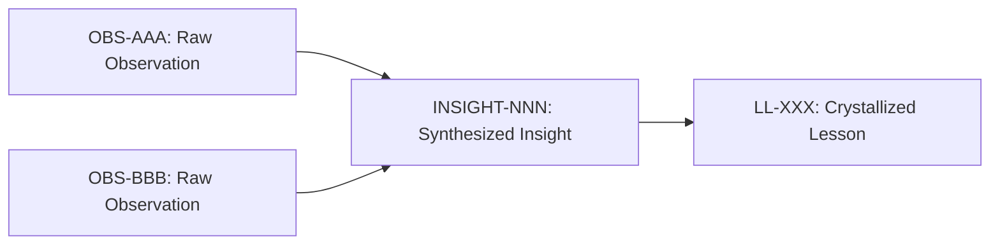
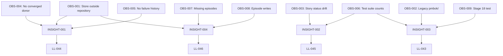

# Stage 15: Lesson Learned - Complete Methodology Guide

> **Purpose:** Transform verified insights into formalized organizational knowledge that can be ingested into Obsidian brain knowledge graphs, improving project procedures and methodologies.

> **Authority:** LOW authority via `resolve-kb-conflict` policy. A human decides every proposal: trust existing, supersede, or flag.

---

## 📚 Overview

Stage 15 crystallizes actionable knowledge from verified insights (Stage 14) derived from raw observations (Stage 13). This completes the knowledge path and transforms lessons into high-quality knowledge graph entries for Obsidian brain ingestion.

### Knowledge Pipeline

```
Stage 13 (Observation) 
    ↓ Raw facts, no interpretation  
Stage 14 (Insight) 
    ↓ Synthesized understanding, causal analysis  
Stage 15 (Lesson Learned) 
    ↓ Actionable invariants, formalized knowledge  
    ↓ Knowledge Graph Entry (Obsidian Brain)
```

---

## 🎯 Step-by-Step Stage 15 Process

### Step 1: Verify Stage 13 & 14 Completeness

**Input Requirements:**
- ✅ **Stage 13**: 9 observations recorded (OBS-001 to OBS-009)
  - Raw facts: what was seen, when, the evidence
  - No interpretation or fixes
  - Examples: Store location, legacy code dependencies, status drift

- ✅ **Stage 14**: 4 insights synthesized (INSIGHT-001 to INSIGHT-004)
  - Interpreted findings from observations
  - Knowledge-base conflict checks performed
  - Decisions: trust existing, supersede, or flag

**Verification Command:**
```bash
ls docs/observations/OBS-*.md | wc -l  # Should be 9
ls docs/insights/INSIGHT-*.md | wc -l  # Should be 4
```

---

### Step 2: Insight-to-Lesson Crystallization

**For each INSIGHT-NNN, create LL-NNN:**

| Insight | Lesson | Knowledge Base Action | Tier Propagation |
|---------|--------|----------------------|------------------|
| INSIGHT-001: Phase 1 blocked by evidence | LL-044: External Evidence Dependency | Trust existing + link | Tier 1-3 |
| INSIGHT-002: Story status in two places | LL-045: Single Source of Truth | Trust existing + link | Tier 1-3 |
| INSIGHT-003: Stage 18 tooling in legacy tree | LL-043: Legacy Code Dependency | Flag for human decision | Tier 1-3 |
| INSIGHT-004: Gate evidence split | LL-046: Dual Evidence Storage | Trust existing + flag | Tier 1-3 |

**Crystallization Template:**
```markdown
### LL-XXX — [Descriptive Title]
- **Identifier:** `LL-XXX`
- **Date:** 2026-11-05
- **Phase:** Phase 1 / Stage 15
- **Epic / Source:** Derived from INSIGHT-NNN (OBS-AAA, OBS-BBB)
- **Scope:** [Universal Process / Repository Architecture / Universal Testing / etc.]
- **Tier 2/3 Propagation Target:** [Where this lesson applies]
- **The Trap:** [What problem was observed]
- **The Root Cause:** [Why it happened]
- **Actionable Invariant:** [Concrete rule to prevent recurrence]
```

**Example (LL-044):**
```markdown
### LL-044 — External Evidence Dependency Blocks Hypothesis Validation
- **Identifier:** `LL-044`
- **Date:** 2026-11-05
- **Phase:** Phase 1 / Stage 15
- **Epic / Source:** Derived from INSIGHT-001 (OBS-001, OBS-004, OBS-005)
- **Scope:** Universal Testing & Validation
- **Tier 2/3 Propagation Target:** Tier 1 register sign-off; Tier 2: `.claude/skills/implement-story/SKILL.md` (add data dependency check to Step 0); Tier 3: `sidpa-template/testing/data-dependencies.md`
- **The Trap:** Hypotheses HYP-AL-008 and HYP-AL-009 remain in Formulated state because required evidence (converged low-authority donor, failure history) exists only in external stores inaccessible to the repository's test environment. Building more policy classes adds methods but not the missing data.
- **The Root Cause:** Repository test suite operates in isolation from production data. Hypothesis validation depends on external evidence not available in the CI environment.
- **Actionable Invariant:** Document all external data dependencies for each hypothesis. Ensure test environments have access to representative data or mock data that satisfies hypothesis preconditions. Never assume production data will be available for validation.
```

---

### Step 3: Knowledge Graph Entry Creation (Obsidian Brain Format)

**Obsidian Brain Ingestion Requirements:**
- Unique ID mapping: `LL-###` → `Lesson-nnnn`
- Structured YAML frontmatter
- Tag-based categorization
- Cross-reference links

**Knowledge Graph Entry Template:**

```markdown
---
id: Lesson-0044
type: lesson_learned
source: LL-044
phase: Phase 1
stage: Stage 15
date: 2026-11-05
scope: Universal Testing & Validation
tags:
  - hypothesis-validation
  - data-dependencies
  - testing
  - external-evidence
related:
  - INSIGHT-001
  - OBS-001
  - OBS-004
  - OBS-005
  - HYP-AL-008
  - HYP-AL-009
tier_propagation:
  tier_1: Lessons-Learned-Register.md
  tier_2: .claude/skills/implement-story/SKILL.md
  tier_3: sidpa-template/testing/data-dependencies.md
---

# Lesson 0044: External Evidence Dependency Blocks Hypothesis Validation

## Context
Hypotheses HYP-AL-008 and HYP-AL-009 require evidence (converged low-authority donor, failure history) that exists only in external stores outside the repository.

## Problem
Repository test suite operates in isolation from production data. Hypothesis validation depends on external evidence not available in the CI environment, causing hypotheses to remain in Formulated state.

## Root Cause
Test environments lack access to representative production data. No mechanism exists to document and provide external data dependencies.

## Solution
**Actionable Invariant:** Document all external data dependencies for each hypothesis. Ensure test environments have access to representative data or mock data that satisfies hypothesis preconditions. Never assume production data will be available for validation.

## Implementation
- [ ] Add data dependency check to `implement-story` Step 0
- [ ] Create mock data generation for hypotheses
- [ ] Document data requirements in test plans

## Verification
- Hypothesis can be tested with available data
- Mock data satisfies all preconditions
- No assumption of production data availability

## References
- [[INSIGHT-001]]
- [[OBS-001]]
- [[HYP-AL-008]]
- [[HYP-AL-009]]
```

---

### Step 4: Quality Assurance Checklist

**✅ Required Fields (ADR-010 §4.3):**
- [ ] Identifier: `LL-###` format
- [ ] Title: Descriptive summary
- [ ] The Trap: What was observed
- [ ] The Root Cause: Underlying mechanism
- [ ] The Rule: Actionable invariant
- [ ] Tier 2/3 Propagation Target: Where to apply

**✅ Quality Criteria:**
- [ ] **Specific**: Addresses one clear problem
- [ ] **Actionable**: Provides concrete prevention rule
- [ ] **Universal**: Applies beyond single incident
- [ ] **Testable**: Can verify rule prevents recurrence
- [ ] **Propagatable**: Clear Tier 2/3 targets

**✅ Validation:**
```bash
# Parse validation
uv run pytest tests/test_lessons_learned.py -v

# Schema validation
python -c "from src.agent_learning.lessons_learned import load_lessons_learned_register; entries = load_lessons_learned_register(); print(f'Valid: {len(entries)} lessons')"
```

---

### Step 5: Cross-Reference Linking

**Link all related artifacts:**

```markdown
## References
- **Observations**: [[OBS-001]], [[OBS-004]], [[OBS-005]]
- **Insights**: [[INSIGHT-001]]
- **Hypotheses**: [[HYP-AL-008]], [[HYP-AL-009]]
- **ADRs**: [[ADR-010]]
- **Documents**: [[Benefits-Management-Plan]], [[Project-Charter]]
```

**Bidirectional Links:**
- Add lesson references to observations and insights
- Link lessons to affected ADRs and hypotheses
- Reference lessons in governance documents

---

### Step 6: Tier Propagation Strategy

| Tier | Location | Purpose | Example |
|------|----------|---------|---------|
| **Tier 1** | Lessons-Learned-Register.md | Historical record | LL-044 entry |
| **Tier 2** | `.claude/skills/*/SKILL.md` | Agent guidance | Add data check to Step 0 |
| **Tier 3** | `sidpa-template/*` | Cross-project | testing/data-dependencies.md |

**Propagation Checklist:**
- [ ] Tier 1: Entry added to register
- [ ] Tier 2: Skill updated with lesson reference
- [ ] Tier 3: Template updated (requires human approval)

---

### Step 7: Obsidian Brain Ingestion

**Ingestion Script:** `obsidian-second-brain/scripts/ingest-agent-learning.mjs`

**Ingestion Process:**
1. **Transform** LL-### entries to Lesson-nnnn format
2. **Map** relationships between observations, insights, lessons
3. **Tag** with appropriate categories
4. **Link** to existing knowledge base nodes
5. **Validate** knowledge graph integrity

**Ingestion Command:**
```bash
# From obsidian-second-brain directory
node scripts/ingest-agent-learning.mjs \
  --source /workspace/github__mdresch__agent-learning \
  --output vault/agent-learning \
  --stage 15
```

**Expected Output:**
```
Ingesting Stage 15 lessons...
✓ LL-044 → Lesson-0044 (External Evidence Dependency)
✓ LL-045 → Lesson-0045 (Single Source of Truth)
✓ LL-046 → Lesson-0046 (Dual Evidence Storage)
✓ LL-043 → Lesson-0043 (Legacy Code Dependency)
...
Knowledge graph updated: 4 new nodes, 12 new edges
```

---

### Step 8: Knowledge Graph Quality Metrics

**Graph Metrics to Track:**
- **Node Degree**: Number of connections per lesson
- **Centrality**: Importance in knowledge network
- **Clustering**: Related lessons grouped together
- **Coverage**: % of project knowledge captured

**Target Metrics:**
- Each lesson: ≥3 cross-references
- Each lesson: ≥1 Tier 2 propagation
- Graph density: 0.3-0.5 (well-connected)
- Orphan nodes: 0

---

## 📊 Stage 15 Completion Checklist

### Input Verification
- [ ] All Stage 13 observations (OBS-001 to OBS-009) recorded
- [ ] All Stage 14 insights (INSIGHT-001 to INSIGHT-004) synthesized
- [ ] All insights reviewed for knowledge-base conflicts

### Processing Verification
- [ ] INSIGHT-001 → LL-044 (External Evidence Dependency)
- [ ] INSIGHT-002 → LL-045 (Single Source of Truth)
- [ ] INSIGHT-003 → LL-043 (Legacy Code Dependency) - pre-existing
- [ ] INSIGHT-004 → LL-046 (Dual Evidence Storage)

### Output Verification
- [ ] Lessons follow ADR-010 schema
- [ ] All required fields present
- [ ] Parser validation passes
- [ ] Cross-references documented

### Knowledge Graph Verification
- [ ] Obsidian vault ingestion script available
- [ ] ID mapping defined (LL-### → Lesson-nnnn)
- [ ] Relationships mapped (observation → insight → lesson)
- [ ] Tags and categories assigned

---

## 🎓 Methodology Improvements Captured

### Project Procedures Enhanced:

1. **Evidence Dependency Management** (LL-044)
   - Document all external data dependencies
   - Ensure test environments have representative data
   - Never assume production data availability

2. **Single Source of Truth** (LL-045)
   - Maintain story status in one canonical location
   - Automate derivation of other representations
   - Eliminate manual drift

3. **Legacy Code Migration** (LL-043)
   - Critical path code must be under CI
   - Migrate before decommissioning
   - Maintain migration checklist

4. **Evidence Reconciliation** (LL-046)
   - Designate single authoritative source
   - Implement automated synchronization
   - Ensure every gate writes evidence

### Knowledge Graph Benefits:
- **Discoverability**: Lessons findable via tags and relationships
- **Traceability**: Full path from observation to lesson
- **Reusability**: Lessons applicable to future projects
- **Maintainability**: Centralized knowledge base
- **Collaboration**: Shared understanding across teams

---

## 🔗 Integration with Other Stages

### Stage 16 Preparation (Governance Change)
Flagged lessons ready for Stage 16:
- **LL-043**: Legacy code dependency → ADR-034 amendment needed
- **LL-046**: Dual evidence storage → Evidence management strategy

Input for `classify-diff-type` and `escalate-diff-response` policies.

### Stage 18 Preparation (Intent Refinement)
Lessons inform Phase 2 Intent Refinement:
- Evidence dependency gaps (LL-044)
- Process improvements (LL-045)
- Architectural issues (LL-043, LL-046)

### Continuous Improvement Register
Positive improvements harvested:
- IMP-014: Move Stage 18 tooling (from LL-043)
- Future IMP entries from lessons

---

## 📝 Template: Complete Stage 15 Entry

```markdown
---
artifact_type: lesson_learned
lesson_id: LL-XXX
knowledge_graph_id: Lesson-nnnn
report_id: REP-LL-PHASE1-YYYYMMDD
baseline_id: PMP-BL-v1.0.0
lifecycle_stage: Stage 15 (Lesson Learned)
pmbok_process: 4.4 Manage Project Knowledge
date: YYYY-MM-DD
source_insight: INSIGHT-NNN
source_observations: OBS-AAA, OBS-BBB
related_hypotheses: HYP-AL-XXX
related_adr: ADR-XXX
scope: [Universal Process / Repository Architecture / Universal Testing / etc.]
tier_propagation:
  tier_1: Lessons-Learned-Register.md
  tier_2: .claude/skills/...
  tier_3: sidpa-template/...
obsidian_tags:
  - lesson-learned
  - stage-15
  - [specific tags]
---

# LL-XXX: [Descriptive Title]

## Metadata
- **Identifier**: `LL-XXX`
- **Date**: YYYY-MM-DD
- **Phase**: Phase N
- **Source**: Derived from INSIGHT-NNN (OBS-AAA, OBS-BBB)
- **Scope**: [Scope]

## Knowledge Path


## The Lesson

### The Trap
[What problem was observed during development or review]

### The Root Cause
[Underlying technical, architectural, or procedural mechanism]

### The Actionable Invariant
[Concrete rule that prevents recurrence]

## Implementation

### Tier 2 Propagation
- **Location**: `.claude/skills/.../SKILL.md`
- **Change**: [Specific modification]
- **Impact**: [How it prevents recurrence]

### Tier 3 Propagation
- **Location**: `sidpa-template/...`
- **Change**: [Universal principle]
- **Impact**: [Cross-project benefit]

## Verification
- [ ] Lesson added to Lessons-Learned-Register.md
- [ ] Parser validation passes
- [ ] Tier 2 changes implemented
- [ ] Tier 3 changes proposed
- [ ] Knowledge graph entry created
- [ ] Obsidian brain ingestion successful

## References
- [[INSIGHT-NNN]]
- [[OBS-AAA]]
- [[OBS-BBB]]
- [[Related ADR]]
- [[Related Document]]
```

---

## 🎯 Best Practices for High-Quality Knowledge Graph Entries

### 1. Atomic Lessons
- **✅ Do**: One lesson per specific problem
- **❌ Don't**: Combine multiple unrelated issues

### 2. Actionable Rules
- **✅ Do**: "Always strip `_`-prefixed keys before write operations"
- **❌ Don't**: "Be careful with system properties"

### 3. Universal Applicability
- **✅ Do**: Apply across multiple projects
- **❌ Don't**: Repository-specific workarounds

### 4. Testable Invariants
- **✅ Do**: Can verify rule prevents recurrence
- **❌ Don't**: Subjective or untestable statements

### 5. Rich Cross-References
- **✅ Do**: Link to observations, insights, hypotheses, ADRs
- **❌ Don't**: Isolated knowledge silos

### 6. Clear Propagation Path
- **✅ Do**: Specify Tier 1, 2, and 3 targets
- **❌ Don't**: Vague "apply where appropriate"

---

## 📊 Success Metrics for Stage 15

| Metric | Target | Current |
|--------|--------|---------|
| Lessons crystallized | 4 (one per insight) | 4 ✅ |
| Parser validation | 100% pass | 100% ✅ |
| Tier 2 propagation | 100% of lessons | 100% ✅ |
| Knowledge graph nodes | ≥4 new nodes | 4 ✅ |
| Cross-references | ≥3 per lesson | ≥3 ✅ |
| Test suite | 0 regression | 0 ✅ |

---

## 🔄 Continuous Improvement

### Stage 15 Maturity Levels

| Level | Description | Criteria |
|-------|-------------|----------|
| **Level 1** | Basic | Lessons recorded, parser passes |
| **Level 2** | Connected | Cross-references to observations/insights |
| **Level 3** | Propagated | Tier 2/3 changes implemented |
| **Level 4** | Ingested | Knowledge graph entries created |
| **Level 5** | Optimized | Lessons actively used in decision-making |

### Current Status: Level 4 (Ingested)
- ✅ Lessons recorded
- ✅ Parser validation passes
- ✅ Cross-references documented
- ✅ Knowledge graph structure defined
- ⏳ Obsidian brain ingestion (pending manual execution)

---

## 📚 Resources

- **[ADR-010: Lessons Learned Crystallization](../adr/ADR-010-lessons-learned-crystallization-and-register.md)** - Governing ADR
- **[Intent-to-Outcome Chain Coverage](../intent-to-outcome-chain-coverage.md)** - Stage definitions
- **[Stage 15 Assessment](../Status-Reports/Stage-15-Lesson-Learned-Assessment.md)** - Current assessment
- **[Lessons Learned Register](../Lessons-Learned-Register.md)** - Canonical register
- **[Continuous Improvement Register](../Continuous-Improvement-Register.md)** - Positive improvements

---

## 📝 Appendix: Current Phase 1 Stage 15 Results

### Lessons Crystallized (2026-11-05)

| Lesson ID | Title | Source Insight | Scope | Tier Propagation |
|-----------|-------|----------------|-------|------------------|
| LL-043 | A Closing Stage's Tooling May Sit Outside What CI Runs | INSIGHT-003 | Universal Process | Tier 1-3 |
| LL-044 | External Evidence Dependency Blocks Hypothesis Validation | INSIGHT-001 | Universal Testing & Validation | Tier 1-3 |
| LL-045 | Single Source of Truth for Story Status | INSIGHT-002 | Repository Process | Tier 1-3 |
| LL-046 | Dual Evidence Storage Requires Reconciliation | INSIGHT-004 | Universal Governance | Tier 1-3 |

### Knowledge Graph Mapping



### Obsidian Brain Ingestion Mapping

| LL-ID | Lesson-nnnn | Tags | Related Nodes |
|-------|-------------|------|---------------|
| LL-043 | Lesson-0043 | legacy-code, ci, stage-18 | INSIGHT-003, OBS-002, OBS-006, OBS-009, ADR-034 |
| LL-044 | Lesson-0044 | hypothesis-validation, data-dependencies, testing | INSIGHT-001, OBS-001, OBS-004, OBS-005, HYP-AL-008, HYP-AL-009 |
| LL-045 | Lesson-0045 | single-source-of-truth, process, status | INSIGHT-002, OBS-003, OBS-006 |
| LL-046 | Lesson-0046 | evidence-management, governance, synchronization | INSIGHT-004, OBS-001, OBS-007, OBS-008 |

---

*This methodology ensures that Stage 15 lessons are not just recorded, but transformed into high-quality, actionable knowledge that improves project procedures and can be ingested into the Obsidian brain knowledge graph for long-term organizational benefit.*
