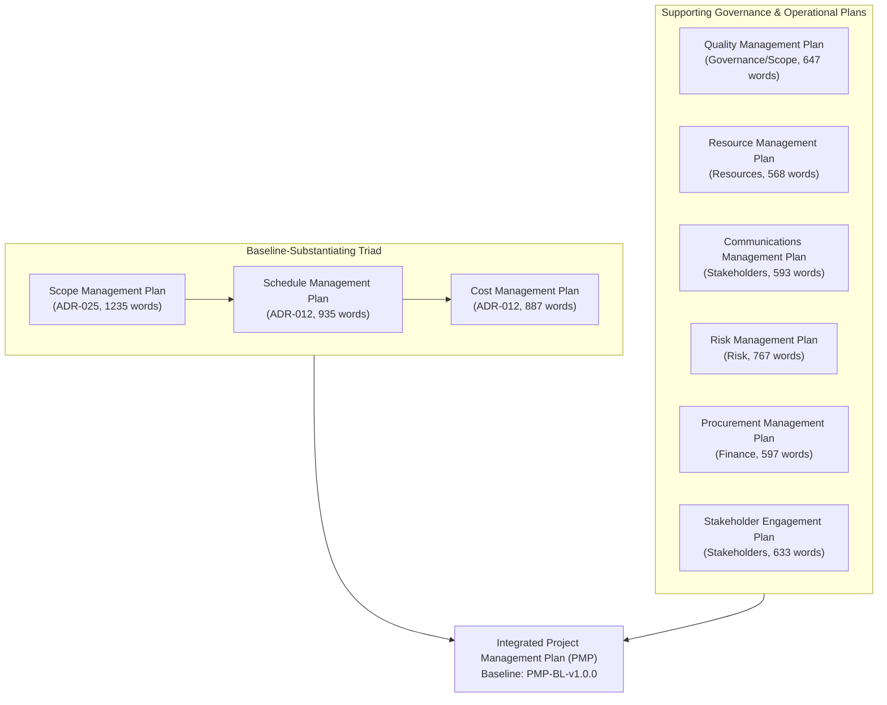

# Project Management Plan (PMP) — agent-learning Phase 1: Warm-Start & Confidence-Interval Bandits

> **PMBOK 8 Process:** `4.2 Develop Project Management Plan` (Planning Focus Area)  
> **Status:** **Proposed (PMP-BL-v1.0.0 Candidate — Not Approved Yet)**  
> **Governance Policy:** `approve-pmp` | **Lifecycle Stage:** `Stage 6 (Planning)`  
> **Baseline Identifier:** `PMP-BL-v1.0.0` (Candidate)  
> **Inputs:** [Project-Charter.md](Project-Charter.md), [docs/project-docs/management-plans/](management-plans/)  
> **Accountable Role:** Project Manager | **Approving Sponsor:** Menno Drescher  

---

## 1. Executive Summary & Core Baselines

This integrated Project Management Plan (PMP) establishes the operational framework, baseline contracts, and governance gates for **Phase 1: Warm-Start & Confidence-Interval Bandits**. It synthesizes the nine constituent subsidiary plans into a unified, actionable project baseline.

### 1.1 The Triple Baseline Contracts
1. **Scope Baseline (`PMP-BL-v1.0.0`):** 
   - Governed by [Scope-Management-Plan.md](management-plans/Scope-Management-Plan.md) and [ADR-025](../adr/ADR-025-scope-management-plan-standard-and-baseline-contract.md).
   - In-Scope: Milestones M0.5 (40-hr value research), M1 (Softmax exportability verification), M2 (Warm-start prior prototype), M3 (Confidence-interval bandit engine), M4 (Autonomy benchmark on 146 episodes), and M5 (Phase close adjudication).
   - Strictly Out-of-Scope: Option B (Phase 2 DPO/critiques), multi-modal OCR, bespoke SQLite database tables, and standalone web servers.
   - Decomposition: Formal WBS 100% rule and Definition of Done (DoD).
2. **Schedule Baseline (`PMP-BL-v1.0.0`):**
   - Governed by [Schedule-Management-Plan.md](management-plans/Schedule-Management-Plan.md).
   - Progressive elaboration with locked phase milestones and critical path duration of $\approx 7.5$ weeks ($\text{M1} \to \text{M2} \to \text{M3} \to \text{M4} \to \text{M5}$).
   - Hard 40-hour timebox on exploratory value research (M0.5) running in parallel float.
   - Schedule variance threshold: Critical path slippage $> 5$ business days triggers formal Sponsor escalation.
3. **Cost Baseline (`PMP-BL-v1.0.0`):**
   - Governed by [Cost-Management-Plan.md](management-plans/Cost-Management-Plan.md).
   - Staged funding model: 40-hour Sponsor research investment envelope for M0.5; 165 engineering hours base + 25 hours contingency reserve (190 hours total Phase 1 ceiling).
   - Zero-Cost Open-Source Policy: 100% free open-source software, free cloud dev tiers, and zero paid SaaS subscriptions.

---

## 2. Integrated Subsidiary Management Plans

### 2.1 Scope Management Plan (PMBOK 5.1 / Domain: Scope)
* **Document Reference:** [management-plans/Scope-Management-Plan.md](management-plans/Scope-Management-Plan.md)
* **Governing Standard:** [ADR-025](../adr/ADR-025-scope-management-plan-standard-and-baseline-contract.md)
* **Summary:** Establishes the authoritative system boundaries for Phase 1. Features an explicit WBS decomposition hierarchy (Phase $\to$ Epic $\to$ Story $\to$ Work Package), strict Definition of Done verification gates (test-first observed RED, pure stdlib implementation, full suite green), and formal out-of-scope boundaries to prevent silent creep. Revisions trigger transitive downstream DAG invalidation to Schedule and Cost.

### 2.2 Schedule Management Plan (PMBOK 6.1 / Domain: Schedule)
* **Document Reference:** [management-plans/Schedule-Management-Plan.md](management-plans/Schedule-Management-Plan.md)
* **Governing Standard:** ADR-026 (Pending daughter standard)
* **Summary:** Operates under progressive elaboration. Establishes the milestone dependency DAG and critical path analysis across M0.5 to M5. Features strict timeboxing (40-hour M0.5 research ceiling, 1-week story sprint iterations), buffer management, and SPI/SV earned schedule variance thresholds. Critical path slips $> 5$ days require Sponsor sign-off via Stage 17.

### 2.3 Cost Management Plan (PMBOK 7.1 / Domain: Finance)
* **Document Reference:** [management-plans/Cost-Management-Plan.md](management-plans/Cost-Management-Plan.md)
* **Governing Standard:** ADR-027 (Pending daughter standard)
* **Summary:** Implements a staged research investment model. Allocates the 40-hour Sponsor research commitment and 165 engineering hours with a 15% contingency reserve (190 hours total Phase 1 ceiling). Enforces an absolute Zero-Cost Open-Source boundary and free cloud tier limits. Tracks effort burn via EVM metrics ($CPI$, $CV$).

### 2.4 Quality Management Plan (PMBOK 8.1 / Domain: Governance & Scope)
* **Document Reference:** [management-plans/Quality-Management-Plan.md](management-plans/Quality-Management-Plan.md)
* **Governing Standard:** ADR-028 (Pending daughter standard)
* **Summary:** Defines the automated verification architecture across four deterministic rings (static analysis, story contract tests, system regression, and mathematical evidence gates). Enforces 100% test pass rates, strict type checking (`mypy --strict`), test-first contract verification (observed RED first), and Bayes factor thresholds ($BF_{10} \ge 10$ validation, $BF_{10} \le 0.1$ refutation).

### 2.5 Resource Management Plan (PMBOK 9.1 / Domain: Resources)
* **Document Reference:** [management-plans/Resource-Management-Plan.md](management-plans/Resource-Management-Plan.md)
* **Governing Standard:** ADR-029 (Pending daughter standard)
* **Summary:** Defines the agile human-agent pair engineering model. Formulates the project RACI matrix across the 18-stage lifecycle. Establishes developer workstation standards (`uv`, Python 3.10-3.12, Cosmos DB emulator) and governs institutional memory through version-controlled component skills and post-epic breakout recaps.

### 2.6 Communications Management Plan (PMBOK 10.1 / Domain: Stakeholders)
* **Document Reference:** [management-plans/Communications-Management-Plan.md](management-plans/Communications-Management-Plan.md)
* **Governing Standard:** ADR-030 (Pending daughter standard)
* **Summary:** Establishes the communication matrix and decision-recording channels. Enforces zero unrecorded verbal commitments, Conventional Commit conventions, and the AI interactive review `/q` protocol (LL-004). Schedules post-epic breakout recaps to capture operational process improvements (ADR-010).

### 2.7 Risk Management Plan (PMBOK 11.1 / Domain: Risk)
* **Document Reference:** [management-plans/Risk-Management-Plan.md](management-plans/Risk-Management-Plan.md)
* **Governing Standard:** ADR-031 (Pending daughter standard)
* **Summary:** Manages epistemic, technical, and operational risks across a $5 \times 5$ severity matrix. Deploys architectural counterweights against epistemic failure: low-pass momentum filtering ($\beta \in [0.6, 0.85]$), bounded recurrence exhaustion ($d_{\max}=2$ ceiling), and empirical Bayes factor gates. Realized critical risks ($Score \ge 15$) escalate to Sponsor.

### 2.8 Procurement Management Plan (PMBOK 12.1 / Domain: Finance)
* **Document Reference:** [management-plans/Procurement-Management-Plan.md](management-plans/Procurement-Management-Plan.md)
* **Governing Standard:** ADR-032 (Pending daughter standard)
* **Summary:** Formalizes the Zero External Procurement Strategy. Enforces complete internal self-sufficiency, zero external staffing contracts, and open-source licensing governance (permissive licenses only; copyleft strictly barred from production dependencies). Governs supply chain security via automated Dependabot audits.

### 2.9 Stakeholder Engagement Plan (PMBOK 13.2 / Domain: Stakeholders)
* **Document Reference:** [management-plans/Stakeholder-Engagement-Plan.md](management-plans/Stakeholder-Engagement-Plan.md)
* **Governing Standard:** ADR-033 (Pending daughter standard)
* **Summary:** Enforces the supreme principle of Sovereign Human Agency: statistical confidence is never permitted to usurp human authority over baselines, architecture, or intent. Defines the stakeholder power/interest grid, tracks engagement levels via SEAM, and guarantees locked human approval on all high-impact decision gates.

---

## 3. Feedback Loop from Closed-Loop Adaptation (ADR-008)

In accordance with **Pillar I (Cybernetic Closed-Loop Feedback)**, this PMP is not a static artifact. When operational drift, realized outcomes, or retrospective lessons learned trigger a Stage 17 Adaptation Plan (`approve-adaptation-plan`):
1. **Targeted Adaptation:** The Governance Change Impact Matrix classifies the drift and authorizes targeted re-planning of affected subsidiary plans.
2. **Transitive Invalidation:** Approved changes propagate staleness flags along the planning DAG (ADR-013 §4.5).
3. **Baseline Versioning:** Upon approval of an adaptation cycle, the current baseline (`PMP-BL-v1.0.0`) is archived to `docs/project-docs/management-plans/history/PMP-BL-v1.0.0/` and a successor baseline (e.g. `PMP-BL-v1.1.0`) is formalized.

---

## 4. Governance Authorization & Invariants

This integrated PMP is submitted for formal evaluation under **`approve-pmp`** (`FULL` Bayesian decision authority, `requires_human_approval: true`):
* **Invariant 1 (Sovereign Sign-off):** Formalization of this baseline requires explicit human sign-off from Menno Drescher (Project Sponsor / Initiator).
* **Invariant 2 (Downstream Baseline Anchoring):** All subsequent technical specifications (ADRs, BRDs, FDDs, User Stories) must record `pmp_baseline: "PMP-BL-v1.0.0"`.
* **Invariant 3 (Storage Boundary Compliance):** The approval verdict and canonical LF-normalized content hashes are serialized into standard `Episode.metadata` through `LearningStore` (ADR-002 Invariant #2, ADR-013 §4.3).
