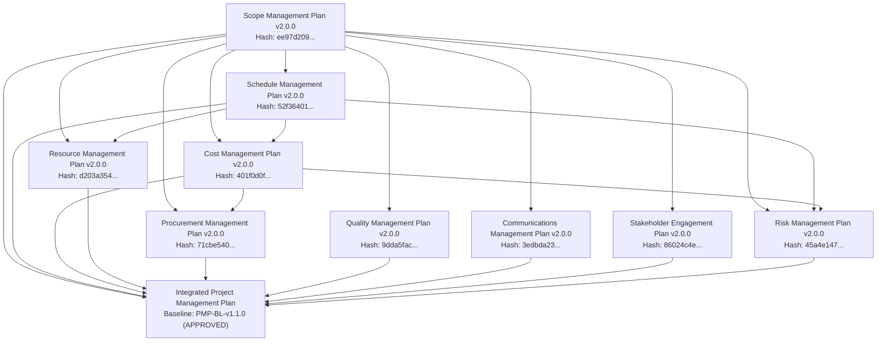

# Project Management Plan (PMP) — agent-learning Phase 2: Autonomous Feedback Loops & Extensible Architecture

> **PMBOK 8 Process:** `4.2 Develop Project Management Plan` (Planning Focus Area)  
> **Status:** **Approved (Baseline PMP-BL-v1.1.0 Formalized)**  
> **Governance Policy:** `approve-pmp` | **Lifecycle Stage:** `Stage 7 (Planning: Integrated PMP & Baselines)`  
> **Baseline Identifier:** `PMP-BL-v1.1.0` (Minor Baseline Increment from `PMP-BL-v1.0.1` / `PMP-BL-v1.0.0`)  
> **Inputs:** [Project-Charter.md](Project-Charter.md) v2.0, [Stakeholder-Register.md](Stakeholder-Register.md) v2.0, [Benefits-Management-Plan.md](Benefits-Management-Plan.md) v2.0, [Business-Case.md](Business-Case.md) v2.0, [management-plans/](management-plans/), [PCD-20261106-001](../governance/decisions/PCD-20261106-001-Phase-1-Close-Decision.md)  
> **Accountable Role:** Project Manager / PMBOK Steward | **Approving Sponsor:** Menno Drescher  
> **Historical Baseline Archive:** Frozen Phase 1 PMP snapshot preserved in [`docs/project-docs/history/PMP-BL-v1.0.0/Project-Management-Plan.md`](history/PMP-BL-v1.0.0/Project-Management-Plan.md)  

---

## 1. Executive Summary & Core Baselines (Phase 2)

This integrated Project Management Plan (PMP) establishes the operational framework, baseline contracts, and governance gates for **Phase 2: Autonomous Feedback Loops & Extensible Architecture**. Minor baseline increment `PMP-BL-v1.1.0` formally authorizes execution of **Option B (Epics 14, 18)**, **Contextual Ensembles (Epics 16, 21)**, and **Cognitive Feedback Loops (Epics 22, 38)** packaged within `agent-training-ext/` under complete upstream Microsoft fork immunity.

### 1.1 The Triple Baseline Contracts (Phase 2)

1. **Scope Baseline (`PMP-BL-v1.1.0`):**
   - Governed by [Scope-Management-Plan.md](management-plans/Scope-Management-Plan.md) v2.0.0, [Scope-Foundation-Pack-Manifest.md](management-plans/scope-baseline/Scope-Foundation-Pack-Manifest.md) v2.0.0, and [ADR-025](../adr/ADR-025-scope-management-plan-standard-and-baseline-contract.md).
   - **Authorized Scope:** Milestones M6 through M10 deliverables (`DEL-P2-01` through `DEL-P2-08`). Authorized execution bands: Band C (Epics 14, 18) and Band D (Epics 16, 21, 22, 38).
   - **Upstream Fork Collision Protection Architecture:** All custom code is developed strictly within `agent-training-ext/`. `src/agent_learning` remains a pristine reflection of upstream `microsoft/agent-learning` (0 lines diff).
   - **Strictly Out-of-Scope:** Direct edits to `src/agent_learning`, cloud GPU fine-tuning, unconstrained LLM parsing, standalone web servers, and relational databases.

2. **Schedule Baseline (`PMP-BL-v1.1.0`):**
   - Governed by [Schedule-Management-Plan.md](management-plans/Schedule-Management-Plan.md) v2.0.0, [Schedule-Foundation-Pack-Manifest.md](management-plans/schedule-baseline/Schedule-Foundation-Pack-Manifest.md) v2.0.0, and [ADR-026](../adr/ADR-026-schedule-management-plan-standard.md).
   - **Critical Path:** Sequential milestone progression across $\text{M6 (7.5 pd)} \to \text{M7 (6.5 pd)} \to \text{M8 (8.0 pd)} \to \text{M9 (5.5 pd)} \to \text{M10 (2.5 pd)} = \mathbf{30.0\text{ \textbf{person-days}}}$ (~5.8 calendar weeks).
   - **Reserve Envelope:** 5.0 pd management reserve (`SR-P2-M10`) + 12.5 pd risk contingency buffers (`CR-P2-01..03`).

3. **Cost & Capacity Baseline (`PMP-BL-v1.1.0`):**
   - Governed by [Cost-Management-Plan.md](management-plans/Cost-Management-Plan.md) v2.0.0, [Cost-Foundation-Pack-Manifest.md](management-plans/cost-baseline/Cost-Foundation-Pack-Manifest.md) v2.0.0, and [ADR-027](../adr/ADR-027-cost-management-plan-standard.md).
   - **Sourced Capacity Commitment:** 120–160 maintainer engineering hours committed by Menno Drescher, accelerated by Antigravity AI engineering throughput.
   - **Economic Labor Valuation:** **€19,175.00** baseline (€15,300 base labor + €3,875 contingency buffer at €85.00/hr shadow rate; €0.00 cash disbursement).
   - **Hard Cash OpEx Ceiling:** $\le €100.00/\text{month}$ and $\le €300.00$ overall Phase 2 cash envelope.
   - **Sourcing:** 100% internal Make sourcing on local workstations; zero cloud GPU spend (saving $> €5,000$).

---

## 2. Integrated Subsidiary Management Plans & Canonical Hashes

All nine constituent subsidiary management plans are fully updated, validated, and integrated into `PMP-BL-v1.1.0`:

| Subsidiary Plan | Primary Domain | Version | Governing Standard | Canonical Content Hash | Word Count |
|---|---|:---:|:---:|:---:|:---:|
| [Scope-Management-Plan.md](management-plans/Scope-Management-Plan.md) | Scope (5.1) | v2.0.0 | [ADR-025](../adr/ADR-025-scope-management-plan-standard-and-baseline-contract.md) | `ee97d20993e90c88a5fe7619ed4329d47377e930a7a7cea5c3207e6d5b9c6270` | 1,632 words |
| [Schedule-Management-Plan.md](management-plans/Schedule-Management-Plan.md) | Schedule (6.1) | v2.0.0 | [ADR-026](../adr/ADR-026-schedule-management-plan-standard.md) | `52f36401e551f37c6f18544f3b78e7d9784aa61d0ef7d5fdf613da93648345c5` | 700 words |
| [Cost-Management-Plan.md](management-plans/Cost-Management-Plan.md) | Finance (7.1) | v2.0.0 | [ADR-027](../adr/ADR-027-cost-management-plan-standard.md) | `401f0d0fe8a3b7092ec76110946e1fe0bc628efd5a77dbf03300a3b5e7309ebc` | 619 words |
| [Quality-Management-Plan.md](management-plans/Quality-Management-Plan.md) | Governance (8.1) | v2.0.0 | [ADR-029](../adr/ADR-029-quality-management-plan-standard.md) | `9dda5facbe7ae1a3e64ba38d7f5ba3030afaa73feb854bb45a41d77e0e6b5fb9` | 1,841 words |
| [Resource-Management-Plan.md](management-plans/Resource-Management-Plan.md) | Resources (9.1) | v2.0.0 | [ADR-030](../adr/ADR-030-resource-management-plan-standard.md) | `d203a3540d9fd6046f23a5ba82250ffe37610a080b85a2e948c3f285c95986a7` | 674 words |
| [Communications-Management-Plan.md](management-plans/Communications-Management-Plan.md) | Stakeholders (10.1)| v2.0.0 | [ADR-032](../adr/ADR-032-communications-management-plan-standard.md) | `3edbda23545b18f0fd84df495067b5dcdbb2351121d1406de992de7d531c74e2` | 2,029 words |
| [Risk-Management-Plan.md](management-plans/Risk-Management-Plan.md) | Risk (11.1) | v2.0.0 | [ADR-028](../adr/ADR-028-risk-management-plan-standard.md) | `45a4e1478ae4e8bb58bad17d0644af837cad7f1ba9b07f3a97833efb7c7e8f39` | 2,276 words |
| [Procurement-Management-Plan.md](management-plans/Procurement-Management-Plan.md) | Finance (12.1) | v2.0.0 | [ADR-033](../adr/ADR-033-procurement-management-plan-standard.md) | `71cbe54099274892ac0c5068239441174503e7acff8252c8c5936ce7667ba44c` | 1,849 words |
| [Stakeholder-Engagement-Plan.md](management-plans/Stakeholder-Engagement-Plan.md) | Stakeholders (13.2)| v2.0.0 | [ADR-031](../adr/ADR-031-stakeholder-engagement-plan-standard.md) | `86024c4e14ae08efb327eeec846332f319ad364b4b1a5acf6b6464926de0e1a6` | 1,864 words |

---

## 3. Planning DAG & Integration Architecture

---

## 4. Upstream Fork Collision Protection Architecture Directive

Per [Project-Charter.md](Project-Charter.md) v2.0 §3 and [Benefits-Management-Plan.md](Benefits-Management-Plan.md) v2.0 (`BEN-P2-004`):
1. **Pristine Upstream Mirror:** The core package in `src/agent_learning/` must remain an exact reflection of upstream `microsoft/agent-learning` HEAD.
2. **Dedicated Extension Package:** All custom code, algorithms, and models must reside exclusively in `agent-training-ext/`.
3. **Decoupled Imports:** Custom extensions may import public frozen dataclasses (`DecisionFrame`, `DecisionOption`, `EvidencePoint`, `Action`, `Episode`) from `agent_learning`, but must never import `agent_learning.storage` or modify upstream internal mechanics.
4. **Automated Verification:** `git diff upstream/main -- src/agent_learning` must output 0 lines on every PR and release build.

---

## 5. Baseline Evolution Log

* **`PMP-BL-v1.0.0` (2026-11-01):** Initial triple baseline formalization for Phase 1: Warm-Start & Confidence-Interval Bandits (Approval episode `d2e37276-6480-4874-ac8f-76d7d701b1cf`).
* **`PMP-BL-v1.0.1` (2026-11-06):** Adaptive closure of Phase 1 and seeding of Phase 2 (PCD-20261106-001, IRP-20261106-001, ADP-20261106-001). Operationalized governance changes GC-001 through GC-004.
* **`PMP-BL-v1.1.0` (2026-11-08):** Minor baseline increment formalizing Phase 2: Autonomous Feedback Loops & Extensible Architecture. Authorizes execution of Option B (Epics 14, 18), Contextual Ensembles (Epics 16, 21), and Continuous SIDPA (Epics 22, 38) inside `agent-training-ext/`.

---

## 6. Governance Authorization & Architectural Invariants

This integrated PMP is formalized under **`approve-pmp`** (`FULL` Bayesian decision authority, `requires_human_approval: true`):
* **Invariant 1 (Sovereign Sign-off):** Formalization of this baseline requires explicit human approval from Menno Drescher (Project Sponsor & Maintainer).
* **Invariant 2 (Downstream Baseline Anchoring):** All Phase 2 technical specifications, story headers, and commits must cite `pmp_baseline: "PMP-BL-v1.1.0"`.
* **Invariant 3 (Storage Boundary Compliance):** Approval verdicts and canonical LF-normalized content hashes are serialized into standard `Episode.metadata` through `LearningStore` (ADR-002 Invariant #2, ADR-013 §4.3).
* **Invariant 4 (Standard Library Purity):** Subsystems in `agent-training-ext/` strictly prohibit unauthorized dependencies; standard library only.
* **Invariant 5 (Deterministic Test Pass Rate):** 100% test pass rate across active unit and contract test suites.
* **Invariant 6 (Upstream Fork Collision Protection):** `src/agent_learning` exhibits zero merge conflicts and zero lines of diff against upstream Microsoft HEAD.
