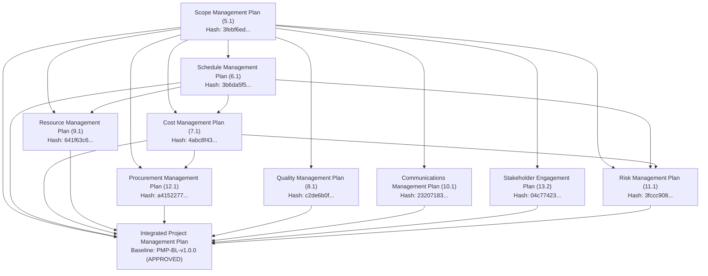

# Project Management Plan (PMP) — agent-learning Phase 1: Warm-Start & Confidence-Interval Bandits

> **PMBOK 8 Process:** `4.2 Develop Project Management Plan` (Planning Focus Area)  
> **Status:** **Approved (Baseline PMP-BL-v1.0.0 Formalized)**  
> **Governance Policy:** `approve-pmp` | **Lifecycle Stage:** `Stage 7 (Planning: Integrated PMP & Baselines)`  
> **Baseline Identifier:** `PMP-BL-v1.0.0`  
> **Inputs:** [Project-Charter.md](Project-Charter.md), [docs/project-docs/management-plans/](management-plans/)  
> **Accountable Role:** Project Manager | **Approving Sponsor:** Menno Drescher  
> **Formal Approval Episode:** `d2e37276-6480-4874-ac8f-76d7d701b1cf` (2026-11-01)

---

## 1. Executive Summary & Core Baselines

This integrated Project Management Plan (PMP) establishes the operational framework, baseline contracts, and governance gates for **Phase 1: Warm-Start & Confidence-Interval Bandits**. It synthesizes the nine constituent subsidiary plans into a unified, actionable, and mathematically verified project baseline.

### 1.1 The Triple Baseline Contracts
1. **Scope Baseline (`PMP-BL-v1.0.0`):** 
   - Governed by [Scope-Management-Plan.md](management-plans/Scope-Management-Plan.md) and [ADR-025](../adr/ADR-025-scope-management-plan-standard-and-baseline-contract.md).
   - In-Scope: Milestones M0.5 (40-hr value research), M1 (Softmax exportability verification), M2 (Warm-start prior prototype), M3 (Confidence-interval bandit engine), M4 (Autonomy benchmark on 146 episodes), and M5 (Phase close adjudication).
   - Strictly Out-of-Scope: Option B (Phase 2 DPO/critiques), multi-modal OCR, bespoke SQLite database tables, and standalone web servers.
   - Decomposition: Formal WBS 100% rule (143 dictionary rows across WP-01 to WP-07) and Definition of Done (DoD).
2. **Schedule Baseline (`PMP-BL-v1.0.0`):**
   - Governed by [Schedule-Management-Plan.md](management-plans/Schedule-Management-Plan.md) and [ADR-026](../adr/ADR-026-schedule-management-plan-standard.md).
   - Progressive elaboration with locked phase milestones and critical path duration of $\approx 7.5$ weeks (37.7 person-days) across $\text{M1} \to \text{M2} \to \text{M3} \to \text{M4} \to \text{M5}$.
   - Hard 40-hour timebox on exploratory value research (M0.5) running in parallel float.
   - Schedule buffer envelope: 24.3 weeks (121.7 person-days) total project buffer; buffer consumption tracked via $BCI$.
   - Schedule variance threshold: Critical path slippage $> 5$ business days triggers formal Sponsor escalation.
3. **Cost Baseline (`PMP-BL-v1.0.0`):**
   - Governed by [Cost-Management-Plan.md](management-plans/Cost-Management-Plan.md) and [ADR-027](../adr/ADR-027-cost-management-plan-standard.md).
   - Staged funding model: Dual-rate labor valuation (€85.00/hr economic shadow rate, €0.00/hr cash disbursement; €58,854.00 total Band B labor valuation).
   - Strict Cash OpEx Ceiling: $\le €100.00/\text{mo}$ (maximum €250.00 total Phase 1 envelope) for model APIs and telemetry validation.
   - Sourcing Decision: 100% internal "Make" sourcing; external temporary contractors strictly barred (€143,327 cost avoidance).

---

## 2. Integrated Subsidiary Management Plans & Formal Baselines

All nine constituent subsidiary management plans have been drafted, linted, verified against normative standards, and formally approved under `approve-subsidiary-plan`:

| Subsidiary Plan | Knowledge Area | Version | Standard | Canonical Content Hash | Approval Episode | Date | Word Count |
|---|---|:---:|:---:|:---:|:---:|:---:|:---:|
| [Scope-Management-Plan.md](management-plans/Scope-Management-Plan.md) | Scope (5.1) | v1.2.0 | [ADR-025](../adr/ADR-025-scope-management-plan-standard-and-baseline-contract.md) | `3febf6edd1dbed564df2a8618176d32c42ec19a5d02dcf3ea45b594b70cb33a8` | `d68772b0-d831-4a86-90a9-a891747b9007` | 2026-10-30 | 3,074 words |
| [Schedule-Management-Plan.md](management-plans/Schedule-Management-Plan.md) | Schedule (6.1) | v1.2.0 | [ADR-026](../adr/ADR-026-schedule-management-plan-standard.md) | `3b6da5f529f68f90133aa17d6b5e8ef84ebf9d332b0279744dad50c5b4b49dba` | `d8ee6350-a7ce-48c7-a566-d2e602c28c9a` | 2026-11-01 | 2,362 words |
| [Cost-Management-Plan.md](management-plans/Cost-Management-Plan.md) | Finance (7.1) | v1.1.0 | [ADR-027](../adr/ADR-027-cost-management-plan-standard.md) | `4abc8f43b5a49cd1b968df4138992ae3900fd77d4168354c5d63218f6e16489b` | `72d23862-3d3e-4438-8950-884f06bd0fd0` | 2026-11-01 | 1,776 words |
| [Quality-Management-Plan.md](management-plans/Quality-Management-Plan.md) | Governance (8.1) | v1.1.0 | [ADR-029](../adr/ADR-029-quality-management-plan-standard.md) | `c2de6b0f18f2abb8c81905cff219a4f365e27c4a171a8ede1bf44b778f03d4ec` | `14ff58df-f027-4d41-93c2-04c5170b151c` | 2026-11-01 | 1,670 words |
| [Resource-Management-Plan.md](management-plans/Resource-Management-Plan.md) | Resources (9.1) | v1.1.0 | [ADR-030](../adr/ADR-030-resource-management-plan-standard.md) | `641f63c63e67cc41fcf49a93cdcbb851c4d9742fcdcdcb17aed8b6c020a97c9f` | `ebf812e6-d3c2-4773-918f-22a7b447cbe9` | 2026-11-01 | 1,627 words |
| [Communications-Management-Plan.md](management-plans/Communications-Management-Plan.md) | Stakeholders (10.1) | v1.1.0 | [ADR-032](../adr/ADR-032-communications-management-plan-standard.md) | `23207183061ba9ed5ff3ec9fa2c02411cc73d478c00f870ca7af5dc34e726e3e` | `d40e8e9c-abe0-48f2-a7df-31ffc28f9bff` | 2026-11-01 | 1,793 words |
| [Risk-Management-Plan.md](management-plans/Risk-Management-Plan.md) | Risk (11.1) | v1.1.0 | [ADR-028](../adr/ADR-028-risk-management-plan-standard.md) | `3fccc908ab0766af6847f4b628dabcaa0eb58763849b45541d006e601f6aa5c9` | `4c609b22-d7d7-419f-b2ee-4b98270e95db` | 2026-11-01 | 1,923 words |
| [Procurement-Management-Plan.md](management-plans/Procurement-Management-Plan.md) | Finance (12.1) | v1.1.0 | [ADR-033](../adr/ADR-033-procurement-management-plan-standard.md) | `a4152277a7b3c70c16178bca116ad4ecc3ab0cf18014807e2883fe51ee997a17` | `cb44cc0c-c923-4443-883e-6f0608273aa5` | 2026-11-01 | 1,517 words |
| [Stakeholder-Engagement-Plan.md](management-plans/Stakeholder-Engagement-Plan.md) | Stakeholders (13.2) | v1.1.0 | [ADR-031](../adr/ADR-031-stakeholder-engagement-plan-standard.md) | `04c77423f5461ff5e3b08a18e2ed367a92237f968bab5599d1aa4ea77ca82a3e` | `b67a8106-9fea-4031-9efb-75236c878a8e` | 2026-11-01 | 1,648 words |

---

## 3. Feedback Loop from Closed-Loop Adaptation (ADR-008)

In accordance with **Pillar I (Cybernetic Closed-Loop Feedback)**, this PMP is not a static artifact. When operational drift, realized outcomes, or retrospective lessons learned trigger a Stage 17 Adaptation Plan (`approve-adaptation-plan`):
1. **Targeted Adaptation:** The Governance Change Impact Matrix classifies the drift and authorizes targeted re-planning of affected subsidiary plans.
2. **Transitive Invalidation:** Approved changes propagate staleness flags along the planning DAG (ADR-013 §4.5).
3. **Baseline Versioning:** Upon approval of an adaptation cycle, the current baseline (`PMP-BL-v1.0.0`) is archived to `docs/project-docs/management-plans/history/PMP-BL-v1.0.0/` and a successor baseline (e.g. `PMP-BL-v1.1.0`) is formalized.

---

## 4. Governance Authorization & Architectural Invariants

This integrated PMP is formalized under **`approve-pmp`** (`FULL` Bayesian decision authority, `requires_human_approval: true`):
* **Invariant 1 (Sovereign Sign-off):** Formalization of this baseline requires explicit human sign-off from Menno Drescher (Project Sponsor / Initiator).
* **Invariant 2 (Downstream Baseline Anchoring):** All subsequent technical specifications (ADRs, BRDs, FDDs, User Stories) must record `pmp_baseline: "PMP-BL-v1.0.0"`.
* **Invariant 3 (Storage Boundary Compliance):** The approval verdict and canonical LF-normalized content hashes are serialized into standard `Episode.metadata` through `LearningStore` (ADR-002 Invariant #2, ADR-013 §4.3).
* **Invariant 4 (Standard Library Purity):** Subsystem modules in `agent_learning.pmbok` strictly prohibit unauthorized dependencies.
* **Invariant 5 (Deterministic Test Pass Rate):** 100% test pass rate across active unit and contract test suites.
