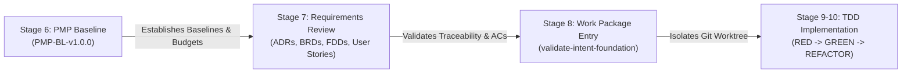
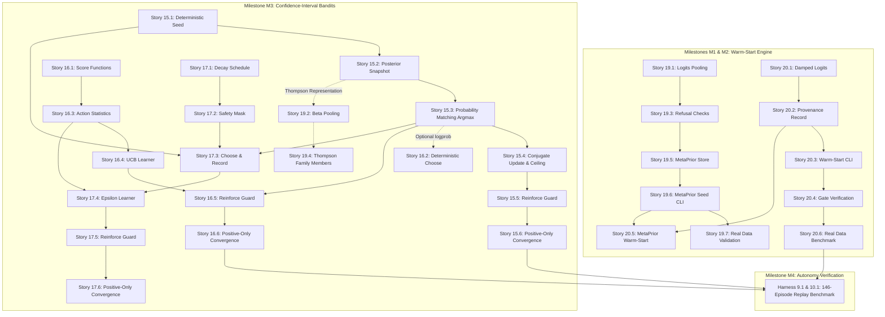

# Stage 7 Technical Requirements Review & Readiness Report

> **Baseline Identifier:** `PMP-BL-v1.0.0` | **Lifecycle Stage:** `Stage 7 (Technical Requirements)`  
> **Report ID:** `REP-REQ-STAGE7-v1.0.0` | **Date:** `2026-11-01`  
> **Accountable Author:** Project Manager | **Approving Sponsor:** Menno Drescher  
> **Governing Standards:** [ADR-008](../../adr/ADR-008-pmbok-lifecycle-orchestration-and-pmp-adaptation-loop.md), [ADR-025](../../adr/ADR-025-scope-management-plan-standard-and-baseline-contract.md), [ADR-029](../../adr/ADR-029-quality-management-plan-standard.md), [ADR-037](../../adr/ADR-037-design-time-baseline-feedback-loop.md)  
> **Gate Destination:** Stage 8 Work Package Entry Gate (`validate-intent-foundation`)

---

## 1. Executive Summary & Stage 7 Purpose

In accordance with [Project-Management-Plan.md](../Project-Management-Plan.md) and [Scope-Management-Plan.md](../management-plans/Scope-Management-Plan.md) §1.7, this report documents the formal completion of **Stage 7 (Technical Requirements Review & Traceability Alignment)**. 

### 1.1 The Operational Role of Stage 7
Stage 7 establishes the formal contractual bridge between the approved **Project Management Plan Baseline (`PMP-BL-v1.0.0`)** and the executable code delivered in Stages 9–10:

Because the technical specifications (ADRs 001–038, BRDs, FDDs, and Epics 1–38) were progressively elaborated and previously approved via Bayesian decision gates (`approve-user-stories`), this Stage 7 milestone did **not** require rewriting the specifications. Instead, it executed a **rigorous technical audit and baseline alignment review**:
1. Recapping the Phase 1 Band B Epics and Stories (Epics 15, 16, 17, 19, 20, and Harness Stories 9.1 & 10.1).
2. Verifying full traceability and anchoring all Band B Epics to `pmp_baseline: "PMP-BL-v1.0.0"`.
3. Verifying non-functional technical invariants (Standard Library purity, zero third-party dependencies, CPU-only execution, snapshot storage constraints).
4. Resolving dependency sequencing across stories to establish an unblocked implementation path.
5. Auditing the Design-Time Baseline Feedback Loop ([ADR-037](../../adr/ADR-037-design-time-baseline-feedback-loop.md)) to certify zero open baseline feedback items (`BFI-NNN`).

**Conclusion:** All Phase 1 Band B technical specifications are certified **Ready for Stage 8 (`validate-intent-foundation`)**.

---

## 2. Band B Technical Specifications Audit & Traceability Matrix

Under [Scope-Management-Plan.md](../management-plans/Scope-Management-Plan.md) §1.5, Phase 1 implementation authority is strictly confined to **Band B (Phase 1 Product)**. Band C (Phase 2 DPO/critiques Epics 14 and 18) and Band D/E epics are strictly deferred.

The 31 stories comprising Band B have been audited for completeness, testability of Acceptance Criteria ($AC_n$), and structural alignment:

| Epic Ref | Title | Stories | Target Modules | Contract Test Suite | Upstream Dependencies | Readiness Status |
|:---:|---|:---:|---|---|---|:---:|
| [**Epic 15**](../../user-stories/epic-15-bayesian-bandit-posterior-sampling.md) | Bayesian Bandit Posterior Sampling (Thompson) | 6 stories (15.1–15.6) | `src/agent_learning/policy/thompson.py` `src/agent_learning/learners/thompson.py` | `tests/test_thompson_seed.py` `tests/test_thompson_policy.py` `tests/test_thompson_learner.py` `tests/test_thompson_reinforce_guard.py` `tests/test_thompson_positive_only.py` | None (Unblocked) | **READY** |
| [**Epic 16**](../../user-stories/epic-16-deterministic-ucb-decision-policy.md) | Deterministic Upper Confidence Bound (UCB-1) | 6 stories (16.1–16.6) | `src/agent_learning/policy/ucb.py` `src/agent_learning/learners/ucb.py` `src/agent_learning/policy/action_statistics.py` | `tests/test_ucb_scores.py` `tests/test_ucb_policy.py` `tests/test_action_statistics.py` `tests/test_ucb_learner.py` `tests/test_ucb_reinforce_guard.py` `tests/test_ucb_positive_only.py` | Story 15.3 (optional `logprob`) | **READY** |
| [**Epic 17**](../../user-stories/epic-17-scheduled-epsilon-greedy-policy.md) | Scheduled Epsilon-Greedy Baseline Policy | 6 stories (17.1–17.6) | `src/agent_learning/policy/epsilon_greedy.py` `src/agent_learning/learners/epsilon_greedy.py` | `tests/test_epsilon_schedule.py` `tests/test_epsilon_safety_mask.py` `tests/test_epsilon_policy.py` `tests/test_epsilon_learner.py` `tests/test_epsilon_reinforce_guard.py` `tests/test_epsilon_positive_only.py` | Stories 15.1, 15.3, 16.3/16.4 | **READY** |
| [**Epic 19**](../../user-stories/epic-19-hierarchical-meta-prior-compilation.md) | Hierarchical Meta-Prior Compilation | 7 stories (19.1–19.7) | `src/agent_learning/meta_prior.py` `src/agent_learning/cli.py` | `tests/test_meta_prior_softmax.py` `tests/test_meta_prior_thompson.py` `tests/test_meta_prior_refusals.py` `tests/test_meta_prior_members.py` `tests/test_meta_prior_store.py` `tests/test_meta_prior_seed.py` `tests/test_meta_prior_real_data.py` | Story 15.2 (Thompson representation) | **READY** |
| [**Epic 20**](../../user-stories/epic-20-explicit-policy-prior-warm-starting.md) | Explicit Policy Prior Warm-Starting | 6 stories (20.1–20.6) | `src/agent_learning/warm_start.py` `src/agent_learning/cli.py` | `tests/test_warm_start_logits.py` `tests/test_warm_start_provenance.py` `tests/test_warm_start_cli.py` `tests/test_warm_start_gate.py` `tests/test_warm_start_meta_prior.py` `tests/test_warm_start_real_data.py` | Stories 19.5, 19.6 | **READY** |
| **Harness** | Autonomy Benchmark 146-Episode Replay | Stories 9.1 & 10.1 | `tests/test_benchmark_autonomy_replay.py` | Synthetic & historical episode replay suite | Epics 15, 16, 20 complete | **READY** |

---

## 3. Deep-Dive Specification Highlights per Epic

### 3.1 Epic 15 — Thompson Sampling (`policy/thompson.py`, `learners/thompson.py`)
* **Core Mechanics:** Beta-Bernoulli conjugate update engine for exploration under high uncertainty.
* **Deterministic Replay:** PRNG seed derived via `HMAC-SHA256(key=policy_id, msg=request_id + "|" + timestamp)` ensuring stochastic choices remain fully auditable and replayable by auditors ($AC_0, AC_3$).
* **Storage Invariant:** Posterior parameters (`alpha`, `beta`) stored directly in `snapshot.metadata["posterior_parameters"]`. No database schema migration or new record types allowed.
* **Observation Ceiling:** Caps cumulative pseudo-counts at 5,000 total observations while preserving the $\alpha : \beta$ ratio, preventing numeric overflow and frozen posteriors ($AC_2$).
* **API Generalization:** Makes `Decision.logprob` optional (`Optional[float]`), decoupling probability-matching policies from logit policies ($AC_3$).

### 3.2 Epic 16 — Deterministic Upper Confidence Bound (`policy/ucb.py`, `learners/ucb.py`)
* **Core Mechanics:** Deterministic choice using standard UCB1 bonus ($c \sqrt{2 \ln(N) / n_i}$) and Wilson lower bound closed-form formulas ($AC_0, AC_1$).
* **Zero-RNG Invariant:** Static code inspection verifies zero import or call to `random` ($AC_5$). Pure function of past pull counts and rewards.
* **Tie-Breaking Rule:** Strict deterministic resolution: highest score $\to$ highest pull count $\to$ lexicographically smallest `action.id` ($AC_2$).
* **Shared Statistics Module:** Pull counts and cumulative rewards extracted into shared `action_statistics.py` for reuse across UCB and $\epsilon$-greedy.

### 3.3 Epic 17 — Scheduled Epsilon-Greedy Baseline (`policy/epsilon_greedy.py`, `learners/epsilon_greedy.py`)
* **Core Mechanics:** Bounded exploration rate decaying from $\epsilon_0$ to a fixed floor: $\epsilon(t) = \max(\text{floor}, \epsilon_0 - \delta \cdot t)$ ($AC_0, AC_1$).
* **Safety Masking:** Exploration restricted strictly to actions explicitly marked with `"reversible": true`. Irreversible actions force greedy selection ($AC_0, AC_2$).
* **Auditing:** Decisions record `branch_taken` (`"greedy"` vs. `"exploration"`), the applied exploration rate, and the deterministic seed ($AC_3$).

### 3.4 Epic 19 — Hierarchical Meta-Prior Compilation (`meta_prior.py`)
* **Core Mechanics:** Empirical Bayes pooling of learned logits across families of related task policies.
* **Offset Invariance:** Member logits are mean-centered prior to pooling, guaranteeing that arbitrary additive constants ignored by Softmax do not distort the compiled meta-prior ($AC_0, AC_2$).
* **Beta Pooling:** Dedicated pooling for Beta-count members using payoff rates and dispersion ($\kappa_{\text{prior}}$) ($AC_0, AC_1$).
* **Strict Refusal:** Refuses families with fewer than 4 members or any member that has not met its autonomy gate ($AC_0, AC_1$).

### 3.5 Epic 20 — Explicit Policy Prior Warm-Starting (`warm_start.py`)
* **Core Mechanics:** Transfers knowledge from a mature donor policy to a cold target via damped logits: $\mathbf{z}_{\text{target}} = \gamma \cdot \mathbf{z}_{\text{donor}}$ ($0 < \gamma \le 1.0$) ($AC_0, AC_2$).
* **Entropy Control:** Damping factor strictly increases softmax entropy, preventing overconfident cold-start assertions ($AC_1$).
* **Auditable Provenance:** Stores full donor lineage (`donor_policy_id`, `donor_version`, `damping_factor`, `action_map`) directly in snapshot metadata ($AC_0$).

---

## 4. Technical Constraints & Architecture Invariants Compliance

All Band B specifications have been audited against the non-negotiable architectural constraints locked in `PMP-BL-v1.0.0`:

1. **Standard Library Purity ([ADR-012](../../adr/ADR-012-subsidiary-management-plan-standards-and-content-contracts.md)):**
   - All modules (`thompson.py`, `ucb.py`, `epsilon_greedy.py`, `meta_prior.py`, `warm_start.py`, `action_statistics.py`) must import **only** from the Python standard library (`math`, `random`, `hmac`, `hashlib`, `json`, `dataclasses`, `typing`).
   - Zero third-party dependencies (`numpy`, `scipy`, `torch`, `pydantic`) are permitted in the policy engine.
2. **Storage Boundary ([ADR-002](../../adr/ADR-002-storage-backend-strategy.md)):**
   - No new Cosmos DB containers, tables, or collections.
   - All posterior state, pull statistics, and provenance records reside within the existing `metadata: Dict[str, Any]` field of `PolicySnapshot`.
3. **Execution Latency & Memory Footprint:**
   - CPU-only execution.
   - Per-decision `choose()` latency: $\le 1.0\text{ ms}$.
   - Memory footprint overhead: $\le 50\text{ KB}$ per policy instance.
4. **Ring 1 Contract Test Isolation ([Quality-Management-Plan.md](../management-plans/Quality-Management-Plan.md)):**
   - Every acceptance criterion maps to a fast, deterministic contract test running sandboxed-first.

---

## 5. Topological Story Dependency Graph & Stage 8 Execution Flow

To ensure smooth work package execution in Stage 8/9 without blocked threads, the implementation dependency order is mapped below:

---

## 6. Design-Time Baseline Feedback Audit (ADR-037)

In accordance with [ADR-037](../../adr/ADR-037-design-time-baseline-feedback-loop.md), all subsidiary management plans and technical specifications have been inspected for open design-time feedback items:

| BFI Ref | Originating Document | Focus Area | Nature of Finding | Resolution Status | Approval Reference |
|:---:|---|---|---|:---:|:---:|
| **BFI-001** | Schedule Management Plan | Schedule Foundation Pack | Tier-1 breakout integration | **Applied** | Episode `d8ee6350-a7ce-48c7-a566-d2e602c28c9a` |
| **BFI-002** | Scope Management Plan | Scope Foundation Pack | Tier-1 breakout integration & 143-row WBS | **Applied** | Episode `d68772b0-d831-4a86-90a9-a891747b9007` |
| **BFI-003** | Resource Management Plan | Resource Foundation Pack | Labor rate structure & capacity estimates | **Applied** | Episode `ebf812e6-d3c2-4773-918f-22a7b447cbe9` |
| **BFI-004** | Cost Management Plan | Cost Foundation Pack | Staged budget & shadow labor pricing | **Applied** | Episode `72d23862-3d3e-4438-8950-884f06bd0fd0` |

* **Pending Baseline Feedback Items:** **None** (`Pending Baseline Feedback = None`).
* **Defect Log:** Zero open defects between technical specifications and `PMP-BL-v1.0.0`.

---

## 7. Stage 8 Readiness Gate Assessment

The pre-conditions required for entering **Stage 8 Work Package Entry Gate (`validate-intent-foundation`)** have been formally verified:

| Stage 8 Entry Pre-Condition | Verification Standard | Evaluation Evidence | Gate Status |
|---|---|---|:---:|
| **1. Integrated PMP Approval** | `approve-pmp` formalization | Formalized baseline `PMP-BL-v1.0.0` (Episode `d2e37276...`) | **PASS** |
| **2. Requirements Baseline Anchoring** | RTM Header Convention | Epics 10, 15, 16, 17, 19, 20 anchored to `PMP-BL-v1.0.0` | **PASS** |
| **3. Acceptance Criteria Completeness** | Testable $AC_n$ in all stories | 31 Band B stories possess discrete mathematical ACs | **PASS** |
| **4. Architectural Invariant Compliance** | Standard library purity & storage | Zero 3rd party packages; metadata-only persistence | **PASS** |
| **5. Design-Time Baseline Feedback** | ADR-037 BFI table | 0 open BFIs across all plans | **PASS** |
| **6. Active Test Suite Cleanliness** | Quality Gate QG-01 | 1,512 tests passed, 0 failures, 3 skipped | **PASS** |

### Formal Recommendation:
The Project Manager certifies that **Stage 7 (Technical Requirements Review)** is complete with zero blockers. The engineering team is authorized to initiate **Stage 8 Work Package Entry (`validate-intent-foundation`)** for Milestone M1 / M2 stories.

---

## 8. Stakeholder Distribution & Acknowledgement

This report is formally transmitted to all stakeholders registered in [Stakeholder-Engagement-Plan.md](../management-plans/Stakeholder-Engagement-Plan.md):

* **SH-01: Menno Drescher (Project Sponsor & Principal Researcher):** Transmitted for executive sign-off and authorization of Stage 8 work packages.
* **SH-02: Project Manager (PMBOK Steward):** Archived in project audit trail.
* **SH-03: Core Maintainers / Tech Leads (Engineering):** Actionable implementation roadmap unblocked.
* **SH-04: Quality Engineer (Verification Lead):** Test architecture contracts locked.
* **SH-05: Downstream SDK Consumers:** Notification of frozen Phase 1 capability scope.
* **SH-06: AI Engineering Assistant:** Authorized to support Stage 8 validation and Stage 9 implementation worktrees.

---
*Report archived under `docs/project-docs/Status-Reports/Stage-7-Requirements-Readiness-Report.md`.*

