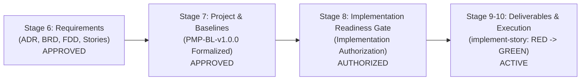

# Stage 8: Implementation Readiness Gate & Project Execution Authorization Notice

> **Baseline Identifier:** `PMP-BL-v1.0.0` | **Lifecycle Stage:** `Stage 8 (Implementation Readiness Gate)`  
> **Notice ID:** `NOT-EXEC-STAGE8-v1.0.0` | **Date:** `2026-11-01`  
> **Accountable Author:** Project Manager | **Approving Sponsor:** Menno Drescher  
> **Governing Framework:** PMBOK® Guide 8th Edition & SIDPA Template  
> **Execution Status:** **FORMALLY AUTHORIZED TO EXECUTE**

---

## 1. Executive Briefing & Milestone Declaration

In accordance with [Project-Management-Plan.md](../Project-Management-Plan.md) and [Stakeholder-Engagement-Plan.md](../management-plans/Stakeholder-Engagement-Plan.md) §3.1, this notice serves as the formal declaration to **all project stakeholders, sponsors, engineering teams, and administrative departments**:

$$\mathbf{STAGE\ 8:\ IMPLEMENTATION\ READINESS\ GATE\ PASSED}$$
$$\mathbf{PROJECT\ EXECUTION\ PHASE\ OFFICIALLY\ COMMENCED}$$

### 1.1 Planning Phase Closeout & Reconciliation
The project has formally and successfully reached the **end of the Planning Phase**. All planning artifacts, governance models, and technical requirements across **Stage 6 (Requirements)** and **Stage 7 (Project Management Plan & Baselines)** have been fully reconciled, validated, and approved:

1. **Stage 6 (Technical Requirements):** Completed and accepted across all Architecture Decision Records ([ADR-001 through ADR-038](../../adr/README.md)), Business Requirements (BRDs), Functional Designs (FDDs), and User Stories with testable Acceptance Criteria ($AC_n$).
2. **Stage 7 (Project Management Plan & Baselines):** Formalized and locked under baseline identifier **`PMP-BL-v1.0.0`** (Episode `d2e37276-6480-4874-ac8f-76d7d701b1cf`).
3. **Stage 8 (Implementation Readiness Gate):** Formally certifies that the testing infrastructure, execution environment, story criteria, and resource authorizations are **100% ready** for developers to begin active code implementation.

---

## 2. Reconciliation of Planning Artifacts & Approvals

The planning baseline has been reconciled with zero open defects, zero dependency cycles, and zero unaddressed findings:

### 2.1 The Triple Baseline Contracts (`PMP-BL-v1.0.0`)
* **Scope Baseline:** Governed by [Scope-Management-Plan.md](../management-plans/Scope-Management-Plan.md) and [ADR-025](../../adr/ADR-025-scope-management-plan-standard-and-baseline-contract.md). Decomposed into 35 Epics, 143 WBS dictionary rows, and explicit Phase 1 Band B boundaries (Epics 15, 16, 17, 19, 20 + Harness 9.1/10.1). Option B (Phase 2 DPO/critiques) is strictly deferred.
* **Schedule Baseline:** Governed by [Schedule-Management-Plan.md](../management-plans/Schedule-Management-Plan.md) and [ADR-026](../../adr/ADR-026-schedule-management-plan-standard.md). Locked critical path duration of $\approx 7.5$ weeks (37.7 person-days) across Milestones M1 $\to$ M5, backed by an authorized 24.3-week (121.7 person-day) project schedule reserve.
* **Cost Baseline:** Governed by [Cost-Management-Plan.md](../management-plans/Cost-Management-Plan.md) and [ADR-027](../../adr/ADR-027-cost-management-plan-standard.md). Staged funding model with dual-rate labor valuation (€85.00/hr economic shadow rate, €0.00 cash disbursement; €58,854.00 total Band B labor valuation). Strict Cash OpEx ceiling of $\le €100.00/\text{mo}$ (€250.00 total Phase 1 envelope).

### 2.2 Formal Subsidiary Management Plan Approvals

| Plan Ref | Knowledge Area | Version | Canonical Content Hash | Approval Episode | Date | Status |
|---|---|:---:|:---:|:---:|:---:|:---:|
| [Scope Plan](../management-plans/Scope-Management-Plan.md) | Scope (5.1) | v1.2.0 | `3febf6edd1dbed564df2a8618176d32c42ec19a5d02dcf3ea45b594b70cb33a8` | `d68772b0-d831-4a86-90a9-a891747b9007` | 2026-10-30 | **APPROVED** |
| [Schedule Plan](../management-plans/Schedule-Management-Plan.md) | Schedule (6.1) | v1.2.0 | `3b6da5f529f68f90133aa17d6b5e8ef84ebf9d332b0279744dad50c5b4b49dba` | `d8ee6350-a7ce-48c7-a566-d2e602c28c9a` | 2026-11-01 | **APPROVED** |
| [Cost Plan](../management-plans/Cost-Management-Plan.md) | Finance (7.1) | v1.1.0 | `4abc8f43b5a49cd1b968df4138992ae3900fd77d4168354c5d63218f6e16489b` | `72d23862-3d3e-4438-8950-884f06bd0fd0` | 2026-11-01 | **APPROVED** |
| [Quality Plan](../management-plans/Quality-Management-Plan.md) | Quality (8.1) | v1.1.0 | `c2de6b0f18f2abb8c81905cff219a4f365e27c4a171a8ede1bf44b778f03d4ec` | `14ff58df-f027-4d41-93c2-04c5170b151c` | 2026-11-01 | **APPROVED** |
| [Resource Plan](../management-plans/Resource-Management-Plan.md) | Resources (9.1) | v1.1.0 | `641f63c63e67cc41fcf49a93cdcbb851c4d9742fcdcdcb17aed8b6c020a97c9f` | `ebf812e6-d3c2-4773-918f-22a7b447cbe9` | 2026-11-01 | **APPROVED** |
| [Communications Plan](../management-plans/Communications-Management-Plan.md) | Comm (10.1) | v1.1.0 | `23207183061ba9ed5ff3ec9fa2c02411cc73d478c00f870ca7af5dc34e726e3e` | `d40e8e9c-abe0-48f2-a7df-31ffc28f9bff` | 2026-11-01 | **APPROVED** |
| [Risk Plan](../management-plans/Risk-Management-Plan.md) | Risk (11.1) | v1.1.0 | `3fccc908ab0766af6847f4b628dabcaa0eb58763849b45541d006e601f6aa5c9` | `4c609b22-d7d7-419f-b2ee-4b98270e95db` | 2026-11-01 | **APPROVED** |
| [Procurement Plan](../management-plans/Procurement-Management-Plan.md) | Procurement (12.1) | v1.1.0 | `a4152277a7b3c70c16178bca116ad4ecc3ab0cf18014807e2883fe51ee997a17` | `cb44cc0c-c923-4443-883e-6f0608273aa5` | 2026-11-01 | **APPROVED** |
| [Stakeholder Plan](../management-plans/Stakeholder-Engagement-Plan.md) | Stakeholders (13.2) | v1.1.0 | `04c77423f5461ff5e3b08a18e2ed367a92237f968bab5599d1aa4ea77ca82a3e` | `b67a8106-9fea-4031-9efb-75236c878a8e` | 2026-11-01 | **APPROVED** |

---

## 3. Multi-Party Operational Authorizations

With the formal passage of **Stage 8: Implementation Readiness Gate**, the following binding operational authorizations take effect immediately:

### 3.1 Resource Management & Staffing Authorization
* **Internal Staff Assignment:** In accordance with [Resource-Management-Plan.md](../management-plans/Resource-Management-Plan.md) and [Resource-Capacity-Estimates.md](../management-plans/resource-baseline/foundation/Resource-Capacity-Estimates.md), maintainers and tech leads are formally assigned to Phase 1 delivery at the agreed maintainer pace of $\approx 5$ person-days/week ($\approx 30$ hours/week).
* **Labor Envelope:** The cumulative labor effort allocation of **115.4 person-days (692.4 hours)** across Band B is released for utilization.
* **Role Catalogue Formalization:** Roles and responsibilities defined in [Resource-Role-Catalogue.md](../management-plans/resource-baseline/foundation/Resource-Role-Catalogue.md) and [Resource-Team-Operating-Charter.md](../management-plans/resource-baseline/foundation/Resource-Team-Operating-Charter.md) are activated.

### 3.2 Procurement & Sourcing Directives
* **100% Internal "Make" Sourcing Confirmed:** In accordance with [Procurement-Management-Plan.md](../management-plans/Procurement-Management-Plan.md), the project strictly reaffirms the internal build decision. **Hiring external contractors, contingent workers, or consultancy temp staff is barred**, securing €143,327 in cost avoidance and eliminating vendor lock-in.
* **Infrastructure OpEx Authorization:** The procurement envelope of $\le €100.00/\text{month}$ (maximum €250.00 total Phase 1 cash disbursement) is authorized for model evaluation APIs, telemetry verification, and development hosting.
* **Procurement Stakeholder Notice:** Corporate Procurement is formally notified that no commercial software licenses, third-party runtime dependencies, or external staffing contracts are required.

### 3.3 Quality Assurance & Verification Architecture
* **Testing Architecture Release:** Quality Gate **QG-01** (Subsidiary Plan Quality) is certified passed. Quality Gate **QG-02** (RED Test-First Gate) is activated for all upcoming work packages.
* **Non-Negotiable Architecture Invariants:** Core modules in `src/agent_learning/` must remain pure Python standard library (`random`, `hmac`, `math`, `json`, `dataclasses`). Third-party packages (`numpy`, `torch`, `pydantic`) remain prohibited in core policy algorithms.
* **Storage Invariant Preservation:** In accordance with [ADR-002](../../adr/ADR-002-storage-backend-strategy.md), no new Cosmos DB containers, SQLite tables, or custom databases may be created. All policy states reside strictly within `snapshot.metadata`.

### 3.4 Developer & Implementation Authorization
* **Worktree Isolation Activated:** Developers and the AI Engineering Assistant are authorized to provision isolated git worktrees (`git worktree add ../agent-learning-story-<X.Y> -b feat/story-<X.Y> main`) in accordance with `.claude/skills/implement-story/SKILL.md`.
* **The SIDPA TDD Delivery Loop:** Engineering is authorized to execute the contract-first delivery loop:
  $$\text{State Intent} \longrightarrow \text{Red-Team Contract (RED)} \longrightarrow \text{SKILL.md} \longrightarrow \text{Code Amendments (GREEN)} \longrightarrow \text{Run All Contracts}$$

---

## 4. Stage 8 Gate Certification & Initial Work Package Launch

The **Stage 8 Implementation Readiness Gate** is formally evaluated against the pre-execution checklist:

| Verification Dimension | Verification Evidence | Audit Verdict |
|---|---|:---:|
| **1. Requirements Lineage** | Traceable to Project Charter, ADRs, BRDs, FDDs, and Stories | **CERTIFIED** |
| **2. PMP Baseline Integrity** | `PMP-BL-v1.0.0` locked; zero open BFIs (`Pending Baseline Feedback = None`) | **CERTIFIED** |
| **3. Acceptance Criteria Rigor** | Discrete mathematical formulas with $10^{-12}$ precision where applicable | **CERTIFIED** |
| **4. Test Infrastructure Readiness** | Python virtual environment verified; 1,512 test cases passing, 0 failures | **CERTIFIED** |
| **5. Clean Repository Tree** | Commit `80b2971` on `main`; working tree clean | **CERTIFIED** |

### Initial Work Package Authorization:
The Implementation Readiness Gate authorizes the immediate execution of **Milestone M1 / M2 Lead: Story 20.1 (Explicit Policy Prior Warm-Starting: The Damped Copy)**:
* **Target Module:** `src/agent_learning/warm_start.py`
* **Target Contract Test:** `tests/test_warm_start_logits.py`
* **Governing Acceptance Criteria:** $AC_0$ through $AC_6$ in [`epic-20-explicit-policy-prior-warm-starting.md`](../../user-stories/epic-20-explicit-policy-prior-warm-starting.md).

---

## 5. Stakeholder Directives & Sign-Off

* **SH-01: Menno Drescher (Project Sponsor & Principal Researcher):** Project Execution is authorized. Milestone gates remain subject to un-delegated human sign-off (`requires_human_approval: true`).
* **SH-02: Project Manager (PMBOK Steward):** Active tracking of the 7.5-week critical path and $BCI$ schedule buffer consumption begins today. Weekly status reports will be issued every Monday.
* **SH-03: Core Maintainers & Tech Leads:** Authorized to commence code implementation on feature branches. Enforce standard library purity and the 10-step SIDPA story loop.
* **SH-04: Quality Engineer:** Test verification contracts active; verify RED state on all initial contract tests before implementation merges.
* **SH-05: Downstream SDK Consumers:** Notification issued that Phase 1 capability baselines (Warm-Start & Bandits) have entered active construction.
* **SH-06: AI Engineering Assistant:** Authorized to collaborate in pair-programming worktree execution under maintainer review.

---
*Notice formally recorded and archived under `docs/project-docs/Status-Reports/Stage-8-Implementation-Authorization-Notice.md`.*  
*Baseline: `PMP-BL-v1.0.0` | Date: 2026-11-01 | Execution Status: **AUTHORIZED**.*
