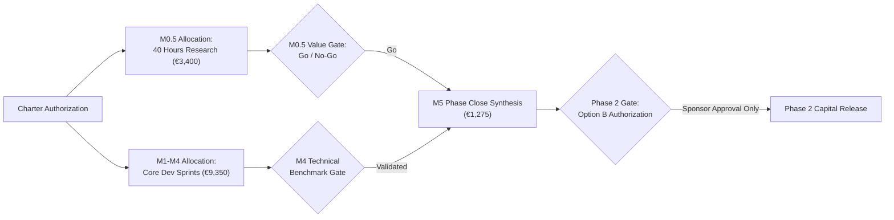

# Cost Management Plan — agent-learning Phase 1: Warm-Start & Confidence-Interval Bandits

> **PMBOK 8 Domain:** `Finance` (Planning Focus Area) | **Legacy Process:** `7.1 Plan Cost Management`  
> **Governance Policy:** `approve-subsidiary-plan` | **Lifecycle Stage:** `Stage 6 (Planning)`  
> **Route:** `full_plan` | **Baseline Identifier:** `PMP-BL-v1.0.0`  
> **Foundation Pack:** [Cost-Foundation-Pack-Manifest.md](cost-baseline/Cost-Foundation-Pack-Manifest.md) (Stage **6.D**)  
> **Accountable Role:** Project Manager | **Approving Sponsor:** Menno Drescher  
> **Normative Standard:** [ADR-012](../../adr/ADR-012-subsidiary-management-plan-standards-and-content-contracts.md) and [ADR-027](../../adr/ADR-027-cost-management-plan-standard-and-baseline-contract.md)  
> **Upstream Baselines:** [Scope-Management-Plan.md](Scope-Management-Plan.md) v1.2+ (**6.A-7**) and [Schedule-Management-Plan.md](Schedule-Management-Plan.md) v1.2+ (**6.B-7**)  
> **Topic Pillars:** [Project-Pillars.md](../Project-Pillars.md); cost trace [Cost-Pillar-Overview-and-Trace.md](cost-baseline/foundation/Cost-Pillar-Overview-and-Trace.md) (**6.D-0P**)

For `PMP-BL-v1.0.0`, the **integrated cost baseline** = approved **[Cost-Foundation-Pack-Manifest.md](cost-baseline/Cost-Foundation-Pack-Manifest.md)** + approved **this plan** (v1.1+). Core mandates, spending ceilings, and decision rights live here; detailed categories, estimating models, staged budgets, and control protocols live under [cost-baseline/foundation/](cost-baseline/foundation/) and are gated per manifest **6.D** checklist before this plan’s subsidiary approval.

---

## 1. Intent, Alignment & Boundaries

### 1.1 Core Mandate & Charter Financial Alignment
This Cost Management Plan establishes the cost management processes, effort accounting mechanisms, contingency reserves, and financial controls for **Phase 1: Warm-Start & Confidence-Interval Bandits**. 

In strict alignment with [Project-Charter.md](../Project-Charter.md) §4 and §7 and [Business-Case.md](../Business-Case.md) §8, the project operates under a **Staged Research Investment** model:
1. **The 40-Hour Research Envelope (M0.5):** A dedicated, time-boxed research investment committed directly by the Project Sponsor (Menno) to evaluate end-user value drivers and willingness-to-pay (HYP-AL-011). Valued at **€3,400.00** economic effort (€85.00/hr shadow rate; €0.00 cash outlay).
2. **Technical Implementation Effort (M1–M4):** 110.0 focused engineering hours allocated across the 7.5-week Phase 1 technical delivery pipeline (€9,350.00 economic effort; ≤ €150.00 API quota).
3. **Phase Close & Synthesis (M5):** 15.0 hours (€1,275.00 economic effort; €25.00 API quota) for formal Bayes factor verification and baseline close.
4. **Phase 2 Commitment Gate (M5 Close):** Zero capital or effort commitment is authorized for Option B (Phase 2) until empirical Bayes factors validate Phase 1 hypotheses ($BF_{10} \ge 10$) and Sponsor approval is formally recorded.

### 1.2 Financial Boundaries & Management Envelope
* **The Authorized Management Envelope:**
  - **Total Phase 1 Economic Valuation:** **€16,150.00** (190.0 hours including 15% contingency reserve).
  - **Total Phase 1 Cash Outlay Ceiling:** **€250.00** (covering developer AI tool subscriptions and model API quotas).
* **Zero-Cost Open-Source Policy:** The runtime SDK relies strictly on standard library implementations and free open-source software (MIT / Apache 2.0). Zero paid runtime licenses or closed SaaS platforms are permitted.
* **Make-or-Buy Outcome (ADR-033 Trace):** In accordance with [Procurement-Management-Plan.md](Procurement-Management-Plan.md) §2.3, the project executed an economic Make-or-Buy analysis selecting 100% internal maintainer execution over external contractor procurement, generating **€143,327.00** in avoided commercial contractor costs.
* **Out-of-Scope Financial Commitments:**
  - External software development consultancies or temp contractors.
  - Dedicated cloud GPU clusters (A100/H100) or managed cloud database services.
  - Phase 2 DPO fine-tuning infrastructure.

---

### 1.4 PMBOK Input, Process & Output (IPO) Specification
In accordance with PMBOK® Guide 8th Edition (Finance Performance Domain §2.4):
* **Inputs (PMBOK 8 §2.4.2.1, §2.4.2.2 & §4):**
  - **Project Charter:** Funding limits, preapproved financial resources, and commercial constraints ([Project-Charter.md](../Project-Charter.md)).
  - **Project Management Plan:** Scope baseline ([Scope-Management-Plan.md](Scope-Management-Plan.md) v1.2+) and schedule baseline ([Schedule-Management-Plan.md](Schedule-Management-Plan.md) v1.2+).
  - **Resource Baseline:** Unit labor rate schedule (€85/h shadow, €0/h cash) in [Resource-Capacity-Estimates.md](resource-baseline/foundation/Resource-Capacity-Estimates.md).
  - **Procurement Baseline:** Make-or-Buy decision and external spend caps in [Procurement-Management-Plan.md](Procurement-Management-Plan.md).
* **Processes (PMBOK 8 §2.4.2 & §5):**
  - **Plan Financial Management:** Defining units of measure (hours / Euros), accuracy levels, and variance thresholds.
  - **Estimate Costs:** Aggregating bottom-up estimates per WBS item and API usage quota.
  - **Develop Budget:** Formulating the cost baseline and staged funding gates.
  - **Monitor & Control Finances:** Tracking burn rates via EVM ($CV, CPI$) and managing contingency reserves.
* **Outputs (PMBOK 8 §2.4.2 & §4):**
  - **Cost Management Plan:** This document and [Cost-Foundation-Pack-Manifest.md](cost-baseline/Cost-Foundation-Pack-Manifest.md).
  - **Cost Baseline:** Approved time-phased budget and staged funding tranches.
  - **Cost Forecasts & EVM Reports:** Actual vs. planned spend tracking in `implementation-log.md`.

---

## 2. Domain Mechanics & Standards

### 2.1 Staged Funding & Capital Allocation Model
Financial and effort commitments are staged across the milestone lifecycle to minimize capital at risk:

### 2.2 Cost Baseline & Effort Breakdown
The Phase 1 Cost Baseline reconciles engineering hours, economic valuation (€85.00/hr), and operational tooling quotas across the 7.5-week delivery window:

| Work Package / Milestone | Focus Area | Baseline Effort | Economic Valuation (€85/h) | External Cloud / API Quota | Total Authorized Envelope |
|---|---|---|---|---|---|
| **M0.5: End-User Value Research** | Sponsor Qualitative Research | 40.0 hrs | €3,400.00 | €0.00 | **€3,400.00** |
| **M1: Softmax State Inspection** | Technical Architecture | 15.0 hrs | €1,275.00 | €25.00 | **€1,300.00** |
| **M2: Warm-Start Prior Transfer** | Algorithm Engineering | 35.0 hrs | €2,975.00 | €50.00 | **€3,025.00** |
| **M3: Confidence-Interval Bandits** | Algorithm Engineering | 35.0 hrs | €2,975.00 | €50.00 | **€3,025.00** |
| **M4: Autonomy Verification** | Benchmark & Evaluation | 25.0 hrs | €2,125.00 | €50.00 | **€2,175.00** |
| **M5: Phase Close & Adjudication** | Governance & Synthesis | 15.0 hrs | €1,275.00 | €25.00 | **€1,300.00** |
| **Subtotal Baseline Commitments** | | **165.0 hrs** | **€14,025.00** | **€200.00** | **€14,225.00** |
| **Contingency Reserve (15%)** | Technical Risk Buffer | 25.0 hrs | €2,125.00 | €50.00 | **€2,175.00** |
| **Total Phase 1 Commitment** | | **190.0 hrs** | **€16,150.00** | **€250.00** | **€16,400.00** |

### 2.3 Integrated Cost Baseline & Foundation Breakouts
The official **integrated cost baseline** for `PMP-BL-v1.0.0` comprises:

1. **[Cost-Foundation-Pack-Manifest.md](cost-baseline/Cost-Foundation-Pack-Manifest.md)** (Stage **6.D-6** roll-up; registry hashes for six breakout artifacts).
2. **Cost Management Plan** (this document, **v1.1.0** — subsidiary approval at manifest **6.D-7**).
3. **6.D-0P — Strategy trace:** [Cost-Pillar-Overview-and-Trace.md](cost-baseline/foundation/Cost-Pillar-Overview-and-Trace.md).
4. **6.D-1 — Categories & basis:** [Cost-Categories-and-Estimating-Basis.md](cost-baseline/foundation/Cost-Categories-and-Estimating-Basis.md).
5. **6.D-2 — Cost estimates:** [Cost-Estimates-by-Category.md](cost-baseline/foundation/Cost-Estimates-by-Category.md).
6. **6.D-3 — Staged budget:** [Cost-Staged-Budget-and-Baseline.md](cost-baseline/foundation/Cost-Staged-Budget-and-Baseline.md).
7. **6.D-4 — Variance control:** [Cost-Variance-and-Control-Protocol.md](cost-baseline/foundation/Cost-Variance-and-Control-Protocol.md).
8. **6.D-5 — Domain checklist:** [Cost-Domain-Checklist.md](cost-baseline/foundation/Cost-Domain-Checklist.md).

**6.D-7 Approved (2026-11-01):** Upstream Scope **6.A-7** and Schedule **6.B-7** are **approved** (**6.D-0** satisfied). Foundation breakouts **6.D-0P … 6.D-5** are **approved**; manifest **6.D-6** is complete (`pack_status: approved` on manifest **v1.1.0**). This plan **v1.1.0** is **approved** under **`approve-subsidiary-plan`** (**6.D-7**). BFI-004 closed as `applied`. Approval Episode `72d23862-3d3e-4438-8950-884f06bd0fd0`.

---

## 3. Governance, Control & Decision Rights

### 3.1 Financial Decision Rights & Authority Levels
* **Developer / Implementer:** Discretion over internal implementation approaches provided work stays within story hour estimates.
* **Project Manager:** Authority to reallocate effort across tasks within an approved milestone up to $\pm 10\%$, provided the milestone cap is preserved. Controls drawdown of the 15% contingency reserve (25.0 hrs / €50 API buffer).
* **Project Sponsor (Menno Drescher):** Holds sovereign authority over total project budget, authorization of the management reserve (5.0 pd / €2,550), expansion of the 40-hour M0.5 envelope, and capital release for Phase 2.

### 3.2 Change Control & Funding Adjustments
Any event requiring effort exceeding the 15% contingency reserve must follow formal change governance:
1. **Variance Audit:** Document root cause of overrun in `implementation-log.md`.
2. **Impact Assessment:** Quantify effect on total project burn and milestone delivery.
3. **Sponsor Adjudication:** Submit formal adaptation proposal via Stage 17 Integrated Change Control (`approve-adaptation-plan`). Work beyond authorized envelopes is halted until signed off.

### 3.3 Position in the Planning DAG (ADR-013 §4.1)
In the planning directed acyclic graph (`PLAN_DAG`):
$$\text{Scope (5.1)} \longrightarrow \text{Schedule (6.1)} \longrightarrow \text{Cost (7.1)} \longrightarrow \text{Procurement (12.1) / Risk (11.1)}$$

* Changes to the approved Cost baseline propagate downstream staleness flags to **Procurement** and **Risk**, which depend directly on Cost in `PLAN_DAG`.
* Re-baselining Cost updates [cost-baseline/Cost-Foundation-Pack-Manifest.md](cost-baseline/Cost-Foundation-Pack-Manifest.md), the registry hashes, and bumps this plan’s amendment log.

---

## Baseline Feedback (Stage 7-8 → 6)

| bfi_id | stage | document | citation | classification | evidence_basis | status |
| --- | ---: | --- | --- | --- | --- | --- | --- |
| BFI-004 | 7 | Cost Management Plan / foundation pack | [ADR-027](../../adr/ADR-027-cost-management-plan-standard-and-baseline-contract.md) §3; [Cost-Foundation-Pack-Manifest.md](cost-baseline/Cost-Foundation-Pack-Manifest.md) § Stage 6.D | *(empty — process interpretation)* | design_time | applied |

**BFI-004 (applied 2026-11-01):** ADR-027 §3 states Cost baselining has no upfront breakout prerequisite. For this repository, **Tier-1 Cost foundation pack** artifacts under Stage **6.D** (PMBOK §2.4 Plan Financial Management, Estimate Costs, Develop Budget, Monitor & Control) are **normative** for the first `approve-subsidiary-plan` on `cost-management` v1.1+: integrated baseline = manifest + plan. Documented Path A without amending ADR-027. Applied when **6.D-7** completed; sponsor approval is recorded in Episode `72d23862-3d3e-4438-8950-884f06bd0fd0`.

---

## 4. Amendment Log

| Date | Author | Description |
|---|---|---|
| 2026-10-25 | Menno Drescher / Antigravity | Initial full baseline Cost Management Plan replacing stub mock content per ADR-012. |
| 2026-11-01 | Menno Drescher / Antigravity | **v1.1.0 — Foundation pack integration:** Linked `foundation_pack` manifest; §2.3 integrated baseline definition; 6 breakout artifacts under `cost-baseline/foundation/`; BFI-004 added; plan ready for **6.D-7** after Scope 6.A-7 and Schedule 6.B-7. |

| 2026-11-01 | Menno Drescher | **6.D-7 approved:** Cost Management Plan v1.1.0 approved under `approve-subsidiary-plan`; BFI-004 applied. Approval Episode `72d23862-3d3e-4438-8950-884f06bd0fd0`; canonical content hash recorded in the approval Episode. |
