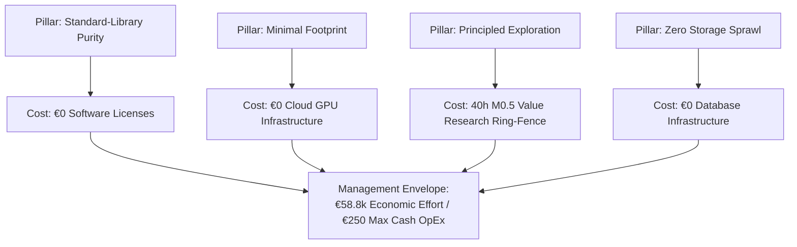

# Cost Foundation — Strategic Pillar Overview & Trace (`PMP-BL-v1.0.0`)

This artifact satisfies PMBOK 8 §2.4.2 *Plan Financial Management* (Figure 2-27) for the Cost Management Plan. It provides the strategic foundation linking the core project pillars ([Project-Pillars.md](../../../Project-Pillars.md)) and the **Procurement Sourcing Decision** to the **Cost Baseline** allocations for **Phase 1: Warm-Start & Confidence-Interval Bandits**.

---

## 1. Project Pillars & Financial Boundaries Trace

The project operates under strict architectural and governance principles. Every financial allocation directly reinforces these strategic invariants:

| Project Pillar | Architectural Invariant | Financial Governance & Cost Impact | Sourcing Strategy Alignment |
| :--- | :--- | :--- | :--- |
| **Standard-Library Purity** | Zero third-party runtime dependencies in `agent_learning.pmbok` (ADR-034). | **Zero Software Licensing Cost (€0.00):** No commercial SDK licenses, closed-source dependencies, or recurring SaaS fees are permitted. | FOSS-only dependency vetting in [Procurement-Management-Plan.md](../../Procurement-Management-Plan.md) §2.1. |
| **Minimal Compute Footprint** | CPU-only local execution; frozen model in-process inference (ADR-002, ADR-028). | **Zero Infrastructure CapEx (€0.00):** Avoids cloud GPU cluster provisioning (saves ~€0.65–€2.50/hr VM costs, or ~€2,500/mo). Host workstation executes full suite. | Make-or-Buy Decision: Reject cloud compute leases; rely on maintainer hardware. |
| **Principled Exploration** | M0.5 qualitative value research ring-fencing before scaling build (HYP-AL-011). | **De-risked Capital Investment:** 40-hour Sponsor research commitment (€3,400 economic value) must achieve Go/No-Go before releasing downstream Option B funds. | Prevents speculative capital deployment into low-utility Phase 2 features. |
| **Zero Storage Sprawl** | In-memory and local file persistence; Cosmos DB local emulator (ADR-002 Invariant #2). | **Zero Relational Database Licensing (€0.00):** Strictly bars PostgreSQL, MySQL, and cloud database instances. Docker emulator provides microsecond telemetry for €0. | Avoids cloud hosting and database administrator retainer expenses. |

---

## 2. Procurement Make-or-Buy Financial Trace

The financial commitments established in this Cost Foundation Pack directly reflect the **authoritative Make-or-Buy analysis** completed in [Procurement-Management-Plan.md](../../Procurement-Management-Plan.md) §2.3:

1. **Internal "Make" Decision (Authoritative):**
   * Sourced internally using maintainer/employee labor (valued at €85.00/hr economic shadow rate; €0.00 cash outlay) accelerated by interactive AI engineering assistants (Antigravity/Cursor/Claude at €2.00/hr pairing).
   * **Economic Effort Baseline:** 115.4 person-days (692.4 hrs) = **€58,854.00**.
   * **Direct Cash Outlay:** **€0.00** payroll / **€250.00** operational tooling and API cap.
2. **Avoidance of External Contractors ("Buy"):**
   * Engaging external senior AI/ML contractors (115.4 days $\times$ 8 hrs $\times$ €135.00/hr = €124,632.00 plus €18,695.00 procurement overhead) is **prohibited**.
   * **Net Financial Avoidance:** **€143,327.00** in direct commercial contractor fees avoided.

---

## 3. Financial Life-Cycle Alignment

Financial allocations are structured across the three core life-cycle horizons established in [Project-Charter.md](../../../Project-Charter.md) §4:

* **Horizon 1 — M0.5 Research Envelope (40.0 hours / €3,400.00 economic value):** Sovereign research timebox allocated directly by the Project Sponsor. Protected from coding preemption.
* **Horizon 2 — M1–M4 Technical Sprints (110.0 hours / €9,350.00 economic value):** Iterative engineering of the Warm-Start and Confidence-Interval Bandit algorithms.
* **Horizon 3 — M5 Phase Close & Adjudication (15.0 hours / €1,275.00 economic value):** Formal Bayes factor calculation, Option B decision gate, and baseline closure.
