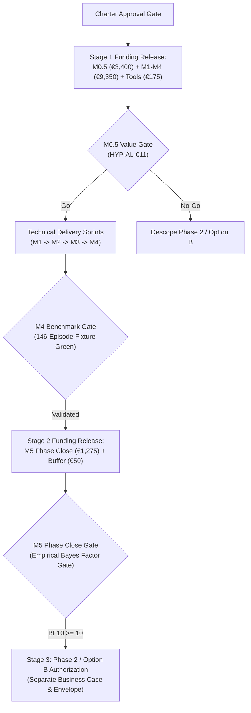

# Cost Foundation — Staged Budget & Cost Baseline (`PMP-BL-v1.0.0`)

This artifact satisfies PMBOK 8 §2.4.2 *Develop Budget* (Figure 2-29) and reserve partitioning (Figure 2-25) for the Cost Management Plan. It establishes the time-phased **Cost Baseline**, staged funding releases, and reserve boundaries for **Phase 1: Warm-Start & Confidence-Interval Bandits**.

---

## 1. Reserve Architecture & Baseline Composition

In strict accordance with PMBOK 8 Figure 2-25, project budget components are partitioned into distinct control layers:

```
+-----------------------------------------------------------------------------------+
|                           TOTAL COST BUDGET: €18,700.00                           |
|  +-------------------------------------------------------------+  +--------------+|
|  |                 COST BASELINE: €16,150.00                   |  |  MANAGEMENT  ||
|  |  +-------------------------------------+  +-----------------+  |   RESERVE    ||
|  |  |    WORK PACKAGE ESTIMATES (M0.5-M5)  |  |   CONTINGENCY   |  |   (5.0 pd)   ||
|  |  |              €14,025.00             |  |     RESERVE     |  |  €2,550.00   ||
|  |  |       (165.0 hrs labor + €200 API)  |  |   (25.0 hrs)    |  |  (Sponsor    ||
|  |  |                                     |  |    €2,125.00    |  |   Controlled)||
|  |  +-------------------------------------+  +-----------------+  +--------------+|
|  +-------------------------------------------------------------+                  |
+-----------------------------------------------------------------------------------+
```

1. **Work Package Baseline (€14,025.00 economic / €200.00 cash):**
   * Core implementation deliverables across milestones M0.5 to M5 (165.0 focused hours).
2. **Contingency Reserve (€2,125.00 economic / €50.00 cash buffer):**
   * 15% technical buffer (25.0 hours) allocated to address known-unknowns (e.g. mathematical edge cases in confidence intervals, matrix decomposition rework, API schema migrations). Managed directly by the Project Manager.
3. **Cost Baseline (€16,150.00 economic / €250.00 cash envelope):**
   * The authoritative, time-phased expenditure plan against which project financial performance is measured.
4. **Management Reserve (€2,550.00 economic / €0.00 cash):**
   * 5.0 person-days (30.0 hours) reserved for unknown-unknowns and Sponsor-directed research explorations. Not part of the Cost Baseline; drawn only upon formal Project Sponsor authorization.

---

## 2. Staged Funding & Capital Release Model

To minimize financial and effort exposure, commitments are released incrementally through formal milestone gates:



* **Tranche 1 (Immediate Release upon Stage 6):** **€12,925.00 economic effort / €175.00 cash OpEx** authorizing M0.5 value research and M1–M4 core technical engineering.
* **Tranche 2 (Conditional on M4 Benchmark Verification):** **€1,300.00 economic effort / €75.00 cash OpEx** authorizing M5 phase synthesis and final baseline documentation.
* **Tranche 3 (Option B / Phase 2 Gate):** Strictly **€0.00** authorized. Blocked until empirical Bayes factors validate Phase 1 hypotheses ($BF_{10} \ge 10$) and formal Sponsor adjudication is recorded.

---

## 3. Time-Phased Cash & Effort Burn Schedule

Mapped across the 7.5-week Phase 1 delivery window (at maintainer velocity of ~5 pd/week):

| Calendar Week | Target Milestone Activities | Planned Effort (hrs) | Cumulative Effort (hrs) | Planned Economic Value (€) | Planned Cash Outlay (€) | Cumulative Cash Outlay (€) |
| :---: | :--- | ---: | ---: | ---: | ---: | ---: |
| **Week 1** | M0.5 Research & M1 Softmax Inspection | 25.0 hrs | 25.0 hrs | €2,125.00 | €25.00 | €25.00 |
| **Week 2** | M0.5 Research Close & M2 Warm-Start Kickoff | 25.0 hrs | 50.0 hrs | €2,125.00 | €25.00 | €50.00 |
| **Week 3** | M2 Warm-Start Prototype Completion | 25.0 hrs | 75.0 hrs | €2,125.00 | €25.00 | €75.00 |
| **Week 4** | M3 CI Bandit Engine Implementation | 25.0 hrs | 100.0 hrs | €2,125.00 | €25.00 | €100.00 |
| **Week 5** | M3 CI Bandit Testing & M4 Benchmark Setup | 25.0 hrs | 125.0 hrs | €2,125.00 | €25.00 | €125.00 |
| **Week 6** | M4 Benchmark Execution & Regression Run | 25.0 hrs | 150.0 hrs | €2,125.00 | €50.00 | €175.00 |
| **Week 7** | M5 Phase Close, Bayes Factors & Governance | 15.0 hrs | 165.0 hrs | €1,275.00 | €25.00 | €200.00 |
| **Week 7.5** | Technical Contingency Buffer (if needed) | 25.0 hrs | 190.0 hrs | €2,125.00 | €50.00 | €250.00 |
| **Total** | **Phase 1 Execution Envelope** | **190.0 hrs** | — | **€16,150.00** | **€250.00** | **€250.00** |
