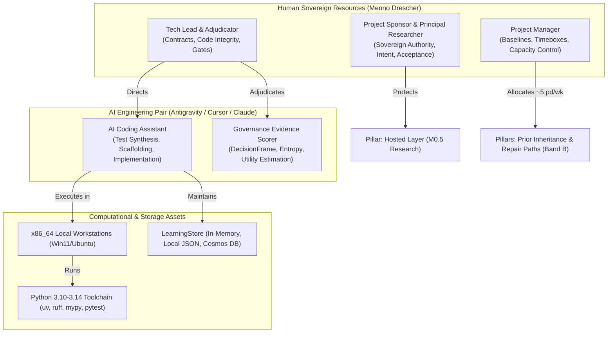

# Resource Foundation — Topic Pillars Overview & Trace (`PMP-BL-v1.0.0`)

Connects the **integrated resource baseline** (Stage **6.C**) to the project **topic pillar model** in [Project-Pillars.md](../../../Project-Pillars.md) (**Approved**; episode `8fe9fea9-6ef1-44be-82a9-e09677e47a4a`). Strategic scope decomposition is defined in [Scope-Pillar-Overview-and-Trace.md](../../scope-baseline/foundation/Scope-Pillar-Overview-and-Trace.md) (**6.A-0P**) and milestone logic in [Schedule-Pillar-Overview-and-Trace.md](../../schedule-baseline/foundation/Schedule-Pillar-Overview-and-Trace.md) (**6.B-0P**). 

This artifact specifies how physical, virtual, human, and autonomous agent resources are allocated across the nine strategic outcome threads for **Phase 1: Warm-Start & Confidence-Interval Bandits** (`PMP-BL-v1.0.0`).

---

## 1. Resource Demands by Topic Pillar

The `agent-learning` program operates under an agile **human-agent pair engineering model** (maintainer Menno Drescher paired with AI coding assistants). The computational philosophy is **frozen-model, in-process learning**—meaning zero remote GPU training clusters or long-running cloud compute jobs are required.

| Topic Pillar | Primary Resource Class | Accountable Human Role | Phase 1 Allocation / Constraint |
| --- | --- | --- | --- |
| **Frozen-model, in-process learning** | Virtual / Tooling (CPU) | Tech Lead / Core Developer | Standard CPU workstations; Python 3.10–3.14 venv; zero GPU cluster spend. |
| **Earned, auditable autonomy** | Human Adjudicator + AI Pair | Project Sponsor (Menno) | Human adjudication on all full-authority gates; AI builds evidence frames; harness compute. |
| **One TaskPolicy for statistical & reasoned** | Developer + AI Pair | Tech Lead / Core Developer | Architectural design and contract verification across Epics 1, 4, 7, 11, 21. |
| **Packaged contextual learning** | Developer + AI Pair | Tech Lead / Core Developer | Program track (Epic 38); spec and tests ready; execution outside Charter critical path. |
| **An honest place against SFT, RLVR, ERL** | Principal Researcher | Principal Researcher (Menno) | Cataloging and positioning (Epic 36 complete); zero remaining Phase 1 effort. |
| **Critique becomes evidence** | Developer + AI Pair | Project Sponsor (Menno) | **Deferred** (Band C, Epics 14 & 18); zero Phase 1 effort allocated until M5 gate. |
| **A new policy inherits similar policy's prior** | Maintainer Pair (Epics 19–20) | Tech Lead / Core Developer | **Phase 1 Critical Path (M1–M2):** ~54.2 pd weighted effort allocated. |
| **A repair path for stuck low-authority** | Maintainer Pair (Epics 15–17) | Tech Lead / Core Developer | **Phase 1 Critical Path (M3):** ~61.2 pd weighted effort allocated. |
| **A hosted layer someone would pay for** | Qualitative Researcher | Principal Researcher (Menno) | **Parallel Track (M0.5):** 40-hour (5 pd) fixed research timebox; protected. |

---

## 2. Topic Pillar ↔ Resource Breakdown & Governance Trace

### 2.1 Strategic Prioritization and Protection Rules
1. **M0.5 Research Protection:** Qualitative investigation into hosted-layer economics (HYP-AL-011) is ring-fenced to a **5 pd (40 hour)** timebox. To prevent development urgency from crowding out strategic validation, development tasks on Epics 15–20 cannot preempt this research window.
2. **Band B Delivery Priority:** Engineering pair resources focus strictly on Band B epics that satisfy the Charter milestone exit conditions:
   - **M1:** `SoftmaxPolicy` inspection (Epic 20 anchor).
   - **M2:** Warm-start / meta-prior prototype (Epics 19, 20).
   - **M3:** UCB & Thompson confidence-interval resolvers (Epics 15, 16, 17).
   - **M4:** Autonomy benchmark harness (Stories 9.1, 10.1; Epic 34 decommission).
3. **Decommissioning Alignment:** Technical debt cleanup under Epic 34 is staffed on the recommended path prior to M4 to unblock 100% collecting test coverage without masking domain test failures.

---

## 3. Foundation Pack Traceability

This strategic trace guides the subsequent Stage **6.C** breakouts:

| Substage | Artifact | Resource Role Grounded Here |
| --- | --- | --- |
| **6.C-1** | [Resource-Role-Catalogue.md](Resource-Role-Catalogue.md) | Human roles, AI agent pair responsibilities, and RACI across lifecycle. |
| **6.C-2** | [Resource-Capacity-Estimates.md](Resource-Capacity-Estimates.md) | 5 pd/week capacity vs. 115.4 pd Band B demand and M0.5 envelope. |
| **6.C-3** | [Resource-Tooling-and-Assignment-Register.md](Resource-Tooling-and-Assignment-Register.md) | Workstations, Python runtime, Cosmos emulator, zero GPU sprawl. |
| **6.C-4** | [Resource-Team-Operating-Charter.md](Resource-Team-Operating-Charter.md) | Human–agent collaboration agreements, RED-first test discipline. |
| **6.C-5** | [Resource-Utilization-and-Control-Protocol.md](Resource-Utilization-and-Control-Protocol.md) | Utilization tracking, burn-rate bounds, descope vs. reschedule escalation. |
| **6.C-6** | [Resource-Domain-Checklist.md](Resource-Domain-Checklist.md) | Verification against PMBOK 8 §2.6.5 Table 2-10 outcomes. |
