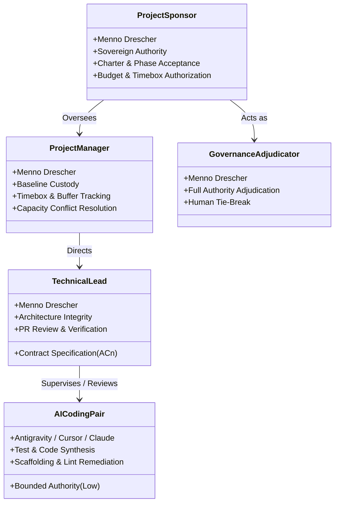

# Resource Foundation — Role Catalogue & Accountabilities (`PMP-BL-v1.0.0`)

This artifact satisfies PMBOK 8 §2.6.2 *Plan Resource Management* (Figure 2-41) for the Resource Management Plan. It defines the formal **Role Catalogue**, organizational accountabilities, decision authority, and the **RACI Assignment Matrix** for the `agent-learning` program.

In accordance with [ADR-030](../../../../adr/ADR-030-resource-management-plan-standard.md) §3 and [ADR-008](../../../../adr/ADR-008-governance-decision-framework-and-charter-acceptance.md) Invariant #4, **every autonomous agent must have a named responsible human**. Autonomous agents never hold unconstrained sovereign authority or unreviewed decision rights.

---

## 1. Project Role Catalogue

### 1.1 Human Roles & Sovereign Decision Rights

#### 1. Project Sponsor & Principal Researcher
* **Named Individual:** Menno Drescher
* **Accountability:** Project initiation, strategic intent refinement (Stage 18), funding envelopes, Phase 1 milestone acceptance (M0.5–M5), and Phase 2 / Option B authorization.
* **Decision Rights:**
  - Sovereign authority over [Project-Charter.md](../../../Project-Charter.md).
  - Approves Level 2 and Level 3 Scope/Schedule adaptations (`approve-adaptation-plan`).
  - Accepts or rejects Phase Close Go/No-Go at milestone **M5**.
  - Sole authority to release or extend qualitative research timeboxes (M0.5).

#### 2. Project Manager
* **Named Individual:** Menno Drescher
* **Accountability:** Custody of the integrated Project Management Plan (`PMP-BL-v1.0.0`), monitoring schedule velocity ($SPI$), tracking maintainer capacity burn, and enforcing boundary constraints.
* **Decision Rights:**
  - Manages maintainer person-day allocations within the approved sprint timeboxes (1 calendar week).
  - Authorizes contingency buffer consumption (≤ 5 pd before M5).
  - Logs Level 0 operational adjustments and Level 1 story scope changes.
  - Initiates Stage 16/17 change control when capacity conflicts arise.

#### 3. Technical Lead & Core Developer
* **Named Individual:** Menno Drescher (supported by interactive AI engineering pair)
* **Accountability:** Architectural adherence to ADRs, technical specification (BRD/FDD), contract test authoring ($AC_n$ RED-first), maintaining standard library purity, and software release packaging.
* **Decision Rights:**
  - Authorizes daily code structure, module decomposition, and internal refactoring.
  - Merges pull requests into `main` after verifying 100% green contract tests and clean `ruff` / `mypy` checks.
  - Enforces pure stdlib boundaries for `agent_learning.pmbok` and `agent_learning.pmbok_runtime`.

#### 4. Governance Adjudicator
* **Named Individual:** Menno Drescher
* **Accountability:** Final human adjudication for all full-authority governance task policies under ADR-001, ADR-008, and ADR-013.
* **Decision Rights:**
  - Adjudicates `approve_plan`, `reject_plan`, or `request_revision_before_decision` for all subsidiary management plans.
  - Resolves policy ties when utility margin $\le 0.05$ (`DecisionStatus.NEEDS_USER_TIE_BREAK`).
  - Evaluates Bayesian evidence frames before signing off on baselines.

---

### 1.2 Autonomous AI Agent Roles & Bound Authority

#### 5. AI Engineering Assistant / Coding Pair
* **Agent Platforms:** Google Antigravity IDE (Gemini models), Anthropic Claude Code, Cursor IDE.
* **Work Scope:**
  - Generating candidate unit tests from user story acceptance criteria ($AC_0 \dots AC_n$).
  - Drafting Python implementations strictly adhering to established interfaces and contracts.
  - Automated linting, formatting, and structural refactoring under developer supervision.
  - Scaffolding Markdown management plans, foundation pack manifests, and amendment logs.
* **Authority Boundaries & Invariants:**
  - **Zero Autonomous Commit Authority:** Agents operate strictly on local working trees or branch sessions; all code and documentation must be reviewed and accepted by a human.
  - **Zero Unsupervised Baseline Authorization:** Agents cannot record accepted governance dispositions or sign off on project baselines autonomously.
  - **Standard Library Purity:** Agents are prohibited from introducing unauthorized third-party dependencies into pure packages (`agent_learning.pmbok`).

#### 6. Governance Evidence Scorer (Reasoning Resolver)
* **Platform:** `agent_learning.decision.DecisionResolver`
* **Work Scope:**
  - Constructing structured `DecisionFrame` models from artifact text and validation findings.
  - Calculating normalized support, Shannon entropy ($H$), and robust Bayesian utilities across defined criteria.
  - Emitting deterministic `DecisionResult` recommendations.
* **Authority Boundaries:** Operates under `FULL` authority with mandatory `requires_human_approval: true`. Outputs are recommendations; final authority is exclusively human.

---

### 1.3 Role Labor Rate & Governance Schedule

To enable downstream financial accounting in the **Cost Management Plan** and provide the comparative baseline for **Procurement Make-or-Buy Analysis**, human roles and synthetic pair capabilities carry the following labor rates and governance oversight:

| Role ID | Role Title | Named Party | Internal Rate (Economic Shadow) | Cash Outlay Rate | External Comparison (Make-or-Buy) | Rate Governance Authority |
| :--- | :--- | :--- | :---: | :---: | :---: | :--- |
| **ROLE-SPO** | Project Sponsor & Principal Researcher | Menno Drescher | **€85.00 / hr** (€510/pd) | €0.00 / hr | €150.00 / hr (Principal Research Consultant) | Project Sponsor / PM (*HR Specialist in scaled org*) |
| **ROLE-PM** | Project Manager | Menno Drescher | **€85.00 / hr** (€510/pd) | €0.00 / hr | €120.00 / hr (Certified PM Consultant) | Project Sponsor / PM (*HR Specialist in scaled org*) |
| **ROLE-TL** | Technical Lead & Core Developer | Menno Drescher | **€85.00 / hr** (€510/pd) | €0.00 / hr | €135.00 / hr (Senior AI/ML Contractor) | Project Sponsor / PM (*HR Specialist in scaled org*) |
| **ROLE-ADJ**| Governance Adjudicator | Menno Drescher | **€85.00 / hr** (€510/pd) | €0.00 / hr | €160.00 / hr (Independent Systems Auditor) | Project Sponsor / PM (*HR Specialist in scaled org*) |
| **ROLE-AI** | AI Engineering Assistant (Pair) | Antigravity / Claude / Cursor | **€2.00 / hr** | Variable (≤ €100/mo) | N/A (Internal Paired Capability) | Project Manager (Token & API budget control) |

> [!NOTE] Human Resources Governance Policy
> In this repository (`agent-learning`), labor rate figures are estimated by the Project Sponsor/PM to reflect current market benchmarks for senior AI/ML engineering and maintainer opportunity cost.  
> In enterprise organizational settings or future production project phases, labor rate scales, compensation bands, and contractor cost baselines are formally established and governed by the **Human Resources Specialist / HR Department** to ensure standardized compensation governance and statutory compliance.

---

## 2. RACI Accountability Matrix Across Lifecycle Stages

In accordance with PMBOK 8 §2.6.2 and program standards:

| Lifecycle Stage | Activity / Deliverable | Sponsor (Menno) | Project Manager | Tech Lead | AI Coding Pair |
| :--- | :--- | :---: | :---: | :---: | :---: |
| **Stage 1–3** | Spark, Ideation & Business Case | **A / R** | C | C | C |
| **Stage 4** | Project Charter (`approve-charter`) | **A** | **R** | C | C |
| **Stage 5** | Tailoring & Route Matrix | **A** | **R** | C | C |
| **Stage 6** | Subsidiary Plans & Foundation Packs | **A** | **R** | C | **R** |
| **Stage 6** | Integrated PMP Synthesis (`approve-pmp`) | **A** | **R** | C | C |
| **Stage 7** | Technical Specs: ADR, BRD, FDD | **A** | C | **R** | **R** |
| **Stage 8–9** | User Story Contracts & TDD Code | I | C | **A / R** | **R** |
| **Stage 10** | Contract Test Verification & Suite Green | I | C | **A / R** | **R** |
| **Stage 11–14**| Integration, Deployment & Docs | I | **R** | **A** | **R** |
| **Stage 15** | Post-Epic Lessons Learned Recap (ADR-010) | **A** | **R** | C | C |
| **Stage 16** | Governance Change Pipeline (`classify-diff`) | **A** | **R** | C | C |
| **Stage 17** | Execution Adaptation (`approve-adaptation-plan`)| **A** | **R** | C | C |
| **Stage 18** | Intent Refinement & Bayes Gate (M5 Close) | **A** | C | **R** | C |

*Legend: **A** = Accountable (Sovereign owner; exactly one per row); **R** = Responsible (Doer/Implementer); **C** = Consulted (Provides domain input); **I** = Informed (Notified of outcome).*

---

## 3. Competency & Skill Requirements

To sustain high delivery velocity without regression, the engineering team maintains the following competency standards:

1. **Software Engineering Core:** Python 3.10–3.14 idioms, static type annotations (`typing`, `mypy`), standard library architecture, and test-driven development with `pytest`.
2. **Reinforcement Learning & Decision Theory:** Multi-armed bandits (Softmax, UCB, Thompson sampling), REINFORCE policy gradients, and Bayesian decision analysis (evidence weights, entropy, robust utility).
3. **PMBOK 8 Governance Standards:** Familiarity with the 8 performance domains (Resources §2.6, Planning §2.3, Scope §2.2, Finance §2.4), progressive elaboration, and immutable baseline hashes.
4. **Tooling Fluency:** Command-line environments (PowerShell, bash), git branch workflows, `uv` package management, and `ruff` linting rules.
