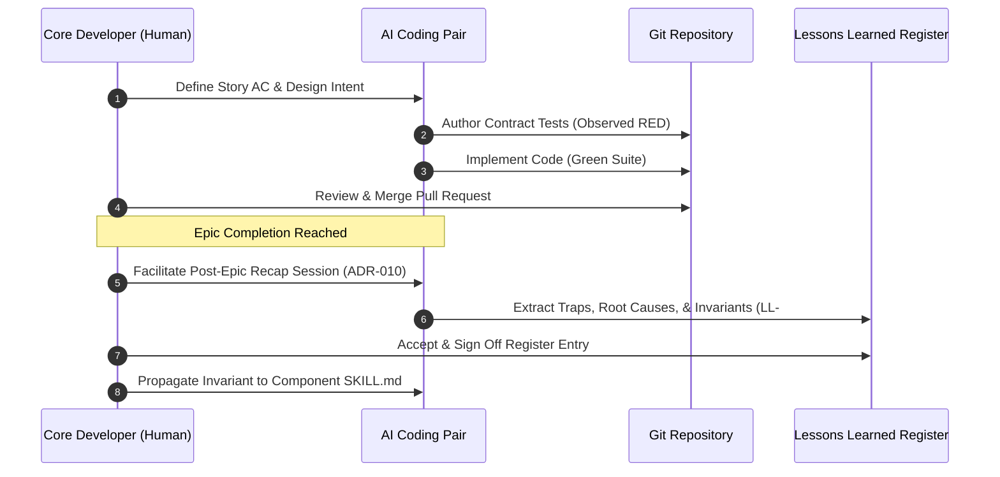

# Resource Foundation — Team Operating Charter (`PMP-BL-v1.0.0`)

This artifact satisfies PMBOK 8 §2.6.2 *Lead the Team* (Figure 2-44) for the Resource Management Plan. It establishes the collaborative operating agreements, development values, human–agent interaction protocols, and team communication cadence for the `agent-learning` engineering initiative.

---

## 1. Team Vision, Core Values & Engineering Principles

The team operates as an agile, high-trust engineering unit centered on **evidence-driven AI decision making**:

```
+-----------------------------------------------------------------------------------+
|                            CORE OPERATING PRINCIPLES                              |
+-----------------------------------------------------------------------------------+
|  1. Observed RED-First   | Never write code without a failing contract test ($AC_n)|
|  2. Pure Stdlib First    | Zero extraneous runtime dependencies in pure packages   |
|  3. Inspectable Autonomy | Every autonomous action leaves an auditable trace       |
|  4. Immutable Baselines  | Canonical hashing prevents silent specification drift   |
|  5. Generational Memory  | Post-epic recaps crystallize lessons into active rules  |
+-----------------------------------------------------------------------------------+
```

1. **Observed RED-First Contract Discipline:** In strict accordance with the Definition of Done ([Scope-Validate-Scope.md](../../scope-baseline/foundation/Scope-Validate-Scope.md)), no production code is implemented until acceptance criteria tests are authored and observed failing (`RED`) in the execution environment.
2. **Standard Library Purity:** Architectural layers such as `agent_learning.pmbok` and `agent_learning.pmbok_runtime` maintain strict decoupling from heavy external libraries. Code must run fast, deterministically, and with zero unnecessary dependencies.
3. **Inspectable Autonomy:** Statistical decisions and Bayesian resolutions must remain fully auditable via `DecisionFrame` entropy scores, criterion weights, and logged evidence points.
4. **Permanent Human Sovereignty:** AI agents accelerate authoring but never hold unmonitored decision authority. A named human is accountable for every merge, baseline sign-off, and release tag.

---

## 2. Human–Agent Collaboration Agreements

The engineering pair comprises a **Human Lead (Menno Drescher)** and an **AI Engineering Assistant (Antigravity / Cursor / Claude)**:

### 2.1 Division of Responsibilities
* **Human Directs & Decides:**
  - Establishes strategic intent, architectural vision, and domain boundaries.
  - Reviews and approves all pull requests and code modifications.
  - Adjudicates all full-authority governance gates (`approve-subsidiary-plan`, `approve-pmp`).
  - Evaluates research outcomes and makes Phase Close Go/No-Go decisions.
* **AI Accelerates & Synthesizes:**
  - Implements boilerplate, type hints, and docstrings under human instruction.
  - Generates comprehensive unit tests covering nominal and adverse boundary conditions.
  - Identifies lint violations, syntax warnings, and documentation inconsistencies.
  - Drafts governance decision frames and computes mathematical utility metrics.

### 2.2 Working Norms
* **Granular, Semantic Commits:** Work is committed in small, verifiable units using Conventional Commits syntax (`feat:`, `fix:`, `docs:`, `test:`, `refactor:`).
* **Co-Authorship Attribution:** When AI agents author or co-develop changes, commits include co-authorship attribution metadata (`Co-Authored-By: Antigravity <noreply@google.com>` or `Co-Authored-By: Cursor <cursoragent@cursor.com>`).
* **Clean Working Tree Discipline:** No untracked scratch scripts or temporary files are committed to the repository; intermediate artifacts reside in git-ignored scratch paths.

---

## 3. Communication, Retrospective Cadence & Continuous Learning



### 3.1 Post-Epic Lessons Learned Recap (ADR-010 §4.1)
* **Cadence:** Held exactly once per epic, immediately following the completion and review of the epic's final user story.
* **Format:** A concise 15-to-30 minute diagnostic session reviewing traps encountered, unexpected edge cases, test collection hiccups, or specification ambiguities.
* **Canonical Register:** Entries are recorded in `docs/project-docs/Lessons-Learned-Register.md` under the strict schema:
  - `Identifier`: `LL-###` with descriptive title.
  - `The Trap / Problem`: Real-world defect or hazard observed during development.
  - `The Root Cause`: Underlying technical or procedural mechanism.
  - `Actionable Invariant / Rule`: Prescriptive rule preventing recurrence.
  - `Propagation Target`: Tier 1 (Register), Tier 2 (In-repo component `.claude/skills/`), or Tier 3 (Global user rules).

### 3.2 Continuous Psychological Safety & Code Health
* **Blameless Failure Analysis:** A broken build or failing test is treated as a high-value signal revealing an unstated invariant, not an error to conceal.
* **Fast Test Feedback:** Test suites are engineered to execute in seconds, allowing immediate verification before committing.
