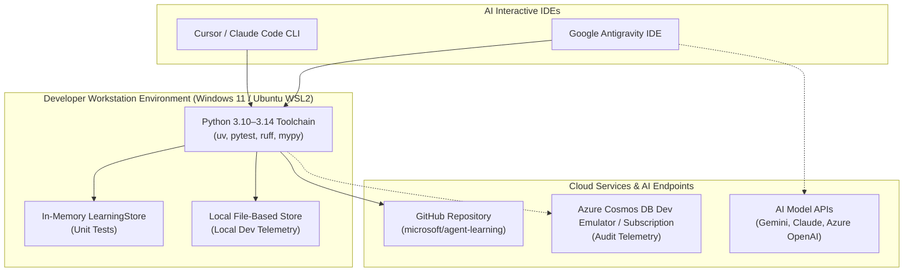

# Resource Foundation — Tooling & Assignment Register (`PMP-BL-v1.0.0`)

This artifact satisfies PMBOK 8 §2.6.2 *Acquire Resources* (Figure 2-43) for the Resource Management Plan. It catalogs the physical hardware, software toolchains, cloud telemetry infrastructure, and AI development environments provisioned for **Phase 1: Warm-Start & Confidence-Interval Bandits** (`PMP-BL-v1.0.0`).

In strict alignment with [Project-Charter.md](../../../Project-Charter.md) §5 and [ADR-028](../../../../adr/ADR-028-risk-management-plan-standard.md), the project maintains a **zero-infrastructure-sprawl** policy.

---

## 1. Tooling & Infrastructure Inventory

### 1.1 Physical & Host Hardware
* **Primary Workstation:** 1x x86_64 host system (Intel/AMD multi-core processor, 64 GB RAM, 2 TB NVMe SSD).
* **Operating Environments:**
  - Windows 11 Pro 64-bit (Primary host).
  - Ubuntu Linux via WSL2 / POSIX shell (Cross-platform compatibility validation).
* **Excluded Hardware (Out-of-Scope):** Dedicated physical on-premise servers, cloud GPU training clusters (e.g. A100/H100 instances), and custom network appliances.

### 1.2 Language, Runtime & Package Management
* **Python Runtimes:** Python 3.10, 3.11, 3.12, and 3.14.
* **Environment & Package Manager:** `uv` and virtual environments (`.venv`).
* **Code Quality & Verification Tooling:**
  - `pytest` (v7.4+) and `pytest-asyncio` for test-driven contract verification.
  - `ruff` (v0.1+) configured to 110-character line length for rapid linting and formatting.
  - `mypy` (v1.6+) for strict static type checking.
  - `git` (v2.40+) for version control, commit signing, and branch management.

### 1.3 Telemetry, Storage & Persistence Assets
In accordance with **ADR-002 Invariant #2** (Zero Storage Expansion) and **ADR-028**:
* **Unit Testing:** `InMemoryStore` providing microsecond-level isolation for unit test suites.
* **Local Development:** File-based local store (`.agent-learning/store/`) for session persistence without network overhead.
* **Cloud Telemetry:** Azure Cosmos DB local emulator and Azure subscription developer container for staging audit records.
* **Zero Relational Database Law:** PostgreSQL, MySQL, and SQLite custom application databases are strictly prohibited from the runtime stack.

### 1.4 AI Development Platforms & Model APIs
* **Google Antigravity IDE:** Pair engineering environment powered by Gemini models for agent orchestration, research lookups, and coding sessions.
* **Claude Code & Cursor:** Interactive development CLI and editor for test synthesis, refactoring, and documentation scaffolding.
* **Evaluation Endpoints:** Azure OpenAI / OpenAI API credentials managed via environment variables for `azure-ai-evaluation` benchmarking.

---

## 2. Resource Assignment, Lead Times & Cost Schedule

| Asset Class | Asset Name | Assigned Owner | Lead Time | Cost Basis | Decommissioning Protocol |
| :--- | :--- | :--- | :---: | :--- | :--- |
| **Hardware** | Developer Workstation | Menno Drescher | 0 days | Sunk capital (€0 incremental; saves ~€0.65/hr cloud VM) | Retained by maintainer post-project. |
| **OS / Virtual** | Windows 11 / WSL2 Ubuntu | Menno Drescher | 0 days | Existing OS license (€0) | Routine OS maintenance. |
| **Toolchain** | Python, `uv`, `pytest`, `ruff` | Tech Lead | 0 days | Open-Source / MIT (€0) | `.venv` recreated as needed via `uv`. |
| **Repository** | GitHub Repo (`agent-learning`) | Project Manager | 0 days | Public Open Source (€0) | Permanent archival on GitHub. |
| **Persistence** | Azure Cosmos DB Emulator | Tech Lead | 0 days | Free Local Emulator (€0) | Docker container teardown at phase close. |
| **AI Services** | Gemini / Claude / OpenAI APIs | Project Sponsor | 0 days | Usage-based (€2.00/hr pairing; ≤ €100/mo cap) | API keys revoked upon phase completion. |

---

## 3. Acquisition, Access Control & Safety Protocols

1. **Zero Lead Time Status:** All physical, virtual, and tooling assets are fully provisioned, verified, and operational on the maintainer workstation. No external vendor negotiations or hardware delivery lead times constrain Phase 1 execution.
2. **Credential Safety (credentials skill):** API tokens (`AZURE_OPENAI_KEY`, `ANTHROPIC_API_KEY`, `GEMINI_API_KEY`) are stored strictly in local environment variables or secure credential vaults. Tokens are never hardcoded or committed to git.
3. **Phase Close Decommissioning (Stage 18 / M5):**
   - Local ephemeral test caches (`.pytest_cache/`, `__pycache__/`, `.mypy_cache/`) are cleared.
   - Cosmos DB emulator instances and mock test containers are halted and pruned.
   - Final baseline artifacts are archived to `docs/archive/` or tagged Git releases.
