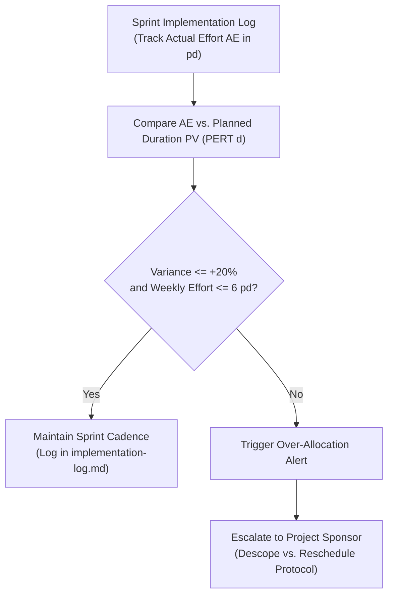

# Resource Foundation — Utilization & Control Protocol (`PMP-BL-v1.0.0`)

This artifact satisfies PMBOK 8 §2.6.2 *Monitor and Control Resourcing* (Figure 2-45) for the Resource Management Plan. It defines the operational protocols for tracking maintainer capacity utilization, monitoring tooling consumption, and resolving resource contentions during **Phase 1: Warm-Start & Confidence-Interval Bandits** (`PMP-BL-v1.0.0`).

In strict compliance with [ADR-030](../../../../adr/ADR-030-resource-management-plan-standard.md) §4.2, **unrecorded maintainer overtime is prohibited**. Capacity deficits are handled through formal governance adjustments.

---

## 1. Capacity Utilization Monitoring & Variance Metrics

### 1.1 Maintainer Burn Rate & Variance Tracking
* **Weekly Capacity Tracking:** Maintainer effort is logged at the completion of each user story in `implementation-log.md`.
* **Variance Indicator:**
  $$\Delta E = AE - PV$$
  where $AE$ is actual person-days expended and $PV$ is the planned weighted duration $\bar{d} = (L + 4M + H)/6$ from [Schedule-Baseline-WBS-Forecast.md](../../schedule-baseline/foundation/Schedule-Baseline-WBS-Forecast.md).
* **Tolerance Thresholds:**
  - **Green (Nominal):** Sprint effort $\le 5\text{ pd/week}$ and $\Delta E \le +20\%$. Normal pair engineering continues.
  - **Amber (Capacity Strain):** Sprint effort between $5\text{ pd}$ and $6\text{ pd/week}$, or story duration exceeds High ($H$) estimate. PM reviews backlog sequence and defers non-critical refactoring.
  - **Red (Over-Allocation Breach):** Sprint effort $> 6\text{ pd/week}$ (exceeding 36 hours/week) or critical-path task slips by $> 2\text{ working days}$. Triggers immediate execution of the **Descope vs. Reschedule Protocol**.

---

## 2. Resource Contention & Priority Hierarchy

When competing engineering or research demands arise within a timebox, resources are allocated strictly according to the following precedence order:

1. **Tier 1 — Strategic Intent & Research Protection (M0.5):**
   - The 40-hour (5 pd) research envelope for **HYP-AL-011** (Hosted Layer Value) is ring-fenced.
   - Engineering work packages on Epics 15–20 cannot borrow or cannibalize this research timebox.
2. **Tier 2 — Phase 1 Critical Path Milestones:**
   - Active milestone deliverables on the primary critical path take precedence over all non-critical work:
     $$\text{M1 (Epic 20)} \longrightarrow \text{M2 (Epics 19, 20)} \longrightarrow \text{M3 (Epics 15–17)} \longrightarrow \text{M4 (Harness / Epics 9, 10)}$$
3. **Tier 3 — Enabling Quality & Technical Debt (Epic 34):**
   - Decommissioning legacy PMBOK test blocks is prioritized ahead of M4 execution to prevent test-collection blockers from obscuring genuine regression signals.
4. **Tier 4 — Program-Track and Deferred Bands:**
   - Stories in Band D (e.g. Epic 38 Contextual Learning, Epic 21 Routing) and Band E are executed only when critical path milestones have positive float. Band C (Epics 14, 18) remains completely deferred until M5 close.

---

## 3. Descope vs. Reschedule Protocol (ADR-030 §4.2)

When an over-allocation breach occurs (actual effort exceeds maintainer capacity), the Project Manager is barred from demanding or assuming unrecorded maintainer overtime. The PM prepares a formal trade-off assessment for the Project Sponsor:

| Strategy | Mechanism | Governance Path | Trade-Off & Impact |
| :--- | :--- | :--- | :--- |
| **Path A: Descope** | Defer non-critical user stories or auxiliary acceptance criteria from Phase 1 Band B into Phase 2 Band C or Program Track Band D. | **Stage 16 Governance Change** or **Stage 17 Adaptation Plan** (`approve-adaptation-plan`). | Preserves the milestone target window; reduces Phase 1 scope footprint; requires sponsor acceptance. |
| **Path B: Reschedule** | Extend the target milestone window (e.g. expand M2 or M3 from 10 pd to 12.5 pd). | **Stage 17 Adaptation Plan** (`approve-adaptation-plan`) amending Schedule plan §1.2. | Preserves full deliverable scope; extends calendar timeline; consumes float or adjusts downstream gates. |

**Decision Right:** The Project Sponsor (Menno Drescher) holds exclusive authority to select between Path A and Path B.

---

## 4. Tooling & Cloud Quota Control

* **API Budget Monitoring:** Monthly API token spend across AI providers (Google AI Studio, Anthropic, Azure OpenAI) is capped at **$100.00 / month**. If spending reaches $80.00 within a billing cycle, automated mock fixtures (`--mock`) are prioritized for local test suites.
* **Test Suite Execution Throttling:**
  - Unit and contract tests must execute within **15 seconds** locally. Any test suite exceeding 30 seconds triggers performance profiling and test optimization (LL-013).
  - Heavy multi-episode benchmarks (e.g. Story 9.1 146-episode harness) must run as detached background tasks or offline scripts, never blocking interactive pair engineering turns.
