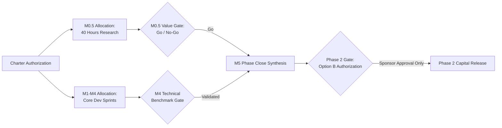

# Cost Management Plan — agent-learning Phase 1: Warm-Start & Confidence-Interval Bandits

> **PMBOK 8 Domain:** `Finance` (Planning Focus Area) | **Legacy Process:** `7.1 Plan Cost Management`  
> **Governance Policy:** `approve-subsidiary-plan` | **Lifecycle Stage:** `Stage 6 (Planning)`  
> **Route:** `full_plan` | **Baseline Identifier:** `PMP-BL-v1.0.0`  
> **Accountable Role:** Project Manager | **Approving Sponsor:** Menno Drescher  
> **Normative Standard:** [ADR-012](../../adr/ADR-012-subsidiary-management-plan-standards-and-content-contracts.md)

---

## 1. Intent, Alignment & Boundaries

### 1.1 Core Mandate & Charter Financial Alignment
This Cost Management Plan establishes the cost management processes, effort accounting mechanisms, contingency reserves, and financial controls for **Phase 1: Warm-Start & Confidence-Interval Bandits**. 

In strict alignment with [Project-Charter.md](../Project-Charter.md) §4 and §7 and [Business-Case.md](../Business-Case.md) §8, the project operates under a **Staged Research Investment** model:
1. **The 40-Hour Research Envelope (M0.5):** A dedicated, time-boxed research investment committed directly by the Project Sponsor (Menno) to evaluate end-user value drivers and willingness-to-pay (HYP-AL-011).
2. **Technical Implementation Effort (M1–M4):** Internal engineering hours allocated across the 7.5-week Phase 1 technical delivery pipeline.
3. **Phase 2 Commitment Gate (M5):** Zero capital or effort commitment is authorized for Option B (Phase 2) until empirical Bayes factors validate Phase 1 hypotheses and Sponsor approval is formally recorded.

### 1.2 Financial Boundaries & Constraints
* **Zero-Cost Open-Source Policy:** The project relies strictly on open-source Python ecosystems (`numpy`, `pydantic`, `pytest`, `ruff`, `mypy`). Zero paid software licenses, proprietary SaaS platforms, or third-party subscription APIs are permitted without prior written sponsor authorization.
* **Cloud & Infrastructure Ceiling:** Azure Cosmos DB testing operates within free-tier limits or local emulator environments. Cloud compute expenditure is capped at baseline developer development subscriptions.
* **Out-of-Scope Financial Commitments:** The following are strictly excluded:
  - External contractor procurement.
  - Marketing and commercialization budgets.
  - Production GPU cluster provisioning.
  - Phase 2 DPO fine-tuning infrastructure.

---

### 1.4 PMBOK Input, Process & Output (IPO) Specification
In accordance with PMBOK® Guide 8th Edition (Finance Performance Domain §2.4):
* **Inputs (PMBOK 8 §2.4.2.1, §2.4.2.2 & §4):**
  - **Project Charter:** Funding limits, preapproved financial resources, and commercial constraints ([Project-Charter.md](../Project-Charter.md)).
  - **Project Management Plan:** Scope baseline ([Scope-Management-Plan.md](Scope-Management-Plan.md)) and schedule baseline ([Schedule-Management-Plan.md](Schedule-Management-Plan.md)).
  - **Enterprise Environmental Factors (EEFs):** Exchange rates, compute cost structures, local hosting options.
  - **Organizational Process Assets (OPAs):** ADR standards ([ADR-012](../../adr/ADR-012-subsidiary-management-plan-standards-and-content-contracts.md), [ADR-027](../../adr/ADR-027-cost-management-plan-standard-and-baseline-contract.md)) and financial policies.
* **Processes (PMBOK 8 §2.4.2 & §5):**
  - **Plan Financial Management:** Defining units of measure (hours / currency), accuracy levels, and variance thresholds.
  - **Estimate Costs:** Aggregating bottom-up estimates per work package and compute resource requirement.
  - **Develop Budget:** Formulating the cost baseline and funding limit reconciliation.
  - **Monitor & Control Finances:** Tracking burn rates, earned value analysis (EVM), and managing contingency reserves.
* **Outputs (PMBOK 8 §2.4.2 & §4):**
  - **Cost Management Plan:** `docs/project-docs/management-plans/Cost-Management-Plan.md`.
  - **Cost Baseline:** Approved time-phased budget and milestone staged funding allocations.
  - **Cost Forecasts & EVM Reports:** Actual vs. planned spend tracking and contingency drawdown logs.

---

## 2. Domain Mechanics & Standards

### 2.1 Staged Funding & Capital Allocation Model
Financial and effort commitments are staged across the milestone lifecycle to minimize capital at risk:

### 2.2 Cost Baseline & Effort Breakdown
The Phase 1 Cost Baseline is measured in engineering and research effort units:

| Work Package / Milestone | Focus Area | Baseline Effort | Contingency Reserve (15%) | Total Authorized Envelope |
|---|---|---|---|---|
| **M0.5: End-User Value Research** | Sponsor Qualitative Research | 40.0 hrs | 6.0 hrs | **46.0 hrs** |
| **M1: Softmax State Inspection** | Technical Architecture | 15.0 hrs | 2.5 hrs | **17.5 hrs** |
| **M2: Warm-Start Prior Transfer** | Algorithm Engineering | 35.0 hrs | 5.0 hrs | **40.0 hrs** |
| **M3: Confidence-Interval Bandits** | Algorithm Engineering | 35.0 hrs | 5.0 hrs | **40.0 hrs** |
| **M4: Autonomy Verification** | Benchmark & Evaluation | 25.0 hrs | 4.0 hrs | **29.0 hrs** |
| **M5: Phase Close & Adjudication** | Governance & Synthesis | 15.0 hrs | 2.5 hrs | **17.5 hrs** |
| **Total Phase 1 Commitment** | | **165.0 hrs** | **25.0 hrs** | **190.0 hrs** |

### 2.3 Earned Value Management (EVM) & Burn Tracking
Effort burn and deliverable progress are tracked weekly via Earned Value Management:
* **Cost Variance ($CV$):** $CV = EV - AC$ (in hours)
* **Cost Performance Index ($CPI$):** $CPI = \frac{EV}{AC}$

**Tolerance Bands:**
* **Green (Nominal):** $CPI \ge 0.90$. Burn rate is within planned milestone parameters.
* **Amber (Tolerance Breach):** $0.80 \le CPI < 0.90$. Project Manager adjusts backlog task depth to contain effort within the milestone envelope.
* **Red (Critical Overrun):** $CPI < 0.80$ or milestone effort exceeds authorized envelope (including contingency). Triggers mandatory escalation to Project Sponsor.

---

## 3. Governance, Control & Decision Rights

### 3.1 Financial Decision Rights & Authority Levels
* **Developer / Implementer:** Discretion over internal implementation approaches provided work stays within story hour estimates.
* **Project Manager:** Authority to reallocate effort across tasks within an approved milestone up to $\pm 10\%$, provided the milestone cap is preserved.
* **Project Sponsor (Menno Drescher):** Holds sovereign authority over total project budget, authorization of the contingency reserve, expansion of the 40-hour M0.5 envelope, and capital release for Phase 2.

### 3.2 Change Control & Funding Adjustments
Any event requiring effort exceeding the 15% contingency reserve must follow formal change governance:
1. **Variance Audit:** Document root cause of overrun in `implementation-log.md`.
2. **Impact Assessment:** Quantify effect on total project burn and milestone delivery.
3. **Sponsor Adjudication:** Submit formal adaptation proposal via Stage 17 Integrated Change Control (`approve-adaptation-plan`). Work beyond authorized envelopes is halted until signed off.

### 3.3 Position in the Planning DAG (ADR-013 §4.1)
Under ADR-013 §4.1, Cost Management is the terminal leaf node of the baseline triad:
$$\text{Scope (5.1)} \longrightarrow \text{Schedule (6.1)} \longrightarrow \text{Cost (7.1)}$$

* Cost variations do not propagate downstream staleness flags because no further baseline plans depend on Cost.
* However, any approved variance in the Cost baseline alters project parameters, requiring formal re-verification under the integrated `approve-pmp` formalization gate.

---

## 4. Amendment Log

| Date | Author | Description |
|---|---|---|
| 2026-10-25 | Menno Drescher / Antigravity | Initial full baseline Cost Management Plan replacing stub mock content per ADR-012. |
