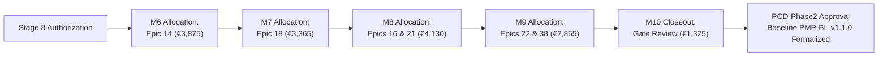

# Cost Management Plan — agent-learning Phase 2: Autonomous Feedback Loops & Extensible Architecture

> **PMBOK 8 Domain:** `Finance` (Planning Focus Area) | **Legacy Process:** `7.1 Plan Cost Management`  
> **Governance Policy:** `approve-subsidiary-plan` | **Lifecycle Stage:** `Stage 6 (Planning: Cost Baseline)`  
> **Route:** `full_plan` | **Baseline Identifier:** `PMP-BL-v1.0.1` (targeting `PMP-BL-v1.1.0`)  
> **Foundation Pack:** [Cost-Foundation-Pack-Manifest.md](cost-baseline/Cost-Foundation-Pack-Manifest.md) (Stage **6.D**)  
> **Accountable Role:** Project Manager / PMBOK Steward | **Approving Sponsor:** Menno Drescher  
> **Normative Standard:** [ADR-012](../../adr/ADR-012-subsidiary-management-plan-standards-and-content-contracts.md) and [ADR-027](../../adr/ADR-027-cost-management-plan-standard-and-baseline-contract.md)  
> **Upstream Baselines:** [Scope-Management-Plan.md](Scope-Management-Plan.md) v2.0.0 and [Schedule-Management-Plan.md](Schedule-Management-Plan.md) v2.0.0  
> **Historical Baseline Archive:** Frozen Phase 1 cost plan preserved in [`docs/project-docs/history/PMP-BL-v1.0.0/management-plans/Cost-Management-Plan.md`](../history/PMP-BL-v1.0.0/management-plans/Cost-Management-Plan.md)  

For `PMP-BL-v1.1.0`, the **integrated cost baseline** = approved **[Cost-Foundation-Pack-Manifest.md](cost-baseline/Cost-Foundation-Pack-Manifest.md)** + approved **this plan** (v2.0.0). Phase 2 operationalizes the staged investment framework across **Milestones M6 through M10**, delivering discrete DPO learning and contextual ensemble routers under a hard cash OpEx ceiling.

---

## 1. Intent, Alignment & Boundaries

### 1.1 Core Mandate & Financial Framework
This Cost Management Plan establishes the cost management processes, effort accounting, contingency reserves, and financial controls for **Phase 2: Autonomous Feedback Loops & Extensible Architecture**.

In strict alignment with [Project-Charter.md](../Project-Charter.md) v2.0 §4 and [Business-Case.md](../Business-Case.md) v2.0:
1. **Maintainer Human Labor Valuation:** 120–160 engineering hours (30.0 pd) evaluated under the established economic shadow rate of **€85.00/hr** (€0.00 cash outlay).
2. **Strict Cash OpEx Ceiling:** Incurred external cash expenses (model APIs, Antigravity endpoints, validation test runs) are capped at **$\le €100.00/\text{month}$** and **$\le €300.00$ total Phase 2 envelope**.
3. **100% Make Sourcing (ADR-033 Trace):** Zero external contractor hiring or proprietary SaaS licensing; all algorithms implemented in-house as open source.
4. **Cloud GPU Spend Avoidance:** Discrete policy formulation and frozen-model architectures completely eliminate the need for cloud GPU cluster rentals (saving $> €5,000$ in CapEx/OpEx).

### 1.2 Financial Boundaries & Management Envelope (Phase 2)
* **Total Phase 2 Economic Valuation Baseline:** **€19,175.00** (Work packages: €15,300 labor + €250 API cash; Contingency reserve: €3,875).
* **Total Phase 2 Budget (including Management Reserve):** **€21,725.00** (€19,175 baseline + €2,550 Sponsor management reserve).
* **Maximum Cash Outlay Ceiling:** **€300.00** overall.

---

## 2. Domain Mechanics & Standards

### 2.1 Staged Funding & Capital Allocation Model (Phase 2)

### 2.2 Earned Value Management (EVM) Control Rules
* **Green (Nominal):** $CPI \ge 0.90$ and $CV \ge -€1,000.00$. Continue pair engineering sprints.
* **Amber (Warning):** $0.80 \le CPI < 0.90$ or $-€2,000.00 \le CV < -€1,000.00$. PM reallocates task depth; draws from contingency reserve.
* **Red (Breach):** $CPI < 0.80$ or cash burn $> €100.00/\text{mo}$. Mandatory work halt; formal Stage 16/17 change submission.

---

## 3. Governance, Control & Decision Rights

* **Project Manager:** Responsible for logging weekly actual effort hours in `implementation-log.md`, tracking EVM ratios, and managing the 12.5 pd contingency reserve.
* **Project Sponsor (Menno Drescher):** Holds sovereign authority over cost baseline formalization, cash allocations, and management reserve drawdowns.

---

## 4. Amendment Log

| Date | Author | Description |
|---|---|---|
| 2026-10-25 | Menno Drescher / Antigravity | Initial full baseline Cost Management Plan replacing stub mock content per ADR-012 and ADR-027. |
| 2026-11-01 | Menno Drescher / Antigravity | **v1.1.0 — 6.D approved:** Integrated Cost foundation pack; approved under `approve-subsidiary-plan` (Episode `72d23862-3d3e-4438-8950-884f06bd0fd0`). |
| 2026-11-08 | Menno Drescher / Antigravity | **v2.0.0 — Phase 2 Cost Formalization:** Advanced to `v2.0.0` for Phase 2 under `PMP-BL-v1.0.1` targeting `PMP-BL-v1.1.0`. Established Phase 2 staged budget across Milestones M6–M10 (€19,175 economic valuation, €300 max cash OpEx), codified GPU spend avoidance, and mapped EVM control boundaries. |
