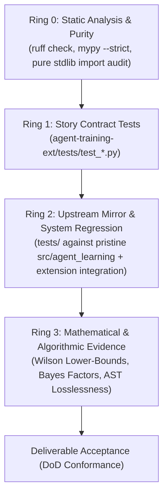

# Quality Management Plan — agent-learning Phase 2: Autonomous Feedback Loops & Extensible Architecture

> **PMBOK 8 Domain:** `Governance` (Planning Focus Area) | **Legacy Process:** `8.1 Plan Quality Management`  
> **Governance Policy:** `approve-subsidiary-plan` | **Lifecycle Stage:** `Stage 6 (Planning)`  
> **Route:** `full_plan` | **Baseline Identifier:** `PMP-BL-v1.1.0`  
> **Accountable Role:** Quality Assurance Lead | **Approving Sponsor:** Menno Drescher  
> **Normative Standard:** [ADR-012](../../adr/ADR-012-subsidiary-management-plan-standards-and-content-contracts.md), [ADR-029](../../adr/ADR-029-quality-management-plan-standard.md)

---

## 1. Intent, Alignment & Boundaries

### 1.1 Core Mandate & Quality Objectives
This Quality Management Plan defines the quality standards, automated verification gates, mathematical confidence thresholds, upstream fork protection checks, and testing policies for **Phase 2: Autonomous Feedback Loops & Extensible Architecture**. 

In strict alignment with [Project-Charter.md](../Project-Charter.md) v2.0 §2, [Scope-Management-Plan.md](Scope-Management-Plan.md) v2.0.0, and **Pillar III (Mathematical Rigor)** / **Pillar IV (Software Engineering Integrity)**, project execution enforces five primary quality objectives:
1. **Mathematical & Algorithmic Soundness:** Bayesian hypothesis adjudication must adhere strictly to Bayes factor thresholds ($BF_{10} \ge 10 \implies \text{VALIDATED}$, $BF_{10} \le 0.1 \implies \text{REFUTED}$, ADR-009). DPO preference optimization models must demonstrate monotonic training loss reduction and bounded validation perplexity without policy collapse.
2. **Statistical Autonomy Verification:** Autonomy transitions for contextual bandit policies must satisfy 95% Wilson score lower-bound intervals ($L_{0.95} \ge \tau$, ADR-003).
3. **Deterministic Contract Verification:** 100% of functional requirements and story acceptance criteria ($AC_n$) across Phase 2 Epics (14, 18, 16, 21, 22, 38) must be pinned by deterministic Pytest contract suites executing in isolated environments.
4. **Standard Library Purity & Static Rigor:** Production code in `agent-training-ext/` must enforce zero unauthorized third-party dependencies, static type safety (`mypy --strict`), and linting compliance (`ruff`).
5. **Upstream Fork Collision Protection (Invariant 6):** Automated zero-diff assertion: `git diff upstream/main -- src/agent_learning` must output exactly 0 lines on all branches and release builds, ensuring zero merge collisions when pulling upstream updates from Microsoft.

### 1.2 Boundary Definitions
* **In-Scope Quality Controls:** 
  - Automated unit, integration, and contract test suites in `agent-training-ext/tests/`.
  - Static analysis, syntax tree validation, and type checking (`ruff`, `mypy --strict`).
  - Pure standard library import auditing (rejecting unauthorized third-party modules in production).
  - Wilson score confidence intervals and Bayes factor evaluations.
  - Upstream fork diff checks against `microsoft/agent-learning` HEAD.
  - Code review quality gates and Definition of Done (DoD) verification audits.
* **Out-of-Scope Quality Activities:** The following verification activities are strictly excluded:
  - Physical load, stress, and endurance testing on distributed cloud server clusters.
  - Multi-GPU distributed training benchmarks (Phase 2 is strictly standard-library CPU-compatible).
  - Manual graphical user interface (GUI) testing (the codebase is strictly a headless Python SDK and CLI tool).
  - Penetration testing of third-party model API endpoints (Anthropic, Google, Azure).

### 1.3 Charter and Scope Traceability
Quality gates directly operationalize the Scope Acceptance Criteria and Definition of Done (DoD) established in [Scope-Management-Plan.md](Scope-Management-Plan.md) v2.0.0 §2.3 and ADR-025:
* **Scope Acceptance Criteria:** Every Phase 2 deliverable (DEL-P2-01 through DEL-P2-08) defines exact acceptance criteria audited by the Quality Assurance Lead prior to Sponsor sign-off.
* **Definition of Done (DoD) Conformance:** A story or deliverable is accepted if and only if all 4 testing rings pass with zero test failures, zero regressions, zero unhandled exceptions, and zero diff in `src/agent_learning/`.

### 1.4 Zero Upfront Deliverable Prerequisite
In accordance with ADR-029 §3, designing and baselining the Quality Management Plan requires only the Project Charter and Scope baseline. It does **not** require test suite code, verification evidence, or human breakout sessions in advance; the plan establishes the quality gates, verification rules, and DoD conformance criteria under which subsequent deliverables are audited.

### 1.5 PMBOK Input, Process & Output (IPO) Specification
In accordance with PMBOK® Guide 8th Edition (Scope Performance Domain §2.2 & Quality Practices §3.5):
* **Inputs (PMBOK 8 §2.2.2, §3.5 & §4):**
  - **Project Charter:** Quality objectives and project success criteria ([Project-Charter.md](../Project-Charter.md) v2.0).
  - **Project Management Plan:** Scope baseline ([Scope-Management-Plan.md](Scope-Management-Plan.md) v2.0.0) and Definition of Done gates.
  - **Enterprise Environmental Factors (EEFs):** Python test ecosystem, linting tools (`ruff`, `mypy`, `pytest`), Git environment.
  - **Organizational Process Assets (OPAs):** ADR standards ([ADR-012](../../adr/ADR-012-subsidiary-management-plan-standards-and-content-contracts.md), [ADR-029](../../adr/ADR-029-quality-management-plan-standard.md)) and peer review checklists.
* **Processes (PMBOK 8 §2.1.6.5, §3.5 & §5):**
  - **Plan Quality Management:** Establishing quality metrics, test inspection thresholds, upstream diff gates, and pure stdlib rules.
  - **Manage Quality Assurance:** Translating standards into executable contract tests and continuous integration checks.
  - **Control Quality (Verification):** Executing automated test suites, assessing test pass rates, and triaging nonconformances.
  - **Waiver Governance:** Enforcing recorded rationale and authorization for all criteria waivers.
* **Outputs (PMBOK 8 §2.1.6.5 & §4):**
  - **Quality Management Plan:** `docs/project-docs/management-plans/Quality-Management-Plan.md` v2.0.0.
  - **Quality Gate Definitions & Metrics:** Strict contract test pass rules, pure stdlib verification, zero upstream diff.
  - **Quality Reports & Audit Records:** Pytest verification logs and `PlanApprovalRecord` quality evidence in `Episode.metadata`.

---

## 2. Domain Mechanics & Standards

### 2.1 Quality Gates Across Lifecycle Stages
Quality is enforced through five discrete, auditable Quality Gates across Phase 2:

| Gate Identifier | Lifecycle Stage / Timing | Gate Name | Pass Criteria | Required Evidence | Gate Owner Role |
|---|---|---|---|---|---|
| **QG-01** | Stage 6 (Planning) | Subsidiary Plan Quality Gate | Frontmatter validity; 0 Tier A/B lint flags; word count within floor/cap; normative ADR compliance | `lint_plan` output clean; canonical plan hash computed | Project Manager |
| **QG-02** | Stage 7–8 (Design / Dev) | RED Test-First Gate | Story contract test written in `agent-training-ext/tests/` and observed FAILING (RED state) before implementation begins | Terminal log of failing test assertion; commit hash | Tech Lead |
| **QG-03** | Stage 9 (Implementation) | Static Code & Pure Stdlib Gate | Zero errors under `ruff check`; zero errors under `mypy --strict`; zero unauthorized third-party imports in `agent-training-ext/` | Static analysis runner exit code 0; dependency audit log | Quality Assurance Lead |
| **QG-04** | Stage 10 (Verification) | Functional, Regression & Upstream Gate | 100% test pass rate across full test suite; zero skipped tests; `git diff upstream/main -- src/agent_learning` outputs 0 lines | Pytest summary report (all passing); git diff log | Quality Assurance Lead |
| **QG-05** | Stage 11–12 (Milestone) | Mathematical & Algorithmic Evidence Gate | Wilson score $L_{0.95} \ge \tau$; Bayes factor $BF_{10} \ge 10$ or $\le 0.1$; AST round-trip lossless verification; zero unhandled warnings | Serialized Episode records with evaluation metrics | Project Sponsor (Menno) |

### 2.2 4-Ring Verification Architecture & Coverage Scope
Verification operates across four deterministic testing rings:

* **Coverage Scope & Standards:**
  - Coverage is measured across 100% of functional requirements and story acceptance criteria ($AC_n$).
  - Every public function and class method in `agent-training-ext/` must have direct contract test verification.
  - Zero test flakiness: tests must execute with fixed random seeds (`random.seed`) and mock all network I/O.
  - Upstream isolation verification: tests for custom modules must reside in `agent-training-ext/tests/` and must never pollute root `tests/`.

### 2.3 Nonconformance Handling & Defect Triage
When a deliverable fails any quality gate:
1. **Immediate Quarantine:** The pull request or build is blocked outright. Merging code that fails any test ring or introduces diff into `src/agent_learning/` is strictly prohibited.
2. **Triage Classification:** The Quality Assurance Lead reviews the failure within 4 hours and assigns one of three remediation paths:
   - **Rework (Default):** Developer remediates the underlying defect and re-runs the full test suite.
   - **Story Revision:** If the failure reveals an ambiguous or contradictory acceptance criterion, the story is sent back to Stage 4 for criteria refinement.
   - **Waiver Request:** If an external environment bug makes a test impractical, a formal waiver must be requested under §3.2.
3. **Brittle Assertion Avoidance (LL-002):** Test assertions must evaluate semantic invariants rather than fragile string matches or arbitrary floating-point representations.

### 2.4 Quality Metrics & Operational Thresholds
Operational quality is measured against six non-negotiable quantitative thresholds:

| Metric Name | Measurement Source | Target / Pass Threshold | Action Trigger |
|---|---|---|---|
| **Test Pass Rate** | Pytest Test Runner | **100%** (zero test failures, zero errors) | Any test failure halts CI merge |
| **Static Lint / Style** | `ruff check` | **0 errors** / 0 warnings | Any lint error blocks PR review |
| **Static Type Safety** | `mypy --strict` | **0 type errors** | Any type discrepancy blocks PR merge |
| **Pure Stdlib Compliance** | AST Import Audit | **0 third-party imports** in `agent-training-ext/` production code | Any external dependency blocks PR merge |
| **Upstream Fork Diff** | `git diff upstream/main -- src/` | **0 lines of diff** | Any diff halts release build immediately |
| **Bayesian Evidence Metric** | Hypothesis Engine | $BF_{10} \ge 10$ (validated) or $\le 0.1$ (refuted) | Indeterminate zone ($0.1 < BF < 10$) triggers evidence gathering |

### 2.5 Continuous Improvement & Lessons Learned Link
In accordance with ADR-010 and the Lessons Learned Register:
* Every post-epic recap analyzes defect escapes and operational friction points.
* Key operational lessons (such as LL-001 through LL-015, LL-044) are distilled into reusable agent skills and permanent lint rules.
* Recurring test failures trigger immediate updates to the DoD checklist.

---

## 3. Governance, Control & Decision Rights

### 3.1 Quality Roles & Responsibilities
* **Developer:** Responsible for writing failing contract tests first (RED), observing failure, implementing minimal passing code (GREEN), maintaining pure stdlib compliance, and maintaining 100% pass rates locally.
* **Quality Assurance Lead / Tech Lead:** Accountable for test suite integrity, test architecture health, CI/CD pipeline reliability, auditing upstream fork diffs, and auditing compliance with ADR-029.
* **Project Manager:** Monitors quality metrics trends, tracks defect remediation timelines, and verifies frontmatter linting across documentation baselines.
* **Project Sponsor (Menno Drescher):** Holds sovereign authority to accept milestone deliverables, authorize hypothesis validation transitions, and approve criteria waivers.

### 3.2 Formal Waiver Governance Protocol
Waivers of quality gate criteria are governed with extreme rigor:
1. **Zero Silent Waivers (ADR-029 §3 Invariant):** Under no circumstances may a test failure, lint error, type warning, or upstream diff be ignored or commented out.
2. **Waiver Submission:** A formal waiver request must document: (a) the exact criterion waived, (b) root cause analysis, (c) compensating risk controls, and (d) a time-bounded remediation date.
3. **Approval Authority:** Waivers can only be approved by Project Sponsor Menno Drescher via a recorded governance `Episode`.

### 3.3 Position in the Planning DAG & Baseline Approval (Stage 6.G)
In accordance with ADR-013 §4.1 and ADR-029 §4.5:
$$\text{Scope Management (5.1)} \longrightarrow \text{Quality Management (8.1)}$$

* **Upstream Baseline:** Scope Management Plan v2.0.0 (approved under `PMP-BL-v1.1.0`, canonical hash `ee97d20993e90c88a5fe7619ed4329d47377e930a7a7cea5c3207e6d5b9c6270`).
* **Phase 2 Baseline Alignment:** Formally updated and baselined under `PMP-BL-v1.1.0`.

### 3.4 Review Cadence & Downstream Invalidation
* **Review Cadence:** Quality gate criteria are reviewed at each milestone boundary (M6 through M10) and upon Phase 2 closeout.
* **Downstream Invalidation:** In accordance with ADR-029 §3 and ADR-013 §4.5, Quality Management has no downstream dependent plans in `PLAN_DAG`. A change to `scope-management` marks this plan `STALE_DEPENDENCY`.

---

## 4. Amendment Log

| Date | Author | Description |
|---|---|---|
| 2026-10-25 | Menno Drescher / Antigravity | Initial full baseline Quality Management Plan replacing stub mock content per ADR-012. |
| 2026-11-01 | Menno Drescher / Antigravity | **v1.1.0 — 6.G approved:** Formalized 5 discrete quality gates across lifecycle stages; expanded 4-ring testing architecture; defined nonconformance triage workflow and strict waiver protocol; linked to Scope DoD and Lessons Learned; approved under `approve-subsidiary-plan` (Episode `14ff58df-f027-4d41-93c2-04c5170b151c`). |
| 2026-11-08 | Menno Drescher / Antigravity | **v2.0.0 — PMP-BL-v1.1.0 Phase 2 Formalization:** Updated for Phase 2: Autonomous Feedback Loops & Extensible Architecture; incorporated Upstream Fork Collision Protection metric (`git diff upstream/main -- src/agent_learning` = 0 lines); codified pure standard library import audit for `agent-training-ext/`; aligned 4-ring testing architecture and quality gates QG-01 to QG-05 with Phase 2 Milestones M6–M10; linked upstream DAG to Scope v2.0.0. |
