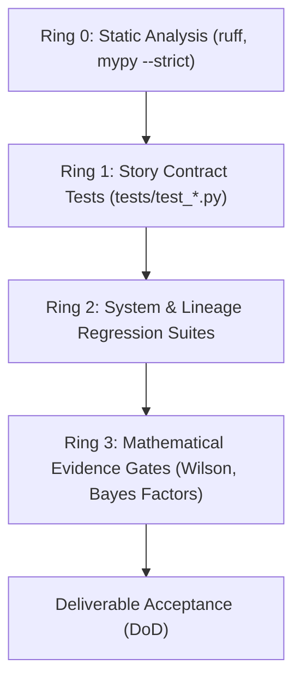

# Quality Management Plan — agent-learning Phase 1: Warm-Start & Confidence-Interval Bandits

> **PMBOK 8 Domain:** `Governance` (Planning Focus Area) | **Legacy Process:** `8.1 Plan Quality Management`  
> **Governance Policy:** `approve-subsidiary-plan` | **Lifecycle Stage:** `Stage 6 (Planning)`  
> **Route:** `full_plan` | **Baseline Identifier:** `PMP-BL-v1.0.0`  
> **Accountable Role:** Quality Assurance Lead / Tech Lead | **Approving Sponsor:** Menno Drescher  
> **Normative Standard:** [ADR-012](../../adr/ADR-012-subsidiary-management-plan-standards-and-content-contracts.md)

---

## 1. Intent, Alignment & Boundaries

### 1.1 Core Mandate & Quality Objectives
This Quality Management Plan defines the quality standards, automated verification gates, mathematical confidence thresholds, and testing policies for **Phase 1: Warm-Start & Confidence-Interval Bandits**. 

In strict alignment with [Project-Charter.md](../Project-Charter.md) §2 and **Pillar III (Mathematical Rigor)** / **Pillar IV (Software Engineering Integrity)**, the quality objectives are:
1. **Mathematical Soundness:** Bayesian hypothesis adjudication must adhere strictly to Bayes factor thresholds ($BF_{10} \ge 10 \implies \text{VALIDATED}$, $BF_{10} \le 0.1 \implies \text{REFUTED}$, ADR-009).
2. **Statistical Autonomy Verification:** Autonomy transitions for learned bandit policies must satisfy 95% Wilson score lower-bound intervals ($L_{0.95} \ge \tau$, ADR-003).
3. **Deterministic Contract Verification:** 100% of functional requirements and story acceptance criteria must be pinned by deterministic Pytest suites executing in standard environments.
4. **Zero Flakiness & Pure Implementations:** Production code must enforce standard library purity, static type safety (`mypy --strict`), and linting compliance (`ruff`).

### 1.2 Boundary Definitions
* **In-Scope Quality Controls:** Automated unit and integration testing; contract test enforcement (observed RED first); static type checking; Wilson score lower-bound evaluations; code review quality gates.
* **Out-of-Scope Quality Activities:** The following verification activities are strictly excluded:
  - Physical load and stress testing on non-existent server infrastructure.
  - Penetration testing on non-existent cloud endpoints.
  - Manual GUI testing (repository is headless SDK and CLI).

---

### 1.4 PMBOK Input, Process & Output (IPO) Specification
In accordance with PMBOK® Guide 8th Edition (Scope Performance Domain §2.2 & Quality Practices §3.5):
* **Inputs (PMBOK 8 §2.2.2, §3.5 & §4):**
  - **Project Charter:** Quality objectives and project success criteria ([Project-Charter.md](../Project-Charter.md)).
  - **Project Management Plan:** Scope baseline ([Scope-Management-Plan.md](Scope-Management-Plan.md)) and Definition of Done gates.
  - **Enterprise Environmental Factors (EEFs):** Python test ecosystem, linting tools (`ruff`, `mypy`, `pytest`), CI runtime environment.
  - **Organizational Process Assets (OPAs):** ADR standards ([ADR-012](../../adr/ADR-012-subsidiary-management-plan-standards-and-content-contracts.md), [ADR-029](../../adr/ADR-029-quality-management-plan-standard.md)) and peer review checklists.
* **Processes (PMBOK 8 §2.1.6.5, §3.5 & §5):**
  - **Plan Quality Management:** Establishing quality metrics, test inspection thresholds, and gate criteria.
  - **Manage Quality Assurance:** Translating standards into executable contract tests and continuous integration checks.
  - **Control Quality (Verification):** Executing automated test suites, assessing code coverage, and triaging nonconformances.
  - **Waiver Governance:** Enforcing recorded rationale and authorization for all criteria waivers.
* **Outputs (PMBOK 8 §2.1.6.5 & §4):**
  - **Quality Management Plan:** `docs/project-docs/management-plans/Quality-Management-Plan.md`.
  - **Quality Gate Definitions & Metrics:** Strict contract test pass rules, stdlib-first verification, zero unhandled errors.
  - **Quality Reports & Audit Records:** Pytest verification logs and `PlanApprovalRecord` quality evidence in `Episode.metadata`.

---

## 2. Domain Mechanics & Standards

### 2.1 Verification Architecture & Test Hierarchy
Quality is verified across four deterministic testing rings:

### 2.2 Quality Metrics & Acceptance Criteria
* **Test Pass Rate:** 100% pass rate across the full repository test suite (`uv run pytest`). Zero collection errors permitted.
* **Code Purity Standard:** Zero undeclared third-party dependencies in production modules (enforcing ADR-028).
* **Code Style & Static Typing:** Zero errors under `ruff check` and strict `mypy` type validation.
* **Regression Protection:** Decision-progress comparison must classify all policy updates as `PROGRESSION` ($\Delta \mathcal{U} > \epsilon$, ADR-005) with zero regression on existing capabilities.

### 2.3 Quality Control Protocols
1. **Test-First Invariant (RED-GREEN-REFACTOR):** Every user story implementation must begin by introducing a failing contract test capturing $AC_n$. The RED state must be observed and documented before functional implementation.
2. **Deterministic Regression Protection:** All test fixtures must use static pseudorandom seeds and mock external network I/O, ensuring execution reproducibility across Windows and Linux runner environments.

---

## 3. Governance, Control & Decision Rights

### 3.1 Quality Roles & Responsibilities
* **Developer:** Responsible for writing contract tests, observing RED states, and maintaining 100% passing tests locally.
* **Quality Assurance / Tech Lead:** Accountable for test suite health, reviewing PR test coverage, and preventing brittle assertions (LL-002).
* **Project Sponsor (Menno Drescher):** Approves hypothesis validation thresholds and sovereign governance sign-off.

### 3.2 Non-Conformance Remediation & Escalation
Any deliverable failing quality gates is subject to immediate remediation:
* **Contract Failure:** Blocks PR merge outright. Developer must resolve failure or request story revision.
* **Flaky Test Detection:** Any test exhibiting non-deterministic behavior is quarantined and remediated within 24 hours.
* **Hypothesis Refutation:** If empirical Bayes factors indicate $BF_{10} \le 0.1$, the hypothesis is marked `REFUTED` under ADR-009 ($d_{\max}=2$ ceiling), preventing endless defensive refinement.

---

## 4. Amendment Log

| Date | Author | Description |
|---|---|---|
| 2026-10-25 | Menno Drescher / Antigravity | Initial full baseline Quality Management Plan replacing stub mock content per ADR-012. |
