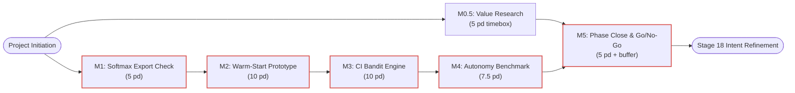

# Schedule Management Plan — agent-learning

> **PMBOK 8 Domain:** `Schedule` (Planning Focus Area) | **Legacy Process:** `6.1 Plan Schedule Management`  
> **Governance Policy:** `approve-subsidiary-plan` | **Lifecycle Stage:** `Stage 6 (Planning)`  
> **Route:** `full_plan` | **Baseline Identifier:** `PMP-BL-v1.0.0`  
> **Foundation pack:** [Schedule-Foundation-Pack-Manifest.md](schedule-baseline/Schedule-Foundation-Pack-Manifest.md) (Stage **6.B**)  
> **Accountable Role:** Project Manager | **Approving Sponsor:** Menno Drescher  
> **Normative Standard:** [ADR-012](../../adr/ADR-012-subsidiary-management-plan-standards-and-content-contracts.md) and [ADR-026](../../adr/ADR-026-schedule-management-plan-standard-and-baseline-contract.md)  
> **Scope baseline:** [Scope-Management-Plan.md](Scope-Management-Plan.md) v1.2+ (foundation pack **6.A**)  
> **Topic pillars:** [Project-Pillars.md](../Project-Pillars.md); schedule trace **[Schedule-Pillar-Overview-and-Trace.md](schedule-baseline/foundation/Schedule-Pillar-Overview-and-Trace.md)** (**6.B-0P**); scope trace [Scope-Pillar-Overview-and-Trace.md](scope-baseline/foundation/Scope-Pillar-Overview-and-Trace.md)

For `PMP-BL-v1.0.0`, the **integrated schedule baseline** = approved **[Schedule-Foundation-Pack-Manifest.md](schedule-baseline/Schedule-Foundation-Pack-Manifest.md)** + approved **this plan** (v1.2+). Milestones and governance live here; estimation basis, Phase 1 network, **activity list & dependencies**, reserves, domain checklist, and the 143-row WBS forecast live under [schedule-baseline/foundation/](schedule-baseline/foundation/) and are gated per the manifest **6.B** checklist before this plan’s first subsidiary approval.

---

## 1. Intent, Alignment & Boundaries

### 1.1 Mandate & Progressive Elaboration Model
This Schedule Management Plan defines scheduling methodology, the **Schedule Baseline** (milestone register + WBS forecast), critical-path controls, and variance tolerances for the `agent-learning` program. [Project-Charter.md](../Project-Charter.md) §7 locks **Phase 1** milestones M0.5–M5; [Scope-Management-Plan.md](Scope-Management-Plan.md) §1.5 defines which WBS bands may execute in Phase 1 versus deferred or program tracks.

**Development approach:** Adaptive / hybrid — Charter milestones are fixed; story-level duration forecasts are elaborated at baseline approval and revised through `approve-adaptation-plan` or design-time baseline feedback (`BFI-NNN`, ADR-037) when variance thresholds in §2.6 are breached.

### 1.2 Schedule Baseline — Milestone Register
Each milestone names a **parent epic or Charter anchor**, **exit condition**, **target window**, and **predecessors**. Durations use **person-days (pd)** (~6 focused hours). Windows are indicative for Phase 1; the Charter remains volunteer-paced, not date-committed.

| ID | Parent anchor | Exit condition (objective) | Target window | Predecessors |
| --- | --- | --- | --- | --- |
| **M0.5** | Charter §5 / §7 | Recorded Go/No-Go on long-term build; Research Log updated | **5 pd** (40 h timebox) | Charter approval |
| **M1** | Epic 20 / Charter §7 | `SoftmaxPolicy` reuse question answered Yes/No with inspection report | **5 pd** (~1 week) | Charter approval |
| **M2** | Epics 19, 20 | Warm-start / meta-prior path implemented; HYP-AL-008 test runnable | **10 pd** (~2 weeks) | M1 disposition |
| **M3** | Epics 15, 16, 17 | UCB and Thompson resolvers integrated; exploration under positive-only evidence | **10 pd** (~2 weeks) | M2 |
| **M4** | Stories 9.1, 10.1; harness | Autonomy benchmark on 146-episode fixture; report vs REINFORCE baseline | **7.5 pd** (~1.5 weeks) | M3; Epic 34 recommended before full suite green |
| **M5** | Story 9.1 / Stage 18 | Bayes factors for HYP-AL-008/009 recorded; Option B gate documented | **5 pd** (~1 week) + **5 pd** buffer | M0.5, M4 |

**Phase 1 critical path (calendar):** Start → M1 → M2 → M3 → M4 → M5 ≈ **7.5 weeks** serial milestone windows, with **M0.5 in parallel** (positive float to M5). WBS weighted sums in §2.5 are **effort**, not calendar length, when stories overlap or run in parallel.

### 1.3 Out-of-Scope Schedule Boundaries
* **In scope:** Milestone DAG; WBS three-point estimates; epic and program rollups; sprint timeboxes; test-run timing benchmarks.
* **Out of scope:**
  - Detailed calendar dates for **Band C** (Epics 14, 18 — Option B / Phase 2) until M5 and Level 3 scope authorization.
  - **ADR-023** user stories (not yet in Scope WBS).
  - Continuous release pipelines beyond manual GitHub release tags.
  - Operational 24/7 on-call schedules.
  - Reading velocity or historical duration from `LearningStore` (ADR-026 §8).

---

### 1.4 PMBOK Input, Process & Output (IPO) Specification
* **Inputs:** Project Charter §7; Scope baseline WBS ([Scope-WBS-Dictionary.md](scope-baseline/foundation/Scope-WBS-Dictionary.md)); development approach (§1.1); team capacity (maintainer-paced, ~5 pd/week planning assumption).
* **Processes:** Plan schedule management; develop schedule (PDM finish-to-start on milestones; story sequencing within epics); monitor and control (§2.6).
* **Outputs:**
  - This Schedule Management Plan.
  - **Schedule Baseline (integrated):** [Schedule-Foundation-Pack-Manifest.md](schedule-baseline/Schedule-Foundation-Pack-Manifest.md) v1.3+ + §1.2 milestone register + §2.5 rollups + eight approved foundation artifacts (see manifest § Integrated schedule baseline).
  - Schedule forecasts updated at each timebox boundary and phase close (foundation forecast file + manifest hash).

---

## 2. Domain Mechanics & Standards

### 2.1 Milestone Dependency DAG & Critical Path Analysis

Primary **critical path:** M1 → M2 → M3 → M4 → M5. M0.5 runs in parallel with positive float relative to M5 convergence.

### 2.2 Timeboxing Standards & Cadence Rules
* **M0.5:** Capped at **40 research hours (5 pd)**; synthesis required when the cap is reached.
* **Sprint cadence:** **1 calendar week** timebox; each user story should fit one sprint at **medium** estimate unless escalated (Level 2).
* **Buffer before M5:** **5 pd** contingency held by the Project Manager for Bayes recalculation and review (consumption logged; Sponsor approves extension beyond 5 pd).
* **Planning horizon:** Full program **remaining weighted forecast ≈ 397 pd** (~79 weeks at 5 pd/week if all Scope bands executed serially); Phase 1 **Band B** remaining **≈ 115 pd** (Epics 15–17, 19–20 only — see §2.5).

### 2.3 Estimation Basis & Complexity Scale

Normative rules: [foundation/Schedule-Basis-of-Estimates.md](schedule-baseline/foundation/Schedule-Basis-of-Estimates.md). Summary:

| Element | Rule |
| --- | --- |
| **Unit** | Person-day (**pd**), one maintainer ~6 focused hours. |
| **Three-point duration** | **Low (L):** optimistic; **Medium (M):** most likely; **High (H):** adverse (unknown deps, data gaps, decommission risk). |
| **Weighted average** | Beta-PERT mode: $\bar{d} = (L + 4M + H) / 6$ per WBS row. |
| **Program rollup** | Sum of $\bar{d}$ over **remaining** stories (excludes Complete and Superseded 8.1). |
| **Complexity C1–C4** | Implementation effort per story (not ADR-003 runtime tier). |

Phase 1 precedence: [foundation/Schedule-Network-Phase1.md](schedule-baseline/foundation/Schedule-Network-Phase1.md) (epic/milestone); story activity list: [foundation/Schedule-Activity-List-Phase1.md](schedule-baseline/foundation/Schedule-Activity-List-Phase1.md) (**6.B-2A**); Gantt: [foundation/Schedule-Gantt-Phase1.md](schedule-baseline/foundation/Schedule-Gantt-Phase1.md) (**6.B-2B**). Reserves: [foundation/Schedule-Reserve-Register.md](schedule-baseline/foundation/Schedule-Reserve-Register.md).

### 2.4 WBS & Milestone Linkage
Every story in [Scope-WBS-Dictionary.md](scope-baseline/foundation/Scope-WBS-Dictionary.md) appears in [foundation/Schedule-Baseline-WBS-Forecast.md](schedule-baseline/foundation/Schedule-Baseline-WBS-Forecast.md) with L/M/H/$\bar{d}$/complexity. The **Milestone** column assigns **M2**, **M3**, **Phase 2**, **Program**, **Foundation**, or **—** (complete). Phase 1 execution uses Scope §1.5 Band **B** (M2/M3 anchors); Bands C–E keep forecasts for program planning without calendar commitment.

### 2.5 Schedule Forecast — Program & Phase 1 Rollups
Story-level lines (all **143** WBS items) are in [foundation/Schedule-Baseline-WBS-Forecast.md](schedule-baseline/foundation/Schedule-Baseline-WBS-Forecast.md). Summary:

| Horizon | Remaining stories | Low (pd) | Medium (pd) | High (pd) | **Weighted (pd)** |
| --- | ---: | ---: | ---: | ---: | ---: |
| **Entire program** (all incomplete WBS) | 112 | 181.5 | 373.0 | 708.0 | **396.9** |
| **Phase 1 Band B only** (Epics 15–17, 19–20) | 31 | 54.5 | 109.0 | 202.0 | **115.4** |
| **Deferred Band C** (Epics 14, 18) | 12 | 26.0 | 52.0 | 104.0 | **~56** |

**Epic rollup (remaining weighted effort, pd):**

| Epic | Theme | Remaining stories | Weighted (pd) | Complexity mix |
| ---: | --- | --- | ---: | --- |
| 14–18 | Learning (incl. deferred Option B) | 6 each | 20.4–37.3 each | C3–C4 |
| 19–20 | Meta-prior / warm-start (M2) | 7 / 6 | 29.2 / 25.0 | C3 |
| 21–22 | Routing / scored search (Band D) | 7 / 7 | 30.3 / 37.3 | C4 |
| 25–33 | Subsidiary plan standards | 4 each | 10.5 each | C2 |
| 34 | Tooling decommission | 5 | 21.7 | C4 |
| 35 | Cycle traceability | 4 | 13.0 | C3 |
| 37 | Design-time BFI | 4 | 12.3 | C3 |
| 38 | Contextual learning | 6 | 16.0 | C3 |

Epics **1–13** and **36** show **0** remaining weighted effort (complete or superseded). **Epic 34** is on the **recommended** path before M4 if legacy `pmbok/` tests still block collection.

### 2.6 Schedule Variance Metrics & Thresholds
$$SV = EV - PV, \quad SPI = \frac{EV}{PV}$$
Earned value uses **medium** estimate as planned value per closed story ($EV = \bar{d}$ at 100% complete).

| Status | Rule | Action |
| --- | --- | --- |
| **Green** | $SPI \ge 0.90$ | Continue. |
| **Amber** | $0.80 \le SPI < 0.90$ or slip **≤ 2** working days off critical path | PM reorders backlog. |
| **Red** | $SPI < 0.80$ or critical-path slip **> 2** working days | Escalate Sponsor; `approve-adaptation-plan` or BFI if exit conditions change. |

Charter stricter rules override these defaults (BRU-026-07). Milestone acceptance follows Scope DoD §2.5.

### 2.7 Integrated Schedule Baseline & Readiness

The official **integrated schedule baseline** for `PMP-BL-v1.0.0` comprises:

1. **[Schedule-Foundation-Pack-Manifest.md](schedule-baseline/Schedule-Foundation-Pack-Manifest.md)** (Stage **6.B-6** roll-up; registry hashes for eight breakout artifacts).
2. **Schedule Management Plan** (this document, **v1.2.0** — subsidiary approval at manifest **6.B-7**).
3. **6.B-0P — Pillar trace:** [Schedule-Pillar-Overview-and-Trace.md](schedule-baseline/foundation/Schedule-Pillar-Overview-and-Trace.md).
4. **6.B-1 — Estimate basis:** [Schedule-Basis-of-Estimates.md](schedule-baseline/foundation/Schedule-Basis-of-Estimates.md).
5. **6.B-2 — Phase 1 network (macro):** [Schedule-Network-Phase1.md](schedule-baseline/foundation/Schedule-Network-Phase1.md).
6. **6.B-2A — Activity list:** [Schedule-Activity-List-Phase1.md](schedule-baseline/foundation/Schedule-Activity-List-Phase1.md).
7. **6.B-2B — Gantt / CPM:** [Schedule-Gantt-Phase1.md](schedule-baseline/foundation/Schedule-Gantt-Phase1.md).
8. **6.B-3 — Reserves:** [Schedule-Reserve-Register.md](schedule-baseline/foundation/Schedule-Reserve-Register.md).
9. **6.B-4 — WBS forecast:** [Schedule-Baseline-WBS-Forecast.md](schedule-baseline/foundation/Schedule-Baseline-WBS-Forecast.md) (143 rows).
10. **6.B-5 — Domain outcomes:** [Schedule-Domain-Checklist.md](schedule-baseline/foundation/Schedule-Domain-Checklist.md).

**Readiness (2026-10-30):** Foundation breakouts **6.B-0P … 6.B-5** are **approved**; manifest **6.B-6** is complete (`pack_status: approved` on manifest **v1.4.0**). This plan **v1.2.0** is **ready** for **`approve-subsidiary-plan`** (**6.B-7**) once Scope **6.A-7** closes (**6.B-0**). Close **BFI-001** as `applied` at **6.B-7**.

---

## 3. Governance, Control & Decision Rights

### 3.1 Decision Rights & Schedule Authority
* **Developer / Implementer:** Daily sequencing within the approved one-sprint story timebox.
* **Project Manager:** Schedule baseline custody, sprint planning, buffer consumption (≤ 5 pd before M5), critical-path tracking.
* **Project Sponsor (Menno Drescher):** Milestone window changes, M0.5 envelope extension, Phase 2 calendar authorization.

### 3.2 Change Control & Rescheduling Protocol
1. **≤ 2 working days** slip on non-critical-path work: PM logs and adjusts backlog.
2. **> 2 working days**, any **critical-path** slip, or changed milestone **exit condition:** impact assessment → remediation → `approve-adaptation-plan` or ADR-037 baseline revision.
3. Re-baseline updates [foundation/Schedule-Baseline-WBS-Forecast.md](schedule-baseline/foundation/Schedule-Baseline-WBS-Forecast.md), the [manifest](schedule-baseline/Schedule-Foundation-Pack-Manifest.md) registry hashes, and bumps this plan’s amendment log.

### 3.3 Transitive Downstream Invalidation (ADR-013 §4.5)
$$\text{Schedule Management Plan} \longrightarrow \text{Cost Management Plan} \longrightarrow \text{Resource Management Plan} \longrightarrow \text{Risk Management Plan}$$

Approved schedule changes that alter duration or milestone allocations mark **Cost**, **Resource**, and **Risk** plans **`STALE_DEPENDENCY`** until re-approved before `approve-pmp`.

---

## Baseline Feedback (Stage 7-8 → 6)

Design-time findings use **BFI-NNN** rows (ADR-037); execution findings use Stage 16 → Stage 17 → Stage 6. This table holds open design-time items for the Schedule plan cycle.

| bfi_id | stage | document | citation | classification | evidence_basis | status |
| --- | ---: | --- | --- | --- | --- | --- |
| BFI-001 | 7 | Schedule Management Plan / foundation pack | [ADR-026](../../adr/ADR-026-schedule-management-plan-standard-and-baseline-contract.md) §3; [Schedule-Foundation-Pack-Manifest.md](schedule-baseline/Schedule-Foundation-Pack-Manifest.md) § Stage 6.B | *(empty — process interpretation)* | design_time | open |

**BFI-001 (open):** ADR-026 §3 states Schedule baselining has no upfront breakout prerequisite. For this repository, **Tier-1 Schedule foundation pack** artifacts under Stage **6.B** are **normative** for the first `approve-subsidiary-plan` on `schedule-management` v1.2+: integrated baseline = manifest + plan. This is documented governance (Path A) without amending ADR-026. Close **BFI-001** as `applied` when 6.B-7 completes or record Sponsor waiver in the manifest.

---

## 4. Amendment Log

| Date | Author | Description |
|---|---|---|
| 2026-10-25 | Menno Drescher / Antigravity | Initial Schedule Management Plan per ADR-012. |
| 2026-10-30 | Menno Drescher / Cursor | **v1.1.0 — First schedule baseline:** milestone register with exit conditions; estimation basis (L/M/H, PERT $\bar{d}$, C1–C4); program and Phase 1 rollups; WBS forecast for all 143 WBS items; aligned to Scope v1.1.0. |
| 2026-10-30 | Menno Drescher / Cursor | **v1.2.0 — Foundation pack:** `foundation_pack` manifest; foundation artifacts (basis, network, reserves, forecast, domain checklist); integrated baseline = manifest + plan; BFI-001 for 6.B normative path; forecast canonical path under `schedule-baseline/foundation/`. |
| 2026-10-30 | Menno Drescher / Cursor | **Pillar trace:** [Schedule-Pillar-Overview-and-Trace.md](schedule-baseline/foundation/Schedule-Pillar-Overview-and-Trace.md) (**6.B-0P**), aligned with Scope **6.A-0P** and [Project-Pillars.md](../Project-Pillars.md). |
| 2026-10-30 | Menno Drescher / Cursor | **6.B-2A:** Phase 1 activity list & dependencies in foundation pack ([Schedule-Activity-List-Phase1.md](schedule-baseline/foundation/Schedule-Activity-List-Phase1.md)). |
| 2026-10-30 | Menno Drescher / Cursor | **6.B-2B:** Phase 1 Gantt from CPM ([Schedule-Gantt-Phase1.md](schedule-baseline/foundation/Schedule-Gantt-Phase1.md)). |
| 2026-10-30 | Menno Drescher / Cursor | **Schedule foundation pack manifest v1.3.0** — integrated baseline roll-up, PMBOK §2.3 evidence chain, eight-artifact registry ([Schedule-Foundation-Pack-Manifest.md](schedule-baseline/Schedule-Foundation-Pack-Manifest.md)). |
| 2026-10-30 | Menno Drescher | Foundation pack **6.B-6** complete; §2.7 aligned to all eight breakout artifacts + manifest; plan **ready** for **6.B-7** after Scope **6.A-7**. |
