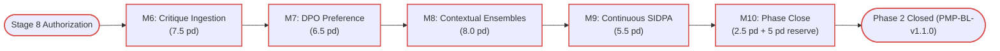

# Schedule Management Plan — agent-learning Phase 2: Autonomous Feedback Loops & Extensible Architecture

> **PMBOK 8 Domain:** `Schedule` (Planning Focus Area) | **Legacy Process:** `6.1 Plan Schedule Management`  
> **Governance Policy:** `approve-subsidiary-plan` | **Lifecycle Stage:** `Stage 6 (Planning: Schedule Baseline)`  
> **Route:** `full_plan` | **Baseline Identifier:** `PMP-BL-v1.0.1` (targeting `PMP-BL-v1.1.0`)  
> **Foundation pack:** [Schedule-Foundation-Pack-Manifest.md](schedule-baseline/Schedule-Foundation-Pack-Manifest.md) (Stage **6.B**)  
> **Accountable Role:** Project Manager / PMBOK Steward | **Approving Sponsor:** Menno Drescher  
> **Normative Standard:** [ADR-012](../../adr/ADR-012-subsidiary-management-plan-standards-and-content-contracts.md) and [ADR-026](../../adr/ADR-026-schedule-management-plan-standard-and-baseline-contract.md)  
> **Scope baseline:** [Scope-Management-Plan.md](Scope-Management-Plan.md) v2.0.0 (foundation pack **6.A**)  
> **Historical Baseline Archive:** Frozen Phase 1 schedule plan preserved in [`docs/project-docs/history/PMP-BL-v1.0.0/management-plans/Schedule-Management-Plan.md`](../history/PMP-BL-v1.0.0/management-plans/Schedule-Management-Plan.md)  

For `PMP-BL-v1.1.0`, the **integrated schedule baseline** = approved **[Schedule-Foundation-Pack-Manifest.md](schedule-baseline/Schedule-Foundation-Pack-Manifest.md)** + approved **this plan** (v2.1.0, pending re-approval — see §4 Amendment Log). Phase 2 operationalizes dependency-sequenced delivery across **Milestones M6 through M10**, authorizing Band C and Band D execution in `src/agent_learning_ext/`.

---

## 1. Intent, Alignment & Boundaries

### 1.1 Mandate & Progressive Elaboration Model
This Schedule Management Plan defines scheduling methodology, critical-path controls, and milestone gates for **Phase 2: Autonomous Feedback Loops & Extensible Architecture**.

[Project-Charter.md](../Project-Charter.md) v2.0 §7 establishes dependency-sequenced milestones M6 through M10. Work proceeds under maintainer-paced open source execution (~5 person-days per week planning assumption, representing 120–160 engineering hours across Phase 2).

### 1.2 Schedule Baseline — Milestone Register (Phase 2)

| Milestone ID | Parent Anchor / Epics | Exit Condition (Objective) | Target Effort Window | Predecessor(s) | Critical Path? |
|---|---|---|:---:|---|:---:|
| **M6** | Epic 14 (Option B) | Critique ingestion parser, exact shift engine, and 32 review records replayed | **7.5 pd** (~1.5 wks) | Stage 8 Authorization | Yes |
| **M7** | Epic 18 (Option B) | Pairwise DPO loss engine operationalized and benchmarked | **6.5 pd** (~1.3 wks) | M6 | Yes |
| **M8** | Epics 16 & 21 | Contextual authority ensemble router with deterministic Wilson lower bounds | **8.0 pd** (~1.6 wks) | M7 | Yes |
| **M9** | Epics 22 & 38 | Continuous SIDPA loop automated; packaged contextual policies exported | **5.5 pd** (~1.1 wks) | M8 | Yes |
| **M10** | Formal Close Gate | 100% test green; 0 upstream diff; `PCD-Phase2` approved by Sponsor | **2.5 pd** (~0.5 wks) + 5 pd reserve | M9 | Yes |

**Phase 2 Critical Path:** Start $\to$ M6 $\to$ M7 $\to$ M8 $\to$ M9 $\to$ M10 = **30.0 person-days** (~5.8 calendar weeks).

### 1.3 Out-of-Scope Schedule Boundaries
* Real-time wall-clock commitments or strict calendar deadlines (execution is milestone-gated).
* Schedule tracking based on stochastic LLM code generation speed.
* Continuous deployment to live production clusters (embeddable SDK and CLI only).

### 1.4 Task Identification & WBS Rollup (ADR-026 §4.2.1)

Each Milestone above (§1.2) decomposes into Tasks per ADR-026 §4.2.1's five-level rollup, **Phase (Cycle) → Group → Stage → Step/Epic → Checklist Item/User Story**:

* **M6–M9's Epic-anchored work (Stage 9, Deliverable):** the Task is the User Story itself — the real `epic.story` WBS package id already named against each Milestone in the Scope Management Plan §1.6 (e.g. M6 → Epic 14 Stories 14.1–14.6). No new numbering is introduced here; the Story id *is* the Task id.
* **The governance/process work that bounds every Milestone** (Stage 8 Authorization gating M6; Stage 10–18 verification, audit, and close work through M10): the Task is a Checklist Item under a numbered Step in that Stage's methodology guide (`docs/project-docs/Methodology/Stage-N-*-Methodology.md`, Stages 1 through 18). This plan references those Steps; it does not restate them.

**WBS code (ADR-026 §4.2.3), always five segments:** `<Phase>.<Group>.<Stage>.<Epic#>.<Story#>` for a Stage 9 Task (example: `2.3.9.14.1` = Phase 2, Executing, Stage 9, Epic 14, Story 1 — M6's first task) or `<Phase>.<Group>.<Stage>.<Step#>.<Item#>` for every other Stage's Task (example: `2.5.18.1.1` = Phase 2, Closing, Stage 18, Step 1, Checklist Item 1 — ADR-026 §4.2.2's own Gantt example). Stage 8's Group segment is still open (ADR-026 §8 item 4); no WBS example is coded for it until that is confirmed.

A Task is never both a User Story and a Checklist Item for the same unit of work (ADR-026 Invariant 6), and this plan never authors a Checklist Item or a Story directly — both stay references to their systems of record (the relevant Stage's methodology guide, and `Scope-WBS-Dictionary.md`/the epic files, respectively).

**Status:** this section mirrors ADR-026 §4.2.1–§4.2.3, drafted 2026-11-11 and still pending its own Stage 16 amendment acceptance.

---

## 2. Domain Mechanics & Standards

### 2.1 Milestone Dependency DAG & Critical Path Analysis

### 2.2 Critical Path Method (CPM) & Float Control
* **Total Float:** Float on the primary milestone chain is zero (strictly critical).
* **Parallel Float:** Packaged contextual exporter (Epic 38) runs in parallel with SIDPA loop automation (Epic 22), possessing 1.0 pd total float before M9 join.
* **Buffer Management:** Management reserve `SR-P2-M10` (5.0 pd) provides schedule protection for Phase 2 close-out.

### 2.3 Schedule Variance Thresholds & Governance Escalation
* **Green (On Track):** Milestones completed within $\pm 1.0\text{ pd}$ of planned duration.
* **Amber (Warning):** Milestone slip between $1.0\text{ pd}$ and $3.0\text{ pd}$. Project Manager re-allocates task sequencing within maintainer capacity.
* **Red (Breach):** Critical path slip $> 3.0\text{ pd}$. Triggers formal escalation to Project Sponsor Menno Drescher and initiates Stage 16/17 review.

---

## 3. Governance, Control & Decision Rights

* **Project Manager:** Accountable for tracking story velocity, updating CPM forward pass, and monitoring schedule reserves.
* **Project Sponsor (Menno Drescher):** Holds sole authority to authorize milestone progression, schedule baseline adjustments, and management reserve drawdowns.

---

## 4. Amendment Log

| Date | Author | Description |
|---|---|---|
| 2026-10-25 | Menno Drescher / Antigravity | Initial full baseline Schedule Management Plan replacing stub mock content per ADR-012 and ADR-026. |
| 2026-11-01 | Menno Drescher / Antigravity | **v1.2.0 — 6.B approved:** Integrated Schedule foundation pack; approved under `approve-subsidiary-plan` (Episode `d8ee6350-a7ce-48c7-a566-d2e602c28c9a`). |
| 2026-11-08 | Menno Drescher / Antigravity | **v2.0.0 — Phase 2 Schedule Formalization:** Advanced to `v2.0.0` for Phase 2 under `PMP-BL-v1.0.1` targeting `PMP-BL-v1.1.0`. Established Milestones M6 through M10 critical path (30.0 pd effort), integrated Phase 2 activity list, logic network, and Gantt CPM forward pass. |
| 2026-11-12 | Menno Drescher / Claude | **v2.1.0 — Task Identification & WBS Rollup (ADR-026 §4.2.1–§4.2.3) and a path correction:** Added §1.4 stating each Milestone's Task-level decomposition (User Story for Stage 9 work; Checklist Item under a Stage Step, per `docs/project-docs/Methodology/Stage-N-*-Methodology.md`, for every other Stage), with WBS code examples. **Also corrected the `agent-training-ext/` reference to the real package path, `src/agent_learning_ext/`** (confirmed on disk; the stated path never existed). **Pending `approve-subsidiary-plan` re-approval; ADR-026 §4.2.1–§4.2.3 itself is pending its own Stage 16 amendment acceptance** — this entry records the draft, not an approved baseline change. |
