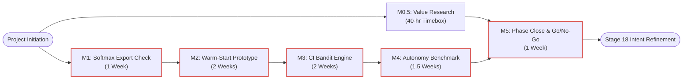

# Schedule Management Plan — agent-learning Phase 1: Warm-Start & Confidence-Interval Bandits

> **PMBOK 8 Domain:** `Schedule` (Planning Focus Area) | **Legacy Process:** `6.1 Plan Schedule Management`  
> **Governance Policy:** `approve-subsidiary-plan` | **Lifecycle Stage:** `Stage 6 (Planning)`  
> **Route:** `full_plan` | **Baseline Identifier:** `PMP-BL-v1.0.0`  
> **Accountable Role:** Project Manager | **Approving Sponsor:** Menno Drescher  
> **Normative Standard:** [ADR-012](../../adr/ADR-012-subsidiary-management-plan-standards-and-content-contracts.md)

---

## 1. Intent, Alignment & Boundaries

### 1.1 Mandate & Progressive Elaboration Model
This Schedule Management Plan establishes the scheduling methodology, milestone dependencies, critical path controls, and variance tolerances for **Phase 1: Warm-Start & Confidence-Interval Bandits**. 

In alignment with PMBOK 8 *Planning Focus Area* and [Project-Charter.md](../Project-Charter.md) §7, the project operates under a **Progressive Elaboration** model:
* High-level phase milestones (M0.5 through M5) are locked by the Project Sponsor.
* Work package activities, story estimation, and tactical task cadences are elaborated progressively at the beginning of each milestone based on empirical velocity and complexity classifications (ADR-003).

### 1.2 Charter Milestone Alignment
The schedule directly anchors to the strategic timeline authorized in the Project Charter:

| Milestone ID | Description | Target Cadence | Dependency | Deliverable Output |
|---|---|---|---|---|
| **M0.5** | End-User Value & Research Log Analysis | 40-hr timebox | Charter Approval | Qualitative case study & preliminary HYP-AL-011 evaluation |
| **M1** | Softmax Policy State Exportability Check | 1 Sprint (1 wk) | Charter Approval | Serialization verification report & contract tests |
| **M2** | Warm-Start Transfer-of-Priors Prototype | 2 Sprints (2 wks) | M1 Verification | `WarmStartPolicy` module & benchmarking harness |
| **M3** | Confidence-Interval Bandit Engine | 2 Sprints (2 wks) | M2 Prototype | UCB-1 & Thompson sampling resolvers |
| **M4** | Positive-Only Autonomy Gate Benchmark | 1.5 Sprints | M3 Resolvers | Synthetic benchmark report (146-episode dataset) |
| **M5** | Phase 1 Close & Option B Go/No-Go Gate | 1 Sprint (1 wk) | M0.5, M4 | Empirical Bayes factor report & Intent Refinement Episode |

### 1.3 Out-of-Scope Schedule Boundaries
* **In-Scope Schedule Controls:** Timeboxing of research spikes; milestone DAG tracking; critical path monitoring; automated test execution timing benchmarks.
* **Out-of-Scope Activities:** The following schedule elements are explicitly excluded:
  - Calendar estimation for deferred Option B (Phase 2).
  - Continuous release pipelines beyond manual GitHub release tags.
  - Operational 24/7 on-call schedules.

---

### 1.4 PMBOK Input, Process & Output (IPO) Specification
In accordance with PMBOK® Guide 8th Edition (Schedule Performance Domain §2.3):
* **Inputs (PMBOK 8 §2.3.2.1, §2.3.2.2 & §4):**
  - **Project Charter:** Summary milestone schedule, target delivery dates, and funding horizons ([Project-Charter.md](../Project-Charter.md)).
  - **Project Management Plan (Scope Baseline):** WBS epics, deliverables, and Definition of Done ([Scope-Management-Plan.md](Scope-Management-Plan.md)).
  - **Development Approach:** Adaptive / hybrid progressive elaboration model.
  - **Enterprise Environmental Factors (EEFs):** Team capacity, velocity benchmarks, developer environment availability.
  - **Organizational Process Assets (OPAs):** ADR standards ([ADR-012](../../adr/ADR-012-subsidiary-management-plan-standards-and-content-contracts.md), [ADR-026](../../adr/ADR-026-schedule-management-plan-standard-and-baseline-contract.md)).
* **Processes (PMBOK 8 §2.3.2 & §5):**
  - **Plan Schedule Management:** Establishing policies, timebox units, and control thresholds.
  - **Develop Schedule:** Defining activities, determining sequence (PDM finish-to-start logic), estimating effort/duration, and adjusting via Critical Path Method (CPM).
  - **Monitor & Control Schedule:** Evaluating milestone progress, managing buffers, and applying variance analysis.
* **Outputs (PMBOK 8 §2.3.2 & §4):**
  - **Schedule Management Plan:** `docs/project-docs/management-plans/Schedule-Management-Plan.md`.
  - **Schedule Baseline:** Approved Milestone Register (M0.5–M5) and timebox schedule model.
  - **Schedule Forecasts & Buffer Reports:** Critical path tracking and milestone progress updates.

---

## 2. Domain Mechanics & Standards

### 2.1 Milestone Dependency DAG & Critical Path Analysis
Project milestones form a directed acyclic graph (DAG) where exploratory research (M0.5) proceeds in parallel with initial technical verification (M1), converging at the formal Phase 1 closure gate (M5):

**Critical Path Analysis:** The primary critical path is the technical chain:
$$\text{Start} \longrightarrow \text{M1} \longrightarrow \text{M2} \longrightarrow \text{M3} \longrightarrow \text{M4} \longrightarrow \text{M5} \quad (\text{Total Duration: } \approx 7.5 \text{ Weeks})$$
Milestone M0.5 (40-hour value research) carries positive float ($\approx 4.5$ weeks relative to M5 convergence), ensuring research exploration does not bottle technical pipeline execution.

### 2.2 Timeboxing Standards & Cadence Rules
* **Research Timeboxing (M0.5):** Capped strictly at 40 productive research hours. When the 40-hour limit is reached, findings must be synthesized immediately regardless of whether exhaustive case data was collected.
* **Sprint Iterations:** Technical delivery follows fixed 1-week sprint iterations. Each user story must be scoped to complete within a single sprint boundary.
* **Buffer Management:** A 1-week buffer is reserved immediately preceding M5 to accommodate Bayes factor recalculation and peer-review adjudication.

### 2.3 Schedule Variance Metrics & Thresholds
Schedule performance is tracked using Schedule Variance ($SV$) and Schedule Performance Index ($SPI$):
$$SV = EV - PV, \quad SPI = \frac{EV}{PV}$$
* **Green (Nominal):** $SPI \ge 0.90$. Activities proceed under standard developer authority.
* **Amber (Warning):** $0.80 \le SPI < 0.90$ or story delay $> 3$ business days. Project Manager executes internal priority rebalancing.
* **Red (Critical Breach):** $SPI < 0.80$ or milestone critical path delay $> 5$ business days. Triggers mandatory escalation to Project Sponsor.

---

## 3. Governance, Control & Decision Rights

### 3.1 Decision Rights & Schedule Authority
* **Developer / Implementer:** Owns daily task sequencing within the approved 1-week story timebox.
* **Project Manager:** Owns sprint backlog scheduling, critical path tracking, and work package commitments. May adjust internal task ordering without escalation.
* **Project Sponsor (Menno Drescher):** Holds sole authority to approve milestone baseline shifts, extend the 40-hour M0.5 research envelope, or authorize Phase 2 initiation.

### 3.2 Change Control & Rescheduling Protocol
Any event threatening a milestone delay greater than 5 business days requires formal escalation:
1. **Impact Assessment:** PM evaluates downstream impact on M5 convergence and resource burn.
2. **Remediation Proposal:** Formulate corrective action (e.g. descoping non-critical test cases or reallocating research float).
3. **Formal Approval:** Revisions to milestone dates are submitted to the Sponsor via Stage 17 Integrated Change Control (`approve-adaptation-plan`).

### 3.3 Transitive Downstream Invalidation (ADR-013 §4.5)
Per ADR-013 §4.5, Schedule Management directly drives financial burn and resource allocation:
$$\text{Schedule Management Plan} \longrightarrow \text{Cost Management Plan}$$

Any approved schedule change that extends project duration or alters milestone allocations automatically transitions `Cost-Management-Plan.md` into **`STALE_DEPENDENCY`** status. The Cost Management Plan must be re-baselined and re-approved before integrated formalization under `approve-pmp`.

---

## 4. Amendment Log

| Date | Author | Description |
|---|---|---|
| 2026-10-25 | Menno Drescher / Antigravity | Initial full baseline Schedule Management Plan replacing stub mock content per ADR-012. |
