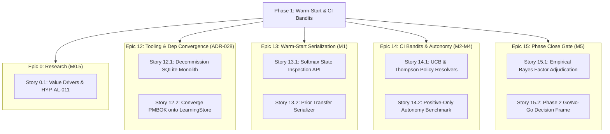

# Scope Management Plan — agent-learning Phase 1: Warm-Start & Confidence-Interval Bandits

> **PMBOK 8 Domain:** `Scope` (Planning Focus Area) | **Legacy Process:** `5.1 Plan Scope Management`  
> **Governance Policy:** `approve-subsidiary-plan` | **Lifecycle Stage:** `Stage 6 (Planning)`  
> **Route:** `full_plan` | **Baseline Identifier:** `PMP-BL-v1.0.0`  
> **Accountable Role:** Project Manager | **Approving Sponsor:** Menno Drescher  
> **Normative Standard:** [ADR-012](../../adr/ADR-012-subsidiary-management-plan-standards-and-content-contracts.md) and [ADR-025](../../adr/ADR-025-scope-management-plan-standard-and-baseline-contract.md)

---

## 1. Intent, Alignment & System Boundaries

### 1.1 Core Mandate & Charter Traceability
This Scope Management Plan establishes the formal mechanisms, verification gates, and boundary definitions for **Phase 1: Warm-Start & Confidence-Interval Bandits** of the `agent-learning` project. It directly operationalizes the strategic objectives authorized in [Project-Charter.md](../Project-Charter.md) §2 and §3:
1. **Unverified Dependency Resolution:** Resolve whether `SoftmaxPolicy` exposes its converged internal state in a structured format reusable as an initial prior distribution for successor policies (Milestone M1).
2. **Warm-Start Empirical Validation (HYP-AL-008):** Validate whether prior-distribution warm-starting reduces the number of interaction episodes required to achieve statistical autonomy eligibility compared to a cold uniform prior (Milestone M2).
3. **Confidence-Interval Bandit Autonomy (HYP-AL-009):** Validate whether an upper confidence bound (UCB) or Thompson sampling bandit can cross the Wilson lower-bound autonomy threshold when operating under positive-only (survivorship-biased) empirical evidence (Milestone M3).
4. **Phase 2 Resourcing Gate:** Formulate a rigorous, empirical decision on whether Option B (critique-to-evidence ingestion and Direct Preference Optimization) warrants development (Milestone M5).
5. **End-User Value Research (M0.5):** Conduct a time-boxed 40-hour qualitative case analysis to assess willingness-to-pay and end-user value drivers before committing to downstream production deployment.

### 1.2 In-Scope Deliverables & Architectural Modules
The authorized deliverables for Phase 1 are strictly bounded to the following components:
* **M0.5 (End-User Value Analysis):** Qualitative case studies extending beyond the SocialEngage example; preliminary empirical testing of HYP-AL-011 recorded in the Research Log.
* **M1 (State Inspection & Serialization):** Technical verification report and export/import serializers for `SoftmaxPolicy` parameters, preserving numerical stability and policy integrity.
* **M2 (Warm-Start Prior Module):** Concrete implementation of hierarchical prior seeding for discrete bandit policies in `src/agent_learning/`, accompanied by automated warm-start benchmarking fixtures.
* **M3 (Confidence-Interval Bandit Engine):** Mathematical implementation of deterministic UCB-1 and Bayesian Thompson sampling policy resolvers capable of maintaining exploration under positive-only reward feedback.
* **M4 (Autonomy Verification Harness):** Automated synthetic evaluation environment reproducing the 146-episode `validate-intent-foundation` dataset to benchmark autonomy gate crossing against baseline REINFORCE.
* **M5 (Phase 1 Synthesis & Decision Frame):** Comprehensive evaluation episode registering empirical Bayes factors for HYP-AL-008 and HYP-AL-009, feeding the formal Stage 18 Intent Refinement gate.

### 1.3 Mandatory Out-of-Scope Boundary
To prevent silent scope creep and maintain architectural focus, the following capabilities are explicitly **excluded** from Phase 1 scope:
* **Option B Implementation (Critique-to-Evidence & DPO):** No implementation of Direct Preference Optimization (DPO), pairwise reward preference fine-tuning, or offline critique parsers (deferred to Phase 2 per Business Case §6).
* **Multi-Modal / OCR Ingestion:** No image processing, scanned PDF extraction, or integration with external OCR engines (`pytesseract`, `pdf2image`, `pillow`).
* **Relational Database Infrastructure:** Zero new database engines, SQLite tables, or SQLAlchemy schemas, strictly adhering to ADR-002 Invariant #2 and ADR-028.
* **Microservice Web Server Deployment:** No FastAPI or Uvicorn server hosting; the repository remains an embedded Python SDK and CLI tool.
* **Continuous Reinforcement Learning in Production:** No unbounded autonomous policy adaptation without explicit human sign-off gates.

---

## 2. Domain Mechanics & Scope Standards

### 2.1 Work Breakdown Structure (WBS) & Decomposition Hierarchy
Project scope is decomposed across four hierarchical tiers:
$$\text{Project Phase} \longrightarrow \text{Epic} \longrightarrow \text{User Story} \longrightarrow \text{Work Package / Commit}$$

### 2.2 WBS Dictionary & 100% Rule
Every deliverable within the project must map to a single parent Epic and User Story. Unassigned work packages are strictly prohibited. The 100% rule mandates that all development work, documentation updates, and test suites must trace to an approved Story acceptance criterion ($AC_n$).

### 2.3 Scope Baseline Definition
The official Scope Baseline for Phase 1 comprises:
1. **The Approved Scope Statement:** As set forth in this document.
2. **The WBS & Milestone Schedule:** Anchored in [Project-Charter.md](../Project-Charter.md) §7.
3. **The User Story Contracts:** Individual Acceptance Criteria specified in approved User Story specifications (`docs/user-stories/`).

### 2.4 Deliverable Acceptance Protocol (Definition of Done)
No work package or deliverable is accepted into the repository baseline until it satisfies the canonical **Definition of Done (DoD)**:
- **Contract Specification:** User story acceptance criteria are formalized in executable contract tests (`tests/test_*.py`).
- **Observed RED First:** Contract tests are verified failing prior to functional implementation.
- **Pure Implementation:** Production code adheres to stdlib-first constraints with zero undeclared dependencies.
- **Full Suite Green:** Complete repository test suite passes without collection errors.
- **Audit Logging:** Story commit hash and acceptance verification are documented in `implementation-log.md`.
- **Peer Review:** Pull request passes automated and human review with all findings resolved.

---

## 3. Governance, Control & Decision Rights

### 3.1 Accountabilities & Escalation Thresholds
* **Project Manager:** Accountable for enforcing scope boundaries, monitoring backlog drift, and rejecting unauthorized feature requests.
* **Project Sponsor (Menno Drescher):** Holds sovereign authority over project scope, milestone gates, and budget authorization.

| Variance Level | Definition | Authority | Action Required |
|---|---|---|---|
| **Level 0 (Operational)** | Minor refactoring or doc clarification within an approved Story | Developer / Tech Lead | Immediate commit; log in `implementation-log.md`. |
| **Level 1 (Story Scope)** | Adding or adjusting an Acceptance Criterion within an Epic | Project Manager | Update Story spec; notify Sponsor. |
| **Level 2 (Milestone Scope)** | Adding a new User Story or altering an Epic boundary | Project Sponsor | Formal review via Stage 16 Governance Change. |
| **Level 3 (Baseline Breach)** | Adding an Epic, modifying Charter boundaries, or Phase 2 work | Project Sponsor | Stage 17 Integrated Change (`approve-adaptation-plan`). |

### 3.2 Transitive Downstream Invalidation (ADR-013 §4.5)
Per ADR-013 §4.5, Scope forms the foundational root node of the planning directed acyclic graph:
$$\text{Scope Management Plan} \longrightarrow \text{Schedule Management Plan} \longrightarrow \text{Cost Management Plan}$$

Any Level 2 or Level 3 change to this Scope Management Plan automatically marks:
1. `Schedule-Management-Plan.md` as **`STALE_DEPENDENCY`** (requiring schedule recalculation).
2. `Cost-Management-Plan.md` as **`STALE_DEPENDENCY`** (requiring budget re-estimation).

Re-validation of downstream plans must occur before composite formalization under `approve-pmp` is permitted.

---

## 4. Amendment Log

| Date | Author | Description |
|---|---|---|
| 2026-10-25 | Menno Drescher / Antigravity | Initial full baseline Scope Management Plan replacing stub mock content per ADR-012 and ADR-025. |
