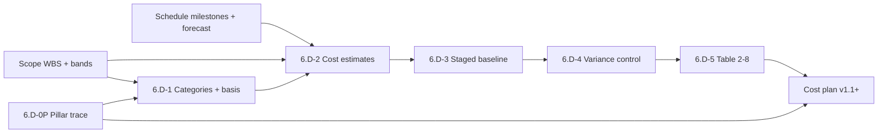

# Cost Foundation Pack — Manifest (`PMP-BL-v1.0.0`)

Roll-up for **Stage 6.D** (proactive cost foundation breakouts) before the first `approve-subsidiary-plan` on [Cost-Management-Plan.md](../Cost-Management-Plan.md) **v1.1+**.

**Pack state:** Scaffold only — six foundation artifacts under [foundation/](foundation/) are **stubs** (`approval_status: pending`). Complete breakouts **6.D-0P … 6.D-5**; **6.D-6** closes the pack; **6.D-7** approves the Cost plan.

**Normative standards:** [ADR-027](../../../adr/ADR-027-cost-management-plan-standard-and-baseline-contract.md) (Cost plan contract, Tier 1), [ADR-013](../../../adr/ADR-013-subsidiary-plan-approval-gates-before-pmp-formalization.md), [ADR-012](../../../adr/ADR-012-subsidiary-management-plan-standards-and-content-contracts.md). **Path A (planned):** Tier-1 foundation pack normative for the first Cost subsidiary approval—record **BFI-004** on the Cost plan at **6.D-7** without amending ADR-027.

**PMBOK 8 anchor:** Finance Performance Domain **§2.4** (printed pp. 58–67); processes **§2.4.2** (Figures **2-26**–**2-30**); reserves **Fig. 2-25**; check outcomes **§2.4.5 Table 2-8**. Legacy process **7.1 Plan Cost Management** maps to **Plan Financial Management**.

---

## Integrated cost baseline (this cycle)

When **6.D-6** and **6.D-7** complete, the **integrated cost baseline** for `PMP-BL-v1.0.0` is:

1. **Approved this manifest** (registry hashes current).
2. **Approved [Cost-Management-Plan.md](../Cost-Management-Plan.md) v1.1+** — envelope authority (§1), governance (§3), variance (§2).
3. **Approved foundation artifacts** (six files, substages **6.D-0P** … **6.D-5**):

| # | Substage | Artifact | PMBOK §2.4.2 process |
| ---: | --- | --- | --- |
| 1 | 6.D-0P | [Cost-Pillar-Overview-and-Trace.md](foundation/Cost-Pillar-Overview-and-Trace.md) | Strategy trace (inputs to Plan Financial Management) |
| 2 | 6.D-1 | [Cost-Categories-and-Estimating-Basis.md](foundation/Cost-Categories-and-Estimating-Basis.md) | Plan Financial Management (Fig. 2-27) |
| 3 | 6.D-2 | [Cost-Estimates-by-Category.md](foundation/Cost-Estimates-by-Category.md) | Estimate Costs (Fig. 2-28) |
| 4 | 6.D-3 | [Cost-Staged-Budget-and-Baseline.md](foundation/Cost-Staged-Budget-and-Baseline.md) | Develop Budget (Fig. 2-29; Fig. 2-25 reserves) |
| 5 | 6.D-4 | [Cost-Variance-and-Control-Protocol.md](foundation/Cost-Variance-and-Control-Protocol.md) | Monitor and Control Finances (Fig. 2-30) |
| 6 | 6.D-5 | [Cost-Domain-Checklist.md](foundation/Cost-Domain-Checklist.md) | §2.4.5 Table 2-8 |

**Management envelope** authority and **amendment log** stay in the **Cost plan**; categories, estimates, staged baseline, control rules, and Table 2-8 evidence stay in **foundation/**.

---

## Upstream inputs & gates

| Input | Requirement |
| --- | --- |
| [Project-Charter.md](../../Project-Charter.md) | Funding limits, Phase 1 financial boundaries |
| [Scope-Management-Plan.md](../Scope-Management-Plan.md) **v1.2+** | WBS / deliverables (**6.A-7** approved) |
| [Schedule-Management-Plan.md](../Schedule-Management-Plan.md) **v1.2+** | Milestones, timeboxes, pd forecast (**6.B-7** approved) |
| [Schedule-Baseline-WBS-Forecast.md](../schedule-baseline/foundation/Schedule-Baseline-WBS-Forecast.md) | Effort-linked cost drivers (pd) |
| [Project-Pillars.md](../../Project-Pillars.md) | **Approved** (episode `8fe9fea9-6ef1-44be-82a9-e09677e47a4a`) |

**6.D-0:** Scope **6.A-7** and Schedule **6.B-7** approved before Cost foundation breakouts (ADR-027 Tier 1: Scope → Schedule → Cost).

---

## Cost baseline process (PMBOK 8 §2.4.2)

**Stage 6.D** is the **proactive foundation path** for the Cost subsidiary plan: one substage per Finance process (Figure **2-26**), then Table **2-8**, roll-up (**6.D-6**), plan gate (**6.D-7**). **6.D** may run **in parallel** with **6.C** (Resource) after **6.D-0**; **6.E** (Procurement) waits for **6.D-7**.

| Step | PMBOK process (Fig.) | Substage | Foundation artifact |
| ---: | --- | --- | --- |
| 0 | Upstream baselines | **6.D-0** | Scope **6.A-7** + Schedule **6.B-7** |
| 1 | Strategy / value trace | **6.D-0P** | Cost-Pillar-Overview-and-Trace |
| 2 | Plan Financial Management (2-27) | **6.D-1** | Cost-Categories-and-Estimating-Basis |
| 3 | Estimate Costs (2-28) | **6.D-2** | Cost-Estimates-by-Category |
| 4 | Develop Budget (2-29) | **6.D-3** | Cost-Staged-Budget-and-Baseline |
| 5 | Monitor and Control Finances (2-30) | **6.D-4** | Cost-Variance-and-Control-Protocol |
| 6 | Check Results (Table 2-8) | **6.D-5** | Cost-Domain-Checklist |
| 7 | Pack roll-up | **6.D-6** | This manifest (`pack_status: approved`) |
| 8 | Subsidiary plan approval | **6.D-7** | Cost Management Plan + **BFI-004** |

**Binding integrated cost baseline** = steps **6.D-6** + **6.D-7** only. Unblocks **6.E-0** (Procurement) and satisfies **Risk** upstream cost dependency in `PLAN_DAG`.

---

## Stage 6.D substage checklist (PMBOK §2.4.2)

| Substage | Process / gate | Artifact | Review focus | Done |
| --- | --- | --- | --- | --- |
| **6.D-0** | Upstream | Scope **6.A-7** + Schedule **6.B-7** | Integrated scope + schedule baselines | ☐ |
| **6.D-0P** | Strategy trace | [Cost-Pillar-Overview-and-Trace.md](foundation/Cost-Pillar-Overview-and-Trace.md) | Pillars ↔ cost categories ↔ milestones | ☐ |
| **6.D-1** | Plan Financial Management | [Cost-Categories-and-Estimating-Basis.md](foundation/Cost-Categories-and-Estimating-Basis.md) | Envelope unit, categories, owners, methods | ☐ |
| **6.D-2** | Estimate Costs | [Cost-Estimates-by-Category.md](foundation/Cost-Estimates-by-Category.md) | Estimates + basis; tie to pd / usage | ☐ |
| **6.D-3** | Develop Budget | [Cost-Staged-Budget-and-Baseline.md](foundation/Cost-Staged-Budget-and-Baseline.md) | Staged funding, contingency, cost baseline | ☐ |
| **6.D-4** | Monitor and Control Finances | [Cost-Variance-and-Control-Protocol.md](foundation/Cost-Variance-and-Control-Protocol.md) | CV/CPI thresholds; burn-rate cadence | ☐ |
| **6.D-5** | Domain outcomes | [Cost-Domain-Checklist.md](foundation/Cost-Domain-Checklist.md) | PMBOK §2.4.5 Table 2-8 | ☐ |
| **6.D-6** | Roll-up | **This manifest** | All six artifacts `approved`; registry hashes set | ☐ |
| **6.D-7** | Plan gate | Cost Management Plan **v1.1+** | Integrated baseline; **BFI-004** closed | ☐ |

Recommended order after **6.D-0:** **0P → 1 → 2 → 3 → 4 → 5 → 6 → 7**. **6.D-2** may start after **6.D-1** if categories are stable.

---

## Artifact registry

| artifact_id | Path | substage | version | approval_status | content_hash |
| --- | --- | --- | --- | --- | --- |
| cost-foundation-pillar-overview-trace | `foundation/Cost-Pillar-Overview-and-Trace.md` | 6.D-0P | 1.0.0 | pending | *(set at approval)* |
| cost-foundation-categories-estimating-basis | `foundation/Cost-Categories-and-Estimating-Basis.md` | 6.D-1 | 1.0.0 | pending | *(set at approval)* |
| cost-foundation-estimates-by-category | `foundation/Cost-Estimates-by-Category.md` | 6.D-2 | 1.0.0 | pending | *(set at approval)* |
| cost-foundation-staged-budget-baseline | `foundation/Cost-Staged-Budget-and-Baseline.md` | 6.D-3 | 1.0.0 | pending | *(set at approval)* |
| cost-foundation-variance-control-protocol | `foundation/Cost-Variance-and-Control-Protocol.md` | 6.D-4 | 1.0.0 | pending | *(set at approval)* |
| cost-foundation-domain-checklist | `foundation/Cost-Domain-Checklist.md` | 6.D-5 | 1.0.0 | pending | *(set at approval)* |

At each breakout: set artifact `approval_status: approved`, record **content_hash** (ADR-013 canonical hash), tick **Done** above, and update this table.

---

## Approval runbook (Path A)

1. Confirm **6.D-0** — Scope and Schedule subsidiary plans approved (**6.A-7**, **6.B-7**).
2. Break out **6.D-0P**, then **6.D-1 … 6.D-5**.
3. Update artifact frontmatter and this manifest registry + checklist.
4. Mark **6.D-6** when all **six** foundation artifacts are approved (`pack_status: approved`).
5. Run `approve-subsidiary-plan` on **Cost Management Plan v1.1+** (**6.D-7**) with upstream hashes and reference to this manifest.
6. Record **BFI-004** `applied` on the Cost plan (Path A; no ADR-027 amendment).

**Downstream (ADR-013):** Approved Cost baseline changes mark **Risk** and **Procurement** `STALE_DEPENDENCY` until re-approved.

---

## Amendment log

| Date | Author | Description |
| --- | --- | --- |
| 2026-10-30 | Menno Drescher / Cursor | Initial scaffold: manifest **v1.0.0**, Stage **6.D** checklist, six stub foundation artifacts (PMBOK §2.4.2, ADR-027). |
