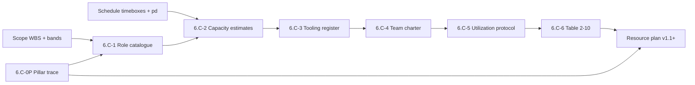

# Resource Foundation Pack — Manifest (`PMP-BL-v1.0.0`)

Roll-up for **Stage 6.C** (proactive resource foundation breakouts) before the first `approve-subsidiary-plan` on [Resource-Management-Plan.md](../Resource-Management-Plan.md) **v1.1+**.

**Pack state:** Scaffold only — seven foundation artifacts under [foundation/](foundation/) are **authored as stubs** (`approval_status: pending`). Complete breakouts **6.C-0P … 6.C-6**; **6.C-7** closes the pack; **6.C-8** approves the Resource plan.

**Normative standards:** [ADR-030](../../../adr/ADR-030-resource-management-plan-standard.md) (Resource plan contract), [ADR-013](../../../adr/ADR-013-subsidiary-plan-approval-gates-before-pmp-formalization.md) (hashes, DAG), [ADR-012](../../../adr/ADR-012-subsidiary-management-plan-standards-and-content-contracts.md) (artifact frontmatter). **Path A (planned):** Tier-1 foundation pack normative for the first Resource subsidiary approval—document on the Resource plan as **BFI-003** at **6.C-8** without amending ADR-030.

**PMBOK 8 anchor:** Resources Performance Domain **§2.6** (printed pp. 79–92); processes **§2.6.2** (Figures 2-40–2-45); check outcomes **§2.6.5 Table 2-10**.

---

## Integrated resource baseline (this cycle)

When **6.C-7** and **6.C-8** complete, the **integrated resource baseline** for `PMP-BL-v1.0.0` is:

1. **Approved this manifest** (registry hashes current).
2. **Approved [Resource-Management-Plan.md](../Resource-Management-Plan.md) v1.1+** — governance (§3), boundaries (§1).
3. **Approved foundation artifacts** (seven files, substages **6.C-0P** … **6.C-6**):

| # | Substage | Artifact | PMBOK §2.6.2 process |
| ---: | --- | --- | --- |
| 1 | 6.C-0P | [Resource-Pillar-Overview-and-Trace.md](foundation/Resource-Pillar-Overview-and-Trace.md) | Strategy trace (inputs to Plan Resource Management) |
| 2 | 6.C-1 | [Resource-Role-Catalogue.md](foundation/Resource-Role-Catalogue.md) | Plan Resource Management (Fig. 2-41) |
| 3 | 6.C-2 | [Resource-Capacity-Estimates.md](foundation/Resource-Capacity-Estimates.md) | Estimate Resources (Fig. 2-42) |
| 4 | 6.C-3 | [Resource-Tooling-and-Assignment-Register.md](foundation/Resource-Tooling-and-Assignment-Register.md) | Acquire Resources (Fig. 2-43) |
| 5 | 6.C-4 | [Resource-Team-Operating-Charter.md](foundation/Resource-Team-Operating-Charter.md) | Lead the Team (Fig. 2-44) |
| 6 | 6.C-5 | [Resource-Utilization-and-Control-Protocol.md](foundation/Resource-Utilization-and-Control-Protocol.md) | Monitor and Control Resourcing (Fig. 2-45) |
| 7 | 6.C-6 | [Resource-Domain-Checklist.md](foundation/Resource-Domain-Checklist.md) | §2.6.5 Table 2-10 |

Role **decision rights** and plan **amendment log** stay in the **Resource plan**; catalogue, capacity, tooling, team norms, utilization rules, and Table 2-10 evidence stay in **foundation/**.

---

## Upstream inputs & gates

| Input | Requirement |
| --- | --- |
| [Project-Charter.md](../../Project-Charter.md) §4–§5 | Human–agent pair model, Phase 1 boundaries |
| [Scope-Management-Plan.md](../Scope-Management-Plan.md) **v1.2+** | WBS / bands (**6.A-7** approved) |
| [Schedule-Management-Plan.md](../Schedule-Management-Plan.md) **v1.2+** | Timeboxes, pd cadence (**6.B-7** approved) |
| [Project-Pillars.md](../../Project-Pillars.md) | **Approved** (episode `8fe9fea9-6ef1-44be-82a9-e09677e47a4a`) |

**6.C-0:** Scope **6.A-7** and Schedule **6.B-7** approved before Resource foundation breakouts (ADR-013 `PLAN_DAG`).

---

## Resource baseline process (PMBOK 8 §2.6.2)

**Stage 6.C** is the **proactive foundation path** for the Resource subsidiary plan: one substage per guide process (Figure **2-40**), then domain checks (Table **2-10**), then manifest roll-up (**6.C-7**) and plan gate (**6.C-8**). Parallel to **6.A** (Scope §2.2) and **6.B** (Schedule §2.3).

| Step | PMBOK process (Fig.) | Substage | Foundation artifact |
| ---: | --- | --- | --- |
| 0 | Upstream baselines | **6.C-0** | Scope **6.A-7** + Schedule **6.B-7** |
| 1 | Inputs to resourcing strategy | **6.C-0P** | Resource-Pillar-Overview-and-Trace |
| 2 | Plan Resource Management (2-41) | **6.C-1** | Resource-Role-Catalogue |
| 3 | Estimate Resources (2-42) | **6.C-2** | Resource-Capacity-Estimates |
| 4 | Acquire Resources (2-43) | **6.C-3** | Resource-Tooling-and-Assignment-Register |
| 5 | Lead the Team (2-44) | **6.C-4** | Resource-Team-Operating-Charter |
| 6 | Monitor and Control Resourcing (2-45) | **6.C-5** | Resource-Utilization-and-Control-Protocol |
| 7 | Check Results (Table 2-10) | **6.C-6** | Resource-Domain-Checklist |
| 8 | Pack roll-up | **6.C-7** | This manifest (`pack_status: approved`) |
| 9 | Subsidiary plan approval | **6.C-8** | Resource Management Plan + **BFI-003** |

**Binding integrated resource baseline** = row **6.C-7** + row **6.C-8** only. Until then, stubs and the plan v1.0 body are **draft** relative to Path A.

---

## Stage 6.C substage checklist (PMBOK §2.6.2)

| Substage | Process / gate | Artifact | Review focus | Done |
| --- | --- | --- | --- | --- |
| **6.C-0** | Upstream | Scope **6.A-7** + Schedule **6.B-7** | Integrated scope + schedule baselines | ☐ |
| **6.C-0P** | Strategy trace | [Resource-Pillar-Overview-and-Trace.md](foundation/Resource-Pillar-Overview-and-Trace.md) | Pillars ↔ roles ↔ Phase 1 capacity | ☐ |
| **6.C-1** | Plan Resource Management | [Resource-Role-Catalogue.md](foundation/Resource-Role-Catalogue.md) | Roles, accountable owner, RAM/RACI | ☐ |
| **6.C-2** | Estimate Resources | [Resource-Capacity-Estimates.md](foundation/Resource-Capacity-Estimates.md) | Capacity vs Schedule timeboxes (pd) | ☐ |
| **6.C-3** | Acquire Resources | [Resource-Tooling-and-Assignment-Register.md](foundation/Resource-Tooling-and-Assignment-Register.md) | Tooling, environments, assignments | ☐ |
| **6.C-4** | Lead the Team | [Resource-Team-Operating-Charter.md](foundation/Resource-Team-Operating-Charter.md) | Vision, norms, agent boundaries | ☐ |
| **6.C-5** | Monitor and Control Resourcing | [Resource-Utilization-and-Control-Protocol.md](foundation/Resource-Utilization-and-Control-Protocol.md) | Planned vs actual; conflict escalation | ☐ |
| **6.C-6** | Domain outcomes | [Resource-Domain-Checklist.md](foundation/Resource-Domain-Checklist.md) | PMBOK §2.6.5 Table 2-10 | ☐ |
| **6.C-7** | Roll-up | **This manifest** | All seven artifacts `approved`; registry hashes set | ☐ |
| **6.C-8** | Plan gate | Resource Management Plan **v1.1+** | Integrated baseline; **BFI-003** closed | ☐ |

Recommended order after **6.C-0:** **0P → 1 → 2 → 3 → 4 → 5 → 6 → 7 → 8**.

---

## Artifact registry

| artifact_id | Path | substage | version | approval_status | content_hash |
| --- | --- | --- | --- | --- | --- |
| resource-foundation-pillar-overview-trace | `foundation/Resource-Pillar-Overview-and-Trace.md` | 6.C-0P | 1.0.0 | pending | *(set at approval)* |
| resource-foundation-role-catalogue | `foundation/Resource-Role-Catalogue.md` | 6.C-1 | 1.0.0 | pending | *(set at approval)* |
| resource-foundation-capacity-estimates | `foundation/Resource-Capacity-Estimates.md` | 6.C-2 | 1.0.0 | pending | *(set at approval)* |
| resource-foundation-tooling-assignment-register | `foundation/Resource-Tooling-and-Assignment-Register.md` | 6.C-3 | 1.0.0 | pending | *(set at approval)* |
| resource-foundation-team-operating-charter | `foundation/Resource-Team-Operating-Charter.md` | 6.C-4 | 1.0.0 | pending | *(set at approval)* |
| resource-foundation-utilization-control-protocol | `foundation/Resource-Utilization-and-Control-Protocol.md` | 6.C-5 | 1.0.0 | pending | *(set at approval)* |
| resource-foundation-domain-checklist | `foundation/Resource-Domain-Checklist.md` | 6.C-6 | 1.0.0 | pending | *(set at approval)* |

At each breakout: set artifact `approval_status: approved`, record **content_hash** (ADR-013 canonical hash), tick **Done** above, and update this table.

---

## Approval runbook (Path A)

1. Confirm **6.C-0** — Scope and Schedule subsidiary plans approved (**6.A-7**, **6.B-7**).
2. Break out **6.C-0P**, then **6.C-1 … 6.C-6** (one artifact per approval episode or batched with per-file disposition).
3. Update artifact frontmatter and this manifest registry + checklist.
4. Mark **6.C-7** when all **seven** foundation artifacts are approved (`pack_status: approved`).
5. Run `approve-subsidiary-plan` on **Resource Management Plan v1.1+** (**6.C-8**) with upstream hashes and reference to this manifest.
6. Record **BFI-003** `applied` on the Resource plan (Path A; no ADR-030 amendment).

**Downstream (ADR-013):** Resource has no dependent plans in `PLAN_DAG`; Scope or Schedule baseline changes mark Resource **`STALE_DEPENDENCY`**.

---

## Stage 6 roadmap after **6.C** (Finance domain)

Path A foundation packs continue with **Finance** (PMBOK **§2.4**, Table **2-8**). **`PLAN_DAG` order differs from Tier-3 draft order:** Procurement **depends on Cost**, not on Resource ([ADR-033](../../../adr/ADR-033-procurement-management-plan-standard.md) §4.1, [ADR-027](../../../adr/ADR-027-cost-management-plan-standard-and-baseline-contract.md)).

| Stage | Plan | Tier | Upstream **6.x-0** gate | PMBOK anchor | Next scaffold |
| --- | --- | ---: | --- | --- | --- |
| **6.C** | Resource | 3 | Scope **6.A-7** + Schedule **6.B-7** | §2.6.2, Table 2-10 | *(this pack)* |
| **6.D** | **Cost** | **1** | Scope **6.A-7** + Schedule **6.B-7** | §2.4 Finance, Table 2-8 | [Cost-Foundation-Pack-Manifest.md](../cost-baseline/Cost-Foundation-Pack-Manifest.md) *(scaffold)* |
| **6.E** | **Procurement** | 3 | Scope **6.A-7** + Cost **6.D-8** | Finance §2.4 sourcing / App. **X4** | `procurement-baseline/` manifest + foundation |

**6.C** and **6.D** may proceed **in parallel** after Scope and Schedule plan gates (both need only scope + schedule hashes). **6.E** waits for an approved **Cost** subsidiary plan and **6.D-7**/**6.D-8** roll-up. **Risk** (`6.F` TBD) remains downstream of **Cost** per `PLAN_DAG`.

---

## Amendment log

| Date | Author | Description |
| --- | --- | --- |
| 2026-10-30 | Menno Drescher / Cursor | Initial scaffold: manifest **v1.0.0**, Stage **6.C** checklist, seven stub foundation artifacts (PMBOK §2.6.2). |
| 2026-10-30 | Menno Drescher / Cursor | **v1.0.1** — § Resource baseline process: Fig. 2-40 chain, substage table, binding baseline definition (6.C-7 + 6.C-8). |
| 2026-10-30 | Menno Drescher / Cursor | **v1.0.2** — § Stage 6 roadmap after 6.C: **6.D Cost** then **6.E Procurement** (DAG); parallel 6.C/6.D after Scope+Schedule. |
