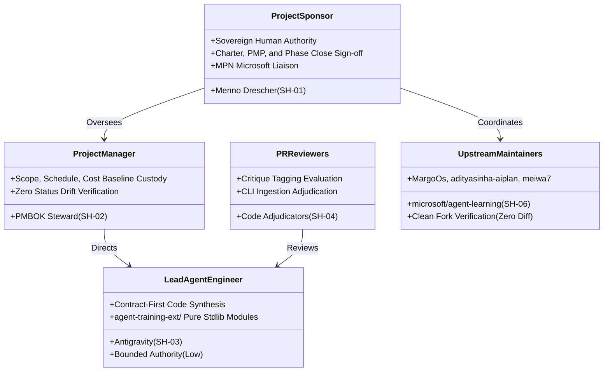

# Resource Foundation — Role Catalogue & Accountabilities (`PMP-BL-v1.1.0`)

Defines the formal **Role Catalogue**, accountabilities, and decision rights for Phase 2 in strict alignment with [Stakeholder-Register.md](../../../Stakeholder-Register.md) v2.0 and [Project-Charter.md](../../../Project-Charter.md) v2.0.

**Historical Baseline Archive:** Frozen Phase 1 role catalogue preserved in [`docs/project-docs/history/PMP-BL-v1.0.0/management-plans/resource-baseline/foundation/Resource-Role-Catalogue.md`](../../history/PMP-BL-v1.0.0/management-plans/resource-baseline/foundation/Resource-Role-Catalogue.md).

---

## 1. Project Role Taxonomy (Phase 2)

---

## 2. Authoritative Role Specifications (Aligned with Stakeholder Register v2.0)

1. **SH-01: Project Sponsor & Principal Researcher (Menno Drescher):** Holds sovereign human authority over project architecture, charter milestones, budget ceilings, and phase close decisions.
2. **SH-02: Project Manager / PMBOK Steward:** Responsible for baseline integration, phase rollups, variance tracking, and zero status drift across registers.
3. **SH-03: Lead Agent Engineer (Antigravity):** AI pair programming throughput; executes AST parsers, discrete policy math, and contract test suites in `agent-training-ext/`.
4. **SH-04: PR Reviewers & Code Adjudicators:** Review evidence evaluators using critique tag grammar to capture qualitative feedback into Bayesian frames.
5. **SH-05: Downstream SDK Adopters:** Open-source consumers of contextual bandit and discrete DPO policy packages.
6. **SH-06: Upstream Microsoft Maintainers:** Custodians of upstream `microsoft/agent-learning` repository.
7. **SH-07: Quality & Governance Auditor:** Responsible for automated CI/CD audits, 4-ring test coverage, and audit register verification.
