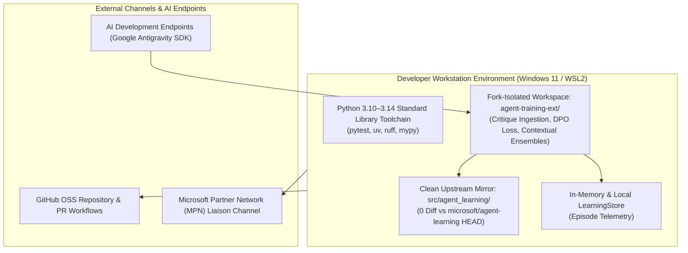

# Resource Foundation — Tooling & Assignment Register (`PMP-BL-v1.1.0`)

Catalogs the software toolchains, development environments, and isolated extension workspaces provisioned for **Phase 2: Autonomous Feedback Loops & Extensible Architecture**.

**Historical Baseline Archive:** Frozen Phase 1 tooling register preserved in [`docs/project-docs/history/PMP-BL-v1.0.0/management-plans/resource-baseline/foundation/Resource-Tooling-and-Assignment-Register.md`](../../history/PMP-BL-v1.0.0/management-plans/resource-baseline/foundation/Resource-Tooling-and-Assignment-Register.md).

---

## 1. Tooling & Workspace Inventory (Phase 2)

---

## 2. Resource Assignment Matrix (Phase 2 Epics)

| Epic ID | Work Package Scope | Assigned Technical Lead | AI Pair Assistant | Target Workspace |
|---|---|---|---|---|
| **Epic 14** | Critique Ingestion Engine | Menno Drescher (SH-01) | Antigravity (SH-03) | `agent-training-ext/` |
| **Epic 18** | DPO Pairwise Optimization | Menno Drescher (SH-01) | Antigravity (SH-03) | `agent-training-ext/` |
| **Epic 16 & 21** | Contextual Authority Router | Menno Drescher (SH-01) | Antigravity (SH-03) | `agent-training-ext/` |
| **Epic 22 & 38** | Continuous SIDPA Automation | Menno Drescher (SH-01) | Antigravity (SH-03) | `agent-training-ext/` & `scripts/` |
| **Milestone M10** | Phase 2 Review & Close Gate | Menno Drescher (SH-01) | Quality Auditor (SH-07) | Governance Registry |
