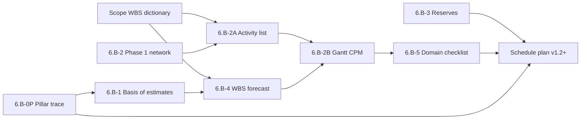

# Schedule Foundation Pack — Manifest (`PMP-BL-v1.0.0`)

Roll-up for **Stage 6.B** (proactive schedule foundation breakouts) before the first `approve-subsidiary-plan` on [Schedule-Management-Plan.md](../Schedule-Management-Plan.md) **v1.2+**.

**Pack state:** Foundation breakouts **6.B-0P … 6.B-5** **approved** (2026-10-30); registry hashes below. **6.B-6** roll-up complete (`pack_status: approved`). **Next:** **6.B-7** — `approve-subsidiary-plan` on [Schedule-Management-Plan.md](../Schedule-Management-Plan.md) **v1.2+** and close **BFI-001**. **6.B-0** (Scope **6.A-7**) must be satisfied before the Schedule **plan** subsidiary gate is valid under ADR-013 DAG.

**Normative standards:** [ADR-026](../../../adr/ADR-026-schedule-management-plan-standard-and-baseline-contract.md) (Schedule plan contract), [ADR-013](../../../adr/ADR-013-subsidiary-plan-approval-gates-before-pmp-formalization.md) (hashes, DAG), [ADR-012](../../../adr/ADR-012-subsidiary-management-plan-standards-and-content-contracts.md) (artifact frontmatter). **Path A:** Tier-1 foundation pack is normative for the first Schedule subsidiary approval (**BFI-001** on the Schedule plan)—no ADR-026 amendment.

---

## Integrated schedule baseline (this cycle)

After **6.B-6**, **this manifest** is **approved** (registry hashes current). When **6.B-7** completes, the **integrated schedule baseline** for `PMP-BL-v1.0.0` is:

1. **This manifest** (v1.4.0, `pack_status: approved`).
2. **Approved [Schedule-Management-Plan.md](../Schedule-Management-Plan.md) v1.2+** — milestone register (§1.2), governance (§3), rollups (§2.5), variance (§2.6).
3. **Approved foundation artifacts** (eight files, substages **6.B-0P** … **6.B-5**):

| # | Substage | Artifact | Role in baseline |
| ---: | --- | --- | --- |
| 1 | 6.B-0P | [Schedule-Pillar-Overview-and-Trace.md](foundation/Schedule-Pillar-Overview-and-Trace.md) | Milestones M0.5–M5 ↔ [Project-Pillars.md](../../Project-Pillars.md) ↔ effort |
| 2 | 6.B-1 | [Schedule-Basis-of-Estimates.md](foundation/Schedule-Basis-of-Estimates.md) | L/M/H, PERT $\bar{d}$, C1–C4 rules |
| 3 | 6.B-2 | [Schedule-Network-Phase1.md](foundation/Schedule-Network-Phase1.md) | Epic/milestone FS network (Phase 1 CPM) |
| 4 | 6.B-2A | [Schedule-Activity-List-Phase1.md](foundation/Schedule-Activity-List-Phase1.md) | Story activity list, predecessors, Band B + Epic 34 |
| 5 | 6.B-2B | [Schedule-Gantt-Phase1.md](foundation/Schedule-Gantt-Phase1.md) | CPM ES/EF, Gantt bars, tool import |
| 6 | 6.B-3 | [Schedule-Reserve-Register.md](foundation/Schedule-Reserve-Register.md) | SR-M5-01, contingency triggers |
| 7 | 6.B-4 | [Schedule-Baseline-WBS-Forecast.md](foundation/Schedule-Baseline-WBS-Forecast.md) | 143 WBS durations and rollups |
| 8 | 6.B-5 | [Schedule-Domain-Checklist.md](foundation/Schedule-Domain-Checklist.md) | PMBOK §2.3.5 Table 2-7 schedule outcomes |

Milestone **windows** and change control stay in the **Schedule plan**; detailed schedule evidence stays in **foundation/** — not duplicated in the plan body.

---

## Upstream inputs & gates

| Input | Requirement |
| --- | --- |
| [Project-Charter.md](../../Project-Charter.md) §7 | Milestones M0.5–M5 (fixed gates) |
| [Scope-Management-Plan.md](../Scope-Management-Plan.md) **v1.2+** | WBS dictionary, §1.5 execution bands (**6.A-7** approved) |
| [Scope-WBS-Dictionary.md](../scope-baseline/foundation/Scope-WBS-Dictionary.md) | 143 story identities (schedule activities) |
| [Project-Pillars.md](../../Project-Pillars.md) | **Approved** (`approve-project-pillars` episode `8fe9fea9-6ef1-44be-82a9-e09677e47a4a`) |
| Scope pillar trace | [Scope-Pillar-Overview-and-Trace.md](../scope-baseline/foundation/Scope-Pillar-Overview-and-Trace.md) (**6.A-0P**) |

**6.B-0:** Scope subsidiary plan approved before any Schedule foundation breakout.

---

## Develop-schedule evidence chain (PMBOK 8 §2.3)

Foundation artifacts implement **Develop Schedule** in dependency order:

| Step | PMBOK intent | Substage | Artifact |
| ---: | --- | --- | --- |
| 1 | Align schedule to strategy / pillars | **6.B-0P** | Schedule-Pillar-Overview-and-Trace |
| 2 | Define estimation approach | **6.B-1** | Schedule-Basis-of-Estimates |
| 3 | Estimate durations (WBS) | **6.B-4** | Schedule-Baseline-WBS-Forecast |
| 4 | Sequence activities (logic) | **6.B-2**, **6.B-2A** | Network + Activity list |
| 5 | Develop schedule (calendar view) | **6.B-2B** | Schedule-Gantt-Phase1 |
| 6 | Buffers & known-unknowns | **6.B-3** | Schedule-Reserve-Register |
| 7 | Domain outcomes | **6.B-5** | Schedule-Domain-Checklist |
| 8 | Baseline integration | **6.B-6**, **6.B-7** | This manifest + Schedule plan |

---

## Baseline metrics snapshot (informational)

Values from forecast and Gantt at pack authoring; authoritative after **6.B-4** / **6.B-2B** approval.

| Metric | Value | Source |
| --- | ---: | --- |
| WBS rows | 143 | Scope dictionary / forecast |
| Program remaining (weighted) | **396.9 pd** | Forecast rollup |
| Phase 1 Band B remaining (weighted) | **115.4 pd** | Schedule plan §2.5 |
| Phase 1 CPM to M5 (single-resource, Dur M) | **67 pd** | Gantt CPM table |
| Charter milestone windows (serial gates) | **~37.5 pd** | Schedule plan §1.2 |
| M5 management reserve | **5 pd** | SR-M5-01 |

Parallel execution after **M2** (Epics 15–17) reduces calendar duration versus the conservative single-resource Gantt.

---

## Stage 6.B substage checklist

Complete in order; each row maps to one foundation artifact approval (`approve-subsidiary-plan`, narrower document scope).

| Substage | Process / gate | Artifact | Review focus | Done |
| --- | --- | --- | --- | --- |
| **6.B-0** | Upstream | Scope Management Plan **v1.2+** (**6.A-7**) | Integrated scope baseline + WBS in scope foundation | ☐ |
| **6.B-0P** | Strategy trace | [Schedule-Pillar-Overview-and-Trace.md](foundation/Schedule-Pillar-Overview-and-Trace.md) | M0.5–M5 ↔ pillars ↔ Band B effort | ☑ |
| **6.B-1** | Estimate basis | [Schedule-Basis-of-Estimates.md](foundation/Schedule-Basis-of-Estimates.md) | L/M/H, PERT, C1–C4; aligned with 6.B-0P | ☑ |
| **6.B-2** | Sequence (macro) | [Schedule-Network-Phase1.md](foundation/Schedule-Network-Phase1.md) | Phase 1 FS, M4/Epic 34; links to 6.B-2A | ☑ |
| **6.B-2A** | Sequence (micro) | [Schedule-Activity-List-Phase1.md](foundation/Schedule-Activity-List-Phase1.md) | Preds, Dur (M); Band B + Epic 34 | ☑ |
| **6.B-2B** | Schedule bars | [Schedule-Gantt-Phase1.md](foundation/Schedule-Gantt-Phase1.md) | ES/EF, critical path, Gantt / import | ☑ |
| **6.B-3** | Reserves | [Schedule-Reserve-Register.md](foundation/Schedule-Reserve-Register.md) | SR-M5-01, contingency triggers | ☑ |
| **6.B-4** | Durations | [Schedule-Baseline-WBS-Forecast.md](foundation/Schedule-Baseline-WBS-Forecast.md) | 143 rows; rollups match plan §2.5 | ☑ |
| **6.B-5** | Domain outcomes | [Schedule-Domain-Checklist.md](foundation/Schedule-Domain-Checklist.md) | PMBOK §2.3.5 Table 2-7 | ☑ |
| **6.B-6** | Roll-up | **This manifest** | All eight artifacts `approved`; registry hashes set | ☑ |
| **6.B-7** | Plan gate | Schedule Management Plan **v1.2+** | Integrated baseline; **BFI-001** closed | ☐ |

Recommended breakout order after **6.B-0:** **0P → 1 → 2 → 2A → 2B → 3 → 4 → 5 → 6 → 7**. **6.B-4** may run in parallel with **6.B-2A** after **6.B-1** if reviewers confirm estimate basis unchanged.

Epic **13.7** / **34.4** may later automate hash verification against this registry; Path A does not require code to execute **6.B**.

---

## Artifact registry

| artifact_id | Path | substage | version | approval_status | content_hash |
| --- | --- | --- | --- | --- | --- |
| schedule-foundation-pillar-overview-trace | `foundation/Schedule-Pillar-Overview-and-Trace.md` | 6.B-0P | 1.0.0 | approved | `3a1f15b573738363e0223b3de8259651661e9e5e24cece1dc6e7addbe405867a` |
| schedule-foundation-basis-of-estimates | `foundation/Schedule-Basis-of-Estimates.md` | 6.B-1 | 1.0.0 | approved | `d473c02ea467bf5b74e6cf5c5271ff71ffdcc1d3a85fc244c7d0235d33bf38ac` |
| schedule-foundation-network-phase1 | `foundation/Schedule-Network-Phase1.md` | 6.B-2 | 1.0.0 | approved | `9c3d1d2e28d4c5dc34ca2ea1829d5a7d0b2c2532bb3e36f41a3ecf7d2e04dd16` |
| schedule-foundation-activity-list-phase1 | `foundation/Schedule-Activity-List-Phase1.md` | 6.B-2A | 1.0.0 | approved | `ce827739eca10f87eb1dc0c4eea317c608a84b8eb209284de4886466f1eb3820` |
| schedule-foundation-gantt-phase1 | `foundation/Schedule-Gantt-Phase1.md` | 6.B-2B | 1.0.0 | approved | `862250509b5a42411c60e8d279dbf441828a32bfc622efdb44d043a73901582f` |
| schedule-foundation-reserve-register | `foundation/Schedule-Reserve-Register.md` | 6.B-3 | 1.0.0 | approved | `5cab10ddacd5cdf9a32bfe2f2412c3d569e648b05425ae01ff621bd10199f373` |
| schedule-foundation-wbs-forecast | `foundation/Schedule-Baseline-WBS-Forecast.md` | 6.B-4 | 1.0.0 | approved | `eb071bfb1f4eff3320a1f9e4ad47cae1854a9124af6bc6cec8f9c374a2eb3fcc` |
| schedule-foundation-domain-checklist | `foundation/Schedule-Domain-Checklist.md` | 6.B-5 | 1.0.0 | approved | `5c73bfd30532e84a5bf2d2dc55a3576597b04084f5df72408a58ca2a5f16d9b3` |

At each breakout: set artifact `approval_status: approved`, record **content_hash** (ADR-013 canonical hash), tick **Done** above, and append hash to this table.

---

## Approval runbook (Path A)

1. Confirm **6.B-0** — Scope Management Plan **v1.2+** approved (**6.A-7**); `scope-management` hash current.
2. Break out **6.B-0P**, then **6.B-1 … 6.B-5** (include **6.B-2A** and **6.B-2B** immediately after **6.B-2**).
3. Update each artifact frontmatter and this manifest registry + checklist.
4. Mark **6.B-6** when all **eight** foundation artifacts are approved.
5. Run `approve-subsidiary-plan` on **Schedule Management Plan v1.2+** (**6.B-7**) with upstream `scope-management` hash and reference to this manifest in approval notes.
6. Set **BFI-001** to `applied` on the Schedule plan (or record Sponsor waiver here).

**Downstream (ADR-013):** Approved Schedule baseline changes mark **Cost**, **Resource**, and **Risk** plans `STALE_DEPENDENCY` until re-approved before `approve-pmp`.

---

## Amendment log

| Date | Author | Description |
| --- | --- | --- |
| 2026-10-30 | Menno Drescher / Cursor | Initial foundation pack manifest for Path A (no ADR-026 amendment). |
| 2026-10-30 | Menno Drescher / Cursor | Added **6.B-0P** pillar overview & trace (aligned with Scope **6.A-0P**). |
| 2026-10-30 | Menno Drescher / Cursor | **v1.1.0 — 6.B-2A** Phase 1 activity list & dependencies. |
| 2026-10-30 | Menno Drescher / Cursor | **v1.2.0 — 6.B-2B** Phase 1 Gantt from activity list CPM. |
| 2026-10-30 | Menno Drescher / Cursor | **v1.3.0 — Pack complete:** integrated baseline definition, PMBOK §2.3 evidence chain, metrics snapshot, full registry (8 artifacts); ready for **6.B** breakouts. |
| 2026-10-30 | Menno Drescher | **v1.4.0 — 6.B-6:** Foundation **6.B-0P … 6.B-5** approved; registry hashes recorded; `pack_status: approved`. |
