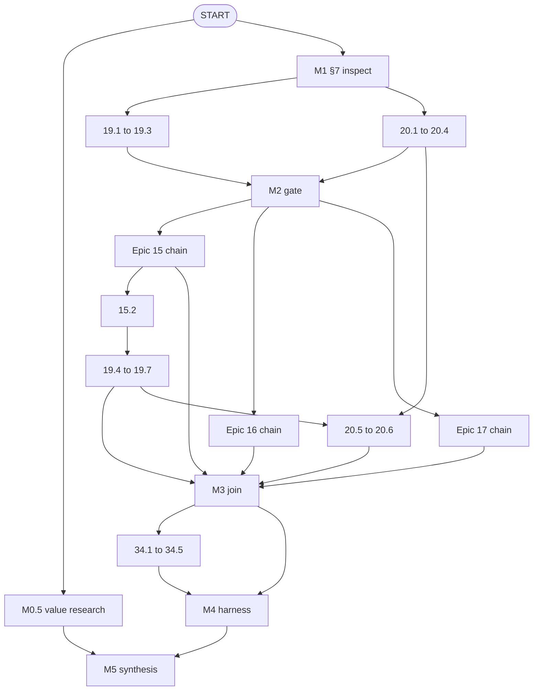

# Schedule Foundation — Phase 1 Activity List & Dependencies (`PMP-BL-v1.0.0`)

Story-level **activity list**, **predecessors**, and **durations** for Charter Phase 1 (Scope §1.5 Band **B**, plus Epic **34** enabler before **M4**). Macro milestone and epic logic: [Schedule-Network-Phase1.md](Schedule-Network-Phase1.md). Durations (**Dur M**) = **Medium** person-days from [Schedule-Baseline-WBS-Forecast.md](Schedule-Baseline-WBS-Forecast.md); weighted PERT $\bar{d}$ stays in the forecast file.

**WBS identity:** [Scope-WBS-Dictionary.md](../../scope-baseline/foundation/Scope-WBS-Dictionary.md). **Authorization:** Band **B** rows may execute in Phase 1; sequencing here does not override Scope §1.5 deferrals.

---

## Develop-schedule method (this baseline)

| Step | Artifact | Phase 1 coverage |
| --- | --- | --- |
| 1. WBS | Scope dictionary | 143 story work packages |
| 2. Activity list | **This document** | Band **B** stories + Charter gate activities + Epic **34** |
| 3. Estimate durations | Forecast file | L/M/H and $\bar{d}$ per WBS row |
| 4. Sequence (PDM) | **Pred** column below | Default **FS**; join gates **M2**, **M3**, **M4**, **M5** |
| 5. Network roll-up | [Schedule-Network-Phase1.md](Schedule-Network-Phase1.md) | Epic/milestone CPM |
| 6. Gantt / calendar | [Schedule-Gantt-Phase1.md](Schedule-Gantt-Phase1.md) (**6.B-2B**) | ES/EF, bars, tool import |

Cross-epic rules are sourced from `docs/user-stories/epic-NN-*.md` headers; within-epic default is **N.(k−1) → N.k** unless overridden below.

---

## Charter gate activities (not WBS rows)

Zero-duration **join** milestones use **0** pd; **M0.5** and **M1** use Charter **planning envelopes** from [Schedule-Management-Plan.md](../../Schedule-Management-Plan.md) §1.2.

| Activity | Type | Band | Description | Pred(s) | Rel | Dur (M pd) | Gate |
| --- | --- | --- | --- | --- | --- | ---: | --- |
| **M0.5** | gate | F | End-user value research; HYP-AL-011 signal (Charter §5) | START | FS | 5 | M0.5 |
| **M1** | gate | B | §7 `SoftmaxPolicy` reuse inspection; Yes/No report | START | FS | 5 | M1 |
| **M2** | gate | B | Warm-start / meta-prior path runnable (HYP-AL-008) | 19.3, 20.4 | FS | 0 | M2 |
| **M3** | gate | B | UCB + Thompson + epsilon baseline; Epic 19 tail complete | 15.6, 16.6, 17.6, 19.7, 20.6 | FS | 0 | M3 |
| **M4** | gate | B | Autonomy harness vs REINFORCE on 146-episode fixture | 34.5, 15.6, 16.6, 17.6 | FS | 0 | M4 |
| **M5** | gate | F | Bayes factors; Option B go/no-go (Stage 18) | M4, M0.5 | FS | 0 | M5 |

**M2 vs Epic 19:** Stories **19.4–19.7** depend on Band **M3** work (**19.4** needs **15.2**). **M2** closes when **19.1–19.3** and **20.1–20.4** finish—the warm-start **skeleton**—while **19.4–19.7** and **20.5–20.6** complete before **M3** (see table).

Harness stories **9.1** and **10.1** are **Complete**; **M4** assumes re-run / benchmark evidence, not greenfield implementation.

---

## Story activities — Epics 19 & 20 (M1 → M3)

| Activity | Band | Pred(s) | Rel | Dur (M pd) | Primary gate |
| --- | --- | --- | --- | ---: | --- |
| 19.1 | B | M1 | FS | 4.0 | M2 |
| 19.2 | B | 19.1 | FS | 4.0 | M2 |
| 19.3 | B | 19.2 | FS | 4.0 | M2 |
| 19.4 | B | 19.3, 15.2 | FS | 4.0 | M3 |
| 19.5 | B | 19.4 | FS | 4.0 | M3 |
| 19.6 | B | 19.5 | FS | 4.0 | M3 |
| 19.7 | B | 19.6 | FS | 4.0 | M3 |
| 20.1 | B | M1 | FS | 4.0 | M2 |
| 20.2 | B | 20.1 | FS | 4.0 | M2 |
| 20.3 | B | 20.2 | FS | 4.0 | M2 |
| 20.4 | B | 20.3 | FS | 4.0 | M2 |
| 20.5 | B | 20.4, 19.5, 19.6 | FS | 4.0 | M3 |
| 20.6 | B | 20.5 | FS | 4.0 | M3 |

*Source: Epic 19 (19.4 → 15.2); Epic 20 (20.5 → 19.5, 19.6).*

---

## Story activities — Epics 15, 16, 17 (M2 → M3)

Epics **15**, **16**, and **17** may **overlap** after **M2**; **M3** is a **join** when all exit stories (**15.6**, **16.6**, **17.6**) are complete.

| Activity | Band | Pred(s) | Rel | Dur (M pd) | Primary gate |
| --- | --- | --- | --- | ---: | --- |
| 15.1 | B | M2 | FS | 3.0 | M3 |
| 15.2 | B | 15.1 | FS | 3.0 | M3 |
| 15.3 | B | 15.2 | FS | 3.0 | M3 |
| 15.4 | B | 15.3 | FS | 3.0 | M3 |
| 15.5 | B | 15.4 | FS | 3.0 | M3 |
| 15.6 | B | 15.5 | FS | 4.0 | M3 |
| 16.1 | B | M2 | FS | 3.0 | M3 |
| 16.2 | B | 16.1, 15.3 | FS | 3.0 | M3 |
| 16.3 | B | 16.2 | FS | 3.0 | M3 |
| 16.4 | B | 16.3 | FS | 3.0 | M3 |
| 16.5 | B | 16.4, 15.3 | FS | 3.0 | M3 |
| 16.6 | B | 16.5 | FS | 4.0 | M3 |
| 17.1 | B | M2 | FS | 3.0 | M3 |
| 17.2 | B | 17.1 | FS | 3.0 | M3 |
| 17.3 | B | 17.2, 15.1, 15.3 | FS | 3.0 | M3 |
| 17.4 | B | 17.3, 16.3 | FS | 3.0 | M3 |
| 17.5 | B | 17.4, 15.3 | FS | 3.0 | M3 |
| 17.6 | B | 17.5 | FS | 4.0 | M3 |

*Source: Epics 15–17 dependency paragraphs; **17.4** also waits on shared statistics (**16.3**) per FDD-017 §7.*

---

## Story activities — Epic 34 (pre-M4 enabler)

Band **E** program scope; on Phase 1 **critical path** before **M4** when legacy tests block collection ([Schedule-Management-Plan.md](../../Schedule-Management-Plan.md) §2.5). Stories **34.3** and **34.4** remain Draft until FDD-034 §5 items 3–4 are confirmed (Epic 34 header).

| Activity | Band | Pred(s) | Rel | Dur (M pd) | Primary gate |
| --- | --- | --- | --- | ---: | --- |
| 34.1 | E | M3 | FS | 4.0 | pre-M4 |
| 34.2 | E | 34.1 | FS | 4.0 | pre-M4 |
| 34.3 | E | 34.2 | FS | 4.0 | pre-M4 |
| 34.4 | E | 34.3 | FS | 4.0 | pre-M4 |
| 34.5 | E | 34.4 | FS | 4.0 | pre-M4 |

---

## Phase 1 logic diagram (story rollup)

---

## Program WBS (deferred sequencing)

Stories in Bands **C**, **D**, and **E** (except Epic **34** above) and remaining **Program** / **Foundation** / **Phase 2** rows in the forecast are **not** sequenced in this artifact until a later baseline cycle or after **M5** authorization. Add a sibling artifact `Schedule-Activity-List-Program.md` when the PM sequences the full **143**-row backlog.

---

## Reviewer checks (6.B-2A)

1. Every Band **B** remaining story in the forecast appears above with at least one predecessor (except **M1** / **M0.5** from **START**).
2. Epic-documented cross-links (**19.4↔15.2**, **20.5↔19.5/19.6**, **16.x/17.x↔15.3**) match user-story headers.
3. **M3** join includes Epic **19** tail and **20.6**, not only Epics **15–17**.
4. Forecast **Dur** columns stay aligned when estimates change (re-diff this table or automate via Epic **13.7** / **34.4** later).
