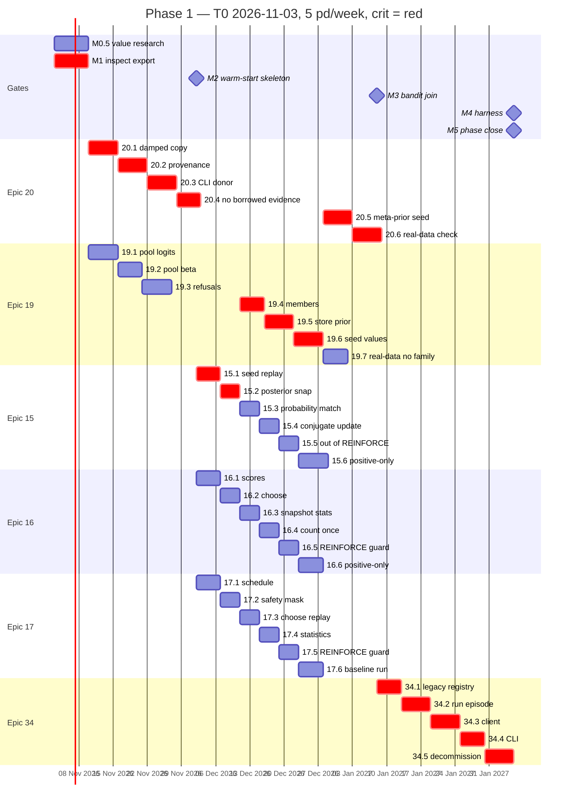

# Schedule Foundation — Phase 1 Gantt (`PMP-BL-v1.0.0`)

**Bar chart view** of the Phase 1 network: early **start/finish** from a single-resource forward pass on [Schedule-Activity-List-Phase1.md](Schedule-Activity-List-Phase1.md) (FS, **Dur M** person-days). Durations and predecessors are **not** duplicated here—when the activity list changes, recompute this Gantt.

---

## Calendar conventions (planning only)

| Rule | Value |
| --- | --- |
| **T0 (planning anchor)** | **2026-11-03** — illustrative only; Charter remains **not date-committed** |
| **Capacity** | **5 pd / calendar week** (~1 pd per weekday) |
| **Calendar start/end** | `T0 + round(ES × 7/5)` and `T0 + round(EF × 7/5)` days |
| **Critical path** | Activities with **zero total float** on the forward/backward pass below |

**Interpretation:** Milestone **windows** in [Schedule-Management-Plan.md](../../Schedule-Management-Plan.md) §1.2 (~**37.5 pd** serial gates) are **envelopes**. This story-level Gantt at **medium** estimates and one maintainer serializes to **~67 pd** to **M5** (~**13.4** weeks from T0)—parallel execution on Epics **15–17** after **M2** reduces calendar time in practice.

---

## CPM schedule table (Gantt inputs)

| Activity | ES (pd) | EF (pd) | Dur (M pd) | Critical | Calendar start | Calendar finish |
| --- | ---: | ---: | ---: | --- | --- | --- |
| M0.5 | 0 | 5 | 5 | | 2026-11-03 | 2026-11-10 |
| M1 | 0 | 5 | 5 | Y | 2026-11-03 | 2026-11-10 |
| 19.1 | 5 | 9 | 4 | | 2026-11-10 | 2026-11-16 |
| 19.2 | 9 | 13 | 4 | | 2026-11-16 | 2026-11-21 |
| 19.3 | 13 | 17 | 4 | | 2026-11-21 | 2026-11-27 |
| 20.1 | 5 | 9 | 4 | 0 | Y | 2026-11-10 | 2026-11-16 |
| 20.2 | 9 | 13 | 4 | 0 | Y | 2026-11-16 | 2026-11-21 |
| 20.3 | 13 | 17 | 4 | 0 | Y | 2026-11-21 | 2026-11-27 |
| 20.4 | 17 | 21 | 4 | 0 | Y | 2026-11-27 | 2026-12-02 |
| M2 | 21 | 21 | 0 | 0 | Y | 2026-12-02 | 2026-12-02 |
| 15.1 | 21 | 24 | 3 | 0 | Y | 2026-12-02 | 2026-12-07 |
| 15.2 | 24 | 27 | 3 | 0 | Y | 2026-12-07 | 2026-12-11 |
| 15.3 | 27 | 30 | 3 | | 2026-12-11 | 2026-12-15 |
| 15.4 | 30 | 33 | 3 | | 2026-12-15 | 2026-12-19 |
| 15.5 | 33 | 36 | 3 | | 2026-12-19 | 2026-12-23 |
| 15.6 | 36 | 40 | 4 | | 2026-12-23 | 2026-12-29 |
| 16.1 | 21 | 24 | 3 | | 2026-12-02 | 2026-12-07 |
| 16.2 | 30 | 33 | 3 | | 2026-12-15 | 2026-12-19 |
| 16.3 | 33 | 36 | 3 | | 2026-12-19 | 2026-12-23 |
| 16.4 | 36 | 39 | 3 | | 2026-12-23 | 2026-12-28 |
| 16.5 | 39 | 42 | 3 | | 2026-12-28 | 2027-01-01 |
| 16.6 | 42 | 46 | 4 | | 2027-01-01 | 2027-01-06 |
| 17.1 | 21 | 24 | 3 | | 2026-12-02 | 2026-12-07 |
| 17.2 | 24 | 27 | 3 | | 2026-12-07 | 2026-12-11 |
| 17.3 | 30 | 33 | 3 | | 2026-12-15 | 2026-12-19 |
| 17.4 | 36 | 39 | 3 | | 2026-12-23 | 2026-12-28 |
| 17.5 | 39 | 42 | 3 | | 2026-12-28 | 2027-01-01 |
| 17.6 | 42 | 46 | 4 | | 2027-01-01 | 2027-01-06 |
| 19.4 | 27 | 31 | 4 | 0 | Y | 2026-12-11 | 2026-12-16 |
| 19.5 | 31 | 35 | 4 | 0 | Y | 2026-12-16 | 2026-12-22 |
| 19.6 | 35 | 39 | 4 | 0 | Y | 2026-12-22 | 2026-12-28 |
| 19.7 | 39 | 43 | 4 | | 2026-12-28 | 2027-01-02 |
| 20.5 | 39 | 43 | 4 | 0 | Y | 2026-12-28 | 2027-01-02 |
| 20.6 | 43 | 47 | 4 | 0 | Y | 2027-01-02 | 2027-01-08 |
| M3 | 47 | 47 | 0 | 0 | Y | 2027-01-08 | 2027-01-08 |
| 34.1 | 47 | 51 | 4 | 0 | Y | 2027-01-08 | 2027-01-13 |
| 34.2 | 51 | 55 | 4 | 0 | Y | 2027-01-13 | 2027-01-19 |
| 34.3 | 55 | 59 | 4 | 0 | Y | 2027-01-19 | 2027-01-25 |
| 34.4 | 59 | 63 | 4 | 0 | Y | 2027-01-25 | 2027-01-30 |
| 34.5 | 63 | 67 | 4 | 0 | Y | 2027-01-30 | 2027-02-05 |
| M4 | 67 | 67 | 0 | 0 | Y | 2027-02-05 | 2027-02-05 |
| M5 | 67 | 67 | 0 | 0 | Y | 2027-02-05 | 2027-02-05 |

**Critical path (activity ids):** M1 → 20.1 → 20.2 → 20.3 → 20.4 → M2 → 15.1 → 15.2 → 19.4 → 19.5 → 19.6 → 20.5 → 20.6 → M3 → 34.1 → 34.2 → 34.3 → 34.4 → 34.5 → M4 → M5.

---

## Mermaid Gantt (render in Markdown preview)



Bar lengths use **calendar** spacing (7d ≈ 5 pd); milestone diamonds are **0d** tasks.

---

## Tool import (MS Project / Smartsheet / Excel)

Use columns **ID**, **Task Name**, **Duration** (`Nd` = person-days at 8h or map 1d = 1 pd per your tool), **Predecessors**, **Start**, **Finish** from the activity list + CPM table. Example rows:

```csv
ID,Task Name,Duration,Predecessors,Start,Finish,Critical
M0.5,M0.5 End-user value research,5d,,2026-11-03,2026-11-10,N
M1,M1 SoftmaxPolicy inspection,5d,,2026-11-03,2026-11-10,Y
19.1,19.1 Pool logits,4d,M1,2026-11-10,2026-11-16,N
20.1,20.1 Damped copy,4d,M1,2026-11-10,2026-11-16,Y
M2,M2 Gate warm-start skeleton,0d,"19.3,20.4",2026-12-02,2026-12-02,Y
M5,M5 Phase close Option B gate,0d,"M4,M0.5",2027-02-05,2027-02-05,Y
```

Full **43-row** CSV can be exported from the CPM table at approval time (Epic **13.7** / **34.4** automation optional).

---

## Reviewer checks (6.B-2B)

1. Every activity in [Schedule-Activity-List-Phase1.md](Schedule-Activity-List-Phase1.md) appears in the CPM table with matching **Dur (M pd)**.
2. **M5** has predecessors **M4** and **M0.5** (join).
3. Gantt **critical path** matches longest zero-float chain to **M5**.
4. Recompute after any activity-list or forecast change before breakout approval.
