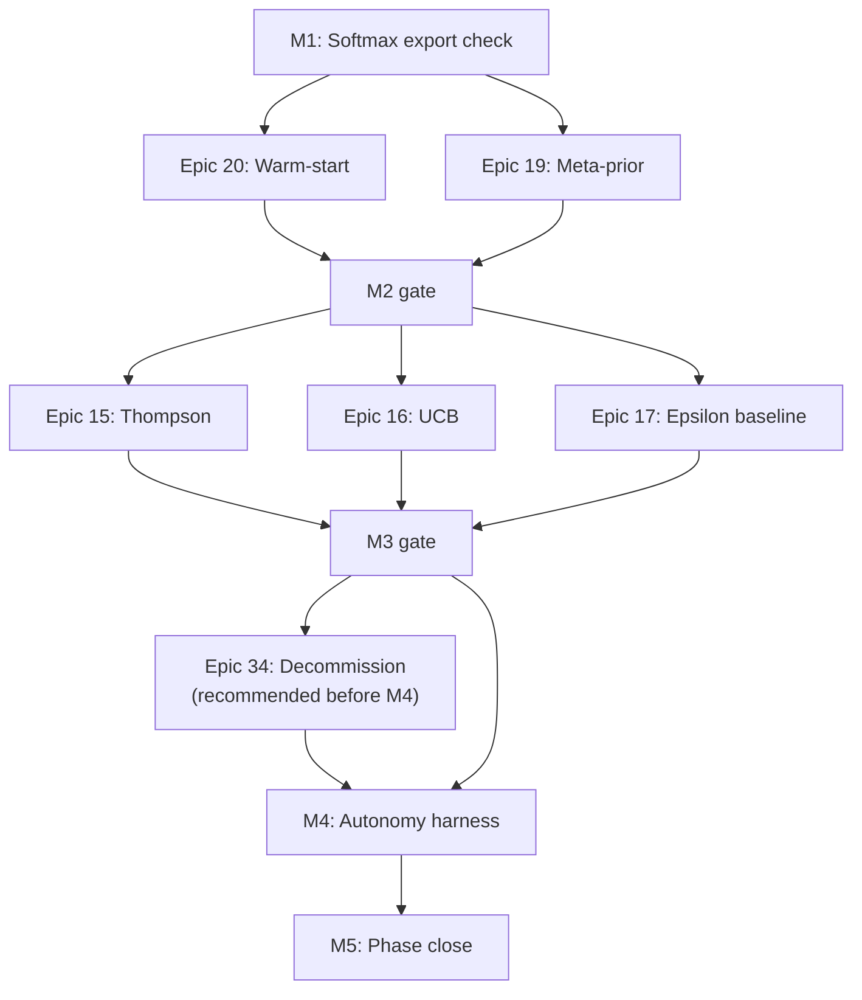

# Schedule Foundation — Phase 1 Logic Network (`PMP-BL-v1.0.0`)

Precedence diagram for **Charter Phase 1** (Scope §1.5 Band **B**) and milestone gates. **Story-level activity list, predecessors, and durations:** [Schedule-Activity-List-Phase1.md](Schedule-Activity-List-Phase1.md) (**6.B-2A**). **Pillar ↔ milestone map:** [Schedule-Pillar-Overview-and-Trace.md](Schedule-Pillar-Overview-and-Trace.md). Relationship type: **finish-to-start (FS)** unless noted.

## Milestone network (critical path)

See [Schedule-Management-Plan.md](../../Schedule-Management-Plan.md) §2.1 for the milestone DAG. Critical path: **M1 → M2 → M3 → M4 → M5**. **M0.5** runs in parallel with float to M5.

## Epic-level Phase 1 sequence

Epics **15**, **16**, and **17** may overlap in execution after M2; **M3** completes when all three meet exit conditions in Schedule plan §1.2.

## Within-epic story order

Default rule: stories run in numeric order (**N.1 → N.2 → …**) per `docs/user-stories/epic-NN-*.md`. Real-data check stories (e.g. **15.6**, **16.6**, **20.6**) are FS successors to implementation stories in the same epic. **Normative predecessor table:** [Schedule-Activity-List-Phase1.md](Schedule-Activity-List-Phase1.md) (includes cross-epic exceptions such as **19.4 → 15.2** and **M2/M3** join gates).

## Out of network (deferred)

Epics **14**, **18** (Band C), and program bands **25–38** except where they block test collection (**34** before M4) are **not** on the Phase 1 critical path until authorized after **M5**.
