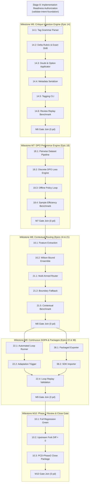

# Schedule Foundation — Phase 2 Logic Network (`PMP-BL-v1.1.0`)

Precedence diagram method (PDM) network for **Charter Phase 2: Autonomous Feedback Loops & Extensible Architecture** (Scope Bands **C** and **D**).

**Historical Baseline Archive:** Frozen Phase 1 logic network preserved in [`docs/project-docs/history/PMP-BL-v1.0.0/management-plans/schedule-baseline/foundation/Schedule-Network-Phase1.md`](../../history/PMP-BL-v1.0.0/management-plans/schedule-baseline/foundation/Schedule-Network-Phase1.md).

---

## 1. Milestone Critical Path (Phase 2)

Critical path executes sequentially across the 5 authorized Phase 2 milestones:
$$\text{Stage 8 Authorization} \longrightarrow \text{M6 (Critique Ingestion)} \longrightarrow \text{M7 (DPO Preference)} \longrightarrow \text{M8 (Contextual Ensembles)} \longrightarrow \text{M9 (SIDPA Loops)} \longrightarrow \text{M10 (Phase Close)}$$

---

## 2. Epic & Milestone Precedence Network

All implementation activities occur strictly within `agent-training-ext/`, maintaining `src/agent_learning` diff = 0.
