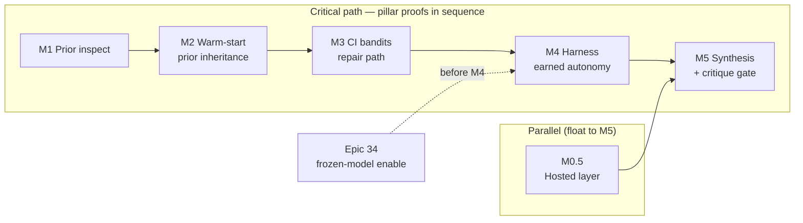

# Schedule Foundation — Topic Pillars Overview & Trace (`PMP-BL-v1.0.0`)

Connects the **integrated schedule baseline** to [Project-Pillars.md](../../../Project-Pillars.md) (**Approved**; gate episode `8fe9fea9-6ef1-44be-82a9-e09677e47a4a`). **WBS bands and scope authorization** remain normative in [Scope-Pillar-Overview-and-Trace.md](../../scope-baseline/foundation/Scope-Pillar-Overview-and-Trace.md) (**6.A-0P**). **Story-level sequence:** [Schedule-Activity-List-Phase1.md](Schedule-Activity-List-Phase1.md) (**6.B-2A**). This artifact adds **milestone windows**, **Phase 1 logic**, and **weighted effort (pd)** per pillar thread.

## How pillars relate to milestone **sequence**

**Milestones** (M0.5 → M1 → … → M5) are the **ordered Phase 1 gates** on the Charter critical path. **Topic pillars** are **strategic outcome threads** from initiating documents—they are **not** a second timeline with nine serial steps.

| Relationship | Meaning | Phase 1 examples |
| --- | --- | --- |
| **Primary** | This milestone’s exit condition **proves or delivers** that pillar for Phase 1 | M1–M2 → prior inheritance; M3 → repair-path bandits; M4 → earned autonomy (harness) |
| **Parallel** | Same calendar band as the chain, **not** on the CPM predecessor line | M0.5 → hosted-layer research (must finish before **M5**) |
| **Enabling** | Work that **unblocks** a later milestone’s pillar proof | Epic **34** → frozen-model / test collection before **M4** |
| **Decision-only** | Pillar **gated at** the milestone, **no** Phase 1 build calendar | **M5** → critique becomes evidence (Option B yes/no; Band C still deferred) |
| **Program** | Pillar has forecast rows but **no** Charter milestone slot in Phase 1 | Methodology catalog (36), packaged contextual (38), routing (21–22), governance standards (25–37) |

So: **milestone sequence constrains when Phase 1 pillar proofs must land**; it does **not** imply nine pillars in nine consecutive milestones. Three pillar threads dominate the **CPM chain** (prior → repair → earned proof); one runs **parallel** (hosted research); one is **decided** at the end (critique); the rest are **program** or **enabling** work.

## Milestone sequence — which pillars move at each gate

| Order | Milestone | Predecessors | Primary pillar(s) | What the gate proves |
| ---: | --- | --- | --- | --- |
| 0 (parallel) | **M0.5** | Charter | Hosted layer someone would pay for | Value / HYP-AL-011 research complete (timebox) |
| 1 | **M1** | Charter | A new policy inherits… | Softmax export reusable? (inspection report) |
| 2 | **M2** | M1 | A new policy inherits… | HYP-AL-008 warm-start path runnable |
| 3 | **M3** | M2 | A repair path for stuck low-authority… | UCB + Thompson under positive-only evidence |
| 4 | **M4** | M3 (+ Epic 34 rec.) | Earned, auditable autonomy | Autonomy harness vs REINFORCE on fixture |
| 5 | **M5** | M0.5, M4 | Earned autonomy (synthesis); **Critique** (decision) | Bayes factors recorded; **Option B** go/no-go—**not** Band C implementation |

**Cross-cutting on every gate:** frozen-model discipline (stdlib SDK, no undeclared deps) and **One TaskPolicy** shape (full vs low authority) appear in story work but are not separate milestone columns.

## Pillar → Charter milestone → schedule anchor

| Topic pillar | Milestone / window | Critical path? | Primary schedule evidence |
| --- | --- | --- | --- |
| **A hosted layer someone would pay for** | **M0.5** (5 pd parallel) | No (float to M5) | Plan §1.2; Charter §5 |
| **A new policy inherits a similar policy's prior** | **M1** → **M2** (5 + 10 pd) | **Yes** | [Schedule-Network-Phase1.md](Schedule-Network-Phase1.md); Epics 19–20 forecast |
| **A repair path for a stuck low-authority decision** | **M3** (10 pd after M2) | **Yes** | Epics 15–17; Band B **≈ 115.4 pd** weighted (plan §2.5) |
| **Earned, auditable autonomy** | **M4** (7.5 pd); harness | **Yes** | Stories 9.1, 10.1; Epic 34 recommended before full suite |
| **Critique becomes evidence** | **M5** gate only (Option B decision) | Indirect | **No Phase 1 duration** — Band C deferred (scope) |
| **Frozen-model, in-process learning** | Epic **34** before **M4** | Supporting | Decommission **≈ 21.7 pd** weighted; test-collection gate |
| **One TaskPolicy… / methodology** | Program (Epics 21–22, 36) | No | Forecast rows; not Charter-critical path |
| **Packaged contextual learning** | Epic **38** (Band D) | No | **≈ 16 pd** weighted; scheduled when authorized |
| **Earned autonomy (governance)** | Epics 25–26, 13 | Program parallel | Subsidiary-plan standards; not on Phase 1 CPM |

Phase 1 **critical path (milestone effort):** M1 → M2 → M3 → M4 → M5 ≈ **37.5 pd** serial milestone windows (plan §1.2), plus **5 pd** M5 reserve ([Schedule-Reserve-Register.md](Schedule-Reserve-Register.md)). **M0.5** runs in parallel.

## Pillar ↔ weighted effort (Band B + gates)

From [Schedule-Baseline-WBS-Forecast.md](Schedule-Baseline-WBS-Forecast.md) rollups (remaining **pd**, PERT weighted):

| Pillar thread | Epic set | Weighted remaining (pd) | Notes |
| --- | --- | ---: | --- |
| Prior inheritance | 19, 20 | **≈ 54** | Drives M1–M2 evidence (HYP-AL-008) |
| Repair-path bandits | 15, 16, 17 | **≈ 61** | Overlaps M3; epsilon (17) is baseline |
| Earned autonomy (harness) | 9–10 path, M4 | In Band B / harness stories | Calendar **M4** window |
| Frozen-model / quality | 34 | **≈ 22** | Contingency up to **8 pd** if tests block M4 |
| Hosted-layer research | M0.5 | **5 pd** timebox | Band F; not epic-decomposed |

Full program remaining weighted total **≈ 396.9 pd** includes Bands C–E; listing in forecast does not authorize Phase 1 execution (scope bands).

## Pillar ↔ PMBOK §2.3 foundation artifacts

| Foundation artifact | Substage | Pillars primarily substantiated (time view) |
| --- | --- | --- |
| [Schedule-Pillar-Overview-and-Trace.md](Schedule-Pillar-Overview-and-Trace.md) | **6.B-0P** | Cross-cutting milestone ↔ pillar map |
| [Schedule-Basis-of-Estimates.md](Schedule-Basis-of-Estimates.md) | 6.B-1 | All forecasted work (estimation rules) |
| [Schedule-Network-Phase1.md](Schedule-Network-Phase1.md) | 6.B-2 | Prior inheritance, repair path, earned autonomy (CPM) |
| [Schedule-Reserve-Register.md](Schedule-Reserve-Register.md) | 6.B-3 | Earned autonomy (M5); frozen-model (Epic 34 contingency) |
| [Schedule-Baseline-WBS-Forecast.md](Schedule-Baseline-WBS-Forecast.md) | 6.B-4 | All nine pillars via story → epic → ADR assignment |
| [Schedule-Domain-Checklist.md](Schedule-Domain-Checklist.md) | 6.B-5 | Holistic schedule ↔ scope/WBS |

## Trace rule (schedule extension)

1. Start from scope trace: story → epic → ADR → pillar ([Project-Pillars.md](../../../Project-Pillars.md)).
2. Map epic/story to **Milestone** column in the forecast file and to [Schedule-Network-Phase1.md](Schedule-Network-Phase1.md).
3. Confirm **Band B** pillar threads fit inside **M1–M4** windows; **Critique becomes evidence** has **no** Phase 1 story execution calendar until **M5** unlocks Band C.

At **6.B-0P** approval, reviewers confirm Phase 1 CPM milestones cover **prior inheritance**, **repair-path bandits**, and **M4 earned-autonomy** verification without scheduling Band C product work.

## Revision triggers

Reconcile when [Project-Pillars.md](../../../Project-Pillars.md), scope **6.A-0P**, milestone exit conditions, or Band B authorization changes (Level 2+ scope or schedule re-baseline).
