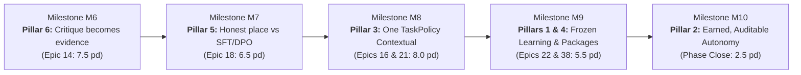

# Schedule Foundation — Topic Pillars Overview & Trace (`PMP-BL-v1.1.0`)

Connects the **integrated schedule baseline** for Phase 2 to [Project-Pillars.md](../../../Project-Pillars.md) (**Approved**). Maps Phase 2 milestones (M6 through M10) directly to topic pillar realizations and planned effort.

**Historical Baseline Archive:** Frozen Phase 1 schedule pillar trace preserved in [`docs/project-docs/history/PMP-BL-v1.0.0/management-plans/schedule-baseline/foundation/Schedule-Pillar-Overview-and-Trace.md`](../../history/PMP-BL-v1.0.0/management-plans/schedule-baseline/foundation/Schedule-Pillar-Overview-and-Trace.md).

---

## 1. How Topic Pillars Sequence into Phase 2 Milestones

In Phase 2, each sequential milestone directly realizes and empirically proves one or more topic pillars:

---

## 2. Milestone Sequence & Pillar Realization Matrix (Phase 2)

| Order | Milestone ID | Predecessor(s) | Primary Topic Pillar Realized | Planned Effort (M pd) | What the Gate Proves |
|---:|---|:---:|---|:---:|---|
| **1** | **M6** | Stage 8 Gate | **Pillar 6: Critique becomes evidence** | 7.5 | Qualitative review tags shift Bayesian pooled support exactly ($\le 10^{-9}$). |
| **2** | **M7** | M6 | **Pillar 5: Honest place against SFT/DPO** | 6.5 | Pairwise DPO loss achieves $\ge 30\%$ sample efficiency gain without GPU compute. |
| **3** | **M8** | M7 | **Pillar 3: One TaskPolicy Contextual Routing** | 8.0 | Contextual multi-armed router dispatches between `low` and `full` tiers with Wilson bounds. |
| **4** | **M9** | M8 | **Pillars 1 & 4: Frozen Learning & Packages** | 5.5 | Automated SIDPA loop operationalized; contextual policies exported for downstream SDKs. |
| **5** | **M10** | M9 | **Pillar 2: Earned, Auditable Autonomy** | 2.5 | 100% tests green; 0 upstream diff; `PCD-Phase2` formally approved. |

**Total Critical Path Planned Effort:** **30.0 person-days** (~180 engineering hours).
