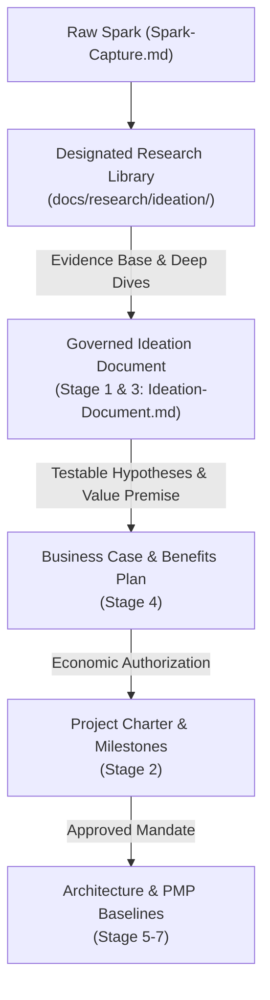

# Spark & Ideation Research Library

> **Purpose:** Exemplary process pattern and research library demonstrating how to conduct, structure, and preserve deep exploratory research stemming from a raw spark and ideation phase without overloading the governed PMBOK lifecycle document.
>
> **Pattern Genesis:** Established during the Phase 1 close-out and Phase 2 initiation of `agent-learning` to solve the *Monolithic Ideation Trap*.

---

## 1. Architectural Lesson: The Monolithic Ideation Trap

In early project formation, a powerful raw spark often triggers deep, necessary research questions:
- *What learning methodologies exist in the literature, and which fit our runtime constraints?*
- *What do existing production frameworks (LangGraph, AutoGen, CrewAI, DSPy, Copilot) actually ship vs. market?*
- *How does this mechanism integrate into sibling or host systems (Scout, ADPA, SIDPA)?*

### The Anti-Pattern
Attempting to push all of this exploratory research, competitive analysis, and architectural prototyping into a single lifecycle document ([`Ideation-Document.md`](../../../docs/project-docs/Ideation-Document.md)) creates a 500+ line monolithic artifact. The document attempts to answer every downstream question at once—blurring the boundaries between *Research*, *Benefits Realization*, *Business Case*, *Project Charter*, and *Technical Baselines*.

### The Best-Practice Pattern: Two-Tier Knowledge Separation
By separating exploratory research from governed lifecycle staging, future project phases achieve both deep intellectual rigor and lean, auditable governance:

1. **The Research Library (`docs/research/ideation/`):**
   - Unconstrained, deep-dive academic, industry, and empirical studies.
   - Preserves comparative benchmarks, external framework audits, code-level archeology, and detailed failure modes.
   - Free to be expansive, narrative, and discursive.

2. **The Governed Lifecycle Document (`docs/project-docs/Ideation-Document.md`):**
   - Lean, auditable PMBOK Stage 1 & 3 artifact.
   - Synthesizes the core problem and staged idea.
   - Formulates and tracks testable, falsifiable hypotheses (`HYP-AL-###`).
   - Cites the Research Library for detailed proofs and surveys.
   - Hands off cleanly to the *Business Case* (Stage 4) and *Project Charter* (Stage 2) under the principle of **Progressive Elaboration**.

---

## 2. Research Library Contents

This library preserves the foundational empirical research conducted during Phase 1:

| Research Study | Description | Key Findings |
|---|---|---|
| [**Learning Methodologies Landscape**](learning-methodologies-landscape.md) | Comprehensive survey of 32 learning and decision methodologies against frozen-model, CPU-only constraints. | 9 feasible/implemented, 4 structurally excluded, 1 declined, 18 prioritized candidates (including warm-start priors, UCB, DPO, and contextual routing). |
| [**Agent Frameworks Comparative Study**](agent-frameworks-comparative-study.md) | Deep-dive evaluation of 8 major agent platforms (LangGraph, AutoGen, CrewAI, DSPy, Copilot Auto, etc.). | 4 frameworks ship memory-as-storage (pure recall); AutoGen and CrewAI independently validate critique-to-evidence and human-override trust; DSPy introduces offline compilation. |
| [**Cross-System Integration Analysis**](cross-system-integration-study.md) | Empirical investigation into production adoption in Microsoft Scout, ADPA quality gates, and SIDPA solution evaluation. | Confirms `agent-learning` as the live decision-governance layer inside Microsoft Scout (`ctava-msft`); maps Council adjudication and quality-gate telemetry. |

---

## 3. How to Use This Library in Future Phases

When a new spark or phase is initiated (e.g., Phase 2 Option B or Phase 3):
1. **Conduct Deep Research in this Directory:** Document framework audits, literature reviews, and benchmark experiments here as dedicated markdown artifacts.
2. **Distill into Ideation:** Extract the actionable hypothesis statements, falsification criteria, and core value premises into `docs/project-docs/Ideation-Document.md`.
3. **Link, Do Not Copy:** Reference the specific research study in the Ideation document's evidence citations.
4. **Progressively Elaborate:** Allow downstream stages (Business Case, Charter, Specifications, Baselines) to resolve their respective open questions in sequence.
