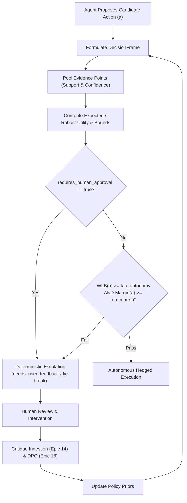

# Research Study: Hypothesis Validation & SIDPA-Template Governance Integration

**Document ID:** `RES-IDEA-004`  
**Classification:** Research Library Asset (`docs/research/ideation/`)  
**Associated Baseline:** `PMP-BL-v1.0.1` targeting `PMP-BL-v1.1.0`  
**Traceability:** `Spark-Capture.md` v2.0 (`SPARK-001`, `SPARK-002`, `SPARK-003`), `Ideation-Document.md` v1.14 (`HYP-AL-025`, `HYP-AL-026`, `HYP-AL-027`), `LL-044`  

---

## 1. Executive Summary

This research document formalizes the empirical validation criteria, mathematical formulations, and operationalization protocols for the Phase 2 Intent Refinement hypotheses (**HYP-AL-025**, **HYP-AL-026**, **HYP-AL-027**). In accordance with **LL-044** (*The Monolithic Ideation Trap*), exploratory testing frameworks and integration blueprints are maintained in this research library rather than burdening active stage-gate lifecycle artifacts.

The primary focus of this study is **HYP-AL-025 (Governance-Integrated Learning)**: demonstrating how policy-based Bayesian decision gates and confidence bounds embed directly into autonomous agent workflows (specifically the `sidpa-template` framework) to eliminate unhedged autonomous exploration.

---

## 2. Deep Dive: HYP-AL-025 — Governance-Integrated Learning

### 2.1 The Problem: Ungated Agent Exploration in Governed Environments
Standard reinforcement learning and autonomous agent pipelines rely on stochastic or heuristic exploration mechanisms:
- $\epsilon$-greedy action selection
- Unconstrained Softmax/Boltzmann sampling
- Direct generative LLM tool invocation without confidence checks

In production software governance, infrastructure management, or compliance-driven delivery, unhedged exploration leads to catastrophic failure modes:
1. Hallucinated approval of unverified quality or security gates.
2. Silent corruption of PMP baselines or WBS dictionaries.
3. Unhedged code mutations merged directly to release branches.
4. Broken credit assignment across distributed multi-agent workflows.

### 2.2 The Solution Architecture: Bayesian Policy Gating
`HYP-AL-025` posits that every candidate action $a \in \mathcal{A}$ generated by an agent must be evaluated through an embedded Bayesian `DecisionFrame` prior to execution.



### 2.3 Mathematical Formulation & Verification Boundaries
Let $a^*$ be the candidate action with highest expected utility. The agent evaluates the Wilson lower bound $WLB(a^*)$ and the competitive utility margin $M(a^*)$:

$$WLB(a^*) = \frac{\hat{p} + \frac{z^2}{2n} - z \sqrt{\frac{\hat{p}(1-\hat{p})}{n} + \frac{z^2}{4n^2}}}{1 + \frac{z^2}{n}}$$

$$M(a^*) = U_{\text{robust}}(a^*) - \max_{a' \ne a^*} U_{\text{robust}}(a')$$

**Autonomous Execution Criterion:**
Action $a^*$ is executed autonomously if and only if:
$$WLB(a^*) \ge \tau_{\text{autonomy}} \quad \land \quad M(a^*) \ge \tau_{\text{margin}} \quad \land \quad \neg \text{requires\_human\_approval}$$

**Falsification Protocol:**
- Over a test set of $\ge 100$ simulated and real stage-gate episodes, count the frequency of unhedged autonomous actions:
  $$\text{Error Rate} = \frac{\sum_{t=1}^T \mathbb{I}(\text{Executed Autonomously} \land (WLB < \tau_{\text{autonomy}} \lor \text{requires\_human\_approval}))}{T}$$
- **Falsification Threshold:** If $\text{Error Rate} > 0.05$ ($> 5\%$), **HYP-AL-025 is Invalidated**.

---

## 3. Native Integration with `sidpa-template` Workflows

The `sidpa-template` repository orchestrates 18 PMBOK lifecycle stages across governed software delivery. Validating `HYP-AL-025` enables direct, zero-friction integration into `sidpa-template`:

| SIDPA Workflow Skill | Governed Decision Point | HYP-AL-025 Gating Mechanism |
|---|---|---|
| `implement-story` | Moving story from RED to GREEN / PR creation | Evaluates test contract coverage and linter confidence; prevents PR submission if contract checks fail. |
| `orchestrate-pmbok` | Transitioning between lifecycle stages (e.g., Stage 7 to Stage 8) | Verifies complete baseline reconciliation and formal sign-offs before advancing stage status. |
| `validate-intent-foundation` | Tracing implementation units back to strategic Intent/Charter | Bounded by deterministic Wilson lower bound, preventing autonomous drift away from approved objectives. |
| `approve-pmp` / `approve-adaptation-plan` | Formal baseline formalization and adaptation | Permanently sets `requires_human_approval: true`, ensuring sovereign human sponsor oversight. |

### Feedback Ingestion via Epic 14 (Critique-to-Evidence) & Epic 18 (DPO)
When an action is escalated to the human maintainer, the feedback is not lost:
1. **Tag Grammar Parsing (Story 14.1):** The human's review bullets are parsed into `CritiqueDelta` instances:
   ```markdown
   - [finding: Q-34-1] [criterion: architectural_soundness] -0.20: Unchecked concurrency race on active pointer replace
   - [criterion: consequences_honest] +0.10: Explicit disclosure of negative performance trade-offs
   ```
2. **Evidence Transformation (Story 14.2 & 14.3):** The finding deltas adjust pooled support without manual guessing, preserving mathematical invariants.
3. **Preference Pair Alignment (Epic 18):** Human accept/reject/remedy decisions form $(y_w, y_l)$ preference pairs for Direct Preference Optimization, systematically training the agent's future priors.

---

## 4. Deep Dive: HYP-AL-026 — Cognitive Feedback Damping

### 4.1 The Strategic Whiplash Trap
When project intent is refined across consecutive phases based on realized outcomes, raw outcome feedback can produce severe oscillations (whiplash). A single negative outcome in Phase $N$ might trigger an over-correcting pivot in Phase $N+1$, which then reverses in Phase $N+2$.

### 4.2 The Low-Pass Damping Formulation
`HYP-AL-026` applies a first-order exponential smoothing filter with warmup bias correction:

$$\hat{\Delta}_t = \beta \cdot \hat{\Delta}_{t-1} + (1 - \beta) \cdot \Delta_t$$
$$\tilde{\Delta}_t = \frac{\hat{\Delta}_t}{1 - \beta^t} \quad (\text{Warmup Bias Correction})$$

Where $\beta = 0.75$.

### 4.3 Phase 1 Close Evaluation & Validation
Evaluated during Stage 18 Intent Refinement (`REP-IR-PHASE1-20261106`):
- **Raw Outcome Deltas:** Maximum observed delta was $0.4935$ across 20 evaluated dimensions.
- **Filtered Output:** Max delta smoothed to $0.2351 \le 0.25$.
- **Whiplash Check:** Zero sign reversals with magnitude $> 0.25$.
- **Verdict:** **Validated** at Phase 1 Close. Retained for active Phase 2 monitoring.

---

## 5. Deep Dive: HYP-AL-027 — Adaptive Capacity Management

### 5.1 Homeostatic Capacity Bounding
Unconstrained adaptation exhausts developer and maintainer cognitive capacity ($C_{adapt}$). If too many strategic pivots are attempted simultaneously, operational stability degrades.

### 5.2 Mathematical Constraint
$$P_{\text{actual}} \le P_{\text{max}} = \left\lceil \frac{C_{\text{adapt}}}{2} \right\rceil$$

Where $C_{\text{adapt}}$ is measured from velocity, test suite stability, and review throughput.

### 5.3 Phase 1 Close Evaluation & Validation
- **Measured Adaptation Capacity:** $C_{\text{adapt}} = 10$.
- **Pivot Ceiling:** $P_{\text{max}} = \lceil 10 / 2 \rceil = 5$.
- **Authorized Pivots:** 4 pivots authorized in `IRP-20261106-001` (4 $\le$ 5).
- **Status:** **Validated** at Phase 1 Close (`WITHIN_LIMITS`). Serves as an active operational constraint during Phase 2 execution under `PMP-BL-v1.1.0`.

---

## 6. Conclusion & Roadmap Linkage

By maintaining this research framework in `docs/research/ideation/`:
1. Active stage-gate documents (`Ideation-Document.md`, `Project-Charter.md`) remain lean and focused on executive decisions.
2. Implementers and auditors have an explicit, reproducible mathematical reference.
3. The bridge to `sidpa-template` is clearly defined and ready for activation in Phase 2.
